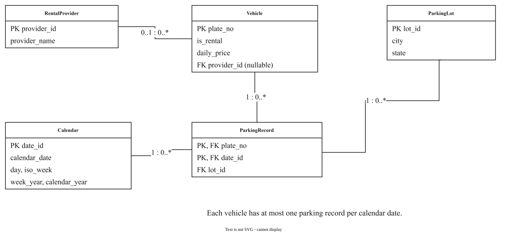
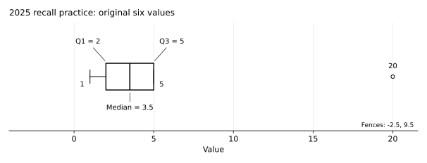
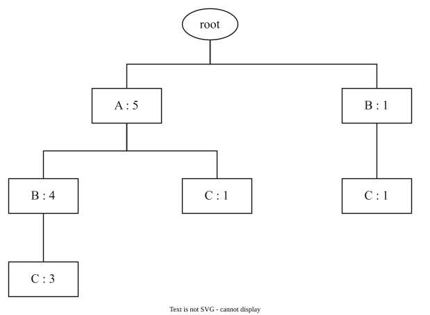
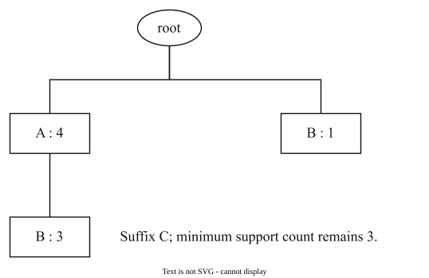
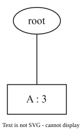
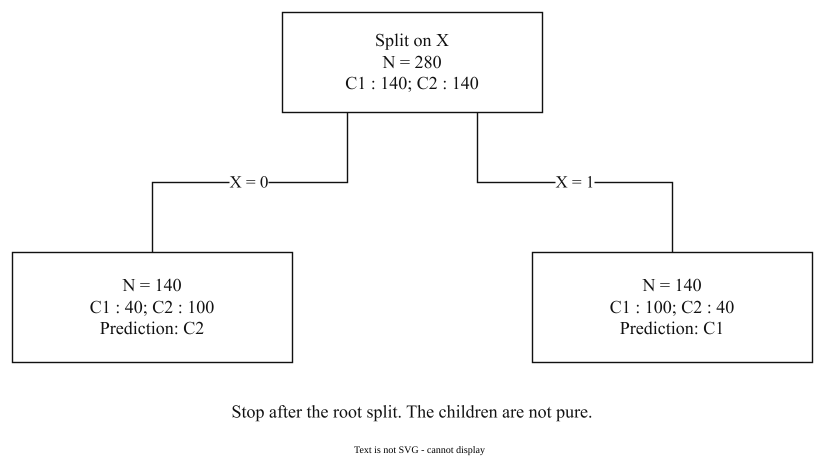

# 2025 回忆题 · 八道完整复原练习

[网页集中练习](index.html#view=recall2025) · [原回忆转录](sources/transcriptions/memory2025.md) · [原件](https://raw.githubusercontent.com/jadmax0w0/UCAS-DataMining-2025Final/main/%E6%95%B0%E6%8D%AE%E6%8C%96%E6%8E%98%202025%E5%B9%B4%20%E6%9C%9F%E6%9C%AB%E8%80%83%E8%AF%95%E5%9B%9E%E5%BF%86%20%E4%BA%BA%E5%B7%A5%E6%99%BA%E8%83%BD%E5%AD%A6%E9%99%A2.pdf)

任务与题型依据 2025 回忆。缺失的图、表、数列和明确的作答口径由本题库补齐，用于完整练习；补配数字不作为原卷原值。每题先给完整英文题干，第一步对应翻译，再明确写到哪一步，最后分步解答。

| 题号 | 练习主题 | 完成标准概览 |
| --- | --- | --- |
| [Q1](#E25-01) | ER 图、星型模式、概念层次与 OLAP | 画星型模式与概念层次，写 OLAP/SQL，并算出各车在指定停车日上的平均日租价。 |
| [Q2](#E25-02) | 6 个数的边界平滑与箱线图 | 交出两箱及六个平滑值；在原数据上求五数概括、离群界限，并画箱线图。 |
| [Q3](#E25-03) | FP-growth 全过程、效率比较和指定置信度 | 完成主树、条件模式基与条件树，列全部频繁集，比较两算法并算指定规则置信度。 |
| [Q4](#E25-04) | 8 行频数表的信息增益与一层树 | 按频数计算三个属性的信息增益，选根，只画一次分裂并标子结点频数与多数类。 |
| [Q5](#E25-05) | 过拟合定义及神经网络的防治 | 定义过拟合，解释至少三种神经网络防治措施，并说明验证集与测试集的分工。 |
| [Q6](#E25-06) | 十个质数的前两轮 K-means | 恰好完成两轮全量分配和均值更新，报告第二轮的成员及更新后的中心。 |
| [Q7](#E25-07) | 余弦邻居、均值修正预测与 Top-1 | 算四个余弦相似度，选两位邻居，按题给公式预测两个评分并推荐 Top-1。 |
| [Q8](#E25-08) | 四站点的全局关联规则挖掘 | 写四站点局部挖掘与全局验证的伪代码、完整性证明，以及通信和内存分析。 |

---
<a id="E25-01"></a>

## E25-01 · 2025 · 第1题：ER 图、星型模式、概念层次与 OLAP

来源：2025 年人工智能学院回忆卷 · Q1 · PDF p.1

状态：完整复原练习；形式：回忆复原 / 完整练习。

**复原依据：**给停车场、汽车与租车服务商的 ER 图，按已给属性构造星型仓库，标概念层次，再通过 OLAP 查询某年北京停车场中汽车的租价。回忆保留了车牌、是否租赁、price、city/state 及 days/weeks/years 等信息。

**补配与口径：**

- 补绘 5 个实体及其主外键关系。
- 补配 6 条停车日记录。
- 将“某年租价”明确为 2025 年、按车辆计算其北京停车日的平均挂牌日租价。

以下为可完整作答的复原练习；补配数值不是原卷原值。

### 原文

The operational database is represented by the ER diagram below. Vehicle has plate_no, is_rental and daily_price; a rental vehicle belongs to one provider. ParkingLot has lot_id, city and state. Calendar contains day, ISO week, week-year and calendar year. ParkingRecord records the lot in which a vehicle is parked on a date. Each vehicle has at most one parking record per date. For this exercise, rental status, provider and listed daily price remain unchanged over the recorded period. Non-rental vehicles have a NULL rental price.

业务数据库由下方 ER 图表示。Vehicle 包含车牌号、是否租赁、日租价；一辆租赁车属于一个服务商。ParkingLot 包含停车场编号、城市和州或省。Calendar 包含日、ISO 周、周年和自然年。ParkingRecord 记录车辆某日在何处停车。每辆车每天最多一条停车记录。本练习中，租赁状态、服务商和挂牌日租价在记录期间保持不变。非租赁车辆的租价为 NULL。



**(a)** Design a star-schema data warehouse. State the fact grain, keys, dimensions and measures.

**(a)** 设计星型模式数据仓库。说明事实粒度、键、维度和度量。

**(b)** Specify appropriate concept hierarchies. Distinguish calendar year from ISO week-year.

**(b)** 指定适当的概念层次。区分自然年与 ISO 周年。

**(c)** Starting from the base cuboid [day, vehicle, lot, provider], return, for each rental vehicle parked in Beijing in calendar year 2025, its average listed daily rental price over its recorded Beijing parking days. Give the OLAP operations and a SQL query. Use the six records below to calculate the result. A listed price is not rental revenue.

**(c)** 从基本方体 [日、车辆、停车场、服务商] 出发，对自然年 2025 年在北京停车的每辆租赁车，返回其已记录的北京停车日上的平均挂牌日租价。给出 OLAP 操作及 SQL 查询。使用下方六条记录计算结果。挂牌价格不等于租赁收入。

| Date | Plate | Lot | City | Provider | Daily price |
| --- | --- | --- | --- | --- | --- |
| 2025-01-06 | 京A001 | L1 | Beijing | P1 | 200 |
| 2025-01-07 | 京A001 | L1 | Beijing | P1 | 200 |
| 2025-02-03 | 京B002 | L2 | Beijing | P2 | 150 |
| 2025-02-03 | 京C003 | L1 | Beijing | N/A | NULL |
| 2025-03-01 | 京B002 | L3 | Shanghai | P2 | 150 |
| 2024-12-30 | 京A001 | L1 | Beijing | P1 | 200 |

### 小问要求与完成标准

| 小问 | 明确要做什么 | 写到什么程度 |
| --- | --- | --- |
| (a) Star schema | 将 ER 模型变为仓库星型模式 | 画 1 张事实表、4 张维度表；写粒度、PK/FK 和度量含义。 |
| (b) Concept hierarchies | 标出日期、地点等可用层次 | 至少写 day→week→week-year、day→year、lot→city→state；指出不同年口径。 |
| (c) OLAP query | 查询 2025 年在北京停车的各租赁车的平均日租价 | 给 OLAP 操作、聚合口径、SQL 及结果表；不把日租价累加成租金收入。 |

### 逐步解答

#### 1. 从业务事实确定粒度

一行表示“**某车辆在某一天、某停车场的停车快照**”。题目约定一车一天最多一条，故事实主键可用 $(date\_key,vehicle\_key)$；lot 与 provider 是该粒度上的外键。不能一行写“停车场全年汇总”却又存单辆车的租价。


#### 2. 写清表、键与度量

| Table | Keys / fields | 含义 |
| --- | --- | --- |
| FactParkingDay | PK(date_key, vehicle_key); lot_key, provider_key; daily_rent, parked_count | 日快照；parked_count=1；daily_rent 从该车日租价取得。 |
| DimDate | date_key; full_date, day, iso_week, week_year, calendar_year | 同一日期同时有自然年与 ISO 周年属性。 |
| DimVehicle | vehicle_key; plate_no, is_rental | 车牌识别车辆；本练习属性在记录期内不变。 |
| DimLot | lot_key; lot_id, city, state | 停车场及其地点。 |
| DimProvider | provider_key; provider_id, provider_name | 租赁商；自有车可指向 N/A 维度成员。 |

$parked\_count$ 可按日累计为“停车车日”；统计跨日独立车辆数时需按车辆去重。$daily\_rent$ 是价格，对时间不能当作收入直接求和。若需要物化均价，应保留价格之和与有效价格的观测数，最后相除。

#### 3. 概念层次

- 日期：$day\to ISO\ week\to week\text{-}year\to ALL$；另一路 $day\to calendar\ year\to ALL$。跨年周属于周年，不能硬拼成 week→calendar-year。
- 地点：$lot\to city\to state\to ALL$。
- 车辆：$plate\to rental\ status\to ALL$ 仅用于按租赁状态分组；查询中保留 plate。
- 租赁商：$provider\to ALL$，题目没有给地区等属性，不另造层级。

#### 4. OLAP 与 SQL

对自然年、城市做切片：$calendar\_year=2025$、$city=Beijing$；筛 $is\_rental=1$。地点从 lot roll-up 到 city，日期从 day 聚合到 calendar-year，provider roll-up 至 ALL，**保留 vehicle**，价格按有效停车日做 AVG。

```sql
SELECT v.plate_no, AVG(f.daily_rent) AS avg_daily_price
FROM FactParkingDay AS f
JOIN DimDate AS d ON d.date_key = f.date_key
JOIN DimVehicle AS v ON v.vehicle_key = f.vehicle_key
JOIN DimLot AS l ON l.lot_key = f.lot_key
WHERE d.calendar_year = 2025
  AND l.city = 'Beijing'
  AND v.is_rental = 1
GROUP BY v.plate_no
ORDER BY v.plate_no;
```

筛选后留下前三条：

$$\begin{aligned}
\bar p_{\text{京A001}}&=\frac{200+200}{2}=200,\\[5pt]
\bar p_{\text{京B002}}&=\frac{150}{1}=150.
\end{aligned}$$

| Plate | Included parking days | Average daily price |
| --- | --- | --- |
| 京A001 | 2 | 200 |
| 京B002 | 1 | 150 |

第四条为非租赁车，第五条不在北京，第六条不在自然年 2025。京A001 的平均日租价为 $(200+200)/2=200$ 元。

### English answer pattern

Use a vehicle-day fact grain. Slice to Beijing and calendar year 2025, retain the vehicle dimension, and average valid listed daily prices. The two resulting prices are 200 and 150.

采用车辆—日事实粒度。切片到北京及自然年 2025，保留车辆维，对有效挂牌日租价求平均。所得两个价格为 200、150。

### 易错点与约定

先解释平均的是“已记录的北京停车日”，不补算全年未出现的日期；自然年查询不能误用 week_year。

### 计算与内存分析

直接扫描 $N$ 条事实并哈希分组约 $O(N)$ 时间、$O(g)$ 分组空间，$g$ 是输出车辆数。预聚合均价需保存 sum 和 count，不能直接平均不等样本量的均值。


---

<a id="E25-02"></a>

## E25-02 · 2025 · 第2题：6 个数的边界平滑与箱线图

来源：2025 年人工智能学院回忆卷 · Q2 · PDF p.1

状态：完整复原练习；形式：回忆复原 / 完整练习。

**复原依据：**回忆为 6 个数、bin boundary（depth=3），并用 box plot 判断 outlier。

**补配与口径：**

- 补配数列 1,2,3,4,5,20。
- 边界距离平局取较小值；四分位数采用上下半组各自中位数。

以下为可完整作答的复原练习；补配数值不是原卷原值。

### 原文

Consider the observations $1,2,3,4,5,20$.

考虑观测值 1、2、3、4、5、20。

**(a)** Smooth the data by bin boundaries using equal-depth bins of depth 3. Show the bins and all smoothed values. If a value is equally close to both observed boundaries, use the lower one.

**(a)** 使用箱深为 3 的等深箱，按箱边界平滑。给出各箱及全部平滑值。若某值到两个实际观测边界等距，取较低边界。

**(b)** For the **original observations**, compute the five-number summary and draw a box plot. Use the medians of the lower and upper halves for $Q_1,Q_3$, and the $1.5IQR$ rule for outliers. Label the whisker endpoints and identify every outlier.

**(b)** 对**原始观测**计算五数概括并绘制箱线图。Q1、Q3 使用下半组与上半组的中位数；离群值使用 1.5IQR 规则。标出须的端点，并识别每个离群值。

### 小问要求与完成标准

| 小问 | 必须交付 | 停止位置 |
| --- | --- | --- |
| (a) | 排序、2 个深度为 3 的箱、逐值边界替换和 6 个平滑值 | 完成一次分箱平滑；不再反复平滑。 |
| (b) | 原数据五数概括、IQR、上下界、箱线图与离群值 | 须落在实际非离群观测值；不用平滑后数据重算。 |

### 逐步解答

#### 等深两箱与边界平滑

6 个观测已排序，箱深 $b=3$，得到

$$B_1=(1,2,3),\qquad B_2=(4,5,20).$$

边界平滑先取每箱的实际最小值 $l$、最大值 $u$，再选较近端点。题面规定平局取较低端点：

$$\widetilde x=\begin{cases}l,&x-l\le u-x,\\u,&x-l>u-x.\end{cases}$$

| 箱 | 原值 $x$ | 到 $l$ 的距离 | 到 $u$ 的距离 | 替换值 |
| --- | ---: | ---: | ---: | ---: |
| $B_1:(l,u)=(1,3)$ | 1 | 0 | 2 | 1 |
| $B_1$ | 2 | 1 | 1 | 1 |
| $B_1$ | 3 | 2 | 0 | 3 |
| $B_2:(l,u)=(4,20)$ | 4 | 0 | 16 | 4 |
| $B_2$ | 5 | 1 | 15 | 4 |
| $B_2$ | 20 | 16 | 0 | 20 |

所以平滑结果为

$$\boxed{(1,1,3,4,4,20)}.$$

#### 原始六数的五数概括

对原始 $(1,2,3,4,5,20)$ 求四分位数：下半组 $(1,2,3)$ 的中位数是 2，上半组 $(4,5,20)$ 的中位数是 5。

$$Q_1=2,\qquad Q_2=\frac{3+4}{2}=3.5,\qquad Q_3=5.$$

因此五数概括为

$$\boxed{(\min,Q_1,Q_2,Q_3,\max)=(1,2,3.5,5,20)}.$$

#### 离群界限与须端点

$$\begin{aligned}
IQR&=Q_3-Q_1=5-2=3,\\
LF&=Q_1-1.5IQR=2-4.5=-2.5,\\
UF&=Q_3+1.5IQR=5+4.5=9.5.
\end{aligned}$$

$20>9.5$，所以唯一离群值是 20。界限内实际最小、最大观测为 $1,5$，分别作为下、上须；箱体为 $[2,5]$，中位线在 $3.5$。



#### 这类题的作答模板

先写分箱与逐值替换，再写原数据五数、$IQR$、离群界限，最后按“箱体—中位线—实际须端点—独立离群点”完成作图。

### English answer pattern

The smoothed sequence is $(1,1,3,4,4,20)$. For the original data, the five-number summary is $(1,2,3.5,5,20)$. The fences are $-2.5$ and $9.5$, so $20$ is the only outlier. The whiskers end at $1$ and $5$.

平滑序列为 $(1,1,3,4,4,20)$。原始数据的五数概括为 $(1,2,3.5,5,20)$。离群界限为 $-2.5$、$9.5$，因此 $20$ 是唯一离群值。须端点为 $1$、$5$。

### 易错点与约定

本题箱线图使用原始观测；平滑序列只回答小问 (a)。五数概括的最大值为 $20$，箱线图上须为界限内最大的实际观测 $5$。

### 计算与内存分析

未排序输入通常先用 $O(N\log N)$ 排序；之后分箱与作图统计为 $O(N)$。保存原始输入需 $O(N)$ 空间；排序额外空间取决于实现，例如归并排序另需 $O(N)$。已排序数据可按箱顺序处理，每箱工作区为 $O(b)$，本题箱深 $b=3$。


---

<a id="E25-03"></a>

## E25-03 · 2025 · 第3题：FP-growth 全过程、效率比较和指定置信度

来源：2025 年人工智能学院回忆卷 · Q3 · PDF p.1

状态：完整复原练习；形式：回忆复原 / 完整练习。

**复原依据：**回忆要求画 FP-tree、各条件模式基与条件树、给出全部频繁项集，比较 Apriori/FP-growth，再计算指定 AB⇒C 的 confidence；未给 min_conf。

**补配与口径：**

- 补配 6 笔事务与 min_sup=50%。
- 同频按 A<B<C<D<E；规则小问只算给定规则，不另设 min_conf。

以下为可完整作答的复原练习；补配数值不是原卷原值。

### 原文

The transaction database is given below. Let $min\_sup=50\%$ and count transactions, not item occurrences. Use a descending singleton-frequency order; break equal frequencies alphabetically.

事务数据库如下。最小支持度为 50%，按事务计数，不按物品出现次数计数。使用单项频数降序；频数相同时按字母顺序。

| TID | Items |
| --- | --- |
| T1 | A, B, C |
| T2 | A, B, D |
| T3 | A, B, C, E |
| T4 | A, C, E |
| T5 | B, C |
| T6 | A, B, C |

**(a)** Use FP-growth to find **all nonempty frequent itemsets**. Show singleton counts, the filtered/ordered transactions, the main FP-tree and header counts, every conditional pattern base and conditional FP-tree, and the final itemsets with support counts. Continue conditional mining where needed.

**(a)** 用 FP-growth 找出**全部非空频繁项集**。给出单项计数、过滤并排序的事务、主 FP 树及头表计数、每个条件模式基和条件 FP 树，以及最终项集及支持计数。需要时继续条件挖掘。

**(b)** Compare Apriori and FP-growth in candidate generation, original-database scans and memory use. State a case where compression is weak.

**(b)** 从候选生成、原始数据库扫描、内存使用方面比较 Apriori 和 FP-growth。给出一种压缩较弱的情况。

**(c)** Calculate $conf(\{A,B\}\Rightarrow\{C\})$ and interpret it. No minimum confidence is specified; you are not asked to generate all rules.

**(c)** 计算并解释 $conf(\{A,B\}\Rightarrow\{C\})$。没有指定最小置信度；本问不要求生成全部规则。

### 小问要求与完成标准

| 小问 | 必须交付 | 完整程度 |
| --- | --- | --- |
| (a) | 单项频数、筛项排序、主 FP-tree、header table、条件模式基/条件树、所有频繁项集 | A/B/C 三个后缀均处理，空条件树写明；C 的条件树继续挖到 ABC。 |
| (b) | 比较候选生成、原库扫描、内存与不利情况 | 至少 3 个有解释的比较点，不只写“FP 更快”。 |
| (c) | AB⇒C 的 count(AB)、count(ABC)、confidence 和语义 | 只计算此规则，不枚举全部强规则，不自行加 min_conf。 |

### 逐步解答

#### 本题计算的三个基础量

设 N 为原事务总数，$count(X)$ 为包含 X 全部物品的事务数，X 为前件：

$$q=\lceil N\,min\_sup\rceil,\quad supp(X)=\frac{count(X)}N,\quad conf(X\Rightarrow Y)=\frac{count(X\cup Y)}{count(X)}.$$

FP-growth 先用整数阈值筛项集；指定规则的置信度最后用前件计数作为分母。

#### 1. 阈值与第一次扫描

$$q=\lceil6\times0.5\rceil=3.$$

| Item | A | B | C | D | E |
| --- | --- | --- | --- | --- | --- |
| Count | 5 | 5 | 5 | 1 | 2 |
| Frequent? | yes | yes | yes | no | no |

保留 A、B、C；同频按字母序，固定全局顺序 $A\prec B\prec C$。

| TID | Filtered ordered sequence |
| --- | --- |
| T1 | A→B→C |
| T2 | A→B |
| T3 | A→B→C |
| T4 | A→C |
| T5 | B→C |
| T6 | A→B→C |

#### 2. 第二次扫描：建主树



头表总计为 A:5、B:5、C:5；B 的结点计数分成 4+1，C 分成 3+1+1。结点链将同名结点串联，不要把某一个结点计数误当该项总支持。

#### 3. 由低序后缀开始投影

| Suffix | Conditional pattern base | Conditional item totals | Kept conditional tree |
| --- | --- | --- | --- |
| C | $\langle A,B:3\rangle,\ \langle A:1\rangle,\ \langle B:1\rangle$ | A:4, B:4 | root→A:4→B:3；另有 root→B:1。 |
| B | $\langle A:4\rangle$ | A:4 | root→A:4。 |
| A | ∅ | ∅ | 空树；单项 A 仍须输出。 |



C 条件树中的 B 总支持是 $3+1=4$，因此保留**两个** B 结点，即使某一个结点计数为 1。进一步在 C 条件树中取后缀 B，其条件模式基为 $\langle A:3\rangle$，树为 root→A:3，得到 ABC:3。


全程仍用原整数阈值 $q=3$，不在条件库内改算 50%。空条件树表示无更长扩展，不表示删除后缀单项。

进一步的递归投影也须交代清楚：

| 当前后缀 | 条件模式基 | 条件树 / 停止 |
| --- | --- | --- |
| BC | $\langle A:3\rangle$ | root→A:3；得到 ABC:3。 |
| AC | ∅ | 空树；AC:4 已由 C 的投影得到。 |
| ABC | ∅ | 空树；三项模式结束。 |
| AB | ∅ | 空树；AB:4 已由 B 的投影得到。 |



#### 4. 汇总所有频繁项集

| Size | Itemset : count | 支持度 Support |
| --- | --- | --- |
| 1 | A:5, B:5, C:5 | 均为 $5/6$ |
| 2 | AB:4, AC:4, BC:4 | 均为 $4/6=2/3$ |
| 3 | ABC:3 | $3/6=1/2$ |

一共 **7 个**非空频繁项集。没有含 D/E 的频繁项集，因为其单项已低于阈值。

#### 5. 比较两种算法

| Aspect | Apriori | FP-growth |
| --- | --- | --- |
| 候选 | 逐层连接、子集剪枝，再对候选计数。 | 不显式产生 Apriori 式候选项集；靠条件投影与模式增长。 |
| 扫原库 | 通常每个候选层一次；层数多时 I/O 大。 | 建主树通常两遍原库；条件树递归另有计算。 |
| 内存 | 存候选及计数器；候选可能爆炸。 | 存主树、头表和递归条件树；共享前缀少时压缩弱。 |
| 最坏输出 | 频繁项集本身可指数多。 | 同样不能避免指数级显式输出。 |

#### 6. 指定规则的置信度

包含 AB 的事务为 T1、T2、T3、T6，共 4 笔；同时包含 C 的为 T1、T3、T6，共 3 笔。

$$conf(AB\Rightarrow C)=\frac{count(ABC)}{count(AB)}=\frac34=\boxed{75\%}.$$

读作：在购买 A 和 B 的事务中，有 75% 也购买 C。该规则的支持度按全部六笔事务计算，为 $3/6=50\%$；题目没有 min_conf，因此到数值和解释即可停止。


### English answer pattern

There are seven frequent itemsets: A, B, C, AB, AC, BC and ABC, with counts 5,5,5,4,4,4,3. The confidence of AB⇒C is 3/4=75%.

共有七个频繁项集：A、B、C、AB、AC、BC、ABC，计数分别为 5、5、5、4、4、4、3。AB⇒C 的置信度为 3/4=75%。

### 易错点与约定

条件模式基的路径不含后缀自身；路径权重必须计入支持。不要删去单个计数小于 3、但同项总计仍频繁的结点。

### 计算与内存分析

设原库总篮长为 $L$、项数为 $m$，首遍计数为 $O(L)$，每篮排序总成本还含 $\sum_t O(|t|\log|t|)$。设过滤后的总篮长为 $L_f$，主树与头表占 $O(L_f+m)$；递归峰值内存还要加上同时存活的条件树及投影工作区。显式输出最多可达 $2^m-1$ 个项集，不能由“两遍原库扫描”直接推出总时间 $O(N)$。


---

<a id="E25-04"></a>

## E25-04 · 2025 · 第4题：8 行频数表的信息增益与一层树

来源：2025 年人工智能学院回忆卷 · Q4 · PDF p.1；2025 年人工智能学院回忆卷 · Q4 续：信息增益与根分裂要求 · PDF p.2

状态：完整复原练习；形式：回忆复原 / 完整练习。

**复原依据：**回忆的表有 X/Y/Z 三个二元属性及 C1/C2 两列样本频数，原卷为 8 行。先算指定属性的信息增益，再选根属性并画根分裂；作者给的四行数字为自填示例。

**补配与口径：**

- 补配 X/Y/Z 的完整 8 组合频数表。
- 限定画一层分裂（根 + 两个子结点），子结点标频数；按多数票加预测标签。

以下为可完整作答的复原练习；补配数值不是原卷原值。

### 原文

Each row below represents multiple samples. Columns C1 and C2 are class **counts**, not input attributes. Logs are base 2.

下表每行代表多个样本。C1、C2 列是类别**计数**，不是输入属性。对数以 2 为底。

| X | Y | Z | C1 | C2 |
| --- | --- | --- | --- | --- |
| 0 | 0 | 0 | 5 | 35 |
| 0 | 0 | 1 | 10 | 30 |
| 0 | 1 | 0 | 15 | 15 |
| 0 | 1 | 1 | 10 | 20 |
| 1 | 0 | 0 | 30 | 10 |
| 1 | 0 | 1 | 35 | 5 |
| 1 | 1 | 0 | 20 | 10 |
| 1 | 1 | 1 | 15 | 15 |

**(a)** Compute the information gain for splitting on X. Show the total sample size, class counts, parent entropy and weighted child entropy.

**(a)** 计算按 X 分裂的信息增益。给出总样本数、类别计数、父熵与加权子熵。

**(b)** Compute the gains for Y and Z and choose the root attribute.

**(b)** 计算 Y、Z 的信息增益，并选择根属性。

**(c)** Draw **only the first split**: the root and its two child nodes. Annotate each child with its C1/C2 counts. If stopping at this depth, label each child by majority class. Do not recursively grow the full tree.

**(c)** 只画**第一次分裂**，即根及两个子节点。在各子节点标出 C1、C2 计数。若在此深度停止，按多数类给子节点标记。不要递归生长完整树。

### 小问要求与完成标准

| 小问 | 必须交付 | 停止位置 |
| --- | --- | --- |
| (a) | 总样本数、总类频数、H(D)、H(D\|X)、Gain(X) | 频数加权，不把 8 行当作 8 个单样本。 |
| (b) | 对 Y、Z 也计算增益并比较 | 选最大增益属性作为根。 |
| (c) | 一层决策树及每个子结点的 C1/C2 频数、停止时多数类 | 只分裂根一次，不递归到完整树。 |

### 逐步解答

#### 本题公式

对当前节点数据集 $D$，$p_c$ 是第 $c$ 类占比，$D_v$ 是按属性 $A=v$ 分出的子集：

$$\begin{aligned}
H(D)&=-\sum_c p_c\log_2p_c,\\
H(D\mid A)&=\sum_v\frac{|D_v|}{|D|}H(D_v),\\
Gain(A)&=H(D)-H(D\mid A).
\end{aligned}$$

熵衡量类别混杂程度；条件熵按各子集样本数加权。选择增益最大的属性后，在尚未纯净的子节点中重新计算。

#### 1. 按类别频数计算样本量

$$N=280,\qquad n_{C_1}=140,\qquad n_{C_2}=140.$$
$$H(D)=-\tfrac12\log_2\tfrac12-\tfrac12\log_2\tfrac12=1\ \text{bit}.$$

某行如 $(X,Y,Z)=(0,0,0)$ 代表 $5+35=40$ 个样本；将八行的类别计数全部相加，得到 280 个样本。

#### 2. 展开 X 的加权熵

X=0 的类频数为 $(40,100)$，X=1 为 $(100,40)$，两组均 140 人。组内比例分别为 $(2/7,5/7)$ 及 $(5/7,2/7)$。

这里 $H(p_1,p_2)=-p_1\log_2p_1-p_2\log_2p_2$，表示给定两类比例时的不确定性；两组各占总样本的一半。

$$\begin{aligned}
H(D\mid X)&=\frac{140}{280}H\!\left(\frac27,\frac57\right)\\
&\quad+\frac{140}{280}H\!\left(\frac57,\frac27\right)\\
&=0.863120569.
\end{aligned}$$
$$Gain(X)=1-0.863120569=\boxed{0.136879431}.$$

#### 3. 比较 Y、Z

| Attribute | 0 branch: (C1,C2) | 1 branch: (C1,C2) | Weighted entropy | Information gain |
| --- | --- | --- | --- | --- |
| X | (40, 100) | (100, 40) | 0.863120569 | 0.136879431 |
| Y | (80, 80) | (60, 60) | 1.000000000 | 0.000000000 |
| Z | (70, 70) | (70, 70) | 1.000000000 | 0.000000000 |

Y 的两组都是类比例 1:1，Z 也一样，所以条件熵都为 1，增益 0。根选 **X**。

#### 4. 按要求只画一层



X=0 预测 C2，X=1 预测 C1。两个子节点仍包含两类样本；按各节点多数类标记，即完成题目要求的**一层截断树**。


### English answer pattern

The dataset contains 280 samples. Gain(X)=0.136879431, while Gain(Y)=Gain(Z)=0. Select X and draw only its two children, labeled C2 and C1 by majority vote.

数据集有 280 个样本。Gain(X)=0.136879431，Gain(Y)=Gain(Z)=0。选 X，只画两个子节点；按多数投票分别标为 C2、C1。

### 易错点与约定

类频数不能当作模型输入；组熵必须乘该组样本比例。多数类标签用于预测；节点是否纯，要检查另一类计数是否为 0。

### 计算与内存分析

对 $r$ 行聚合记录和 $d$ 个属性，可用 $O(rd)$ 时间汇总分裂统计，无须把频数展开成 $N$ 行；额外计数空间按属性取值和类别数计。


---

<a id="E25-05"></a>

## E25-05 · 2025 · 第5题：过拟合定义及神经网络的防治

来源：2025 年人工智能学院回忆卷 · Q5 · PDF p.2

状态：完整复原练习；形式：回忆复原 / 完整练习。

**复原依据：**回忆为简答：说明 overfitting，解释如何解决神经网络过拟合。

**补配与口径：**

- 将简答的作答深度明确为“定义 + 训练/验证表现 + 至少三项带机理的措施 + 选参纪律”。

以下为可完整作答的复原练习；补配数值不是原卷原值。

### 原文

**(a)** What is overfitting? Explain its typical effect on training and validation performance.

**(a)** 什么是过拟合？解释它对训练和验证表现的典型影响。

**(b)** Describe at least three methods for reducing overfitting in a neural network classifier. Explain the mechanism of each method.

**(b)** 描述至少三种减轻神经网络分类器过拟合的方法。解释每种方法的机制。

**(c)** State how regularization strengths and the stopping epoch should be selected without using the test set for repeated tuning.

**(c)** 说明怎样选择正则化强度与停止训练的轮次，同时不反复使用测试集调参。

### 小问要求与完成标准

| 小问 | 必须交付 | 完整程度 |
| --- | --- | --- |
| (a) | 定义 overfitting，并说明训练与验证误差的典型差异 | 2—3 句，提到泛化。 |
| (b) | 至少 3 种减轻神经网络过拟合的措施 | 每种写名称与起作用的方式；不是只列术语。 |
| (c) | 说明在哪个数据集上选超参数与早停轮次 | 验证集/交叉验证；测试集保留作最终评价。 |

### 逐步解答

#### 过拟合的含义与判断

过拟合（overfitting）是模型过度适应训练集中的噪声和偶然规律，对未见数据的预测能力下降。典型学习曲线是训练损失持续下降，验证损失先下降、到达最低点后上升。应结合连续多轮趋势判断。

#### 常用公式及含义

设 $p_{i,y_i}$ 为模型给样本 $i$ 的真实类别 $y_i$ 分配的概率。分类交叉熵损失与 L2 正则目标可写为：

$$\begin{aligned}
\mathcal L_{data}(\theta)&=-\frac1n\sum_{i=1}^{n}\log p_{i,y_i},\\
\mathcal J(\theta)&=\mathcal L_{data}(\theta)+\lambda\sum_{\ell}\|W^{(\ell)}\|_F^2,\\
t^*&=\arg\min_t\mathcal L_{val}(\theta_t).
\end{aligned}$$

真实类别概率越大，交叉熵越小。第二项惩罚过大的权重，$\lambda$ 控制惩罚强度；$\|W\|_F^2$ 为矩阵全部权重的平方和。$t^*$ 是验证损失最低的训练轮次；早停后恢复该轮保存的权重。若题目采用平方误差，沿用题给损失，正则与验证的思路相同。

#### 至少三种措施及原理

| 措施 | 原理 | 参数如何选 |
| --- | --- | --- |
| L2 regularization（L2 正则） | 限制权重幅值，减少对个别样本的过度拟合。 | 验证集选择 $\lambda$。 |
| Early stopping（早停） | 验证损失不再改善时停止，保留验证最优模型。 | 用验证曲线确定轮次及 patience。 |
| Dropout（随机失活） | 训练时随机屏蔽部分单元，减少单元共同适应。 | 验证集选失活比例；推理采用对应实现的缩放规则。 |
| Capacity control（容量控制） | 减少层数或隐藏单元，限制可拟合的复杂度。 | 验证集比较容量；过小会欠拟合。 |
| More data / augmentation（更多数据、数据增强） | 增加有效训练样本，减少对有限样本的记忆。 | 增强方式应保持标签语义。 |

#### 模型选择与最终评价

训练集拟合权重；验证集或交叉验证选择模型容量、正则强度和停止轮次；最终测试集评价选好的模型。比较多个方案时保持相同的数据划分与评价指标，使差别能反映方案本身。小样本时可用 $k$ 折交叉验证，平均验证误差为

$$\overline E_{CV}=\frac1k\sum_{j=1}^{k}E_j.$$

按验证指标选定方案后，锁定超参数与训练规则，再进行最终测试评价。

#### 最终答案的组织

先说明“训练表现继续改善、验证表现变差”的典型现象；选三种措施逐项解释机理；最后交代验证选参、测试评价的分工。


### English answer pattern

Overfitting occurs when a model learns noise or accidental details in the training set and generalizes poorly. Training loss may keep decreasing while validation loss increases. L2 regularization penalizes large weights; early stopping restores the model at the best validation epoch; dropout reduces co-adaptation of hidden units. Reducing unnecessary model capacity and adding representative, label-preserving training data can also help. Select hyperparameters on validation data or cross-validation, and reserve the test set for final evaluation.

模型学习训练噪声或偶然细节、泛化表现差时，发生过拟合。训练损失可能继续下降，而验证损失上升。L2 正则化惩罚大权重；提前停止恢复验证表现最佳轮次的模型；Dropout 减少隐藏单元共同适应。减少多余模型容量，增加有代表性且保持标签的训练数据，也有帮助。用验证集或交叉验证选择超参数，保留测试集用于最终评价。

### 易错点与约定

每种方法要说明它怎样限制拟合噪声，并交代如何用验证数据选择设置。Batch normalization 与输入缩放不能保证消除过拟合。


---

<a id="E25-06"></a>

## E25-06 · 2025 · 第6题：十个质数的前两轮 K-means

来源：2025 年人工智能学院回忆卷 · Q6 · PDF p.2

状态：完整复原练习；形式：回忆复原 / 完整练习。

**复原依据：**回忆为一维十个排序质数，初始中心 0 和 11；要求前两步迭代过程，以及两轮后的中心和所属簇。

**补配与口径：**

- 采用前十个质数 2,3,5,7,11,13,17,19,23,29。
- 一轮定义为全量分配后统一更新；距离平局选编号小的簇。

以下为可完整作答的复原练习；补配数值不是原卷原值。

### 原文

Use K-means to divide the one-dimensional points

用 K-means 将以下一维点

$$2,3,5,7,11,13,17,19,23,29$$

into two clusters. Initialize the centers at $\mu_1^{(0)}=0$ and $\mu_2^{(0)}=11$. Use Euclidean distance; squared distance may be used for comparisons. Break distance ties by the smaller cluster index.

分成两个簇。初始中心为 0 和 11。使用欧氏距离，比较时可使用平方距离。距离相同时，选择簇编号较小者。

Show **exactly two complete iterations**. In each iteration, assign all points using the old centers, then update both centers. Report the memberships from the second assignment pass and the centers after the second update. Do not iterate to convergence.

展示**恰好两次完整迭代**。每轮使用旧中心分配所有点，再更新两个中心。报告第二次分配后的成员，以及第二次更新后的中心。不要迭代至收敛。

### 小问要求与完成标准

| 交付项 | 写到什么程度 |
| --- | --- |
| 第 1 轮 | 用 (0,11) 分配所有点，写两簇成员和更新均值。 |
| 第 2 轮 | 用第 1 轮的新中心重新分配，写成员和第 2 轮更新均值。 |
| 停止位置 | 只做两轮。第 2 轮更新后不再重分配，否则就是第 3 轮。 |

### 逐步解答

#### 本题公式

先以旧中心给全部点分簇，再计算各簇新均值：

$$\begin{aligned}
c_i^{(t)}&=\arg\min_j\|x_i-\mu_j^{(t)}\|_2^2,\\
\mu_j^{(t+1)}&=\frac1{|C_j^{(t)}|}\sum_{x_i\in C_j^{(t)}}x_i.
\end{aligned}$$

欧氏距离的平方保留距离大小顺序，比较时可以省去开方。均值使簇内平方距离和最小，因此用它更新中心。分配不再变化时停止。

#### 1. 第一轮：用旧中心 0、11 分配

一维两中心分界在中点：

$$b^{(0)}=\frac{0+11}{2}=5.5.$$

| x | $d_1^2=(x-0)^2$ | $d_2^2=(x-11)^2$ | Cluster |
| --- | --- | --- | --- |
| 2 | 4 | 81 | 1 |
| 3 | 9 | 64 | 1 |
| 5 | 25 | 36 | 1 |
| 7 | 49 | 16 | 2 |
| 11 | 121 | 0 | 2 |
| 13 | 169 | 4 | 2 |
| 17 | 289 | 36 | 2 |
| 19 | 361 | 64 | 2 |
| 23 | 529 | 144 | 2 |
| 29 | 841 | 324 | 2 |

$$C_1^{(1)}=\{2,3,5\},\quad C_2^{(1)}=\{7,11,13,17,19,23,29\}.$$
$$\begin{aligned}
\mu_1^{(1)}&=\frac{2+3+5}{3}=\frac{10}{3},\\[6pt]
\mu_2^{(1)}&=\frac{7+11+13+17+19+23+29}{7}=17.
\end{aligned}$$

#### 2. 第二轮：用 10/3、17 重新分配

$$b^{(1)}=\frac{10/3+17}{2}=\frac{61}{6}\approx10.166667.$$

| x | $d_1^2=(x-10/3)^2$ | $d_2^2=(x-17)^2$ | Cluster |
| --- | --- | --- | --- |
| 2 | $\frac{16}{9}$ | 225 | 1 |
| 3 | $\frac{1}{9}$ | 196 | 1 |
| 5 | $\frac{25}{9}$ | 144 | 1 |
| 7 | $\frac{121}{9}$ | 100 | 1 |
| 11 | $\frac{529}{9}$ | 36 | 2 |
| 13 | $\frac{841}{9}$ | 16 | 2 |
| 17 | $\frac{1681}{9}$ | 0 | 2 |
| 19 | $\frac{2209}{9}$ | 4 | 2 |
| 23 | $\frac{3481}{9}$ | 36 | 2 |
| 29 | $\frac{5929}{9}$ | 144 | 2 |

所以 7 从第 2 簇移到第 1 簇，11 仍在第 2 簇：

$$C_1^{(2)}=\{2,3,5,7\},\qquad C_2^{(2)}=\{11,13,17,19,23,29\}.$$
$$\boxed{\mu_1^{(2)}=\frac{17}{4}=4.25.}$$
$$\boxed{\mu_2^{(2)}=\frac{112}{6}=\frac{56}{3}\approx18.666667.}$$

#### 3. 按题目要求停止

上面是第二轮分配得到的成员与第二轮更新得到的中心。再用新中心重新分配就进入**第三轮**。本题在第二次更新后停止。


### English answer pattern

After the first update the centers are 10/3 and 17. After the second assignment, C1={2,3,5,7} and C2={11,13,17,19,23,29}; the updated centers are 17/4 and 56/3. Stop after these two iterations.

第一轮更新后中心为 10/3、17。第二次分配后，C1={2,3,5,7}、C2={11,13,17,19,23,29}；更新后的中心为 17/4、56/3。在这两轮之后停止。

### 易错点与约定

不要边处理某个点边更新中心，那是另一种在线过程。题目只要求两轮；判断收敛需要继续检查分配是否改变。

### 计算与内存分析

直接 Lloyd 实现每轮 $O(Nkd)$，做 $t$ 轮为 $O(tNkd)$；本题 $t=2,N=10,k=2,d=1$。输入占 $O(Nd)$，中心和各簇累加器额外占 $O(kd)$，若保存每点标签还需 $O(N)$。无需存 $N\times k$ 的完整距离表；可逐点比较并保留最小距离。


---

<a id="E25-07"></a>

## E25-07 · 2025 · 第7题：余弦邻居、均值修正预测与 Top-1

来源：2025 年人工智能学院回忆卷 · Q7 · PDF p.2

状态：完整复原练习；形式：回忆复原 / 完整练习。

**复原依据：**回忆为对 user2 找两位余弦最相似用户，再预测 item2 与 item5 的评分并选 Top-1。

**补配与口径：**

- 补配 5 用户×5 商品评分矩阵，U2 的 item2/item5 未知。
- 明确采用课件的均值修正预测，用户均值用各自全部已知评分。

以下为可完整作答的复原练习；补配数值不是原卷原值。

### 原文

The table contains ratings on a 1–5 scale. A question mark denotes a missing rating.

表中为 1—5 分尺度的评分。问号表示评分缺失。

| User | item1 | item2 | item3 | item4 | item5 |
| --- | --- | --- | --- | --- | --- |
| U1 | 3 | 4 | 1 | 2 | 2 |
| U2 | 3 | ? | 1 | 2 | ? |
| U3 | 3 | 2 | 1 | 5 | 5 |
| U4 | 2 | 5 | 4 | 1 | 1 |
| U5 | 1 | 1 | 3 | 4 | 4 |

**(a)** Compute cosine similarity between U2 and every other user on the co-rated items. Select the two users with the largest similarities; break similarity ties by the smaller user ID.

**(a)** 在共同评分物品上，计算 U2 与其他各用户的余弦相似度。选择相似度最大的两个用户；相似度相同时，取用户编号较小者。

**(b)** Use these two neighbors to predict U2’s ratings on item2 and item5 with the formula

**(b)** 用这两个邻居，按下式预测 U2 对 item2 和 item5 的评分。

$$\hat r_{2i}=\bar r_2+
\frac{\sum_{v\in N_2}s(2,v)(r_{vi}-\bar r_v)}{\sum_{v\in N_2}s(2,v)}.$$

Here each $\bar r_u$ is the mean of all observed ratings of user u; similarities are uncentered cosines on co-rated items. Both selected users rate both candidates. Do not round intermediate values.

这里每个用户均值取其全部已观测评分的平均；相似度是共同评分物品上未经中心化的余弦。两位已选用户都评过两个候选物品。中间结果不要舍入。

**(c)** Recommend only one of item2 and item5. Report both predicted ratings to six decimal places and explain the selection.

**(c)** 在 item2、item5 中只推荐一个。将两个预测评分保留六位小数，并解释选择。

### 小问要求与完成标准

| 小问 | 必须交付 | 明确口径 |
| --- | --- | --- |
| (a) | U2 与其余四人的余弦值、排序、Top-2 | 只用共同评分列 item1/item3/item4；未知评分不补 0。 |
| (b) | 目标/两邻居均值，以及 item2/item5 的预测 | 使用题给均值修正式；相似度仍是未中心化余弦。 |
| (c) | 只推荐一个候选并说明比较 | 按两个预测分数高低选；不重新挑另一套邻居。 |

### 逐步解答

#### 本题公式

余弦比较共同评分向量的方向：

$$s(u,v)=\frac{u^Tv}{\|u\|_2\|v\|_2}=\frac{\sum_i u_iv_i}{\sqrt{\sum_i u_i^2}\sqrt{\sum_i v_i^2}}.$$

#### 1. 共同评分列与向量

$$J=\{item1,item3,item4\}.$$
$$u_2=(3,1,2),\qquad\lVert u_2\rVert^2=14.$$
$$s(2,v)=\frac{u_2^Tu_v}{\sqrt{14}\,\lVert u_v\rVert}.$$

| Neighbor | Vector on J | Dot product | $\lVert u_v\rVert^2$ | Cosine |
| --- | --- | --- | --- | --- |
| U1 | (3, 1, 2) | 14 | 14 | 1.000000000 |
| U3 | (3, 1, 5) | 20 | 35 | 0.903507903 |
| U4 | (2, 4, 1) | 12 | 21 | 0.699854212 |
| U5 | (1, 3, 4) | 14 | 26 | 0.733799386 |

按相似度排序：$U1>U3>U5>U4$，所以选 **U1、U3**。其中

$$s(2,1)=1,\qquad s(2,3)=\frac{20}{\sqrt{490}}\approx0.903507903.$$

#### 2. 均值与偏差

$$\begin{aligned}
\bar r_2&=\frac{3+1+2}{3}=2,\\[6pt]
\bar r_1&=\frac{3+4+1+2+2}{5}=\frac{12}{5}=2.4,\\[6pt]
\bar r_3&=\frac{3+2+1+5+5}{5}=\frac{16}{5}=3.2.
\end{aligned}$$

| Neighbor | Mean | $r_{v,2}-\bar r_v$ | $r_{v,5}-\bar r_v$ |
| --- | --- | --- | --- |
| U1 | 2.4 | 1.6 | -0.4 |
| U3 | 3.2 | -1.2 | 1.8 |

#### 3. 分别计算候选评分

令 $s=20/\sqrt{490}$，保留其未舍入值：

$$\hat r_{2,2}=2+\frac{1\times1.6+s\times(-1.2)}{1+s}
\approx 2.270968413.$$
$$\hat r_{2,5}=2+\frac{1\times(-0.4)+s\times1.8}{1+s}
\approx 2.644239104.$$

| Candidate | Predicted rating (6 decimals) | Top-1 |
| --- | --- | --- |
| item2 | 2.270968 |  |
| item5 | 2.644239 | ✓ |

#### 4. 解释推荐

均值修正先比较邻居相对自身平均水平的偏爱，再加回 U2 的平均水平。item5 的预测高于 item2，故只推荐 **item5**。本题依题给口径，用未中心化余弦选邻居，再用均值修正式预测评分。


### English answer pattern

The two cosine neighbors are U1 and U3. With the specified mean-centered formula, the predicted ratings are 2.270968 for item2 and 2.644239 for item5. Recommend item5.

两个余弦近邻为 U1、U3。按指定去均值公式，item2 预测为 2.270968，item5 为 2.644239。推荐 item5。

### 易错点与约定

相似度的共同列与计算用户均值的全部已知列是两套集合；问号不进入任何均值或内积。

### 计算与内存分析

对 $M$ 个候选用户、最多 $d$ 个共同特征直接比较为 $O(Md)$；Top-$k$ 可用 $O(M\log k)$ 时间维护，本题 $k=2$ 为线性。存下全部相似度需 $O(M)$；逐个比较、只留前 $k$ 位则额外 $O(k+d)$ 工作空间。原评分矩阵按稀疏格式占 $O(nnz)$，其中 nnz 为已知评分数，不需要为本题生成 $M^2$ 相似度矩阵。


---

<a id="E25-08"></a>

## E25-08 · 2025 · 第8题：四站点的全局关联规则挖掘

来源：2025 年人工智能学院回忆卷 · Q8 · PDF p.2；2025 年人工智能学院回忆卷 · Q8：Partition 方法补充页 · PDF p.3

状态：完整复原练习；形式：回忆复原 / 完整练习。

**复原依据：**回忆明确指出与 2016 最后一道四站点分布式关联规则设计题相同，要求不搬运全部原始数据并避免过量通信。

**补配与口径：**

- 将输入输出、阈值和伪代码/正确性/通信量的答题范围写完整；不需要补一个任意事务大表。

以下为可完整作答的复原练习；补配数值不是原卷原值。

### 原文

A store’s transaction database is horizontally distributed among four sites $D_1,\ldots,D_4$ with the same item universe. Site p contains $N_p>0$ transactions; $N=\sum_{p=1}^{4}N_p$. Let the minimum support be $s\in(0,1]$ and minimum confidence be $c\in(0,1]$. Thresholds include equality.

商店事务数据库水平分布在四个站点，各站物品全集相同。第 p 站包含 $N_p>0$ 笔事务，总数 $N=\sum_{p=1}^{4}N_p$。最小支持度为 $s\in(0,1]$，最小置信度为 $c\in(0,1]$。阈值包含等号。

Design an algorithm that outputs all globally frequent itemsets and all global association rules meeting these thresholds, without shipping all raw transactions to a central site.

设计算法，在不把全部原始事务传到中心站点的情况下，输出全部全局频繁项集及满足阈值的全部全局关联规则。

Give **(a)** pseudocode with local and global thresholds, **(b)** a correctness argument, and **(c)** an explanation of the communicated data, database access and candidate-memory costs. It is sufficient to present an algorithm outline; no numerical transaction database is required.

给出 **(a)** 包含局部与全局阈值的伪代码，**(b)** 正确性论证，**(c)** 通信数据、数据库访问和候选内存成本的说明。给出算法纲要即可，不要求提供数值事务数据库。

### 小问要求与完成标准

| 交付项 | 完整程度 |
| --- | --- |
| 输入与阈值 | 4 个站点 Dp、各自 Np、全局 N，支持比例 s 和置信比例 c。 |
| 伪代码 | 本地挖掘、候选并集、广播、本地精确计数、全局筛选、规则生成六步。 |
| 正确性 | 证明全局频繁项集至少局部频繁一次，并说明为什么需全局复核。 |
| 资源分析 | 传什么、扫库/本地计算代价、候选峰值内存；不要把两阶段说成恒定总时间。 |

### 逐步解答

#### 1. 区分比例阈值与计数阈值

$$N=\sum_{p=1}^{4}N_p,\qquad q_p=\lceil sN_p\rceil,\qquad q=\lceil sN\rceil.$$

其中 $s$ 为支持度比例，$N_p$ 为站点事务数，$q_p$ 为该站点的整数门槛，$q$ 为全局整数门槛。各站点按自己的 $N_p$ 计算 $q_p$。

#### 2. 两阶段伪代码

**Algorithm · Distributed frequent-itemset mining and rule generation**

**Input:** $D_1,\ldots,D_4$, support s, confidence c.

**Output:** global frequent itemsets L and strong rules R.

1. **Local mining.** At each site p, mine $L_p$ with count threshold $q_p=\lceil sN_p\rceil$; send itemsets and $N_p$ to the coordinator.

2. **Candidate union.** The coordinator sets $C=\bigcup_pL_p$ and broadcasts C.

3. **Exact recount.** Each site scans its local transactions and counts $n_p(X)$ for every $X\in C$; send the count vector.

4. **Global filtering.** Set $n(X)=\sum_p n_p(X)$ and $L=\{X\in C:n(X)\ge\lceil sN\rceil\}$.

5. **Rule generation.** For every $F\in L$ with $|F|\ge2$, enumerate nonempty proper antecedents $A\subset F$ and set $H=F\setminus A$.

6. Output $A\Rightarrow H$ when $n(F)/n(A)\ge c$. Its support is $n(F)/N$.

#### 3. 为什么候选并集不会漏

假设某项集 X 在全部站点都不频繁，则整数计数满足

$$n_p(X)<\lceil sN_p\rceil\quad\Longrightarrow\quad n_p(X)<sN_p.$$

求和得到

$$n(X)=\sum_pn_p(X)<s\sum_pN_p=sN,$$

所以 X 不可能全局频繁。取逆否命题：**任何全局频繁项集，至少在一处局部频繁**，因此一定进入 C。

局部频繁也可能只在一个小站点出现，所以 C 只是候选；第二阶段全局精确计数必不可少。生成规则的前件 $A\subset F$ 由 Apriori 性质也全局频繁，其计数可从 L 的全局计数表取得。

#### 4. 通信、扫描与内存

| 资源 | 所需数据与工作 |
| --- | --- |
| 上传候选 | 发送 $L_p$ 的项集编码与本地库大小。 |
| 广播 | 全局并集 C 的项集编码；候选多时可以按长度分批。 |
| 上传计数 | 每站点对 C 的精确计数向量，共约 $4\lvert C\rvert$ 个计数。 |
| 内存 | 每站点需本地挖掘工作区及候选/计数器；协调者需 C、全局计数和输出。 |
| 扫描 | 第一阶段本地挖掘可能有多轮扫描/内存遍历；第二阶段至少一次本地精确重数，不能把它简化为两次 CPU 运算。 |

令 $\ell$ 为候选平均项集长度，候选上传约 $O(\ell\sum_p|L_p|)$，广播约 $O(4\ell|C|)$，回传计数约 $O(4|C|)$。候选爆炸时通信、内存及规则输出仍可能很大；优势是原始事务留在本地。

保存候选编码和计数器需 $O((\ell+1)|C|)$，本地挖掘工作区和输出另计。令 $B_p=\sum_{t\in D_p}|t|$ 为站点 p 的总篮长。逐笔建立哈希集合再逐候选检查包含关系，重数的期望时间可写 $O(B_p+N_p|C|\ell)$；更好的候选索引可减少实际检查，但不能只按扫描次数评价 CPU 时间。朴素规则枚举还要处理 $\sum_{F\in L,\,|F|\ge2}(2^{|F|}-2)$ 个前件选择。

#### 5. 规则用全局计数

$$\begin{aligned}
supp(A\Rightarrow H)&=\frac{n(A\cup H)}{N},\\[6pt]
conf(A\Rightarrow H)&=\frac{n(A\cup H)}{n(A)}.
\end{aligned}$$

先分别累加全局共同计数与全局前件计数，再求二者的比值；这样每笔事务按相同权重参与计算。

### English answer pattern

Mine locally with threshold ceil(sNp), union the local frequent itemsets, and recount every candidate globally. Any globally frequent itemset must be frequent at some site. Generate rules from global counts, and communicate itemsets and count vectors rather than raw transactions.

按 ceil(sNp) 阈值进行本地挖掘，合并本地频繁项集，再对每个候选进行全局计数。每个全局频繁项集必在某站点频繁。根据全局计数生成规则，通信传送项集和计数向量，无须传输原始事务。

### 易错点与约定

这是一道算法设计题，完成伪代码、证明和代价分析即可；不要求虚构一套数据库再手算所有规则。
