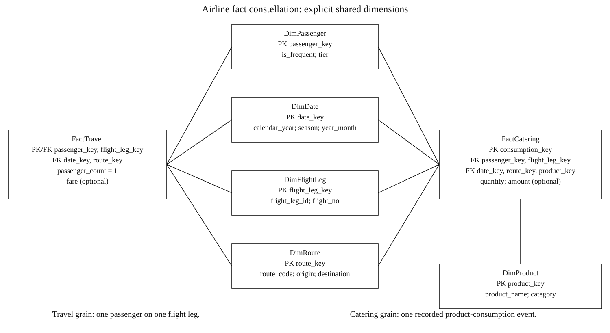
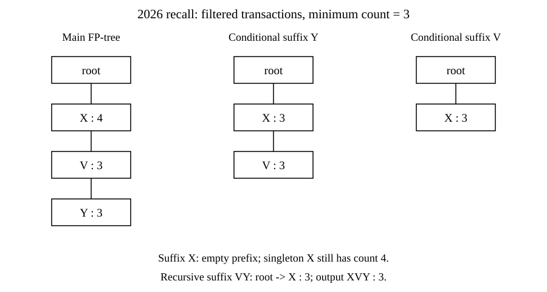

# 2026 年数据挖掘期末题型回忆

[网页按年查看](index.html#view=past&year=2026) · [往年题索引](往年题索引.md)

整理日期：2026-11-23。根据考后口述整理七道大题；英文题干为回忆整理版，后附中文。已记得的数据用于计算，缺失数据以公式、代码与解题步骤说明。

| 题号 | 主题 | 回忆分值 | 资料状态 |
| --- | --- | --- | --- |
| [Q1](#E26-01) | 2026 · 第1题：航空仓库设计与月度食品/饮品销量OLAP | 12 分 | 考后回忆整理 |
| [Q2](#E26-02) | 2026 · 第2题：18个数的基础统计、z分数与离群值 | 未记清 | 回忆整理：原数列与部分参数缺失 |
| [Q3](#E26-03) | 2026 · 第3题：四笔事务 FP-growth 与 Apriori 比较 | 未记清 | 回忆整理：单项计数和过滤后事务可计算 |
| [Q4](#E26-04) | 2026 · 第4题：二元组合频数表的贝叶斯分类 | 未记清 | 回忆整理（频数与目标缺失，保留通用解法） |
| [Q5](#E26-05) | 2026 · 第5题：过拟合及神经网络、决策树的防治 | 未记清 | 回忆整理（三问任务明确） |
| [Q6](#E26-06) | 2026 · 第6题：一维 K-means 代码（原数列与初始条件缺失） | 未记清 | 回忆整理：原数列及初始条件缺失 |
| [Q7](#E26-07) | 2026 · 第7题：为指定用户和商品编写协同过滤预测代码 | 未记清 | 回忆整理（代码任务明确，参数细节缺失） |

---
<a id="E26-01"></a>

## E26-01 · 2026 · 第1题：航空仓库设计与月度食品/饮品销量OLAP

来源：2026 年期末考后回忆 · Q1(a) 8分；Q1(b) 4分，共12分

状态：考后回忆整理；形式：回忆题 / 仓库设计与OLAP。

**回忆记录：** 航空公司数据仓库，设计题8分；OLAP题4分，涉及某航司客户的月度机上商品销量。设计背景与2020航空题接近。

**尚缺信息：** 完整题面及原图未保留；第二问商品称呼的语音表述不清，按航空场景归纳为机上食品/饮品销量；具体客户分组层级、商品分类层级与筛选值未记清；答案用变量及相应聚合变体表示。

**相关已有题：** E20-01。

### 英文题干（根据考后回忆整理）

(a) Design a data warehouse for an airline to analyze customer travel, passenger traffic on different routes, and on-board food/drink consumption or sales. State the fact grain, dimensions and measures. (8 points)

（a）为航空公司设计数据仓库，分析客户出行、不同航线的客流，以及机上食品/饮品消费或销售。说明事实粒度、维度和度量。（8分）

(b) Describe the OLAP operations needed to obtain monthly sales quantities of on-board food/drink products for customers of a selected airline. (4 points)

（b）说明获取指定航空公司客户月度机上食品/饮品销量所需的OLAP操作。（4分）

### 解答



**(a) 仓库设计（8分）。** 推荐按业务粒度使用两张事实表：FactTravel 一行是一名乘客的一次具体航段，PK为$(passenger\_key,flight\_leg\_key)$，度量passenger_count=1；FactCatering 一行是一条机上食品/饮品销售明细，PK为consumption_key，度量quantity，金额可另记amount。共享Passenger、FlightLeg、Date、Route维，销售事实另连Product维；航段维保存承运航司airline_code。

单表按“乘客—航段—商品明细”粒度也可汇总销量；乘次和票价按乘机去重，分析全部客流时还要覆盖未购买者。方案的可行性取决于粒度和聚合规则。

**(b) 月度销量OLAP（4分）。** 按客户分别统计时，从$[Passenger,FlightLeg,Day,Route,Product]$出发，Slice：$FlightLeg.airline\_code=A$；Day→YearMonth，FlightLeg、Route、Product在筛选后→ALL，保留Passenger。最终为$[Passenger,ALL,YearMonth,ALL,ALL]$，按客户、年月求$SUM(quantity)$。

若题目还要求按商品类别区分，则将Product上卷到Category并保留；若只求航司月总量，则Passenger也上卷到ALL。具体筛选值及是否保留商品类别未记全，以题面为准。

### English answer · 英文作答

Use passenger-flight-leg travel facts and separate on-board product-sales-line facts with shared Passenger, FlightLeg, Date and Route dimensions; add Product to sales facts. Slice to the selected airline. For monthly quantities by customer, roll Day to YearMonth and FlightLeg, Route and Product to ALL, retain Passenger, and sum quantity. A single fact can also work if its grain and aggregation rules preserve the required measures.

使用旅客—具体航段的出行事实与独立的机上商品销售明细事实，共享Passenger、FlightLeg、Date和Route维，销售事实另加Product维。切片限定所选航司。按客户统计月度数量时，将Day上卷到YearMonth，将FlightLeg、Route和Product上卷到ALL，保留Passenger，求quantity之和。若粒度和聚合规则能够保留所需度量，单张事实表也可成立。

<details>
<summary>补充解释与 SQL（展开）</summary>


### 补充详解

#### (a) 用明确粒度组织航空公司的两类业务

2020原卷Q1的任务是常客出行趋势、航线客流的季节变化与增长，以及各航班食品和饮料的消费情况。2026回忆与该设计背景接近，并新增4分OLAP小问。以下用两张事实表表达不同粒度，月度销量要求记录真实销售数量。


| 表 | 一行的粒度与主键 | 外键 / 度量 |
| --- | --- | --- |
| FactTravel | 一名乘客乘坐一个具体航段；PK(passenger_key,flight_leg_key) | FK连接Passenger、FlightLeg、Date、Route；passenger_count=1，票价可记fare |
| FactCatering | 一条机上食品/饮品销售明细；PK consumption_key | FK连接同样四维，另含product_key；quantity，金额可记amount |
| DimPassenger | PK passenger_key | 常客标志与等级等客户属性 |
| DimFlightLeg | PK flight_leg_key | 具体航段、航班号；airline_code表示本航段承运航司 |
| DimDate | PK date_key | calendar_year、year_month；year_month同时标识年份和月份 |
| DimRoute | PK route_key | route_code、始发与到达地点 |
| DimProduct | PK product_key | 食品/饮品名称与category |

图沿用已有航空公司事实星座；在航段维中以airline_code支持本小问的航司筛选。日期维是共享的日历，事实中的date_key分别按相应业务事件的记录日期赋值。食品销量由销售明细的quantity表示；消费量、销售金额、乘坐人次是各自独立的度量。

典型层次有Day→YearMonth→Year→ALL、Product→Category→ALL；Passenger可按常客等级分组，FlightLeg可按承运航司汇总。各维度键唯一，每条事实通过外键连接对应维度记录。

#### (b) 月度食品/饮品销量：先明确输出粒度

回忆未保留完整筛选值及客户分组层级。下面按“指定航司、每位客户、每个年月的销量”给出操作；$A$表示未记清的航司取值。

1. **Base cuboid：** $[Passenger,FlightLeg,Day,Route,Product]$，使用食品/饮品销售事实FactCatering；Customer沿用图中的Passenger维。
2. **Slice：** $FlightLeg.airline\_code=A$，限定该航司的明细。若原题还给时间、客户集合等条件，与此条件一起先做Dice。
3. **Roll-up：** Day→YearMonth，保留Passenger；FlightLeg、Route、Product在已筛定范围内→ALL。
4. **Aggregate：** 按客户和年月求$SUM(quantity)$。最终方体为$[Passenger,ALL,YearMonth,ALL,ALL]$。

$$Q_{p,m}^{(A)}=\sum_{f:\,passenger(f)=p,\,month(f)=m,\,airline(f)=A}quantity(f).$$

这里$m$是带年份的月份，如“2026-11”。若按食品类别输出，Product→Category并保留该轴；若只求某航司的月总销量，Passenger也→ALL。上卷只合并已选范围内的事实，航司条件一直有效。

#### 对应 SQL：用于理解上述操作

```sql
SELECT f.passenger_key, d.year_month,
       SUM(f.quantity) AS monthly_food_quantity
FROM FactCatering AS f
JOIN DimDate AS d ON d.date_key=f.date_key
JOIN DimFlightLeg AS l ON l.flight_leg_key=f.flight_leg_key
WHERE l.airline_code=:airline_code
GROUP BY f.passenger_key,d.year_month;
```

参数`:airline_code`对应$A$。本设计的FactCatering保存机上食品/饮品销售记录；若事实还包含其他商品，应先增加对应类别筛选。要按商品类别分组时，再连接DimProduct并在SELECT、GROUP BY中保留category。FlightLeg、Route、Product不进入GROUP BY，体现为ALL；Passenger仍参与分组，因此按客户分别输出。

#### 单张事实表何时也可成立

一行统一为“一名乘客在一次航段中的一条食品购买明细”时，单张事实表可以正确统计$SUM(quantity)$。同次乘机若有多条食品购买，乘次和票价会随明细重复；客流需按不同的$(passenger\_key,flight\_leg\_key)$组合计数，票价需先回到乘机粒度。要分析全部客流，还应覆盖没有购买食品的乘机记录。

因此判断设计要核对事实粒度、维度、度量与聚合规则。单事实与双事实都可以有合理实现；双事实更便于分别保存乘机事件与商品明细。

### 易错点与约定

同一乘机对应多条商品明细时，不能把每条明细上的passenger_count或完整票价直接相加。只记购买者的表无法覆盖未购买食品的客流。月度销量需要数量记录；仅有偏好标签不能直接计算销量。

### 计算与内存分析

对销售事实N行扫描筛选并哈希聚合，期望时间约$O(N)$、分组状态$O(G)$，G为输出的客户—年月组数。按日期分区及物化常用客户—年月数量汇总可减少重复扫描，需另计索引、物化空间和刷新成本。

</details>

### 知识点与公式总结

- **先定粒度：** 乘机事件与食品销售明细具有不同粒度，双事实便于分别汇总；单事实需要处理重复的乘次/票价。
- **销量：** $SUM(quantity)$；乘坐人次与票价总额分别按相应乘机粒度计算。
- **OLAP：** 先筛选航司，再明确客户、年月及商品分类哪些轴保留、哪些到ALL。
- **月份：** 采用YearMonth或$(year,month)$，区分不同年份的同名月份。


---

<a id="E26-02"></a>

## E26-02 · 2026 · 第2题：18个数的基础统计、z分数与离群值

来源：2026 年期末考后回忆 · Q2

状态：回忆整理：原数列与部分参数缺失；形式：考后回忆 / 按回忆整理。

**回忆记录：** 给出18个数，考查min/max、z-score和箱线图离群值等基础计算；min/max具体是求极值还是还要求归一化，回忆未完全确认。

**尚缺信息：** 18个原始数值；min-max目标区间和题给参数；总体/样本标准差及四分位数的具体原题约定；各统计小问的完整措辞与分值；min/max是仅求极值还是还要求min-max归一化，尚未确认。

**相关已有题：** E20-02B、E16-01CD、PPT-PRE25。

### 本题公式 · Min-max 与 z-score

$x$ 为待转换值，原极值为 $x_{\min},x_{\max}$，目标区间为 $[a,b]$：

$$x'=a+\frac{x-x_{\min}}{x_{\max}-x_{\min}}(b-a).$$

目标为 $[0,1]$ 时，化为 $x'=(x-x_{\min})/(x_{\max}-x_{\min})$；所有值使用同一组极值。

Z-score 为 $z=(x-\mu)/\mathrm{SD}$，$\mu$ 为该列均值，SD 为采用的标准差；题面给出均值或标准差时直接沿用给定量。

**标准差记号对应。** SD 是 standard deviation 的文字缩写；采用总体口径时 $\mathrm{SD}=\sigma$，采用样本口径时 $\mathrm{SD}=s$。这两种标准差分别使用 n 与 n−1 的方差分母，按题给条件选择。Z-score 中 $\mu$ 表示本题采用的均值；由当前数列计算时，其值就是 $\bar x=\sum_i x_i/n$。

### 英文题干（根据考后回忆整理）

An 18-value data set is given. Find the minimum and maximum, compute z-scores using the supplied parameters, and identify outliers using the five-number summary and a box plot.

给出一组18个数。求最小值、最大值，使用给定参数计算z分数，并根据五数概括和箱线图识别离群值。

### 逐步解答

#### 1. 先列中间量：18 个排序值、总和与平方和

用 $x_{(1)}\le\cdots\le x_{(18)}$ 表示原数列排序后的结果，括号下标表示排序位置。补齐数据后先填：

| 中间量 | 计算或定位方法 |
| --- | --- |
| 最小值、最大值 | $x_{\min}=x_{(1)},\ x_{\max}=x_{(18)}$ |
| 总和、平方和 | $S_1=\sum_{i=1}^{18}x_i,\ S_2=\sum_{i=1}^{18}x_i^2$ |
| 均值 | $\bar x=S_1/18$ |
| 离均差平方和 | $S_{xx}=S_2-S_1^2/18$ |

总和、平方和可以按原次序计算；中位数和四分位数按排序位置取值。

#### 2. Min-max：先找极值，再代入目标区间

对目标区间 $[a,b]$：

$$x_i'=a+\frac{x_i-x_{(1)}}{x_{(18)}-x_{(1)}}(b-a).$$

若原题要求 $[0,1]$，代入 $a=0,b=1$ 后为

$$x_i'=\frac{x_i-x_{(1)}}{x_{(18)}-x_{(1)}}.$$

每个观测共用同一组极值；按原始记录顺序列出 18 个转换结果。若全列相同，分母为 0，需采用题目对常量列的处理约定。

#### 3. Z-score：先均值、标准差，再逐值标准化

若原题给定均值或标准差，直接采用题给量。若从这 18 个数计算，分别写明口径：

$$\sigma=\sqrt{\frac{S_{xx}}{18}}\quad\text{（总体）},\qquad
s=\sqrt{\frac{S_{xx}}{17}}\quad\text{（样本）}.$$

以所选标准差 SD 代入：

$$z_i=\frac{x_i-\bar x}{\mathrm{SD}}=\frac{x_i-S_1/18}{\mathrm{SD}}.$$

正值表示高于均值，负值表示低于均值；绝对值表示相差多少个所选标准差。18 个原值缺失，当前保留这一步可直接填数的表达式。

#### 4. 五数概括与 IQR：定位第 5、9、10、14 个值

以下采用课程练习常用的上下半组中位数法。18 个值的上下半组各 9 个：

$$Q_1=x_{(5)},\qquad Q_2=\frac{x_{(9)}+x_{(10)}}2,\qquad Q_3=x_{(14)}.$$

因此五数概括按顺序为

$$\boxed{\left(x_{(1)},\ x_{(5)},\ \frac{x_{(9)}+x_{(10)}}2,\ x_{(14)},\ x_{(18)}\right)}.$$

依次对应 min、$Q_1$、median、$Q_3$、max。离群判定为

$$\begin{aligned}
IQR&=x_{(14)}-x_{(5)},\\
LF&=x_{(5)}-1.5IQR,\\
UF&=x_{(14)}+1.5IQR.
\end{aligned}$$

遍历原观测，$x_i<LF$ 或 $x_i>UF$ 时标为离群值。若补齐原题后有其他四分位数定义，按其定义重新定位 $Q_1,Q_3$。

#### 5. 作图要点与当前结论

先画有刻度的数轴；箱体从 $Q_1$ 到 $Q_3$，中位线在 $Q_2$；两条须分别取 $[LF,UF]$ 内最小、最大的实际观测，离群值单独画点。原数列缺失，当前无法确定实际箱体坐标、须端点和离群值名单。

可用 E20-02B 的已知 24 个年龄练箱线图、E16-01CD 练归一化；这些是另行标注来源的旧题数据。

### English answer pattern

For 18 sorted observations, the median is $(x_{(9)}+x_{(10)})/2$. Under the median-of-halves convention, $Q_1=x_{(5)}$ and $Q_3=x_{(14)}$. Use one set of min-max parameters and one stated standard-deviation convention. The numerical results and outliers remain undetermined because the original observations are missing.

18 个观测排序后，中位数为 $(x_{(9)}+x_{(10)})/2$。采用上下半组中位数法时，$Q_1=x_{(5)}$，$Q_3=x_{(14)}$。归一化共用同一组极值，并声明标准差口径。原观测缺失，因此具体数值与离群值尚不能确定。

### 易错点与约定

保留原始 18 个值用于统计和作图；min-max 与 z-score 分别按各自参数转换。围栏用于判离群，须端点取围栏内的实际观测。

### 计算与内存分析

通常排序 $O(N\log N)$；均值、方差、两种归一化及离群扫描各为 $O(N)$。保存原数列和输出为 $O(N)$，本题 $N=18$。

### 知识点与公式总结

- Min-max：$x'=a+(x-x_{\min})(b-a)/(x_{\max}-x_{\min})$；z-score：$z=(x-\bar x)/\mathrm{SD}$。
- 五数概括依次为 min、$Q_1$、median、$Q_3$、max；18 个值采用上下半组法时，$Q_1=x_{(5)},Q_3=x_{(14)}$。
- $IQR=Q_3-Q_1$；界限为 $Q_1-1.5IQR,Q_3+1.5IQR$，须取界限内实际观测。


---

<a id="E26-03"></a>

## E26-03 · 2026 · 第3题：四笔事务 FP-growth 与 Apriori 比较

来源：2026 年期末考后回忆 · Q3

状态：回忆整理：单项计数和过滤后事务可计算；形式：考后回忆 / 按回忆整理。

**回忆记录：** 回忆为4笔事务、X4/Y3/V3/Z2/W2、最小支持度60%，构建FP-tree并比较FP-growth与Apriori。

**尚缺信息：** 原事务中Z、W的位置；原题完整措辞与分值。

**相关已有题：** HW3-03、E25-03。

### 本题公式 · FP-growth：节点计数与条件投影

设原事务数为 $N$、支持度阈值为 $s$：$q=\lceil Ns\rceil$，$supp(X)=count(X)/N$。

对后缀 $a$，其条件模式基由根到各 $a$ 节点之前的前缀路径组成；每条路径的权重为该 $a$ 节点计数。条件物品计数为包含它的路径权重之和。

同名节点计数相加得到该物品支持计数；筛选条件树时始终使用原 $q$，递归扩展后将后缀接回，最后列出全部项集及计数。

### 英文题干（根据考后回忆整理）

This recall preserves four transactions after filtering infrequent items, together with the following singleton counts. The original placement of Z and W within transactions was not retained.

本次回忆保留了四笔事务筛除非频繁物品后的内容，以及以下单项支持计数；Z、W 在原事务中的具体分布未保留。

| Item | X | Y | V | Z | W |
| --- | --- | --- | --- | --- | --- |
| Recalled count | 4 | 3 | 3 | 2 | 2 |

| TID | Recalled transaction after filtering Z and W |
| --- | --- |
| T1 | X,V,Y |
| T2 | X,V,Y |
| T3 | X |
| T4 | X,V,Y |

**(a)** With minimum support 60%, construct the FP-tree and find all nonempty frequent itemsets with their support counts. For this worked reconstruction, use descending singleton frequency and place V before Y when their counts tie.

**(a)** 最小支持度为 60%。构建 FP-tree，列出全部非空频繁项集及支持计数。本解答按单项计数降序排列；V、Y 同频时固定 V 在 Y 前。

**(b)** Compare FP-growth with Apriori.

**(b)** 比较 FP-growth 与 Apriori。题面根据考后回忆重新表述。

### 逐步解答

#### (a) 先换算门槛并过滤

原事务总数 $N=4$，$min\_sup=60\%=0.6$：

$$q=\lceil N\,min\_sup\rceil=\lceil4\times0.6\rceil=\lceil2.4\rceil=\boxed{3}.$$

回忆单项计数为 $X:4,Y:3,V:3,Z:2,W:2$，所以保留 X、V、Y，筛除 Z、W。固定顺序为 $X\prec V\prec Y$，过滤后事务如下：

| 事务 | 过滤并排序的序列 |
| --- | --- |
| T1 | $X\to V\to Y$ |
| T2 | $X\to V\to Y$ |
| T3 | $X$ |
| T4 | $X\to V\to Y$ |

该表记录的是**筛选后事务**；原 Z、W 的位置仍保持缺失。

#### (a) 合并公共前缀，写节点计数

T1、T2、T4 共享完整路径，T3 只增加 X 的计数，所以

$$\boxed{root\to X:4\to V:3\to Y:3}.$$



头表支持计数为 X:4、V:3、Y:3；X 的节点计数为四笔事务，V、Y 的节点计数为包含完整前缀的三笔事务。

#### (a) 条件投影与全部频繁项集

| 后缀 | 条件模式基 | 条件树及输出 |
| --- | --- | --- |
| Y | $\langle X,V:3\rangle$ | $root\to X:3\to V:3$；输出 Y、XY、VY、XVY，计数均为 3 |
| V | $\langle X:3\rangle$ | $root\to X:3$；输出 V、XV，计数均为 3 |
| X | 空前缀，计数 4 | 条件树为空；输出单项 X:4 |

在 Y 的条件树继续以 V 为后缀，前缀为 X:3，得到三项集 XVY:3。全程保持整数门槛 $q=3$。

| 项集 | 支持计数 | 支持度 |
| --- | ---: | --- |
| $\{X\}$ | 4 | $4/4=1$ |
| $\{V\}$ | 3 | $3/4=0.75$ |
| $\{Y\}$ | 3 | $3/4=0.75$ |
| $\{X,V\}$ | 3 | $3/4=0.75$ |
| $\{X,Y\}$ | 3 | $3/4=0.75$ |
| $\{V,Y\}$ | 3 | $3/4=0.75$ |
| $\{X,V,Y\}$ | 3 | $3/4=0.75$ |

共 $3+3+1=\boxed{7}$ 个非空频繁项集。Z、W 单项已低于门槛，包含它们的更大项集也低于门槛，因此未保存它们的原始分布仍足以计算上述频繁结果。

#### (b) 用方法、原因与代价比较

| 方面 | Apriori | FP-growth |
| --- | --- | --- |
| 处理方法 | 连接、子集剪枝，逐层扫描候选计数 | 排序后共享前缀，用条件投影递归扩展 |
| 本例 | 保留 3 个单项，检查 3 个二项和 1 个三项候选 | 三笔相同有序事务压成共享的 X→V→Y 路径 |
| 原库扫描 | 标准逐层实现扫描单项、二项、三项各层 | 标准建主树通常两遍；条件树递归另有计算 |
| 空间与适用性 | 存候选和计数器，候选多时占用增长 | 存主树、头表与递归条件树；公共前缀少时压缩较弱 |

本例共享前缀多，FP-tree 很紧凑。两种算法在相同阈值下输出相同的 7 个频繁项集。

### English answer pattern

The minimum count is $\lceil4\times0.6\rceil=3$. Keep X, V and Y. With order X before V before Y, the tree is root→X:4→V:3→Y:3. The seven frequent itemsets are X, V, Y, XV, XY, VY and XVY. X has count 4; all other listed itemsets have count 3.

最小计数为 $\lceil4\times0.6\rceil=3$。保留 X、V、Y。按 X、V、Y 的顺序，树为 root→X:4→V:3→Y:3。七个频繁项集为 X、V、Y、XV、XY、VY、XVY。X 的计数为 4，其余列出的项集计数均为 3。

### 易错点与约定

回忆表是过滤后的事务表。阈值 60% 对应整数计数 3；条件树继续用同一整数阈值，支持度始终除以原事务数 4。

### 计算与内存分析

本例主树除根外有 3 个节点。一般设过滤后总篮长 $B=\sum_t|t|$，主树节点数至多为 $O(B)$；排序、头表及递归条件树另计。Apriori 的开销受候选总数和扫描层数影响。

### 知识点与公式总结

- 频繁门槛为 $q=\lceil N\,min\_sup\rceil$；本题 $q=3$，先筛除计数 2 的 Z、W。
- 同一顺序重排事务，前缀共享时将节点计数相加；条件路径的权重取后缀节点计数。
- 回忆的过滤后数据足以得到七个频繁项集；原 Z、W 分布没有补造。


---

<a id="E26-04"></a>

## E26-04 · 2026 · 第4题：二元组合频数表的贝叶斯分类

来源：2026 年期末考后回忆 · Q4

状态：回忆整理（频数与目标缺失，保留通用解法）；形式：2026 考后回忆 / 频数表计算。

**回忆记录：** 二元组合频数表的贝叶斯分类

**尚缺信息：** 七行具体的 X/Y/Z 组合、两类频数、目标 S；只记得前两行及最后一行 C1 较小、中间四行 C1 较大，这些大小关系不足以恢复人数。

**相关已有题：** E16-04、HW2-02、PPT-CL38。

### 本题公式 · 条件概率与贝叶斯：公式和分母

**条件概率与联合概率。** $P(A\mid B)$ 表示已知 B 发生时 A 的概率，分母限定在 B 中：

$$P(A\mid B)=\frac{P(A\cap B)}{P(B)},\qquad P(A\cap B)=P(A\mid B)P(B).$$

**全概率与贝叶斯。** 若类别 $C_1,\ldots,C_K$ 互斥且覆盖全部样本，观察证据 x 后：

$$\begin{aligned}
P(x)&=\sum_kP(x\mid C_k)P(C_k),\\
P(C_c\mid x)&=\frac{P(x\mid C_c)P(C_c)}{\sum_kP(x\mid C_k)P(C_k)}.
\end{aligned}$$

**朴素贝叶斯。** 给定类别后，假设各属性条件独立。先验用“该类人数/总人数”，条件概率用“该类内符合属性的人数/该类人数”：

$$s_c=P(C_c)\prod_jP(x_j\mid C_c),\qquad P_{NB}(C_c\mid x)=\frac{s_c}{\sum_k s_k}.$$

按“类人数→条件计数→相乘得分→比较类别→需要时归一化”计算。分类取分数最大者；条件概率与归一化均要求分母大于 0。题目指定平滑时，按同一规则调整各类条件计数。

### 英文题干（根据考后回忆整理）

A table gives seven combinations of binary attributes X, Y and Z and the frequency counts for classes C1 and C2. Use a naïve Bayesian classifier to classify the given sample S.

表格给出二元属性X、Y、Z的七种组合，以及类别C1、C2的频数。使用朴素贝叶斯分类器对给定样本S分类。

### 逐步解答

#### 1. 先读懂频数列

表中一行是一种属性组合；C1、C2 列分别保存该组合下两类的人数。一行若是 $(0,2)$，表示这个组合对应 0 个 C1、2 个 C2。一般一行 $(a,b)$ 就贡献 a 个 C1 和 b 个 C2，即使 $a>b$，两个人数都要保留。

可以直接在频数表上求和，无须把它展开成很多条重复记录。这里把第 $\ell$ 行的两类频数记为 $n_{\ell1},n_{\ell2}$，$\ell=1,\ldots,7$；待预测样本记为 $S=(x^*,y^*,z^*)$。

#### 2. 汇总类别人数，计算先验

$$N_k=\sum_{\ell=1}^{7}n_{\ell k},\qquad N=N_1+N_2,\qquad P(C_k)=\frac{N_k}{N}.$$

把七行 C1 列加总得到 $N_1$，C2 列加总得到 $N_2$。分母是样本总人数 N，行数 7 只表示属性组合的数量。

#### 3. 分别汇总与 S 匹配的属性人数

先找到 X 列等于 $x^*$ 的所有行，再把这些行的 Ck 人数相加：

$$m_{Xk}=\sum_{\ell:X_\ell=x^*}n_{\ell k},\qquad P(X=x^*\mid C_k)=\frac{m_{Xk}}{N_k}.$$

Y、Z 也分别这样做：

$$\begin{aligned}
m_{Yk}&=\sum_{\ell:Y_\ell=y^*}n_{\ell k},&P(Y=y^*\mid C_k)&=\frac{m_{Yk}}{N_k},\\
m_{Zk}&=\sum_{\ell:Z_\ell=z^*}n_{\ell k},&P(Z=z^*\mid C_k)&=\frac{m_{Zk}}{N_k}.
\end{aligned}$$

每个条件概率分别按一个属性筛行，并使用对应类的全部人数作分母。

#### 4. 乘先验与三个条件概率，再比较

采用给定类别后的属性条件独立假设，两个类的未归一化分数为

$$\begin{aligned}
s_1&=\frac{N_1}{N}\times\frac{m_{X1}}{N_1}\times\frac{m_{Y1}}{N_1}\times\frac{m_{Z1}}{N_1},\\
s_2&=\frac{N_2}{N}\times\frac{m_{X2}}{N_2}\times\frac{m_{Y2}}{N_2}\times\frac{m_{Z2}}{N_2}.
\end{aligned}$$

| 类别 | 类人数 | X 匹配人数 | Y 匹配人数 | Z 匹配人数 |
| --- | --- | --- | --- | --- |
| C1 | $N_1$ | $m_{X1}$ | $m_{Y1}$ | $m_{Z1}$ |
| C2 | $N_2$ | $m_{X2}$ | $m_{Y2}$ | $m_{Z2}$ |

列好这八个中间量后即可代入。若要求后验概率，再计算

$$P_{NB}(C_1\mid S)=\frac{s_1}{s_1+s_2},\qquad P_{NB}(C_2\mid S)=\frac{s_2}{s_1+s_2}.$$

#### 最终作答

取分数较大的类别；先验和条件概率都按每行的类频数加权。完整七行频数和 S 尚未记回，因此这里保留可直接代入的解答模板，不填写一个推测的数值类别。


### English answer pattern

Treat the C1 and C2 entries as class counts. Sum the columns to obtain class priors. For each attribute of S, sum the corresponding class counts over all matching rows and divide by the class total. Multiply the prior and the three class-conditional probabilities, then select the larger score. A numerical prediction requires the missing counts and S.

将 C1、C2 的条目视为类别人数。将各列求和以计算类别先验。对 S 的每个属性，在全部匹配行上汇总对应类的人数，再除以该类总人数。将先验与三个类条件概率相乘，选择较大的分数。数值预测需要缺失的频数及 S。

### 易错点与约定

人数列应分别累加；按一行哪类人数较大只保留一个标签，会丢掉该行的样本数量及另一类信息。题目指定平滑时再按要求调整条件概率。

### 计算与内存分析

对 R 行、d 个属性、K 类的频数表，累计中间量可在 $O(RdK)$ 时间内完成，额外计数空间为 $O(dK)$；本回忆 $R=7,d=3,K=2$，不需要按总人数展开记录。

### 知识点与公式总结

- 一行 $(a,b)$ 表示 a 个 C1 和 b 个 C2，两类人数分别参与统计。
- $P(C_k)=N_k/N$；条件概率将“匹配属性行的 Ck 人数之和”除以 $N_k$。
- 贝叶斯分数为先验乘三个条件概率；要概率时归一化，要类别时比较大小。


---

<a id="E26-05"></a>

## E26-05 · 2026 · 第5题：过拟合及神经网络、决策树的防治

来源：2026 年期末考后回忆 · Q5

状态：回忆整理（三问任务明确）；形式：2026 考后回忆 / 简答分析。

**回忆记录：** 过拟合及神经网络、决策树的防治

**尚缺信息：** 除三问任务外，没有记回更多限定条件；不另补数值要求。

**相关已有题：** E25-05、E17-03、E20-03D。

### 本题公式 · 过拟合、正则化与早停

训练损失 $\mathcal L_{train}$ 衡量对训练数据的拟合；验证损失 $\mathcal L_{val}$ 用于选模型和训练轮次。典型过拟合现象是训练损失继续下降，验证损失开始上升。

**L2 正则化（L2 regularization）**

$$\mathcal J(\theta)=\mathcal L_{data}(\theta)+\lambda\sum_\ell\|W^{(\ell)}\|_F^2.$$

$\theta$ 为模型参数；$W^{(\ell)}$ 为第 $\ell$ 层权重；$\|W\|_F^2=\sum_{i,j}w_{ij}^2$；$\lambda\ge0$ 控制惩罚强度。若题目写 $\lambda/2$，按题给系数代入。

**早停（early stopping）与选模**

$$t^*=\arg\min_t\mathcal L_{val}(\theta_t),\qquad \overline E_{CV}=\frac1K\sum_{j=1}^K E_j.$$

$t$ 为训练轮次，早停保留验证损失最低轮次的参数；$E_j$ 为第 $j$ 折验证误差，$K$ 折交叉验证取平均。训练集拟合参数，验证集选超参数，测试集评价最终方案。

### 英文题干（根据考后回忆整理）

(a) What is overfitting?

（a）什么是过拟合？

(b) How can overfitting be reduced in a neural network classifier?

（b）如何减轻神经网络分类器的过拟合？

(c) How can overfitting be reduced in a decision tree?

（c）如何减轻决策树的过拟合？

### 逐步解答

#### (a) 过拟合的定义与表现

过拟合（overfitting）是模型过度适应训练数据中的噪声或偶然规律，导致对未见样本的泛化表现较差。典型现象是训练损失继续下降，验证损失不再改善或开始上升。

#### (b) 神经网络：三种常用方法

| 方法 | 如何减少过拟合 |
| --- | --- |
| L2 regularization（正则化） | 惩罚过大的权重，限制对有限训练样本的过度适应。 |
| Early stopping（早停） | 监测验证损失，停止继续拟合并恢复验证效果最好的轮次。 |
| Dropout（随机失活） | 训练时随机屏蔽部分单元，减少网络对少数单元组合的依赖。 |

设数据损失为 $\mathcal L_{data}$，权重矩阵为 W，L2 目标为

$$\mathcal J=\mathcal L_{data}+\lambda\|W\|_F^2.$$

$\lambda\ge0$ 控制惩罚强度，$\|W\|_F^2$ 是全部权重的平方和。早停可写为 $t^*=\arg\min_t\mathcal L_{val}(\theta_t)$，选择并恢复验证损失最低轮次的参数。正则强度、失活率和轮次都用验证数据选择。

#### (c) 决策树：剪枝与复杂度选择

| 方法 | 做法与作用 |
| --- | --- |
| Pre-pruning（预剪枝） | 建树时限制最大深度、最小叶样本数或最小增益，避免为少量或噪声样本反复分裂。 |
| Post-pruning（后剪枝） | 先生成树，再比较保留子树与替换为叶节点的验证表现，剪去无助泛化的分支。 |

在同一验证集或交叉验证划分上选择树的复杂度。预剪枝可减少建树工作，但过早停止可能欠拟合；后剪枝能先观察完整子树的效果，再作取舍。

#### 最终作答要点

先写过拟合定义和训练/验证的典型现象；神经网络列三种方法并解释作用；决策树说明预剪枝、后剪枝及验证选复杂度。训练集拟合参数，验证集选方案，独立测试集评价选好的模型。


### English answer pattern

Overfitting means fitting training noise or accidental patterns so that generalization becomes poor. For neural networks, use L2 regularization, early stopping and dropout. For decision trees, use pre-pruning to restrict growth and post-pruning to remove branches that do not improve validation performance. Select complexity with validation data and evaluate the final model on an independent test set.

过拟合指拟合训练噪声或偶然模式，使泛化表现变差。神经网络可采用 L2 正则化、早停和随机失活。决策树可通过预剪枝限制生长，通过后剪枝删除不能改善验证表现的分支。使用验证数据选择复杂度，并在独立测试集上评价最终模型。

### 易错点与约定

早停与复杂度选择依据验证数据；最终测试数据留作评价。每种方法配一句机制说明，比只列方法名称更完整。

### 知识点与公式总结

- 过拟合关注对未见数据的表现：训练损失继续改善，验证表现却变差。
- 神经网络可答 L2、早停、Dropout，每项说明怎样限制过度适应。
- 决策树说明预剪枝、后剪枝和验证选复杂度；测试集用于最终评价。


---

<a id="E26-06"></a>

## E26-06 · 2026 · 第6题：一维 K-means 代码（原数列与初始条件缺失）

来源：2026 年期末考后回忆 · Q6

状态：回忆整理：原数列及初始条件缺失；形式：考后回忆 / 按回忆整理。

**回忆记录：** 回忆为有序的一维奇数或质数数列的K-means代码题；数列类型与初始条件尚未确认。

**尚缺信息：** 原始数列；奇数还是质数的确认；簇数k与初始中心；要求的迭代次数 / 停止条件；原题完整措辞与分值。

**相关已有题：** E25-06、HW3-01、E20-07。

### 本题公式 · K-means：距离、分配和新中心

$x_i$ 为 d 维数据点，$\mu_j$ 为第 j 个中心。每轮用同一套旧中心先完成分配，再更新均值：

$$d^2(x_i,\mu_j)=\sum_{r=1}^{d}(x_{ir}-\mu_{jr})^2,\qquad c_i=\arg\min_j d^2(x_i,\mu_j).$$

$$\mu_j^{new}=\frac1{|C_j|}\sum_{x_i\in C_j}x_i.$$

逐坐标求和、除以簇内点数；比较平方距离与比较欧氏距离得到相同最近中心。

**距离与平方距离的对应。**

$$d(x,\mu)=\sqrt{\sum_r(x_r-\mu_r)^2},\qquad d^2(x,\mu)=\sum_r(x_r-\mu_r)^2.$$

平方根在非负数上单调递增，所以 $\arg\min_j d(x,\mu_j)=\arg\min_j d^2(x,\mu_j)$。分簇时比较平方距离即可；求实际距离、平均距离时按相应公式保留开方。

### 英文题干（根据考后回忆整理）

Write a K-means algorithm for an ordered one-dimensional data set. Show how points are assigned to clusters and how the cluster centers are updated.

为有序的一维数据集编写K-means算法。说明如何分配数据点，以及如何更新簇中心。

### 逐步解答

#### 1. 输入参数与一维计算公式

输入为数列 $x_1,\ldots,x_N$、簇数 k、初始中心 $\mu_1,\ldots,\mu_k$ 与迭代上限 I。回忆缺失的数列和初始条件作为参数读取。

一维平方距离、分配和更新分别为

$$d_{ij}^2=(x_i-\mu_j^{old})^2,\qquad label_i=\arg\min_j d_{ij}^2,$$

$$n_j=\sum_i\mathbf1[label_i=j],\quad S_j=\sum_{i:label_i=j}x_i,\quad
\mu_j^{new}=S_j/n_j\quad(n_j>0).$$

先比较旧中心的距离，再汇总每簇点数与坐标和。下面代码采用明确约定：距离平局取编号小者；空簇保留旧中心。

#### 2. 批量 Lloyd 伪代码

```text
Input: x[1..N], k, initial mu[1..k], iteration limit I
for t = 1 .. I:
    old = copy(mu)
    count[1..k] = 0
    sum[1..k] = 0
    for i = 1 .. N:
        best = 1
        best_d2 = (x[i] - old[1])^2
        for j = 2 .. k:
            d2 = (x[i] - old[j])^2
            if d2 < best_d2:
                best = j
                best_d2 = d2
        label[i] = best
        count[best] += 1
        sum[best] += x[i]
    for j = 1 .. k:
        if count[j] > 0:
            mu[j] = sum[j] / count[j]
        else:
            mu[j] = old[j]
    if convergence is requested AND mu equals old:
        break
return label, mu
```

按簇编号递增扫描，只在严格更小时换候选，距离相同即保留较小编号。分配阶段读取 old，更新阶段写 mu，所以某个中心的更新不会影响本轮后续点的分配。

#### 3. 停止位置与应报告的结果

若题目给固定轮次，就完成指定轮数，并列出每轮的分簇、$n_j,S_j$ 和更新中心；若要求收敛，则按中心不再变化或题给容差停止。返回的 label 对应最后一轮旧中心的分配，mu 对应该轮统一更新后的中心。

数列、k、初始中心、轮数未补齐，因此当前没有唯一数值簇或最终中心。E25-06 可练固定两轮的手算；E20-07 可用于学习数据流在线摘要，本题模板采用批量 Lloyd。

#### 4. 复杂度

一轮比较 N 个点到 k 个中心的距离，需要 $O(Nk)$ 时间；实际运行 I 轮为

$$\boxed{O(INk)}.$$

保存输入和标签需 $O(N)$，旧 / 新中心、各簇 sum 与 count 需 $O(k)$，总空间为

$$\boxed{O(N+k)}.$$

可逐点保存当前最小距离，无需存完整的 N×k 距离矩阵。

### English answer pattern

Use a copy of the old centers to assign every point, accumulate each cluster count and sum, and then update the centers simultaneously. Break distance ties by the smaller cluster index and retain the old center for an empty cluster. The one-dimensional implementation takes $O(INk)$ time and $O(N+k)$ space. Numerical clusters require the missing original inputs.

复制旧中心后分配全部点，累计每簇的点数和坐标和，再同时更新中心。距离平局取较小簇编号，空簇保留旧中心。一维实现需要 $O(INk)$ 时间、$O(N+k)$ 空间。具体数值簇需要缺失的原始输入。

### 易错点与约定

同一轮全部距离都使用 old；整轮分配完成后才更新 mu。固定轮次与收敛停止按题意选择。数列是奇数或质数尚未确认。

### 计算与内存分析

设 I 为实际迭代轮数、N 为点数、k 为簇数，一维 Lloyd 时间为 $O(INk)$；输入、标签、中心和累加器共 $O(N+k)$ 空间。

### 知识点与公式总结

- 分配按 $(x_i-\mu_j^{old})^2$ 选择最近旧中心；更新按 $S_j/n_j$ 求新中心。
- 每轮先完成全部点的分配，再同时更新；平局与空簇规则写在代码约定中。
- 一维运行 I 轮的时间为 $O(INk)$、空间为 $O(N+k)$；有序性和奇数 / 质数描述不改变此基本实现。


---

<a id="E26-07"></a>

## E26-07 · 2026 · 第7题：为指定用户和商品编写协同过滤预测代码

来源：2026 年期末考后回忆 · Q7

状态：回忆整理（代码任务明确，参数细节缺失）；形式：2026 考后回忆 / 代码设计。

**回忆记录：** 为指定用户和商品编写协同过滤预测代码

**尚缺信息：** 具体相似度、k、评分矩阵及其他实现限定未完整记回；解答明确提供一种课件示范方案。

**相关已有题：** E17-07、E20-05、E25-07、SL-JANE。

### 本题公式 · 课件推荐公式：余弦相似度与均值修正

$J_{uv}$ 为 u、v 共同已评分的物品集合。课件第 19 页的余弦相似度为

$$\operatorname{sim}(u,v)=\frac{\sum_{i\in J_{uv}}r_{ui}r_{vi}}{\sqrt{\sum_{i\in J_{uv}}r_{ui}^2}\sqrt{\sum_{i\in J_{uv}}r_{vi}^2}}.$$

分子是逐项相乘再相加的点积；两个根号分别是两个用户向量的模长。先分别写出数值，再除以两个模长，相似度越大越近。$\sqrt a\sqrt b=\sqrt{ab}$（$a,b\ge0$），两种根号写法等价。

**评分用课件 recommend.pdf 第 20 页的均值修正式。** $r_{ui}$ 是已有评分，$\widehat r_{ui}$ 是预测；$\bar r_u$ 是用户 u 全部已观察评分的均值，$N_u$ 为选出的邻居：

$$\widehat r_{ui}=\bar r_u+\frac{\sum_{v\in N_u}\operatorname{sim}(u,v)(r_{vi}-\bar r_v)}{\sum_{v\in N_u}\operatorname{sim}(u,v)}.$$

先算邻居评分比其自身均值高/低多少，用相似度加权平均，再加回目标用户均值。分母是所用邻居的相似度总和。均值包含有效的 0 分，跳过缺失的问号。 题干中的 $s(u,v)$ 与这里的 $\operatorname{sim}(u,v)$ 表示同一个相似度，代入时使用前面算出的数值。

### 英文题干（根据考后回忆整理）

A rating matrix contains N users and M items. Write code to predict a specified user's rating for a specified item using similar users.

评分矩阵包含N名用户和M个商品。编写代码，利用相似用户预测指定用户对指定商品的评分。

### 解答

采用课件的用户余弦相似度与均值修正作为示范方案。先用共同已评分物品计算相似度，再用给目标商品评过分的邻居预测：

$$\widehat r_{ui}=\bar r_u+\frac{\sum_{v\in N_u}\operatorname{sim}(u,v)(r_{vi}-\bar r_v)}{\sum_{v\in N_u}\operatorname{sim}(u,v)}.$$

```text
function PREDICT(R, u, item, k):
    if R[u,item] is known: return R[u,item]
    mean_u = mean of known ratings in row u
    if row u has no known ratings: return global known-rating mean
    candidates = []
    for each user v other than u who rated item:
        skip v if the co-rated vectors have a zero norm
        sim = cosine of u and v on their co-rated items
        if sim > 0:
            mean_v = mean of known ratings in row v
            save (sim, v, R[v,item] - mean_v) in candidates
    neighbors = top k candidates by sim
    if neighbors is empty: return mean_u
    return mean_u + sum(sim * deviation) / sum(sim)
```

0 分参与计算，缺失值跳过。以上伪代码先展示核心步骤；下方完整 Python 用堆维护前 k 人，并处理零模长及回退。


### English answer · 英文作答

One complete implementation uses co-rated-item cosine similarity and the course mean-centered predictor. Consider only users who rated the target item, retain the top-k positive similarities, and normalize the weighted rating deviations before adding the target user mean. Skip missing values without treating valid zeros as missing. Use the user mean, or the global mean for a user without ratings, when a prediction has no supporting neighbors.

一种完整实现使用共同评分商品上的余弦相似度和课件均值修正预测式。只考虑对目标商品打过分的用户，保留前 k 个正相似度，归一化加权评分偏差后加回目标用户均值。跳过缺失值，不把有效的零分当作缺失。在预测缺少邻居支持时，使用用户均值；用户没有评分时使用全局均值。

<details>
<summary>补充解释（展开）</summary>


### 补充详解

#### 1. 用课件方法给出一个完整实现

下面示范课件的“用户余弦相似度＋均值修正预测”。具体代码采用这些明确约定：None 表示缺失，0 为有效评分；只考虑给目标商品打过分的其他用户；选前 k 个正相似度邻居，同相似度优先较小用户编号。k 为函数参数。

设 $J_{uv}$ 为 u、v 共同已评分的商品，$N_u$ 为本次选中的邻居：

$$\operatorname{sim}(u,v)=\frac{\sum_{j\in J_{uv}}r_{uj}r_{vj}}{\sqrt{\sum_{j\in J_{uv}}r_{uj}^2}\sqrt{\sum_{j\in J_{uv}}r_{vj}^2}}.$$

各用户的均值 $\bar r$ 使用其全部已知评分。预测时先减邻居均值，加权后加回目标用户均值：

$$\widehat r_{ui}=\bar r_u+\frac{\sum_{v\in N_u}\operatorname{sim}(u,v)(r_{vi}-\bar r_v)}{\sum_{v\in N_u}\operatorname{sim}(u,v)}.$$

#### 2. 按公式写代码

代码中的用户u与商品item使用从0开始的下标。

```python
from math import sqrt
from heapq import heappush, heapreplace

def predict(ratings, u, item, k=10):
    """None is missing; 0 is a valid rating; k must be positive."""
    if k < 1:
        raise ValueError("k must be positive")
    if ratings[u][item] is not None:
        return float(ratings[u][item])

    def mean(row):
        total, count = 0.0, 0
        for value in row:
            if value is not None:
                total += value
                count += 1
        return total / count if count else None

    user_mean = mean(ratings[u])
    if user_mean is None:
        total, count = 0.0, 0
        for row in ratings:
            for value in row:
                if value is not None:
                    total += value
                    count += 1
        return total / count if count else None

    heap = []
    for v, row in enumerate(ratings):
        if v == u or row[item] is None:
            continue
        dot, norm_u2, norm_v2 = 0.0, 0.0, 0.0
        for a, b in zip(ratings[u], row):
            if a is not None and b is not None:
                dot += a * b
                norm_u2 += a * a
                norm_v2 += b * b
        if norm_u2 == 0 or norm_v2 == 0:
            continue
        sim = dot / (sqrt(norm_u2) * sqrt(norm_v2))
        if sim <= 0:                # declared positive-neighbor policy
            continue
        offset = row[item] - mean(row)
        entry = (sim, -v, offset)   # equal similarity: smaller user ID first
        if len(heap) < k:
            heappush(heap, entry)
        elif entry[:2] > heap[0][:2]:
            heapreplace(heap, entry)

    if not heap:
        return user_mean
    weight_sum = sum(sim for sim, _, _ in heap)
    correction = sum(sim * offset for sim, _, offset in heap) / weight_sum
    return user_mean + correction
```

#### 3. 各分支对应的含义

- 目标评分已经存在时，直接返回该评分。
- 共同评分向量的模长为 0 时跳过该用户；正相似度筛选是本示范算法的邻居策略。
- 无合格邻居时返回目标用户均值；目标用户没有已知评分时返回全体有效评分均值；矩阵全缺失时返回 None。
- 小根堆只保留当前最优 k 人；最后用“相似度乘评分偏差”的和除以权重和，再加回用户均值。

#### 最终作答要点

代码完成“读共同评分→算相似度→筛选并保留邻居→算均值偏差→归一化预测”，并处理缺失和空邻域。余弦及均值修正来自课件；上述 k、正相似度和回退处理是为完整代码明确的示范选择。


### 易错点与约定

代码中的 sim<=0 筛选、同分编号规则和回退均已声明为示范选择；不将它们写成原卷已经指定的条件。所有有效 0 都参与均值及共同评分运算。

### 计算与内存分析

对一个用户—商品查询，最多比较 N 位用户，每次扫描 M 项，时间为 $O(NM+N\log k)$，k=1 时堆操作按常数计。代码逐行计算均值，不另存全部 N 个相似度或均值，只需 $O(k)$ 额外堆空间与常数累计量；评分矩阵本身的 $O(NM)$ 输入存储另计。 上方伪代码若存下全部候选，额外空间为O(N)；下方堆实现只保留k名邻居，额外空间为O(k)，均不含输入评分矩阵。

</details>

### 知识点与公式总结

- 用共同已评分集合 $J_{uv}$ 算余弦，但只有已评目标商品的用户能贡献 $r_{vi}$。
- 课件预测式是目标均值加上邻居评分偏差的归一化加权和。
- None 为缺失、0 有效；跳过零模长，明确 top-k、相似度筛选和空邻域回退。
