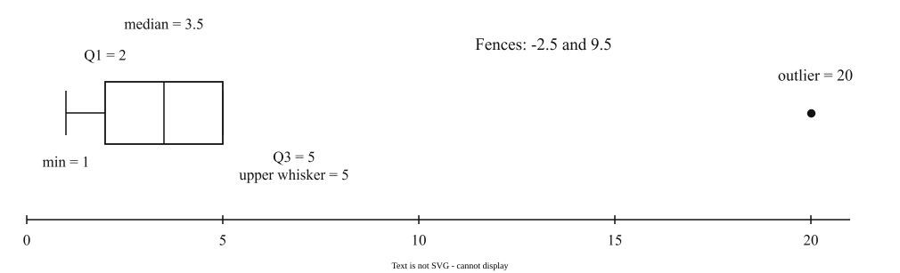

# 分箱与噪声平滑

[返回题型索引](../题型索引.md) · [网页练习](../index.html#type=binning)

同数据同题合并列出多处来源；题目文字为转录整理，原扫描页保留供核对。

## E16-01AB · 2016：18 个年龄的等深均值与等宽边界

来源：2016 年扫描卷 · Q1(a-b) / 10 points · PDF p.1

状态：完整；形式：计算 / 推导。

### 原题 / 转录整理

Use smoothing by bin means on the age data with bin depth 6. Then partition age into 3 bins by equal-width partitioning and smooth each bin by bin boundaries.

| age | 1 | 2 | 3 | 4 | 5 | 6 | 7 | 8 | 9 | 10 | 11 | 12 | 13 | 14 | 15 | 16 | 17 | 18 |
| --- | --- | --- | --- | --- | --- | --- | --- | --- | --- | --- | --- | --- | --- | --- | --- | --- | --- | --- |
| values | 39 | 57 | 41 | 58 | 47 | 58 | 49 | 60 | 50 | 61 | 23 | 52 | 23 | 54 | 27 | 54 | 27 | 56 |

### 第一步：中文翻译与条件

将给定 18 个年龄排序，先按每箱 6 个做均值平滑，再分为 3 个等宽箱并用最近箱内端点平滑。

### 逐步解答

**等深：**先排序，再分成三组。

| Bin | Sorted values | Smoothed values |
| --- | --- | --- |
| 1 | 23, 23, 27, 27, 39, 41 | 30, 30, 30, 30, 30, 30 |
| 2 | 47, 49, 50, 52, 54, 54 | 51, 51, 51, 51, 51, 51 |
| 3 | 56, 57, 58, 58, 60, 61 | 58.333333, 58.333333, 58.333333, 58.333333, 58.333333, 58.333333 |

**等宽：**最小 23、最大 61，宽度 $(61-23)/3=38/3$。采用 $[23,35.6667)$、$[35.6667,48.3333)$、$[48.3333,61]$。

| Bin | Values | Boundary-smoothed |
| --- | --- | --- |
| 1 | 23,23,27,27 | 23,23,27,27 |
| 2 | 39,41,47 | 39,39,47 |
| 3 | 49,50,52,54,54,56,57,58,58,60,61 | 49,49,49,49,49,61,61,61,61,61,61 |

边界平滑用**每箱实际最小和最大观测**，不是机械替换成区间切点。最近端点距离相同取较小端点，本例等宽末箱无 55 的端点平局。

### English answer pattern

Sort first for equal-depth bins. Equal-width bins have equal numeric ranges, not equal record counts.

### 易错点与约定

原始年龄 58 出现两次；57 与 56 各出现一次。箱内两端应保留原观测端点。

### 计算与内存分析

排序 O(N log N)；给定已排序数据时分箱 O(N)，流式统计每箱均值额外 O(1)。

---

## E20-02A · 2020：24 个年龄，深度 6 均值平滑

来源：2020 年扫描卷 · Q2(1) / 6 points · PDF p.1

状态：完整；形式：计算 / 推导。

### 原题 / 转录整理

Use smoothing by bin means to smooth the age data, using a bin depth of 6.

20, 13, 15, 16, 25, 35, 36, 40, 45, 46, 52, 25, 25, 30, 21, 22, 22, 33, 33, 35, 35, 70, 19, 20

### 第一步：中文翻译与条件

将 24 个年龄排序，按每箱 6 个分组，用每组均值替换该组。

### 逐步解答

| Bin | Sorted values | Smoothed values |
| --- | --- | --- |
| 1 | 13, 15, 16, 19, 20, 20 | 17.166667, 17.166667, 17.166667, 17.166667, 17.166667, 17.166667 |
| 2 | 21, 22, 22, 25, 25, 25 | 23.333333, 23.333333, 23.333333, 23.333333, 23.333333, 23.333333 |
| 3 | 30, 33, 33, 35, 35, 35 | 33.5, 33.5, 33.5, 33.5, 33.5, 33.5 |
| 4 | 36, 40, 45, 46, 52, 70 | 48.166667, 48.166667, 48.166667, 48.166667, 48.166667, 48.166667 |

每个原始观测都必须出现一次；重复的 25、33、35 不可去重。平滑结果按排序后给出；若题目要求原顺序，则保存排序前索引再还原。

### English answer pattern

Bin depth is a record count. Sorting is required before forming equal-depth bins.

### 计算与内存分析

O(N log N) 排序加 O(N) 统计；保留原顺序索引 O(N) 空间。

---

## HW1-04 · 当前 HW1：深度 5 中位数与边界

来源：当前 HW1 · Q4(a-b)

状态：完整；形式：计算 / 推导。

### 原题 / 转录整理

对商品 A 的 20 个月销量做深度为 5 的 Equal-depth binning，分别使用 bin median 和 bin boundaries 平滑。

21, 16, 19, 24, 27, 23, 22, 21, 20, 17, 16, 20, 23, 22, 18, 24, 26, 25, 20, 26

### 第一步：中文翻译与条件

原题为中文。排序后分四箱，每箱五个。分别用中位数和最近实际端点替换。

### 逐步解答

**中位数平滑：**

| Bin | Sorted values | Smoothed values |
| --- | --- | --- |
| 1 | 16, 16, 17, 18, 19 | 17, 17, 17, 17, 17 |
| 2 | 20, 20, 20, 21, 21 | 20, 20, 20, 20, 20 |
| 3 | 22, 22, 23, 23, 24 | 23, 23, 23, 23, 23 |
| 4 | 24, 25, 26, 26, 27 | 26, 26, 26, 26, 26 |

**边界平滑：**

| Bin | Sorted values | Smoothed values |
| --- | --- | --- |
| 1 | 16, 16, 17, 18, 19 | 16, 16, 16, 19, 19 |
| 2 | 20, 20, 20, 21, 21 | 20, 20, 20, 21, 21 |
| 3 | 22, 22, 23, 23, 24 | 22, 22, 22, 22, 24 |
| 4 | 24, 25, 26, 26, 27 | 24, 24, 27, 27, 27 |

边界距离平局取小端点；如某箱内部同时含中点，必须写清选择规则。

### English answer pattern

Replace all values in each bin with its median, or with the nearer observed bin boundary.

---

## HX1-04 · 往届 HW1：深度 4 与四等宽箱

来源：往届 HW1（hxd） · Q4(a-c) · PDF p.1

状态：完整；形式：计算 / 推导。

### 原题 / 转录整理

对 23,23,27,27,39,41,47,49,50,52,53,53,54,55,56,57 做：(a) 深度 4 的 median 平滑；(b) 深度 4 的 boundaries 平滑；(c) 四个等宽箱的 mean 平滑。

### 第一步：中文翻译与条件

原题为中文。前两问每箱四个观测；第三问每个区间宽度相同。

### 逐步解答

**(a)**

| Bin | Sorted values | Smoothed values |
| --- | --- | --- |
| 1 | 23, 23, 27, 27 | 25, 25, 25, 25 |
| 2 | 39, 41, 47, 49 | 44, 44, 44, 44 |
| 3 | 50, 52, 53, 53 | 52.5, 52.5, 52.5, 52.5 |
| 4 | 54, 55, 56, 57 | 55.5, 55.5, 55.5, 55.5 |

**(b)**

| Bin | Sorted values | Smoothed values |
| --- | --- | --- |
| 1 | 23, 23, 27, 27 | 23, 23, 27, 27 |
| 2 | 39, 41, 47, 49 | 39, 39, 49, 49 |
| 3 | 50, 52, 53, 53 | 50, 53, 53, 53 |
| 4 | 54, 55, 56, 57 | 54, 54, 57, 57 |

**(c)** 宽度 $(57-23)/4=8.5$，区间 $[23,31.5),[31.5,40),[40,48.5),[48.5,57]$。

| Bin | Values | Mean |
| --- | --- | --- |
| 1 | 23,23,27,27 | 25 |
| 2 | 39 | 39 |
| 3 | 41,47 | 44 |
| 4 | 49,50,52,53,53,54,55,56,57 | 53.222222 |

第三问最后一个箱包含九个观测，不是四个。

### English answer pattern

Equal-depth and equal-width partitioning solve different constraints.

---

## E25-02 · 2025 · 第2题：6 个数的边界平滑与箱线图

来源：2025 年人工智能学院回忆卷 · Q2 · PDF p.1

状态：完整复原练习；形式：回忆复原 / 完整练习。

**复原依据：**回忆为 6 个数、bin boundary（depth=3），并用 box plot 判断 outlier。

**补配与口径：**

- 补配数列 1,2,3,4,5,20。
- 边界距离平局取较小值；四分位数采用上下半组各自中位数。

以下为可完整作答的复原练习；补配数值不是原卷原值。

### 完整英文题干 / Reconstructed problem

Consider the observations $1,2,3,4,5,20$.

**(a)** Smooth the data by bin boundaries using equal-depth bins of depth 3. Show the bins and all smoothed values. If a value is equally close to both observed boundaries, use the lower one.

**(b)** For the **original observations**, compute the five-number summary and draw a box plot. Use the medians of the lower and upper halves for $Q_1,Q_3$, and the $1.5IQR$ rule for outliers. Label the whisker endpoints and identify every outlier.

### 第一步：中文翻译与条件

已知六个观测 1、2、3、4、5、20。

(a) 将数据排序，每箱恰有 3 个观测，用各箱实际最小值或最大值中更近的一个替换。平局向小端。写出两个箱及全部平滑值。

(b) 对原始六数求五数概括，按 1.5IQR 规则画箱线图并标异常点；这里不是对平滑结果作图。

### 小问要求与完成标准

| 小问 | 必须交付 | 停止位置 |
| --- | --- | --- |
| (a) | 排序、2 个深度为 3 的箱、逐值边界替换和 6 个平滑值 | 完成一次分箱平滑；不再反复平滑。 |
| (b) | 原数据五数概括、IQR、上下界、箱线图与离群值 | 须落在实际非离群观测值；不用平滑后数据重算。 |

### 逐步解答

#### 1. 按深度分成两箱

$$B_1=(1,2,3),\qquad B_2=(4,5,20).$$

箱内端点分别为 $(1,3)$ 与 $(4,20)$。对箱 $B=[l,u]$：

$$\tilde x=\begin{cases}l,&x-l\le u-x,\\u,&x-l>u-x.\end{cases}$$

| Bin | Value | Distance to lower / upper | Replacement |
| --- | --- | --- | --- |
| 1 | 1 | 0 / 2 | 1 |
| 1 | 2 | 1 / 1（平局） | 1 |
| 1 | 3 | 2 / 0 | 3 |
| 2 | 4 | 0 / 16 | 4 |
| 2 | 5 | 1 / 15 | 4 |
| 2 | 20 | 16 / 0 | 20 |

所以完整平滑序列为

$$\boxed{(1,1,3,4,4,20)}.$$

#### 2. 在原数据上计算箱线图

下半组 $(1,2,3)$、上半组 $(4,5,20)$，故

$$\min=1,\quad Q_1=2,\quad Q_3=5,\quad\max=20.$$
$$Q_2=\frac{3+4}{2}=3.5.$$
$$\begin{aligned}
IQR&=Q_3-Q_1=3,\\
LF&=2-1.5\times3=-2.5,\\
UF&=5+1.5\times3=9.5.
\end{aligned}$$

只有 $20>9.5$，所以唯一离群值为 20。下须=1，上须=5；箱体为 [2,5]，中位线在 3.5。上须不能画到理论界限 9.5，也不能画到异常点 20。

#### 3. 最后交卷检查

写出两箱、六个平滑值、五数概括、两个离群界限及一张有刻度的箱线图；只写“20 是异常”还缺作图与推导。

### English answer pattern

The smoothed sequence is (1,1,3,4,4,20). For the original data, Q1=2, median=3.5, Q3=5 and IQR=3. The fences are −2.5 and 9.5; 20 is the only outlier.

### 易错点与约定

边界是箱内实际观测的最小/最大值；分箱平滑不保证能消除原始离群值。

### 计算与内存分析

未排序输入通常先用 $O(N\log N)$ 排序；之后分箱与作图统计为 $O(N)$。保存原始输入需 $O(N)$ 空间；排序额外空间取决于实现，例如归并排序另需 $O(N)$。已排序数据可按箱顺序处理，每箱工作区为 $O(b)$，本题箱深 $b=3$。
