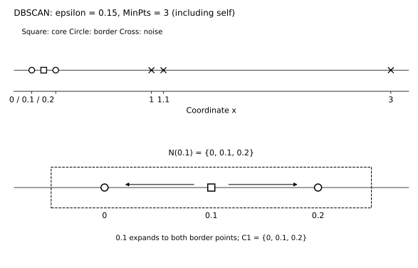
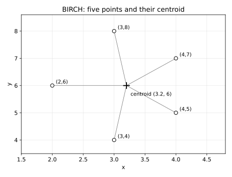
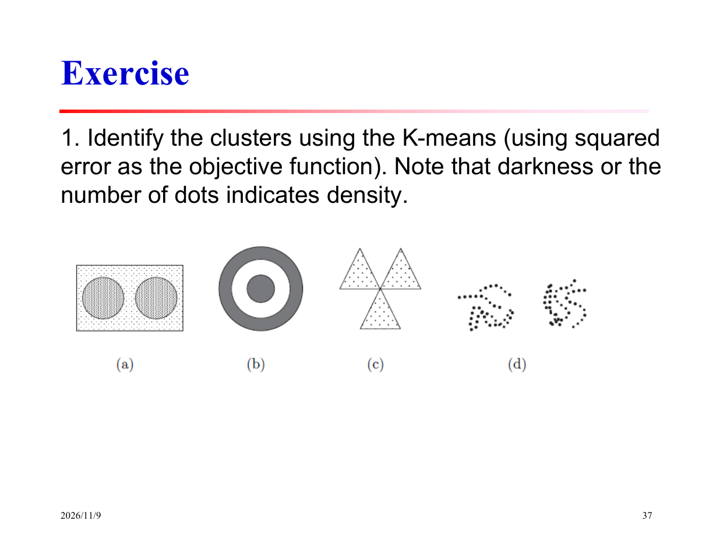
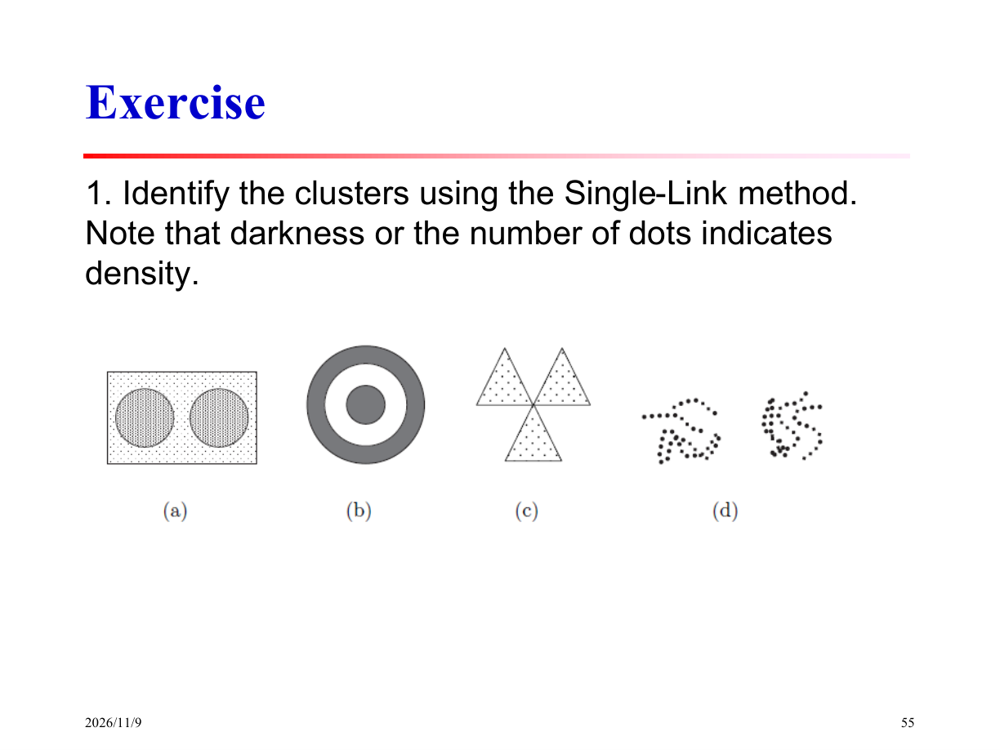
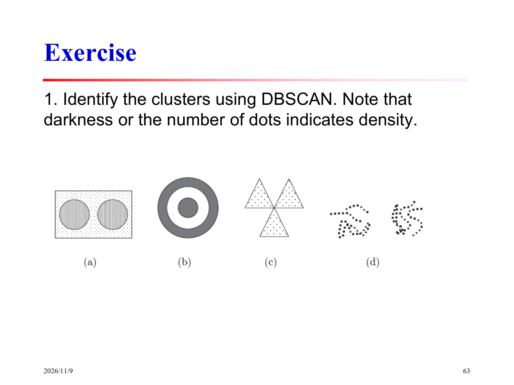

# DBSCAN、BIRCH 与网格

[返回题型索引](../题型索引.md) · [网页练习](../index.html#type=density)

同数据同题合并列出多处来源；题目文字为转录整理，原扫描页保留供核对。

## SUP-DBSCAN · 补充计算：核心、边界、噪声与可达

来源：当前完整七讲课件 · clustering.pdf pp.58–60 · PDF p.58；整理者补充变式 · 一维自设数据

状态：完整；形式：补充变式。

### 原文

Run DBSCAN on {0,0.1,0.2,1,1.1,3}, ε=0.15, MinPts=3, including each point itself in its neighborhood. Label core, border and noise points.

对 {0,0.1,0.2,1,1.1,3} 运行 DBSCAN，ε=0.15、MinPts=3，每个点的邻域包含自身。标出核心点、边界点和噪声点。

### 逐步解答

#### 距离、邻域与分类公式

本题为课件概念的补充手算数据。点在一维数轴上，距离为 $d(p,q)=|p-q|$。半径 $\varepsilon=0.15$，最少点数 $\mathrm{MinPts}=3$，邻域包含自身：

$$N_{\varepsilon}(p)=\{q:|p-q|\le0.15\}.$$

按以下顺序判断每个点：

1. **核心点（core）** ：$|N_{\varepsilon}(p)|\ge3$，局部邻域足够密集，可以发起簇的扩展。
2. **边界点（border）** ：自身邻域少于 3 点，但落在某个核心点的邻域中，可以加入该核心点所在簇。
3. **噪声点（noise）** ：既非核心点，也未被任何核心点所在的簇吸收。

#### 逐点计算邻域

例如 $d(0.1,0)=0.1\le0.15$，$d(0.1,0.2)=0.1\le0.15$，所以 $0.1$ 的邻域含 3 个点；$d(0,0.2)=0.2>0.15$，所以 $0$ 的邻域仅含 $0,0.1$。

| 点 $p$ | 完整邻域 $N_{\varepsilon}(p)$（含自身） | 个数 | 核心点？ | 最终类型 |
| --- | --- | ---: | --- | --- |
| $0$ | $\{0,0.1\}$ | 2 | 否 | 边界：属于核心点 $0.1$ 的邻域 |
| $0.1$ | $\{0,0.1,0.2\}$ | 3 | 是 | 核心 |
| $0.2$ | $\{0.1,0.2\}$ | 2 | 否 | 边界：属于核心点 $0.1$ 的邻域 |
| $1$ | $\{1,1.1\}$ | 2 | 否 | 噪声 |
| $1.1$ | $\{1,1.1\}$ | 2 | 否 | 噪声 |
| $3$ | $\{3\}$ | 1 | 否 | 噪声 |

#### 扩展簇并输出结果

从核心点 $0.1$ 创建 $C_1$，将其邻域 $0,0.1,0.2$ 加入。两个边界点各自只有 2 个邻居，扩展在这里结束。其余点的邻域均未达到 3，输出为

$$\boxed{C_1=\{0,0.1,0.2\},\qquad\mathrm{Noise}=\{1,1.1,3\}}.$$

上图使用真实数轴距离；下图放大 $0,0.1,0.2$ 所在区间，虚框表示核心点 $0.1$ 的半径邻域。

#### 直接密度可达、密度可达与密度相连

$0$、$0.2$ 均从核心点 $0.1$ **直接密度可达（directly density-reachable）** ：目的点在其邻域内，出发点为核心点。**密度可达（density-reachable）** 允许沿这样的有向步骤走一条路径。

$0$ 与 $0.2$ 共同从 $0.1$ 可达，因此两者 **密度相连（density-connected）** 并属于同簇。$1,1.1$ 虽相邻，但其局部点数均不足 3，形成不了核心点，最终都为噪声。

#### 手算检查顺序

先列全邻域 → 数点（包括自己）→ 圈出核心点 → 由核心点扩展 → 标边界和最终噪声。若先访问 $0$ 时暂标噪声，后续访问核心点 $0.1$ 时会把 $0$ 加入 $C_1$。

### English answer pattern

Including each point itself, only $0.1$ has at least three neighbors and is core. Points $0$ and $0.2$ are border points. The only cluster is $\{0,0.1,0.2\}$; points $1,1.1,3$ are noise.

把每个点自身计入后，只有 $0.1$ 至少有三个邻居，因此为核心点。$0$、$0.2$ 为边界点。唯一簇为 $\{0,0.1,0.2\}$；$1,1.1,3$ 为噪声点。

### 易错点与约定

本题阈值使用 $|N_\varepsilon(p)|\ge\mathrm{MinPts}$，邻域包含点自身。扩展邻域的出发点需要是核心点；边界点可以加入簇。仅有两个邻近点 $1,1.1$ 时，各自计数为 2，未达到 3。

### 计算与内存分析

对 $N$ 个 $d$ 维点，朴素范围查询逐一比较距离，总时间最坏为 $O(N^2d)$。按需查询、只保存标签及当前扩展队列时，除输入外可用 $O(N)$ 工作空间；预存全部邻域最坏需要 $O(N^2)$。在适合空间索引的低维数据上，查询可明显加快；高维或高密度时仍可能接近二次成本。

### 知识点与公式总结

- **邻域与核心点**：$N_\varepsilon(p)=\{q:d(p,q)\le\varepsilon\}$，$\varepsilon$ 为半径，邻域包含自身；$|N_\varepsilon(p)|\ge\mathrm{MinPts}$ 时为核心点（core）。
- **边界与噪声**：邻域不足 MinPts、但落在核心点邻域内的是边界点（border）；最终未被任何簇吸收的点为噪声（noise）。
- **扩展规则**：从核心点反复扩展邻域，形成密度可达的簇；边界点加入簇，但只由核心点继续扩展。先列邻域、再数点、再定类型。
- **本题核对**：核心点为 0.1；边界点为 0、0.2；其余 1、1.1、3 为噪声。

---

## SL-BIRCH · BIRCH：CF 可加性和半径计算

来源：当前完整七讲课件 · clustering.pdf · CF 向量例图与 pp.46–49 方法说明 · PDF p.45

状态：完整；形式：计算 / 推导。

### 原文

For points (3,4),(2,6),(4,5),(4,7),(3,8), compute CF=(N,LS,SS), centroid, RMS radius and RMS pairwise diameter.

对点 (3,4)、(2,6)、(4,5)、(4,7)、(3,8)，计算 CF=(N,LS,SS)、质心、均方根半径和均方根点对直径。

### 逐步解答

#### CF 中的三个量

课件的聚类特征（clustering feature）为 $CF=(N,LS,SS)$：$N$ 是点数，$LS=\sum X_i$ 是逐坐标线性和，$SS=\sum X_i\odot X_i$ 是逐坐标平方和。

| 点 $(x_i,y_i)$ | $x_i^2$ | $y_i^2$ |
| --- | ---: | ---: |
| $(3,4)$ | 9 | 16 |
| $(2,6)$ | 4 | 36 |
| $(4,5)$ | 16 | 25 |
| $(4,7)$ | 16 | 49 |
| $(3,8)$ | 9 | 64 |
| 求和 | 54 | 190 |

$$\begin{aligned}
N&=5,\\
LS&=(3+2+4+4+3,\;4+6+5+7+8)=(16,30),\\
SS&=(54,190).
\end{aligned}$$

因此 $\boxed{CF=(5,(16,30),(54,190))}$。总平方范数和记为 $S_2=\sum\|X_i\|^2=54+190=244$。

#### 质心与均方根半径

质心（centroid）是逐坐标均值：

$$\mu=\frac{LS}{N}=(16/5,30/5)=\boxed{(3.2,6)}.$$

均方根半径把每个点到质心的平方距离取平均后开方。展开平方并用 $\sum X_i=N\mu$，可直接使用 CF：

$$\begin{aligned}
R^2&=\frac{1}{N}\sum\|X_i-\mu\|^2\\
&=\frac{S_2}{N}-\|\mu\|^2\\
&=244/5-(3.2^2+6^2)=48.8-46.24=2.56,\\
R&=\sqrt{2.56}=\boxed{1.6}.
\end{aligned}$$

#### 均方根点对直径

这里把所有不同点对的平方距离取平均后开方：

$$\begin{aligned}
D^2&=\frac{\sum_{i\ne j}\|X_i-X_j\|^2}{N(N-1)}\\
&=\frac{2NS_2-2\|LS\|^2}{N(N-1)}\\
&=\frac{2(5)(244)-2(16^2+30^2)}{5(4)}\\
&=\frac{2440-2312}{20}=6.4,\\
D&=\sqrt{6.4}\approx\boxed{2.529822}.
\end{aligned}$$

分子中的 $2NS_2-2\|LS\|^2$ 来自展开 $\|X_i-X_j\|^2$ 后对点对求和。使用无序点对 $i<j$ 同样得到该平均值。

#### CF 可加性与用途

将前两个点作为子簇 A、后三个点作为子簇 B，则

$$CF_A=(2,(5,10),(13,52)),\qquad CF_B=(3,(11,20),(41,138)).$$

对互不重叠子簇逐分量相加：$CF_{A\cup B}=CF_A+CF_B=(5,(16,30),(54,190))$。因而加入新点、合并子簇时可直接更新摘要，再算质心与离散程度。

### English answer pattern

$CF=(5,(16,30),(54,190))$. The centroid is $(3.2,6)$, the RMS radius is $1.6$, and the RMS pairwise diameter is $\sqrt{6.4}\approx2.529822$. CF components are additive for disjoint subclusters.

$CF=(5,(16,30),(54,190))$。质心为 $(3.2,6)$，均方根半径为 $1.6$，均方根点对直径为 $\sqrt{6.4}\approx2.529822$。互不重叠子簇的 CF 分量可以相加。

### 易错点与约定

$SS=(54,190)$ 按坐标保存；代入范数公式使用其分量之和 $S_2=244$。本题 $R$ 为均方根半径，$D$ 为均方根点对直径；二者描述平均平方离散程度。

### 计算与内存分析

一个 $d$ 维 CF 保存 $1+2d$ 个数，即 $O(d)$ 空间；单点插入后的 CF 更新、两个 CF 合并均为 $O(d)$。若 CF 树高 $h$、每层最多比较 $b$ 个条目，一次查找叶条目通常约 $O(hbd)$，节点分裂或重建另计。

### 知识点与公式总结

- **聚类特征**：$CF=(N,LS,SS)$；$N$ 为点数，$LS=\sum X_i$，$SS$ 为逐坐标平方和，$S_2$ 是 SS 各分量之和。
- **质心与半径**：$\mu=LS/N$；均方根半径 $R=\sqrt{S_2/N-\|\mu\|^2}$，描述点围绕质心的平均平方离散程度。
- **点对直径**：$D=\sqrt{\frac{2NS_2-2\|LS\|^2}{N(N-1)}}$（$N>1$），对全部不同点对的平方距离平均后开方。
- **CF 可加性**：互不重叠子簇的 N、LS、SS 逐分量相加，可更新摘要并重新计算上述量；每个 d 维 CF 用 $O(d)$ 个数存储。

---

## SL-STING · 课件问答：STING 四方面评论

来源：当前完整七讲课件 · clustering.pdf · Exercise 1；p.70 解答 · PDF p.69

状态：完整；形式：课件可考简答。

### 原文

Comment on STING in terms of cluster shape, computational complexity, cluster quality and incremental clustering.

从簇形状、计算复杂度、簇质量和增量聚类方面评价 STING。

### 逐步解答

#### 用四个方面组织答案

STING（statistical information grid）把空间分成层次网格，在格中保存计数、均值、方差等摘要。先理解“按单元统计，再组合单元”的过程，再讨论四点：

| 方面 | 结论 | 原因与作答要点 |
| --- | --- | --- |
| 簇形状（cluster shape） | 边界沿水平、垂直网格线 | 输出由矩形单元组合；斜线、曲线需要细网格阶梯近似 |
| 复杂度（computational complexity） | 建统计约 $O(N)$；统计已建好的查询约 $O(K)$ | 固定维数、固定层数下扫描 $N$ 个点；查询检查最低层 $K$ 个网格及其层次摘要 |
| 簇质量（cluster quality） | 受单元粒度、阈值与统计模型影响 | 大格子把局部密度差异平均掉；细格子提高分辨率，也增加格数与存储 |
| 增量聚类（incremental clustering） | 新记录可局部更新摘要 | 更新所属叶格与其祖先的计数、线性和、平方和即可 |

#### 为什么支持增量更新

对某格保留 $n,S=\sum x_i,Q=\sum x_i^2$，新点 $x$ 进入后：

$$n'=n+1,\qquad S'=S+x,\qquad Q'=Q+x^2.$$

由此可重算均值 $S'/n'$ 和方差 $Q'/n'-(S'/n')^2$。各坐标分别更新，上层格由子格统计汇总。

#### 规模分析

若每一维分成 $b$ 格，$d$ 维完整底层网格有 $K=b^d$ 格。查询工作量由格数决定；当维数增加时，要分析网格数量和已占用格的存储方案。答题时同时写清建统计的 $N$ 和查询所依赖的 $K$。

### English answer pattern

STING represents clusters as unions of grid cells, so boundaries are axis-aligned. At fixed dimension and depth, building statistics takes $O(N)$ and querying stored statistics takes $O(K)$. Grid resolution affects quality and storage. New records update their cells and ancestor summaries incrementally.

STING 用网格单元的并集表示簇，因此边界与坐标轴平行。在维数和层数固定时，构建统计需 $O(N)$，查询已存统计需 $O(K)$。网格分辨率影响质量和存储。新记录可增量更新其所在单元及祖先摘要。

### 计算与内存分析

在固定维数与固定层数的条件下，建统计约 $O(N)$，基于现有统计查询约 $O(K)$。若显式存全部网格摘要，存储约 $O(Kd)$；层数为 $h$ 时更新一个点及祖先约为 $O(hd)$。

### 知识点与公式总结

- **网格统计**：STING 在层次网格中保存计数、均值、方差等摘要；查询按统计准则自顶向下筛选相关格，再检查更细层。
- **形状与质量**：簇由矩形单元组合，边界沿坐标轴；网格粒度决定边界分辨率，细格增加格数和存储。
- **复杂度**：固定维数、层数时建统计约 $O(N)$，已有统计的查询约 $O(K)$；$N$ 为点数，$K$ 为底层网格数。每维 b 格的完整 d 维网格有 $K=b^d$ 格。
- **增量更新**：新点只更新所属格及祖先的计数、线性和、平方和，再据此重算均值和方差。

---

## PPT-CL-SHAPE · 课件 · 同一组图形比较 K-means、Single-Link 与 DBSCAN

来源：当前完整七讲课件 · clustering.pdf · Exercise 1：K-means · PDF p.37；当前完整七讲课件 · clustering.pdf · Exercise 1：Single-Link · PDF p.55；当前完整七讲课件 · clustering.pdf · Exercise 1：DBSCAN · PDF p.63

状态：完整课件练习；形式：课件图形题 / 方法比较。

### 原文

Identify the clusters using the K-means (using squared error as the objective function). Note that darkness or the number of dots indicates density.

使用 K-means（以平方误差为目标函数）识别簇。注意：深浅或点数表示密度。

Identify the clusters using the Single-Link method. Note that darkness or the number of dots indicates density.

使用 Single-Link 方法识别簇。注意：深浅或点数表示密度。

Identify the clusters using DBSCAN. Note that darkness or the number of dots indicates density.

使用 DBSCAN 识别簇。注意：深浅或点数表示密度。

### 逐步解答

#### 1. 先读图：形状、连接与密度

(a) 两个稠密圆形区域外有稀疏背景；(b) 一个实心圆和外部圆环分离；(c) 三个三角形在顶点附近相接；(d) 两组不规则点集。颜色深或点多表示密度较高。

#### 2. K-means：围绕质心最小化平方误差

$$SSE=\sum_{j=1}^{k}\sum_{x\in C_j}\|x-\mu_j\|^2,\qquad
\mu_j=\frac1{|C_j|}\sum_{x\in C_j}x.$$

画法是按最近质心将平面分区，再移动质心到其簇均值处。(a) 通常可围绕两团稠密区域分割，但背景点也会分配给某个簇；(b) 中心圆和环的质心接近，K-means 容易按方向切开圆环；(c)(d) 按距离分区，未必保留原来的接触形状或弯曲边界。该题未给 $k$、坐标和初始中心，答案应说明这些分区倾向及其原因。

#### 3. Single-Link：画最近连接，再选截断尺度

$$d(C_i,C_j)=\min_{x\in C_i,y\in C_j}\|x-y\|.$$

先连接最近点或簇，再逐步合并。若画阈值图，距离不大于截断值的点之间连边，其连通分量就是该层的簇。(a) 背景中的近邻链可能连通两团；(b) 若圆环与内圆的间隔大于各自内部近邻距离，可在合适高度分开；(c) 接触点容易将三个三角形串成一簇；(d) 可沿不规则形状连接，但若两组之间存在近邻链，也会合并。读答案时重点看“是否有一条很短的桥”而不是只看形状是否圆。

#### 4. DBSCAN：先标核心，再扩展密度连通区

$$N_\varepsilon(p)=\{q:d(p,q)\le\varepsilon\},\qquad
p\text{ 为核心点}\iff |N_\varepsilon(p)|\ge MinPts.$$

画图步骤：选半径 $\varepsilon$，对代表点画邻域并数点；圈出核心点；把相邻核心点连通的区域涂同一标记；邻近核心点但本身不够密的点标为边界点；剩余点标噪声。

| 图 | 选择合适密度门槛时的解释 |
| --- | --- |
| (a) | 两个稠密圆可形成两个簇，稀疏背景多为噪声；圆周附近可能有边界点。 |
| (b) | 中心圆与外环间有空隙，密度连通链断开，因此可保留圆和环两个不同形状的簇。 |
| (c) | 是否合并取决于接触处是否形成核心点链；仅在几何上接触不保证密度连通。 |
| (d) | 可沿不规则稠密区域扩展；统一门槛对密度差别很大的两组点可能难以同时适配。 |

#### 5. 怎样把定性题写清楚

每个结论都配一个准则：K-means 写到中心的平方距离，Single-Link 写最近连接/链效应，DBSCAN 写核心点链与噪声。原图没有数值坐标、$\varepsilon$、$MinPts$，因此无法逐点列唯一标签；需要练习精确数邻域时，使用题库中明确给出坐标和参数的 DBSCAN 计算题。

### English answer pattern

K-means prefers compact centroid-based partitions. Single-link follows nearest-neighbor chains. DBSCAN follows density-connected core regions and can mark sparse points as noise. Exact labels require the algorithm parameters and point coordinates.

K-means 倾向于围绕质心的紧凑分区。Single-Link 沿最近邻链连接。DBSCAN 沿密度连通的核心区域扩展，并可将稀疏点标为噪声。精确标签需要算法参数和点坐标。

### 知识点与公式总结

- **K-means**：最小化 $SSE=\sum_j\sum_{x\in C_j}\|x-\mu_j\|^2$，$C_j$ 为第 j 簇、$\mu_j$ 为其均值；按最近质心分区，倾向于紧凑簇。
- **Single-Link**：$d(A,B)=\min_{x\in A,y\in B}d(x,y)$，用最近跨簇点对合并；细长区域可沿近邻链连接，短桥可能串联不同区域。
- **DBSCAN**：半径 $\varepsilon$ 内点数（含自身）达到 MinPts 为核心点；沿核心点链扩展，吸收边界点并保留噪声，可识别不规则稠密区域。
- **读图依据**：深浅、点数表示密度。比较质心分区、最近连接、核心点链三种准则；具体簇数与边界随 k、截断高度或密度参数变化。
