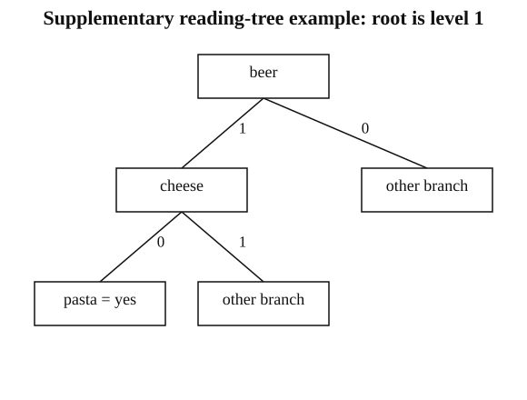
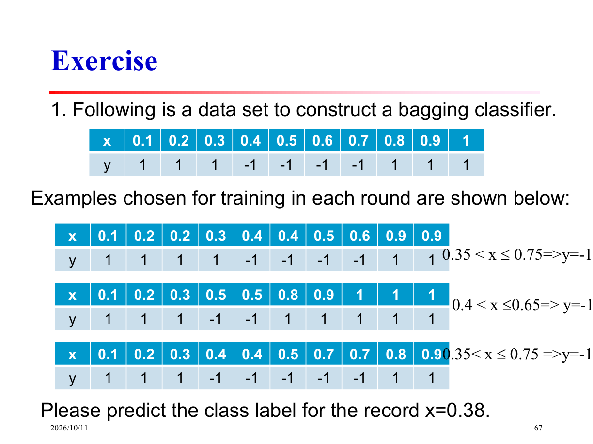

# 过拟合、评估与选模

[返回题型索引](../题型索引.md) · [网页练习](../index.html#type=evaluation)

同数据同题合并列出多处来源；题目文字为转录整理，原扫描页保留供核对。

## E17-03 · 决策树过拟合：历年重复简答

来源：2017 年扫描卷 · Q3 / 5 points · PDF p.1；2020 年扫描卷 · Q3(1-2) / 8 points · PDF p.1

状态：完整；形式：历年简答。

### 原文

How to overcome overfitting in decision trees? What is overfitting?

怎样克服决策树过拟合？什么是过拟合？

### 逐步解答

过拟合指模型连训练样本中的偶然噪声也拟合了，训练误差低而对未见数据的泛化较差。

1. **Pre-pruning 预剪枝：** 限制最大深度、最小分裂/叶样本数、最小增益等，提前停止不可靠分裂。优点是省训练成本；可能过早停止而欠拟合。
2. **Post-pruning 后剪枝：** 先生成树，再用验证误差或误差估计、代价复杂度等剪去不能改善泛化的子树。允许保留早期看似弱但后续有用的分裂。
3. 用独立验证集或交叉验证选择树的复杂度；用未参与拟合的数据检查泛化表现。增加高质量数据、处理错误标签也有帮助。

复杂度惩罚示例 $R_\alpha(T)=R(T)+\alpha|Leaves(T)|$，α 越大越偏向小树；这里是说明一种剪枝准则，不表示 C5.0 就直接采用这条公式。

### English answer pattern

Overfitting means fitting noise in the training data and generalizing poorly. Use pre-pruning or post-pruning and select complexity on validation data.

过拟合指拟合训练噪声，泛化表现差。采用预剪枝或后剪枝，并用验证数据选择复杂度。

---

## E20-03D · 2020：神经网络过拟合的防治

来源：2020 年扫描卷 · Q3(4) / 6 points · PDF p.1

状态：完整；形式：历年简答。

### 原文

A neural network classifier may consist of multiple hidden layers. How to overcome overfitting in a neural network classifier?

神经网络分类器可能包含多个隐藏层。怎样克服神经网络分类器的过拟合？

### 逐步解答

可选三至四项展开：

1. **Regularization 正则化**：在数据损失之外增加权重惩罚：

$$\mathcal L=\mathcal L_{data}+\lambda\|W\|_F^2.$$

$\lambda$ 控制惩罚强度，通过验证集选择。
2. **Early stopping 提前停止**：监测验证损失，在继续训练已不能改善泛化时停止，恢复最佳轮次参数。
3. **Reduce capacity 减小容量**：减少隐藏单元/层或参数；过度缩减会欠拟合。
4. **More representative data / augmentation**：增加有效数据；增强操作须保持标签语义。
5. **Dropout**：训练时随机屏蔽部分单元，减少共同适应，推理时使用对应缩放约定。

输入标准化通常改善优化，不等价于防过拟合；BatchNorm 也不能替代独立验证与正则化。测试集只能用于最终评价，不能逐轮看测试集来早停。

### English answer pattern

Use weight regularization, early stopping, capacity control, appropriate data augmentation or dropout, with hyperparameters selected on validation data.

使用权重正则化、提前停止、容量控制、适当的数据增强或 Dropout，并在验证数据上选择超参数。

---

## HW3-LAB1 · 银行实验转手算：混淆矩阵与选树

来源：当前 HW3 · Lab Q1；往届 HW2（hxd） · Lab Q1 (pruning parameter differs)

状态：完整；形式：作业提炼 / 评估。

### 原文

Build PEP decision trees with minimum records per child 56,15,10; compare validation confusion matrices and choose a model for holdout scoring. Current pruning severity is 70; the older homework uses 75.

分别以每个子节点最少记录数 56、15、10 构建 PEP 决策树；比较验证集混淆矩阵，选择模型为留出集打分。当前剪枝严重度为 70，往届作业使用 75。

### 逐步解答

#### 1. 先确定正类与公式

正类取 $PEP=YES$。TP 为正确预测购买，FP 为误报购买，FN 为漏掉购买，TN 为正确预测不购买。

$$\begin{aligned}
Accuracy&=\frac{TP+TN}{TP+FP+FN+TN},&Precision&=\frac{TP}{TP+FP},\\
Recall&=\frac{TP}{TP+FN},&Specificity&=\frac{TN}{TN+FP}.
\end{aligned}$$

#### 2. 把验证矩阵转成可比较指标

以下为练习计算的补充数据，非软件原始输出：A 的 $(TP,FP,FN,TN)=(30,10,20,140)$，B 为 $(38,22,12,128)$。两者总样本数都为 200。

| 指标 | 模型 A | 模型 B |
| --- | --- | --- |
| Accuracy | $(30+140)/200=0.85$ | $(38+128)/200=0.83$ |
| Precision | $30/(30+10)=0.75$ | $38/(38+22)=0.633333$ |
| Recall | $30/(30+20)=0.60$ | $38/(38+12)=0.76$ |
| Specificity | $140/150=0.933333$ | $128/150=0.853333$ |

#### 3. 根据选择标准给出结论

若只最大化准确率，选 **A**。若漏判代价更高，使用

$$Cost=C_{FN}\,FN+C_{FP}\,FP.$$

取 $C_{FN}=3,C_{FP}=1$ 的补充业务设定，A 成本为 $3\times20+10=70$，B 为 $3\times12+22=58$，此时选 **B**。说明选择指标后再给结论，最后用选定模型为 holdout 打分。

### English answer pattern

Select on validation performance and business costs, not training accuracy or tree size alone.

根据验证表现与业务成本选择模型，不能只看训练准确率或树大小。

---

## HW2-LAB · 从树路径提取规则与新样本预测

来源：当前 HW2 · Lab 1-3；往届 HW3（hxd） · Lab Prediction

状态：完整；形式：作业提炼 / 读树。

### 原文

Build a C5.0 tree for pasta, predict 20 rollout customers, and report positive purchase rules up to the fifth level with the root counted as level 1.

为 pasta 构建 C5.0 树，预测 20 位推广顾客，并报告到第五层为止的正类购买规则，根计为第 1 层。

### 逐步解答

#### 1. 从根到叶做一次预测

对待预测样本，从根节点读取分裂属性，沿满足条件的边到下一节点，直到叶节点；叶标签就是预测结果。若叶节点还记录类比例，可同时报告其样本数与类别比例。

#### 2. 把路径条件转为规则

下面是便于读树的**补充路径示例**，非 pasta 软件实验输出：

样本 $(beer=1,cheese=0)$ 先走 beer=1，再走 cheese=0，到达 yes 叶节点。所以

$$beer=1\ \land\ cheese=0\ \Rightarrow\ pasta=yes.$$

每个 yes 叶节点对应一条这种路径规则；条件取整条路径的合取。对 20 名 rollout 客户，分别执行同样的路径判断。

#### 3. 五层限制怎么数

根计为 level 1，图中 cheese 为 level 2，yes 叶为 level 3。到 level 5 的叶最多经过四条边，最多有四个分支测试条件。若 level 5 仍是内部节点，应继续区分其下方预测，或明确采用截断后多数类标记；输出规则应注明相应处理。

### English answer pattern

Conjoin the edge tests along each root-to-positive-leaf path. Count the root as level one.

将每条根到正类叶路径上的边条件作合取。根计为第 1 层。

---

## HX2-LAB2 · 往届学习行为预测：模型选择与泄漏

来源：往届 HW2（hxd） · Lab Q2 考试成绩预测

状态：实验题提炼；未重跑软件；形式：作业提炼 / 设计。

### 原文

Predict final-exam pass/fail from online learning behavior. Training data have 873 records and the supplied test data 461 records. Try decision trees, neural networks or logistic regression with different parameters and report a confusion matrix.

根据在线学习行为预测期末考试通过或不通过。训练数据有 873 条，所给测试数据有 461 条。尝试不同参数的决策树、神经网络或逻辑回归，并报告混淆矩阵。

### 逐步解答

#### 1. 先划清训练、验证、测试的用途

训练集估计权重/树分裂；验证集或交叉验证选择超参数及阈值；测试集最后评价选好的方案。若反复根据测试分数改参数，选择过程也会适应该批数据，使最后分数偏乐观。

#### 2. 执行实验步骤

1. 定义正类：及格=1、不及格=0。人员ID用作标识，不直接当连续预测特征。确认所有输入是在预测时点之前可获得的行为；期末之后产生的字段会泄漏答案。

2. 在873条训练数据内部划分验证集或做交叉验证，用验证表现调节树深度/最小叶样本、网络容量/早停、逻辑回归正则化；数值缩放只在各训练折拟合。

3. 选定模型及阈值后再在461条给定测试数据上汇报TP、FP、FN、TN，并计算precision、recall、F1；若原作业使用“测试集”反复选模，须说明它事实上承担验证集作用，最终泛化还需新留出集。

4. 类别不平衡时，全部预测为多数类也可能准确率很高。若重点提前识别不及格学生，可把不及格重新定义为业务正类并完整重算指标；不能只换解释而不换分母。

#### 3. 从得到的矩阵计算评价指标

声明正类后，用 TP、FP、FN、TN 代入：

$$Accuracy=\frac{TP+TN}{N},\quad Precision=\frac{TP}{TP+FP},\quad Recall=\frac{TP}{TP+FN}.$$

$$F_1=\frac{2TP}{2TP+FP+FN},\qquad Specificity=\frac{TN}{TN+FP}.$$

在报告中同时列出实际混淆矩阵和这些计算；本题没有给定固定的手算矩阵，数值由实际模型预测产生。

### English answer pattern

Tune on training/validation data, prevent temporal leakage, and evaluate the selected model on held-out records with a clearly defined positive class.

在训练或验证数据上调参，防止时间泄漏；明确正类后，在留出记录上评价选定模型。

### 易错点与约定

不同学习者的重复记录可能需要按人分组划分；同一人同时出现在训练与测试中可能高估泛化。

### 计算与内存分析

模型比较次数乘以单次训练与验证成本；交叉验证K折使训练成本大致再乘K。

---

## E25-05 · 2025 · 第5题：过拟合定义及神经网络的防治

来源：2025 年人工智能学院回忆卷 · Q5 · PDF p.2

状态：完整复原练习；形式：回忆复原 / 完整练习。

**复原依据：**回忆为简答：说明 overfitting，解释如何解决神经网络过拟合。

**补配与口径：**

- 将简答的作答深度明确为“定义 + 训练/验证表现 + 至少三项带机理的措施 + 选参纪律”。

以下为可完整作答的复原练习；补配数值不是原卷原值。

### 原文

**(a)** What is overfitting? Explain its typical effect on training and validation performance.

**(a)** 什么是过拟合？解释它对训练和验证表现的典型影响。

**(b)** Describe at least three methods for reducing overfitting in a neural network classifier. Explain the mechanism of each method.

**(b)** 描述至少三种减轻神经网络分类器过拟合的方法。解释每种方法的机制。

**(c)** State how regularization strengths and the stopping epoch should be selected without using the test set for repeated tuning.

**(c)** 说明怎样选择正则化强度与停止训练的轮次，同时不反复使用测试集调参。

### 小问要求与完成标准

| 小问 | 必须交付 | 完整程度 |
| --- | --- | --- |
| (a) | 定义 overfitting，并说明训练与验证误差的典型差异 | 2—3 句，提到泛化。 |
| (b) | 至少 3 种减轻神经网络过拟合的措施 | 每种写名称与起作用的方式；不是只列术语。 |
| (c) | 说明在哪个数据集上选超参数与早停轮次 | 验证集/交叉验证；测试集保留作最终评价。 |

### 逐步解答

#### 过拟合的含义与判断

过拟合（overfitting）是模型过度适应训练集中的噪声和偶然规律，对未见数据的预测能力下降。典型学习曲线是训练损失持续下降，验证损失先下降、到达最低点后上升。应结合连续多轮趋势判断。

#### 常用公式及含义

设 $p_{i,y_i}$ 为模型给样本 $i$ 的真实类别 $y_i$ 分配的概率。分类交叉熵损失与 L2 正则目标可写为：

$$\begin{aligned}
\mathcal L_{data}(\theta)&=-\frac1n\sum_{i=1}^{n}\log p_{i,y_i},\\
\mathcal J(\theta)&=\mathcal L_{data}(\theta)+\lambda\sum_{\ell}\|W^{(\ell)}\|_F^2,\\
t^*&=\arg\min_t\mathcal L_{val}(\theta_t).
\end{aligned}$$

真实类别概率越大，交叉熵越小。第二项惩罚过大的权重，$\lambda$ 控制惩罚强度；$\|W\|_F^2$ 为矩阵全部权重的平方和。$t^*$ 是验证损失最低的训练轮次；早停后恢复该轮保存的权重。若题目采用平方误差，沿用题给损失，正则与验证的思路相同。

#### 至少三种措施及原理

| 措施 | 原理 | 参数如何选 |
| --- | --- | --- |
| L2 regularization（L2 正则） | 限制权重幅值，减少对个别样本的过度拟合。 | 验证集选择 $\lambda$。 |
| Early stopping（早停） | 验证损失不再改善时停止，保留验证最优模型。 | 用验证曲线确定轮次及 patience。 |
| Dropout（随机失活） | 训练时随机屏蔽部分单元，减少单元共同适应。 | 验证集选失活比例；推理采用对应实现的缩放规则。 |
| Capacity control（容量控制） | 减少层数或隐藏单元，限制可拟合的复杂度。 | 验证集比较容量；过小会欠拟合。 |
| More data / augmentation（更多数据、数据增强） | 增加有效训练样本，减少对有限样本的记忆。 | 增强方式应保持标签语义。 |

#### 模型选择与最终评价

训练集拟合权重；验证集或交叉验证选择模型容量、正则强度和停止轮次；最终测试集评价选好的模型。比较多个方案时保持相同的数据划分与评价指标，使差别能反映方案本身。小样本时可用 $k$ 折交叉验证，平均验证误差为

$$\overline E_{CV}=\frac1k\sum_{j=1}^{k}E_j.$$

按验证指标选定方案后，锁定超参数与训练规则，再进行最终测试评价。

#### 最终答案的组织

先说明“训练表现继续改善、验证表现变差”的典型现象；选三种措施逐项解释机理；最后交代验证选参、测试评价的分工。

### English answer pattern

Overfitting occurs when a model learns noise or accidental details in the training set and generalizes poorly. Training loss may keep decreasing while validation loss increases. L2 regularization penalizes large weights; early stopping restores the model at the best validation epoch; dropout reduces co-adaptation of hidden units. Reducing unnecessary model capacity and adding representative, label-preserving training data can also help. Select hyperparameters on validation data or cross-validation, and reserve the test set for final evaluation.

模型学习训练噪声或偶然细节、泛化表现差时，发生过拟合。训练损失可能继续下降，而验证损失上升。L2 正则化惩罚大权重；提前停止恢复验证表现最佳轮次的模型；Dropout 减少隐藏单元共同适应。减少多余模型容量，增加有代表性且保持标签的训练数据，也有帮助。用验证集或交叉验证选择超参数，保留测试集用于最终评价。

### 易错点与约定

每种方法要说明它怎样限制拟合噪声，并交代如何用验证数据选择设置。Batch normalization 与输入缩放不能保证消除过拟合。

---

## PPT-CL67 · 课件 · Bagging 的三轮预测与多数投票

来源：当前完整七讲课件 · classification.pdf · Exercise 1 · PDF p.67

状态：完整课件练习；形式：课件计算 / 逐步练习。

### 原文

Following is a data set to construct a bagging classifier. Examples chosen for training in each round are shown below. Please predict the class label for the record x=0.38.

下面是用于构造 Bagging 分类器的数据集。各轮选出的训练样本如下。请预测记录 x=0.38 的类别标签。

原图中 Examples chosen for training in each round 为“每轮选作训练的样本”；各区间给出预测为 -1 的范围。

### 逐步解答

#### 1. 先理解本题的三个模型

课件已根据三次有放回抽样给出分类区间，手算预测时分别代入三个模型。

#### 2. 逐轮代入 0.38

| 模型 | $-1$ 区间 | 0.38 是否在区间内 | 模型预测 |
| --- | --- | --- | --- |
| $h_1$ | $0.35<x\le0.75$ | 是 | $-1$ |
| $h_2$ | $0.4<x\le0.65$ | 否，$0.38<0.4$ | $+1$ |
| $h_3$ | $0.35<x\le0.75$ | 是 | $-1$ |

#### 3. Bagging 多数投票

$$\hat y=\operatorname{mode}\{h_1(0.38),h_2(0.38),h_3(0.38)\}
=\operatorname{mode}\{-1,+1,-1\}=\boxed{-1}.$$

Bagging 对这些基分类器等权投票，负类获得 2 票。三次训练集通过有放回抽样产生，因此同一原记录可在一轮中重复出现。

### English answer pattern

The three classifiers predict -1,+1,-1. Equal-weight majority voting therefore predicts -1 for x=0.38.

三个分类器分别预测 -1、+1、-1。因此等权多数投票对 x=0.38 预测为 -1。

---

## PPT-CL84 · 课件 · 由课件混淆矩阵计算四个指标

来源：当前完整七讲课件 · classification.pdf · Exercise 1 · PDF p.84；当前完整七讲课件 · classification.pdf · Exercise 1 答案页 · PDF p.85

状态：完整课件练习；形式：课件计算 / 逐步练习。

### 原文

Please compute the sensitivity, specificity, precision and accuracy of the classifier.

请计算该分类器的灵敏度、特异度、精确率和准确率。

| Actual / Predicted | buy_computer=yes | buy_computer=no | Total |
| --- | --- | --- | --- |
| yes | 6954 | 46 | 7000 |
| no | 412 | 2588 | 3000 |
| Total | 7366 | 2634 | 10000 |

行是真实类别，列是预测类别；以 buys_computer=yes 为正类。

### 逐步解答

#### 1. 按真实行与预测列确定四个数

正类 yes 的 7000 人中，预测对的 6954 为 $TP$，漏掉的 46 为 $FN$；负类 no 的 3000 人中，误报的 412 为 $FP$，预测对的 2588 为 $TN$。

$$TP=6954,\ FN=46,\ FP=412,\ TN=2588.$$

#### 2. 选择分母并代入

| 指标 | 要回答的问题 | 公式与代入 | 结果 |
| --- | --- | --- | --- |
| Sensitivity / Recall | 真实正类找回多少？ | $TP/(TP+FN)=6954/7000$ | 99.3429% |
| Specificity | 真实负类排除多少？ | $TN/(TN+FP)=2588/3000$ | 86.2667% |
| Precision | 预测为正的有多少是真的？ | $TP/(TP+FP)=6954/7366$ | 94.4067% |
| Accuracy | 全部样本有多少判对？ | $(TP+TN)/N=9542/10000$ | 95.42% |

#### 3. 用计数核对

$$TP+FN=7000,\quad TN+FP=3000,\quad TP+FP=7366,\quad N=10000.$$

Recall 按真实正类行求比例，Precision 按预测正类列求比例；先看矩阵轴再写公式，可以避免分母混用。

### English answer pattern

Sensitivity is 99.3429%, specificity is 86.2667%, precision is 94.4067%, and accuracy is 95.42%.

灵敏度为 99.3429%，特异度为 86.2667%，精确率为 94.4067%，准确率为 95.42%。
