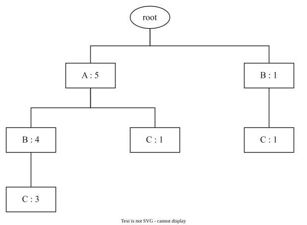
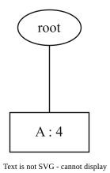

# FP-tree 与条件挖掘

[返回题型索引](../题型索引.md) · [网页练习](../index.html#type=fp)

同数据同题合并列出多处来源；题目文字为转录整理，原扫描页保留供核对。

<a id="E16-02B"></a>

## E16-02B · 2016 / 2020：十笔交易 FP-growth

来源：2016 年扫描卷 · Q2(b) / 10 points · PDF p.1；2020 年扫描卷 · Q4(1) / 10 points · PDF p.1

状态：完整；形式：计算 / 推导。

### 原文

Find all frequent itemsets using FP-growth. Present the FP-tree, conditional pattern bases and conditional FP-trees for every item. min_support=50%.

用 FP-growth 找出全部频繁项集。给出 FP 树，以及每个物品的条件模式基和条件 FP 树。最小支持度为 50%。

| TID | Items |
| --- | --- |
| 1 | a, b, e |
| 2 | a, b, c, e |
| 3 | a, b, d, e |
| 4 | a, c, d, e |
| 5 | b, c, e |
| 6 | b, d, e |
| 7 | c, d |
| 8 | a, b, c |
| 9 | a, b, e |
| 10 | a, b, e |

### 逐步解答

固定全局顺序（支持计数降序，同频按字母序）：b:8, e:8, a:7, c:5。计数阈值始终是 5，不能在条件数据库内重新按比例降低阈值。

```text
root
├─ b:8
│  ├─ e:7
│  │  ├─ a:5
│  │  │  └─ c:1
│  │  └─ c:1
│  └─ a:1
│     └─ c:1
├─ e:1
│  └─ a:1
│     └─ c:1
└─ c:1
```

| Suffix | Conditional pattern base (weighted) | Filtered conditional paths | All emitted patterns |
| --- | --- | --- | --- |
| c | bea:1; ea:1; be:1; ba:1 | ∅ | c:5 |
| a | be:5; e:1; b:1 | b→e:5; e:1; b:1 | a:7; ab:6; ae:6; abe:5 |
| e | b:7 | b:7 | e:8; be:7 |
| b | ∅ | ∅ | b:8 |

路径后的数是该前缀的权重，不能只数不同路径数；后缀本身不放进自己的前缀路径。条件路径共享前缀时合并计数；上表同时给出可重建每棵条件树的过滤路径。每个频繁项集按最后一个全局排序项唯一归入一行，避免漏列或重复。

### English answer pattern

A conditional pattern base contains weighted prefix paths leading to the suffix item. Keep the original minimum support count in conditional mining.

条件模式基包含通向后缀项的带权前缀路径。条件挖掘保持原始最小支持计数。

### 易错点与约定

同频项顺序可能不同，树形可变，但支持计数与最终频繁项集必须一致。

### 计算与内存分析

建主树常需两遍原库扫描；条件树递归仍耗 CPU 和内存，输出频繁项集最坏有 2^m−1 个。


---

<a id="E17-05"></a>

## E17-05 · 2017：min_sup=30% 的完整条件挖掘

来源：2017 年扫描卷 · Q5 / 15 points · PDF p.1

状态：完整；形式：计算 / 推导。

### 原文

Find all frequent itemsets using FP-growth. Present the FP-tree, conditional pattern bases and conditional FP-trees for every item. min_support=30%.

用 FP-growth 找出全部频繁项集。给出 FP 树，以及每个物品的条件模式基和条件 FP 树。最小支持度为 30%。

| TID | Items |
| --- | --- |
| 1 | a, b, d |
| 2 | b, c, d |
| 3 | a, b, d |
| 4 | a, b, c, d |
| 5 | b, c, d |
| 6 | b, d |
| 7 | c, d |
| 8 | a, b, c |
| 9 | a, d |
| 10 | b, d |

### 逐步解答

固定全局顺序（支持计数降序，同频按字母序）：d:9, b:8, a:5, c:5。计数阈值始终是 3，不能在条件数据库内重新按比例降低阈值。

```text
root
├─ d:9
│  ├─ b:7
│  │  ├─ a:3
│  │  │  └─ c:1
│  │  └─ c:2
│  ├─ c:1
│  └─ a:1
└─ b:1
   └─ a:1
      └─ c:1
```

| Suffix | Conditional pattern base (weighted) | Filtered conditional paths | All emitted patterns |
| --- | --- | --- | --- |
| c | db:2; dba:1; d:1; ba:1 | d→b:3; d:1; b:1 | c:5; bc:4; cd:4; bcd:3 |
| a | db:3; b:1; d:1 | d→b:3; b:1; d:1 | a:5; ab:4; ad:4; abd:3 |
| b | d:7 | d:7 | b:8; bd:7 |
| d | ∅ | ∅ | d:9 |

路径后的数是该前缀的权重，不能只数不同路径数；后缀本身不放进自己的前缀路径。条件路径共享前缀时合并计数；上表同时给出可重建每棵条件树的过滤路径。每个频繁项集按最后一个全局排序项唯一归入一行，避免漏列或重复。

### English answer pattern

A conditional pattern base contains weighted prefix paths leading to the suffix item. Keep the original minimum support count in conditional mining.

条件模式基包含通向后缀项的带权前缀路径。条件挖掘保持原始最小支持计数。

### 易错点与约定

同频项顺序可能不同，树形可变，但支持计数与最终频繁项集必须一致。

### 计算与内存分析

建主树常需两遍原库扫描；条件树递归仍耗 CPU 和内存，输出频繁项集最坏有 2^m−1 个。


---

<a id="HW3-03"></a>

## HW3-03 · 当前 HW3：四笔交易的 FP-tree

来源：当前 HW3 · Written Q3

状态：完整；形式：计算 / 推导。

### 原文

Find all frequent itemsets using FP-growth. Present the FP-tree, conditional pattern bases and conditional FP-trees for every item. min_support=60%.

用 FP-growth 找出全部频繁项集。给出 FP 树，以及每个物品的条件模式基和条件 FP 树。最小支持度为 60%。

| TID | Items |
| --- | --- |
| 1 | A, B, C, D |
| 2 | A, B, C, D, E |
| 3 | A, B, E |
| 4 | A, B, D |

### 逐步解答

固定全局顺序（支持计数降序，同频按字母序）：A:4, B:4, D:3。计数阈值始终是 3，不能在条件数据库内重新按比例降低阈值。

```text
root
└─ A:4
   └─ B:4
      └─ D:3
```

| Suffix | Conditional pattern base (weighted) | Filtered conditional paths | All emitted patterns |
| --- | --- | --- | --- |
| D | AB:3 | A→B:3 | D:3; AD:3; BD:3; ABD:3 |
| B | A:4 | A:4 | B:4; AB:4 |
| A | ∅ | ∅ | A:4 |

路径后的数是该前缀的权重，不能只数不同路径数；后缀本身不放进自己的前缀路径。条件路径共享前缀时合并计数；上表同时给出可重建每棵条件树的过滤路径。每个频繁项集按最后一个全局排序项唯一归入一行，避免漏列或重复。

### English answer pattern

A conditional pattern base contains weighted prefix paths leading to the suffix item. Keep the original minimum support count in conditional mining.

条件模式基包含通向后缀项的带权前缀路径。条件挖掘保持原始最小支持计数。

### 易错点与约定

同频项顺序可能不同，树形可变，但支持计数与最终频繁项集必须一致。

### 计算与内存分析

建主树常需两遍原库扫描；条件树递归仍耗 CPU 和内存，输出频繁项集最坏有 2^m−1 个。


---

<a id="HX3-01B"></a>

## HX3-01B · 往届 HW3：五笔交易的条件模式基

来源：往届 HW3（hxd） · Written Q1(b)

状态：完整；形式：计算 / 推导。

### 原文

Find all frequent itemsets using FP-growth. Present the FP-tree, conditional pattern bases and conditional FP-trees for every item. min_support=40%.

用 FP-growth 找出全部频繁项集。给出 FP 树，以及每个物品的条件模式基和条件 FP 树。最小支持度为 40%。

| TID | Items |
| --- | --- |
| 1 | E, K, N, O |
| 2 | D, E, K, O, Y |
| 3 | A, E, K, O |
| 4 | C, K, M, U |
| 5 | C, E, I, K, O |

### 逐步解答

固定全局顺序（支持计数降序，同频按字母序）：K:5, E:4, O:4, C:2。计数阈值始终是 2，不能在条件数据库内重新按比例降低阈值。

```text
root
└─ K:5
   ├─ E:4
   │  └─ O:4
   │     └─ C:1
   └─ C:1
```

| Suffix | Conditional pattern base (weighted) | Filtered conditional paths | All emitted patterns |
| --- | --- | --- | --- |
| C | K:1; KEO:1 | K:2 | C:2; CK:2 |
| O | KE:4 | K→E:4 | O:4; EO:4; KO:4; EKO:4 |
| E | K:4 | K:4 | E:4; EK:4 |
| K | ∅ | ∅ | K:5 |

路径后的数是该前缀的权重，不能只数不同路径数；后缀本身不放进自己的前缀路径。条件路径共享前缀时合并计数；上表同时给出可重建每棵条件树的过滤路径。每个频繁项集按最后一个全局排序项唯一归入一行，避免漏列或重复。

### English answer pattern

A conditional pattern base contains weighted prefix paths leading to the suffix item. Keep the original minimum support count in conditional mining.

条件模式基包含通向后缀项的带权前缀路径。条件挖掘保持原始最小支持计数。

### 易错点与约定

同频项顺序可能不同，树形可变，但支持计数与最终频繁项集必须一致。

### 计算与内存分析

建主树常需两遍原库扫描；条件树递归仍耗 CPU 和内存，输出频繁项集最坏有 2^m−1 个。


---

<a id="E25-03"></a>

## E25-03 · 2025 · 第3题：FP-growth 全过程、效率比较和指定置信度

来源：2025 年人工智能学院回忆卷 · Q3 · PDF p.1

状态：完整复原练习；形式：回忆复原 / 完整练习。

**复原依据：**回忆要求画 FP-tree、各条件模式基与条件树、给出全部频繁项集，比较 Apriori/FP-growth，再计算指定 AB⇒C 的 confidence；未给 min_conf。

**补配与口径：**

- 补配 6 笔事务与 min_sup=50%。
- 同频按 A<B<C<D<E；规则小问只算给定规则，不另设 min_conf。

以下为可完整作答的复原练习；补配数值不是原卷原值。

### 原文

The transaction database is given below. Let $min\_sup=50\%$ and count transactions, not item occurrences. Use a descending singleton-frequency order; break equal frequencies alphabetically.

事务数据库如下。最小支持度为 50%，按事务计数，不按物品出现次数计数。使用单项频数降序；频数相同时按字母顺序。

| TID | Items |
| --- | --- |
| T1 | A, B, C |
| T2 | A, B, D |
| T3 | A, B, C, E |
| T4 | A, C, E |
| T5 | B, C |
| T6 | A, B, C |

**(a)** Use FP-growth to find **all nonempty frequent itemsets**. Show singleton counts, the filtered/ordered transactions, the main FP-tree and header counts, every conditional pattern base and conditional FP-tree, and the final itemsets with support counts. Continue conditional mining where needed.

**(a)** 用 FP-growth 找出**全部非空频繁项集**。给出单项计数、过滤并排序的事务、主 FP 树及头表计数、每个条件模式基和条件 FP 树，以及最终项集及支持计数。需要时继续条件挖掘。

**(b)** Compare Apriori and FP-growth in candidate generation, original-database scans and memory use. State a case where compression is weak.

**(b)** 从候选生成、原始数据库扫描、内存使用方面比较 Apriori 和 FP-growth。给出一种压缩较弱的情况。

**(c)** Calculate $conf(\{A,B\}\Rightarrow\{C\})$ and interpret it. No minimum confidence is specified; you are not asked to generate all rules.

**(c)** 计算并解释 $conf(\{A,B\}\Rightarrow\{C\})$。没有指定最小置信度；本问不要求生成全部规则。

### 小问要求与完成标准

| 小问 | 必须交付 | 完整程度 |
| --- | --- | --- |
| (a) | 单项频数、筛项排序、主 FP-tree、header table、条件模式基/条件树、所有频繁项集 | A/B/C 三个后缀均处理，空条件树写明；C 的条件树继续挖到 ABC。 |
| (b) | 比较候选生成、原库扫描、内存与不利情况 | 至少 3 个有解释的比较点，不只写“FP 更快”。 |
| (c) | AB⇒C 的 count(AB)、count(ABC)、confidence 和语义 | 只计算此规则，不枚举全部强规则，不自行加 min_conf。 |

### 逐步解答

#### 1. 阈值与第一次扫描

$$q=\lceil6\times0.5\rceil=3.$$

| Item | A | B | C | D | E |
| --- | --- | --- | --- | --- | --- |
| Count | 5 | 5 | 5 | 1 | 2 |
| Frequent? | yes | yes | yes | no | no |

保留 A、B、C；同频按字母序，固定全局顺序 $A\prec B\prec C$。

| TID | Filtered ordered sequence |
| --- | --- |
| T1 | A→B→C |
| T2 | A→B |
| T3 | A→B→C |
| T4 | A→C |
| T5 | B→C |
| T6 | A→B→C |

#### 2. 第二次扫描：建主树



头表总计为 A:5、B:5、C:5；B 的结点计数分成 4+1，C 分成 3+1+1。结点链将同名结点串联，不要把某一个结点计数误当该项总支持。

#### 3. 由低序后缀开始投影

| Suffix | Conditional pattern base | Conditional item totals | Kept conditional tree |
| --- | --- | --- | --- |
| C | $\langle A,B:3\rangle,\ \langle A:1\rangle,\ \langle B:1\rangle$ | A:4, B:4 | root→A:4→B:3；另有 root→B:1。 |
| B | $\langle A:4\rangle$ | A:4 | root→A:4。 |
| A | ∅ | ∅ | 空树；单项 A 仍须输出。 |


C 条件树中的 B 总支持是 $3+1=4$，因此保留**两个** B 结点，即使某一个结点计数为 1。进一步在 C 条件树中取后缀 B，其条件模式基为 $\langle A:3\rangle$，树为 root→A:3，得到 ABC:3。



全程仍用原整数阈值 $q=3$，不在条件库内改算 50%。空条件树表示无更长扩展，不表示删除后缀单项。

进一步的递归投影也须交代清楚：

| 当前后缀 | 条件模式基 | 条件树 / 停止 |
| --- | --- | --- |
| BC | $\langle A:3\rangle$ | root→A:3；得到 ABC:3。 |
| AC | ∅ | 空树；AC:4 已由 C 的投影得到。 |
| ABC | ∅ | 空树；三项模式结束。 |
| AB | ∅ | 空树；AB:4 已由 B 的投影得到。 |


#### 4. 汇总所有频繁项集

| Size | Itemset : count | 支持度 Support |
| --- | --- | --- |
| 1 | A:5, B:5, C:5 | 均为 $5/6$ |
| 2 | AB:4, AC:4, BC:4 | 均为 $4/6=2/3$ |
| 3 | ABC:3 | $3/6=1/2$ |

一共 **7 个**非空频繁项集。没有含 D/E 的频繁项集，因为其单项已低于阈值。

#### 5. 比较两种算法

| Aspect | Apriori | FP-growth |
| --- | --- | --- |
| 候选 | 逐层连接、子集剪枝，再对候选计数。 | 不显式产生 Apriori 式候选项集；靠条件投影与模式增长。 |
| 扫原库 | 通常每个候选层一次；层数多时 I/O 大。 | 建主树通常两遍原库；条件树递归另有计算。 |
| 内存 | 存候选及计数器；候选可能爆炸。 | 存主树、头表和递归条件树；共享前缀少时压缩弱。 |
| 最坏输出 | 频繁项集本身可指数多。 | 同样不能避免指数级显式输出。 |

#### 6. 指定规则的置信度

包含 AB 的事务为 T1、T2、T3、T6，共 4 笔；同时包含 C 的为 T1、T3、T6，共 3 笔。

$$conf(AB\Rightarrow C)=\frac{count(ABC)}{count(AB)}=\frac34=\boxed{75\%}.$$

读作：在购买 A 和 B 的事务中，有 75% 也购买 C。该规则的支持度按全部六笔事务计算，为 $3/6=50\%$；题目没有 min_conf，因此到数值和解释即可停止。

### English answer pattern

There are seven frequent itemsets: A, B, C, AB, AC, BC and ABC, with counts 5,5,5,4,4,4,3. The confidence of AB⇒C is 3/4=75%.

共有七个频繁项集：A、B、C、AB、AC、BC、ABC，计数分别为 5、5、5、4、4、4、3。AB⇒C 的置信度为 3/4=75%。

### 易错点与约定

条件模式基的路径不含后缀自身；路径权重必须计入支持。不要删去单个计数小于 3、但同项总计仍频繁的结点。

### 计算与内存分析

设原库总篮长为 $L$、项数为 $m$，首遍计数为 $O(L)$，每篮排序总成本还含 $\sum_t O(|t|\log|t|)$。设过滤后的总篮长为 $L_f$，主树与头表占 $O(L_f+m)$；递归峰值内存还要加上同时存活的条件树及投影工作区。显式输出最多可达 $2^m-1$ 个项集，不能由“两遍原库扫描”直接推出总时间 $O(N)$。
