# FP-tree 与条件挖掘

[返回题型索引](../题型索引.md) · [网页练习](../index.html#type=fp)

同数据同题合并列出多处来源；题目文字为转录整理，原扫描页保留供核对。

## E16-02B · 2016 / 2020：十笔交易 FP-growth

来源：2016 年扫描卷 · Q2(b) / 10 points · PDF p.1；2020 年扫描卷 · Q4(1) / 10 points · PDF p.1

状态：完整；形式：计算 / 推导。

### 本题公式 · FP-growth：节点计数与条件投影

设原事务数为 $N$、支持度阈值为 $s$：$q=\lceil Ns\rceil$，$supp(X)=count(X)/N$。

对后缀 $a$，其条件模式基由根到各 $a$ 节点之前的前缀路径组成；每条路径的权重为该 $a$ 节点计数。条件物品计数为包含它的路径权重之和。

同名节点计数相加得到该物品支持计数；筛选条件树时始终使用原 $q$，递归扩展后将后缀接回，最后列出全部项集及计数。

### 原文

Find all frequent itemsets using FP-growth. Present the FP-tree, conditional pattern bases and conditional FP-trees for every item. min_support=50%.

用 FP-growth 找出全部频繁项集。给出 FP 树，以及每个物品的条件模式基和条件 FP 树。最小支持度为 50%。

| TID | Items |
| --- | --- |
| 1 | a, b, e |
| 2 | a, b, c, e |
| 3 | a, b, d, e |
| 4 | a, c, d, e |
| 5 | b, c, e |
| 6 | b, d, e |
| 7 | c, d |
| 8 | a, b, c |
| 9 | a, b, e |
| 10 | a, b, e |

### 逐步解答

#### 1. 换算整数阈值，扫描单项

$$q=\left\lceil N\times min\_sup\right\rceil=\left\lceil 10\times 0.5\right\rceil=5.$$

| 物品 Item | 支持计数 Count | 是否保留 |
| --- | --- | --- |
| a | 7 | 保留 |
| b | 8 | 保留 |
| c | 5 | 保留 |
| d | 4 | 删去 |
| e | 8 | 保留 |

#### 2. 过滤并按固定顺序排列每笔事务

频繁单项按支持计数降序、同频按字母序排列：$b:8$、$e:8$、$a:7$、$c:5$。每笔事务均使用这个顺序。

| 事务 | 过滤后的序列 |
| --- | --- |
| T1 | $b\to e\to a$ |
| T2 | $b\to e\to a\to c$ |
| T3 | $b\to e\to a$ |
| T4 | $e\to a\to c$ |
| T5 | $b\to e\to c$ |
| T6 | $b\to e$ |
| T7 | $c$ |
| T8 | $b\to a\to c$ |
| T9 | $b\to e\to a$ |
| T10 | $b\to e\to a$ |

#### 3. 插入有序事务，构造主 FP-tree

从根沿已有前缀前进时计数加 1，缺少的路径新建节点。同名物品可以出现于多个分支；头表计数等于全部同名节点计数之和。

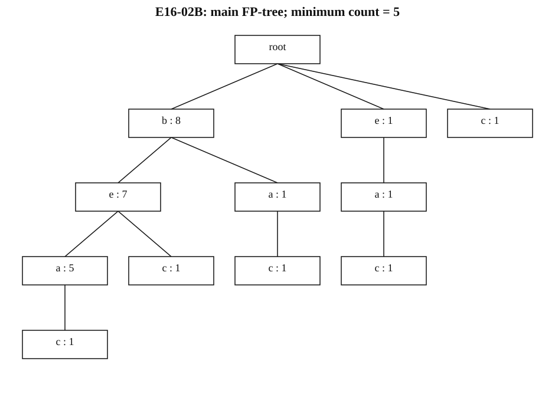

#### 4. 按后缀取条件模式基与条件树

后缀节点之前的路径构成前缀；路径的权重取该后缀节点计数。将相同前缀的权重相加，然后按条件物品的总计数筛选，整数阈值仍为 $q=5$。

**后缀 $c$。**

| 前缀路径 | 权重 |
| --- | --- |
| $b\to e\to a$ | 1 |
| $e\to a$ | 1 |
| $b\to e$ | 1 |
| $b\to a$ | 1 |

条件计数：$b:3$、$e:3$、$a:3$。

各条件物品计数均小于阈值，条件树为空。

该分支输出：$\{c\}:5$。

**后缀 $a$。**

| 前缀路径 | 权重 |
| --- | --- |
| $b\to e$ | 5 |
| $e$ | 1 |
| $b$ | 1 |

条件计数：$b:6$、$e:6$。

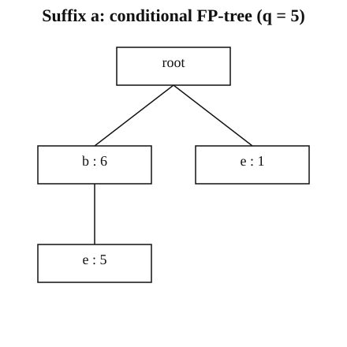

该分支输出：$\{a\}:7$；$\{a,b\}:6$；$\{a,e\}:6$；$\{a,b,e\}:5$。

继续挖掘条件树时，将新前缀与当前后缀拼接；每个项集只在其全局顺序最后一项的分支输出。

递归展开 $\{b,e,a\}$：在后缀 $a$ 的条件树中，再以 $e$ 为后缀取前缀路径。保留下来的 $b$ 计数为 $5\ge 5$，递归条件树如下；拼接当前后缀 $ea$，得到三项集 $bea:5$。

**后缀 $e$。**

| 前缀路径 | 权重 |
| --- | --- |
| $b$ | 7 |

条件计数：$b:7$。

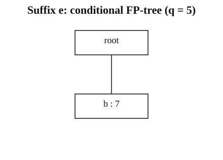

该分支输出：$\{e\}:8$；$\{b,e\}:7$。

**后缀 $b$。**

没有非空前缀路径，条件树为空。

该分支输出：$\{b\}:8$。

#### 5. 最终频繁项集与支持度

| 项集 | 计数 | 支持度 |
| --- | --- | --- |
| $\{a\}$ | 7 | $7/10$ |
| $\{b\}$ | 8 | $8/10$ |
| $\{c\}$ | 5 | $5/10$ |
| $\{e\}$ | 8 | $8/10$ |
| $\{a,b\}$ | 6 | $6/10$ |
| $\{a,e\}$ | 6 | $6/10$ |
| $\{b,e\}$ | 7 | $7/10$ |
| $\{a,b,e\}$ | 5 | $5/10$ |

共 **8 个**非空频繁项集。支持度统一除以原事务总数 $N=10$。

### English answer pattern

A conditional pattern base contains weighted prefix paths leading to the suffix item. Keep the original minimum support count in conditional mining.

条件模式基包含通向后缀项的带权前缀路径。条件挖掘保持原始最小支持计数。

### 易错点与约定

同频项顺序可能不同，树形可变，但支持计数与最终频繁项集必须一致。

### 计算与内存分析

建主树常需两遍原库扫描；条件树递归仍耗 CPU 和内存，输出频繁项集最坏有 2^m−1 个。

### 知识点与公式总结

- 先求 $q=\lceil N\,min\_sup\rceil$（本题 $N=10$、$min\_sup=0.5$），按单项频数降序过滤、重排事务，再合并共同前缀建 FP-tree。
- 取后缀的前缀路径形成条件模式基，路径权重取对应后缀节点计数；同名节点合计才是该项支持计数。
- 条件树继续用原整数门槛 q；递归挖掘后拼接当前后缀。空条件树仍保留频繁后缀单项，最后汇总全部长度的项集。

---

## E17-05 · 2017：min_sup=30% 的完整条件挖掘

来源：2017 年扫描卷 · Q5 / 15 points · PDF p.1

状态：完整；形式：计算 / 推导。

### 本题公式 · FP-growth：节点计数与条件投影

设原事务数为 $N$、支持度阈值为 $s$：$q=\lceil Ns\rceil$，$supp(X)=count(X)/N$。

对后缀 $a$，其条件模式基由根到各 $a$ 节点之前的前缀路径组成；每条路径的权重为该 $a$ 节点计数。条件物品计数为包含它的路径权重之和。

同名节点计数相加得到该物品支持计数；筛选条件树时始终使用原 $q$，递归扩展后将后缀接回，最后列出全部项集及计数。

### 原文

Find all frequent itemsets using FP-growth. Present the FP-tree, conditional pattern bases and conditional FP-trees for every item. min_support=30%.

用 FP-growth 找出全部频繁项集。给出 FP 树，以及每个物品的条件模式基和条件 FP 树。最小支持度为 30%。

| TID | Items |
| --- | --- |
| 1 | a, b, d |
| 2 | b, c, d |
| 3 | a, b, d |
| 4 | a, b, c, d |
| 5 | b, c, d |
| 6 | b, d |
| 7 | c, d |
| 8 | a, b, c |
| 9 | a, d |
| 10 | b, d |

### 逐步解答

#### 1. 换算整数阈值，扫描单项

$$q=\left\lceil N\times min\_sup\right\rceil=\left\lceil 10\times 0.3\right\rceil=3.$$

| 物品 Item | 支持计数 Count | 是否保留 |
| --- | --- | --- |
| a | 5 | 保留 |
| b | 8 | 保留 |
| c | 5 | 保留 |
| d | 9 | 保留 |

#### 2. 过滤并按固定顺序排列每笔事务

频繁单项按支持计数降序、同频按字母序排列：$d:9$、$b:8$、$a:5$、$c:5$。每笔事务均使用这个顺序。

| 事务 | 过滤后的序列 |
| --- | --- |
| T1 | $d\to b\to a$ |
| T2 | $d\to b\to c$ |
| T3 | $d\to b\to a$ |
| T4 | $d\to b\to a\to c$ |
| T5 | $d\to b\to c$ |
| T6 | $d\to b$ |
| T7 | $d\to c$ |
| T8 | $b\to a\to c$ |
| T9 | $d\to a$ |
| T10 | $d\to b$ |

#### 3. 插入有序事务，构造主 FP-tree

从根沿已有前缀前进时计数加 1，缺少的路径新建节点。同名物品可以出现于多个分支；头表计数等于全部同名节点计数之和。

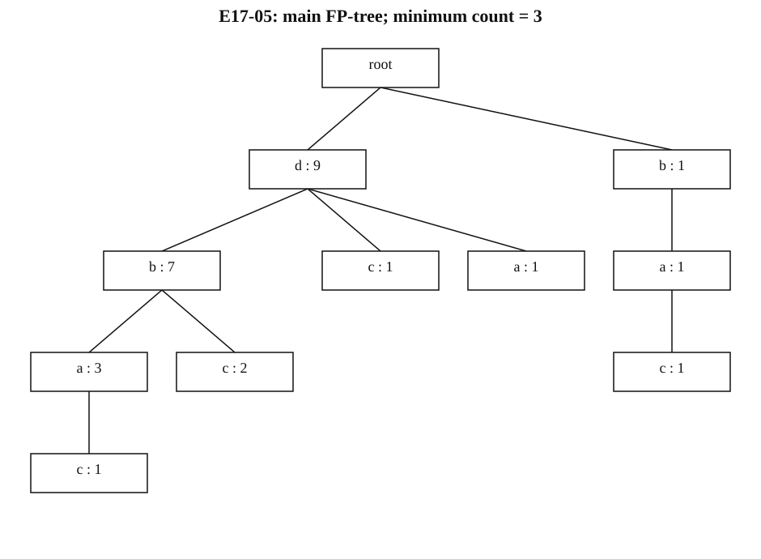

#### 4. 按后缀取条件模式基与条件树

后缀节点之前的路径构成前缀；路径的权重取该后缀节点计数。将相同前缀的权重相加，然后按条件物品的总计数筛选，整数阈值仍为 $q=3$。

**后缀 $c$。**

| 前缀路径 | 权重 |
| --- | --- |
| $d\to b$ | 2 |
| $d\to b\to a$ | 1 |
| $d$ | 1 |
| $b\to a$ | 1 |

条件计数：$d:4$、$b:4$、$a:2$。

该分支输出：$\{c\}:5$；$\{b,c\}:4$；$\{c,d\}:4$；$\{b,c,d\}:3$。

继续挖掘条件树时，将新前缀与当前后缀拼接；每个项集只在其全局顺序最后一项的分支输出。

递归展开 $\{d,b,c\}$：在后缀 $c$ 的条件树中，再以 $b$ 为后缀取前缀路径。保留下来的 $d$ 计数为 $3\ge 3$，递归条件树如下；拼接当前后缀 $bc$，得到三项集 $dbc:3$。

**后缀 $a$。**

| 前缀路径 | 权重 |
| --- | --- |
| $d\to b$ | 3 |
| $b$ | 1 |
| $d$ | 1 |

条件计数：$d:4$、$b:4$。

该分支输出：$\{a\}:5$；$\{a,b\}:4$；$\{a,d\}:4$；$\{a,b,d\}:3$。

继续挖掘条件树时，将新前缀与当前后缀拼接；每个项集只在其全局顺序最后一项的分支输出。

递归展开 $\{d,b,a\}$：在后缀 $a$ 的条件树中，再以 $b$ 为后缀取前缀路径。保留下来的 $d$ 计数为 $3\ge 3$，递归条件树如下；拼接当前后缀 $ba$，得到三项集 $dba:3$。

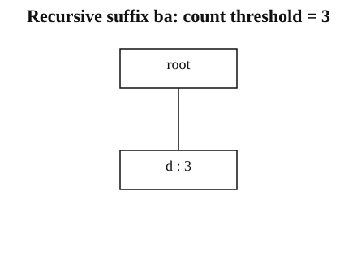

**后缀 $b$。**

| 前缀路径 | 权重 |
| --- | --- |
| $d$ | 7 |

条件计数：$d:7$。

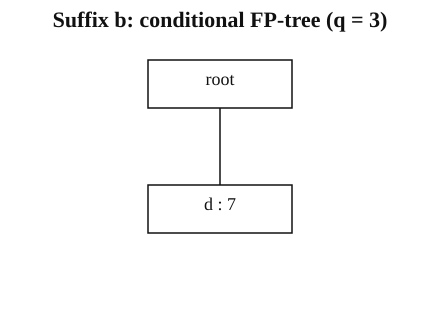

该分支输出：$\{b\}:8$；$\{b,d\}:7$。

**后缀 $d$。**

没有非空前缀路径，条件树为空。

该分支输出：$\{d\}:9$。

#### 5. 最终频繁项集与支持度

| 项集 | 计数 | 支持度 |
| --- | --- | --- |
| $\{a\}$ | 5 | $5/10$ |
| $\{b\}$ | 8 | $8/10$ |
| $\{c\}$ | 5 | $5/10$ |
| $\{d\}$ | 9 | $9/10$ |
| $\{a,b\}$ | 4 | $4/10$ |
| $\{a,d\}$ | 4 | $4/10$ |
| $\{b,c\}$ | 4 | $4/10$ |
| $\{b,d\}$ | 7 | $7/10$ |
| $\{c,d\}$ | 4 | $4/10$ |
| $\{a,b,d\}$ | 3 | $3/10$ |
| $\{b,c,d\}$ | 3 | $3/10$ |

共 **11 个**非空频繁项集。支持度统一除以原事务总数 $N=10$。

### English answer pattern

A conditional pattern base contains weighted prefix paths leading to the suffix item. Keep the original minimum support count in conditional mining.

条件模式基包含通向后缀项的带权前缀路径。条件挖掘保持原始最小支持计数。

### 易错点与约定

同频项顺序可能不同，树形可变，但支持计数与最终频繁项集必须一致。

### 计算与内存分析

建主树常需两遍原库扫描；条件树递归仍耗 CPU 和内存，输出频繁项集最坏有 2^m−1 个。

### 知识点与公式总结

- 先求 $q=\lceil N\,min\_sup\rceil$（本题 $N=10$、$min\_sup=0.3$），按单项频数降序过滤、重排事务，再合并共同前缀建 FP-tree。
- 取后缀的前缀路径形成条件模式基，路径权重取对应后缀节点计数；同名节点合计才是该项支持计数。
- 条件树继续用原整数门槛 q；递归挖掘后拼接当前后缀。空条件树仍保留频繁后缀单项，最后汇总全部长度的项集。

---

## HW3-03 · 当前 HW3：四笔交易的 FP-tree

来源：当前 HW3 · Written Q3

状态：完整；形式：计算 / 推导。

### 本题公式 · FP-growth：节点计数与条件投影

设原事务数为 $N$、支持度阈值为 $s$：$q=\lceil Ns\rceil$，$supp(X)=count(X)/N$。

对后缀 $a$，其条件模式基由根到各 $a$ 节点之前的前缀路径组成；每条路径的权重为该 $a$ 节点计数。条件物品计数为包含它的路径权重之和。

同名节点计数相加得到该物品支持计数；筛选条件树时始终使用原 $q$，递归扩展后将后缀接回，最后列出全部项集及计数。

### 原文

Find all frequent itemsets using FP-growth. Present the FP-tree, conditional pattern bases and conditional FP-trees for every item. min_support=60%.

用 FP-growth 找出全部频繁项集。给出 FP 树，以及每个物品的条件模式基和条件 FP 树。最小支持度为 60%。

| TID | Items |
| --- | --- |
| 1 | A, B, C, D |
| 2 | A, B, C, D, E |
| 3 | A, B, E |
| 4 | A, B, D |

### 逐步解答

#### 1. 换算整数阈值，扫描单项

$$q=\left\lceil N\times min\_sup\right\rceil=\left\lceil 4\times 0.6\right\rceil=3.$$

| 物品 Item | 支持计数 Count | 是否保留 |
| --- | --- | --- |
| A | 4 | 保留 |
| B | 4 | 保留 |
| C | 2 | 删去 |
| D | 3 | 保留 |
| E | 2 | 删去 |

#### 2. 过滤并按固定顺序排列每笔事务

频繁单项按支持计数降序、同频按字母序排列：$A:4$、$B:4$、$D:3$。每笔事务均使用这个顺序。

| 事务 | 过滤后的序列 |
| --- | --- |
| T1 | $A\to B\to D$ |
| T2 | $A\to B\to D$ |
| T3 | $A\to B$ |
| T4 | $A\to B\to D$ |

#### 3. 插入有序事务，构造主 FP-tree

从根沿已有前缀前进时计数加 1，缺少的路径新建节点。同名物品可以出现于多个分支；头表计数等于全部同名节点计数之和。

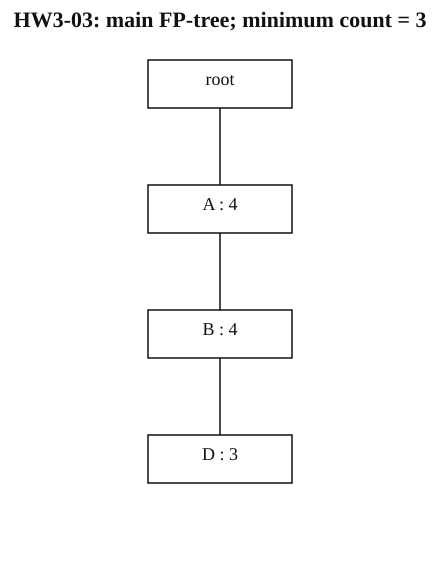

#### 4. 按后缀取条件模式基与条件树

后缀节点之前的路径构成前缀；路径的权重取该后缀节点计数。将相同前缀的权重相加，然后按条件物品的总计数筛选，整数阈值仍为 $q=3$。

**后缀 $D$。**

| 前缀路径 | 权重 |
| --- | --- |
| $A\to B$ | 3 |

条件计数：$A:3$、$B:3$。

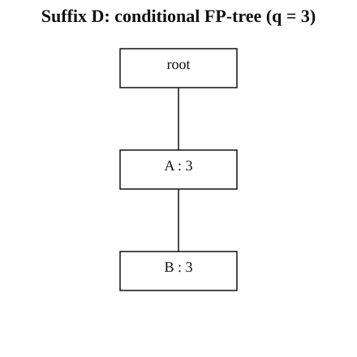

该分支输出：$\{D\}:3$；$\{A,D\}:3$；$\{B,D\}:3$；$\{A,B,D\}:3$。

继续挖掘条件树时，将新前缀与当前后缀拼接；每个项集只在其全局顺序最后一项的分支输出。

递归展开 $\{A,B,D\}$：在后缀 $D$ 的条件树中，再以 $B$ 为后缀取前缀路径。保留下来的 $A$ 计数为 $3\ge 3$，递归条件树如下；拼接当前后缀 $BD$，得到三项集 $ABD:3$。

**后缀 $B$。**

| 前缀路径 | 权重 |
| --- | --- |
| $A$ | 4 |

条件计数：$A:4$。

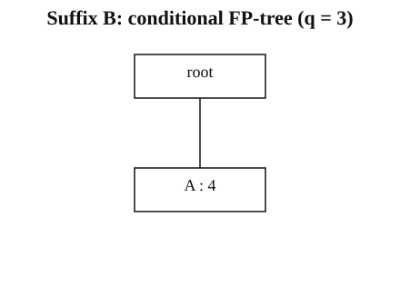

该分支输出：$\{B\}:4$；$\{A,B\}:4$。

**后缀 $A$。**

没有非空前缀路径，条件树为空。

该分支输出：$\{A\}:4$。

#### 5. 最终频繁项集与支持度

| 项集 | 计数 | 支持度 |
| --- | --- | --- |
| $\{A\}$ | 4 | $4/4$ |
| $\{B\}$ | 4 | $4/4$ |
| $\{D\}$ | 3 | $3/4$ |
| $\{A,B\}$ | 4 | $4/4$ |
| $\{A,D\}$ | 3 | $3/4$ |
| $\{B,D\}$ | 3 | $3/4$ |
| $\{A,B,D\}$ | 3 | $3/4$ |

共 **7 个**非空频繁项集。支持度统一除以原事务总数 $N=4$。

### English answer pattern

A conditional pattern base contains weighted prefix paths leading to the suffix item. Keep the original minimum support count in conditional mining.

条件模式基包含通向后缀项的带权前缀路径。条件挖掘保持原始最小支持计数。

### 易错点与约定

同频项顺序可能不同，树形可变，但支持计数与最终频繁项集必须一致。

### 计算与内存分析

建主树常需两遍原库扫描；条件树递归仍耗 CPU 和内存，输出频繁项集最坏有 2^m−1 个。

### 知识点与公式总结

- 先求 $q=\lceil N\,min\_sup\rceil$（本题 $N=4$、$min\_sup=0.6$），按单项频数降序过滤、重排事务，再合并共同前缀建 FP-tree。
- 取后缀的前缀路径形成条件模式基，路径权重取对应后缀节点计数；同名节点合计才是该项支持计数。
- 条件树继续用原整数门槛 q；递归挖掘后拼接当前后缀。空条件树仍保留频繁后缀单项，最后汇总全部长度的项集。

---

## HX3-01B · 往届 HW3：五笔交易的条件模式基

来源：往届 HW3（hxd） · Written Q1(b)

状态：完整；形式：计算 / 推导。

### 本题公式 · FP-growth：节点计数与条件投影

设原事务数为 $N$、支持度阈值为 $s$：$q=\lceil Ns\rceil$，$supp(X)=count(X)/N$。

对后缀 $a$，其条件模式基由根到各 $a$ 节点之前的前缀路径组成；每条路径的权重为该 $a$ 节点计数。条件物品计数为包含它的路径权重之和。

同名节点计数相加得到该物品支持计数；筛选条件树时始终使用原 $q$，递归扩展后将后缀接回，最后列出全部项集及计数。

### 原文

Find all frequent itemsets using FP-growth. Present the FP-tree, conditional pattern bases and conditional FP-trees for every item. min_support=40%.

用 FP-growth 找出全部频繁项集。给出 FP 树，以及每个物品的条件模式基和条件 FP 树。最小支持度为 40%。

| TID | Items |
| --- | --- |
| 1 | E, K, N, O |
| 2 | D, E, K, O, Y |
| 3 | A, E, K, O |
| 4 | C, K, M, U |
| 5 | C, E, I, K, O |

### 逐步解答

#### 1. 换算整数阈值，扫描单项

$$q=\left\lceil N\times min\_sup\right\rceil=\left\lceil 5\times 0.4\right\rceil=2.$$

| 物品 Item | 支持计数 Count | 是否保留 |
| --- | --- | --- |
| A | 1 | 删去 |
| C | 2 | 保留 |
| D | 1 | 删去 |
| E | 4 | 保留 |
| I | 1 | 删去 |
| K | 5 | 保留 |
| M | 1 | 删去 |
| N | 1 | 删去 |
| O | 4 | 保留 |
| U | 1 | 删去 |
| Y | 1 | 删去 |

#### 2. 过滤并按固定顺序排列每笔事务

频繁单项按支持计数降序、同频按字母序排列：$K:5$、$E:4$、$O:4$、$C:2$。每笔事务均使用这个顺序。

| 事务 | 过滤后的序列 |
| --- | --- |
| T1 | $K\to E\to O$ |
| T2 | $K\to E\to O$ |
| T3 | $K\to E\to O$ |
| T4 | $K\to C$ |
| T5 | $K\to E\to O\to C$ |

#### 3. 插入有序事务，构造主 FP-tree

从根沿已有前缀前进时计数加 1，缺少的路径新建节点。同名物品可以出现于多个分支；头表计数等于全部同名节点计数之和。

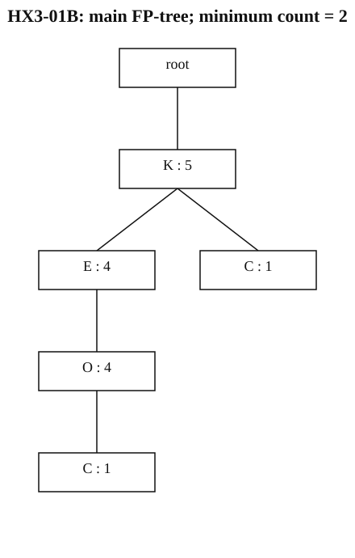

#### 4. 按后缀取条件模式基与条件树

后缀节点之前的路径构成前缀；路径的权重取该后缀节点计数。将相同前缀的权重相加，然后按条件物品的总计数筛选，整数阈值仍为 $q=2$。

**后缀 $C$。**

| 前缀路径 | 权重 |
| --- | --- |
| $K$ | 1 |
| $K\to E\to O$ | 1 |

条件计数：$K:2$、$E:1$、$O:1$。

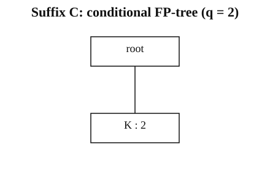

该分支输出：$\{C\}:2$；$\{C,K\}:2$。

**后缀 $O$。**

| 前缀路径 | 权重 |
| --- | --- |
| $K\to E$ | 4 |

条件计数：$K:4$、$E:4$。

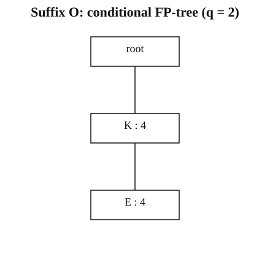

该分支输出：$\{O\}:4$；$\{E,O\}:4$；$\{K,O\}:4$；$\{E,K,O\}:4$。

继续挖掘条件树时，将新前缀与当前后缀拼接；每个项集只在其全局顺序最后一项的分支输出。

递归展开 $\{K,E,O\}$：在后缀 $O$ 的条件树中，再以 $E$ 为后缀取前缀路径。保留下来的 $K$ 计数为 $4\ge 2$，递归条件树如下；拼接当前后缀 $EO$，得到三项集 $KEO:4$。

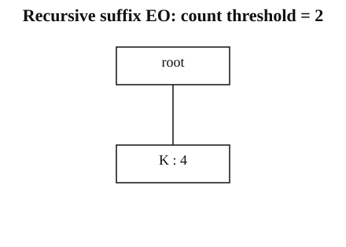

**后缀 $E$。**

| 前缀路径 | 权重 |
| --- | --- |
| $K$ | 4 |

条件计数：$K:4$。

该分支输出：$\{E\}:4$；$\{E,K\}:4$。

**后缀 $K$。**

没有非空前缀路径，条件树为空。

该分支输出：$\{K\}:5$。

#### 5. 最终频繁项集与支持度

| 项集 | 计数 | 支持度 |
| --- | --- | --- |
| $\{C\}$ | 2 | $2/5$ |
| $\{E\}$ | 4 | $4/5$ |
| $\{K\}$ | 5 | $5/5$ |
| $\{O\}$ | 4 | $4/5$ |
| $\{C,K\}$ | 2 | $2/5$ |
| $\{E,K\}$ | 4 | $4/5$ |
| $\{E,O\}$ | 4 | $4/5$ |
| $\{K,O\}$ | 4 | $4/5$ |
| $\{E,K,O\}$ | 4 | $4/5$ |

共 **9 个**非空频繁项集。支持度统一除以原事务总数 $N=5$。

### English answer pattern

A conditional pattern base contains weighted prefix paths leading to the suffix item. Keep the original minimum support count in conditional mining.

条件模式基包含通向后缀项的带权前缀路径。条件挖掘保持原始最小支持计数。

### 易错点与约定

同频项顺序可能不同，树形可变，但支持计数与最终频繁项集必须一致。

### 计算与内存分析

建主树常需两遍原库扫描；条件树递归仍耗 CPU 和内存，输出频繁项集最坏有 2^m−1 个。

### 知识点与公式总结

- 先求 $q=\lceil N\,min\_sup\rceil$（本题 $N=5$、$min\_sup=0.4$），按单项频数降序过滤、重排事务，再合并共同前缀建 FP-tree。
- 取后缀的前缀路径形成条件模式基，路径权重取对应后缀节点计数；同名节点合计才是该项支持计数。
- 条件树继续用原整数门槛 q；递归挖掘后拼接当前后缀。空条件树仍保留频繁后缀单项，最后汇总全部长度的项集。

---

## E25-03 · 2025 · 第3题：FP-growth 全过程、效率比较和指定置信度

来源：2025 年人工智能学院回忆卷 · Q3 · PDF p.1

状态：完整复原练习；形式：回忆复原 / 完整练习。

**复原依据：**回忆要求画 FP-tree、各条件模式基与条件树、给出全部频繁项集，比较 Apriori/FP-growth，再计算指定 AB⇒C 的 confidence；未给 min_conf。

**补配与口径：**

- 补配 6 笔事务与 min_sup=50%。
- 同频按 A<B<C<D<E；规则小问只算给定规则，不另设 min_conf。

以下为可完整作答的复原练习；补配数值不是原卷原值。

### 本题公式 · FP-growth 与指定规则置信度

设原事务数为 $N$、支持度阈值为 $s$：$q=\lceil Ns\rceil$，$supp(X)=count(X)/N$。

对后缀 $a$，其条件模式基由根到各 $a$ 节点之前的前缀路径组成；每条路径的权重为该 $a$ 节点计数。条件物品计数为包含它的路径权重之和。

同名节点计数相加得到该物品支持计数；筛选条件树时始终使用原 $q$，递归扩展后将后缀接回，最后列出全部项集及计数。

$X,Y$ 为非空且不相交的项集，$N$ 为事务总数，$count(Z)$ 为包含 Z 全部物品的事务数：

$$supp(X\Rightarrow Y)=\frac{count(X\cup Y)}N,\qquad conf(X\Rightarrow Y)=\frac{count(X\cup Y)}{count(X)}.$$

先数同时包含前后件的事务，再以前件计数为分母算置信度。

### 原文

The transaction database is given below. Let $min\_sup=50\%$ and count transactions, not item occurrences. Use a descending singleton-frequency order; break equal frequencies alphabetically.

事务数据库如下。最小支持度为 50%，按事务计数，不按物品出现次数计数。使用单项频数降序；频数相同时按字母顺序。

| TID | Items |
| --- | --- |
| T1 | A, B, C |
| T2 | A, B, D |
| T3 | A, B, C, E |
| T4 | A, C, E |
| T5 | B, C |
| T6 | A, B, C |

**(a)** Use FP-growth to find **all nonempty frequent itemsets**. Show singleton counts, the filtered/ordered transactions, the main FP-tree and header counts, every conditional pattern base and conditional FP-tree, and the final itemsets with support counts. Continue conditional mining where needed.

**(a)** 用 FP-growth 找出**全部非空频繁项集**。给出单项计数、过滤并排序的事务、主 FP 树及头表计数、每个条件模式基和条件 FP 树，以及最终项集及支持计数。需要时继续条件挖掘。

**(b)** Compare Apriori and FP-growth in candidate generation, original-database scans and memory use. State a case where compression is weak.

**(b)** 从候选生成、原始数据库扫描、内存使用方面比较 Apriori 和 FP-growth。给出一种压缩较弱的情况。

**(c)** Calculate $conf(\{A,B\}\Rightarrow\{C\})$ and interpret it. No minimum confidence is specified; you are not asked to generate all rules.

**(c)** 计算并解释 $conf(\{A,B\}\Rightarrow\{C\})$。没有指定最小置信度；本问不要求生成全部规则。

### 小问要求与完成标准

| 小问 | 必须交付 | 完整程度 |
| --- | --- | --- |
| (a) | 单项频数、筛项排序、主 FP-tree、header table、条件模式基/条件树、所有频繁项集 | A/B/C 三个后缀均处理，空条件树写明；C 的条件树继续挖到 ABC。 |
| (b) | 比较候选生成、原库扫描、内存与不利情况 | 至少 3 个有解释的比较点，不只写“FP 更快”。 |
| (c) | AB⇒C 的 count(AB)、count(ABC)、confidence 和语义 | 只计算此规则，不枚举全部强规则，不自行加 min_conf。 |

### 逐步解答

#### 本题计算的三个基础量

设 N 为原事务总数，$count(X)$ 为包含 X 全部物品的事务数，X 为前件：

$$q=\lceil N\,min\_sup\rceil,\quad supp(X)=\frac{count(X)}N,\quad conf(X\Rightarrow Y)=\frac{count(X\cup Y)}{count(X)}.$$

FP-growth 先用整数阈值筛项集；指定规则的置信度最后用前件计数作为分母。

#### 1. 阈值与第一次扫描

$$q=\lceil6\times0.5\rceil=3.$$

| Item | A | B | C | D | E |
| --- | --- | --- | --- | --- | --- |
| Count | 5 | 5 | 5 | 1 | 2 |
| Frequent? | yes | yes | yes | no | no |

保留 A、B、C；同频按字母序，固定全局顺序 $A\prec B\prec C$。

| TID | Filtered ordered sequence |
| --- | --- |
| T1 | A→B→C |
| T2 | A→B |
| T3 | A→B→C |
| T4 | A→C |
| T5 | B→C |
| T6 | A→B→C |

#### 2. 第二次扫描：建主树

头表总计为 A:5、B:5、C:5；B 的结点计数分成 4+1，C 分成 3+1+1。结点链将同名结点串联，不要把某一个结点计数误当该项总支持。

#### 3. 由低序后缀开始投影

| Suffix | Conditional pattern base | Conditional item totals | Kept conditional tree |
| --- | --- | --- | --- |
| C | $\langle A,B:3\rangle,\ \langle A:1\rangle,\ \langle B:1\rangle$ | A:4, B:4 | root→A:4→B:3；另有 root→B:1。 |
| B | $\langle A:4\rangle$ | A:4 | root→A:4。 |
| A | ∅ | ∅ | 空树；单项 A 仍须输出。 |

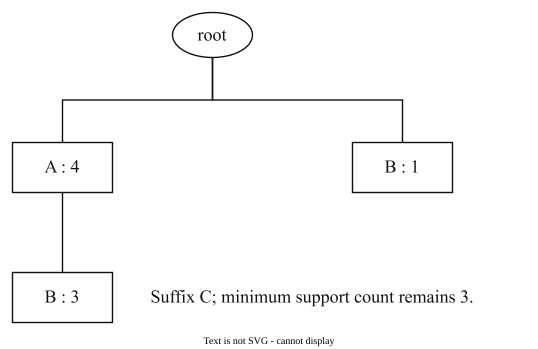

C 条件树中的 B 总支持是 $3+1=4$，因此保留**两个** B 结点，即使某一个结点计数为 1。进一步在 C 条件树中取后缀 B，其条件模式基为 $\langle A:3\rangle$，树为 root→A:3，得到 ABC:3。

全程仍用原整数阈值 $q=3$，不在条件库内改算 50%。空条件树表示无更长扩展，不表示删除后缀单项。

进一步的递归投影也须交代清楚：

| 当前后缀 | 条件模式基 | 条件树 / 停止 |
| --- | --- | --- |
| BC | $\langle A:3\rangle$ | root→A:3；得到 ABC:3。 |
| AC | ∅ | 空树；AC:4 已由 C 的投影得到。 |
| ABC | ∅ | 空树；三项模式结束。 |
| AB | ∅ | 空树；AB:4 已由 B 的投影得到。 |

#### 4. 汇总所有频繁项集

| Size | Itemset : count | 支持度 Support |
| --- | --- | --- |
| 1 | A:5, B:5, C:5 | 均为 $5/6$ |
| 2 | AB:4, AC:4, BC:4 | 均为 $4/6=2/3$ |
| 3 | ABC:3 | $3/6=1/2$ |

一共 **7 个**非空频繁项集。没有含 D/E 的频繁项集，因为其单项已低于阈值。

#### 5. 比较两种算法

| Aspect | Apriori | FP-growth |
| --- | --- | --- |
| 候选 | 逐层连接、子集剪枝，再对候选计数。 | 不显式产生 Apriori 式候选项集；靠条件投影与模式增长。 |
| 扫原库 | 通常每个候选层一次；层数多时 I/O 大。 | 建主树通常两遍原库；条件树递归另有计算。 |
| 内存 | 存候选及计数器；候选可能爆炸。 | 存主树、头表和递归条件树；共享前缀少时压缩弱。 |
| 最坏输出 | 频繁项集本身可指数多。 | 同样不能避免指数级显式输出。 |

#### 6. 指定规则的置信度

包含 AB 的事务为 T1、T2、T3、T6，共 4 笔；同时包含 C 的为 T1、T3、T6，共 3 笔。

$$conf(AB\Rightarrow C)=\frac{count(ABC)}{count(AB)}=\frac34=\boxed{75\%}.$$

读作：在购买 A 和 B 的事务中，有 75% 也购买 C。该规则的支持度按全部六笔事务计算，为 $3/6=50\%$；题目没有 min_conf，因此到数值和解释即可停止。

### English answer pattern

There are seven frequent itemsets: A, B, C, AB, AC, BC and ABC, with counts 5,5,5,4,4,4,3. The confidence of AB⇒C is 3/4=75%.

共有七个频繁项集：A、B、C、AB、AC、BC、ABC，计数分别为 5、5、5、4、4、4、3。AB⇒C 的置信度为 3/4=75%。

### 易错点与约定

条件模式基的路径不含后缀自身；路径权重必须计入支持。不要删去单个计数小于 3、但同项总计仍频繁的结点。

### 计算与内存分析

设原库总篮长为 $L$、项数为 $m$，首遍计数为 $O(L)$，每篮排序总成本还含 $\sum_t O(|t|\log|t|)$。设过滤后的总篮长为 $L_f$，主树与头表占 $O(L_f+m)$；递归峰值内存还要加上同时存活的条件树及投影工作区。显式输出最多可达 $2^m-1$ 个项集，不能由“两遍原库扫描”直接推出总时间 $O(N)$。

### 知识点与公式总结

- 先求 $q=\lceil N\,min\_sup\rceil$（本题 $N=6$、$min\_sup=0.5$），按单项频数降序过滤、重排事务，再合并共同前缀建 FP-tree。
- 取后缀的前缀路径形成条件模式基，路径权重取对应后缀节点计数；同名节点合计才是该项支持计数。
- 条件树继续用原整数门槛 q；递归挖掘后拼接当前后缀。空条件树仍保留频繁后缀单项，最后汇总全部长度的项集。
- 指定规则置信度 $conf(AB\Rightarrow C)=count(ABC)/count(AB)$；比较算法时分别说候选、扫描、内存与输出量。

---

## PPT-ARM49 · 课件 · 九笔事务的 FP 树、条件树和全部频繁项集

来源：当前完整七讲课件 · ARM.pdf · Exercise 3；pp.50–51 为课件解答 · PDF p.49

状态：完整课件练习；形式：课件计算 / 逐步练习。

### 本题公式 · FP-growth：节点计数与条件投影

设原事务数为 $N$、支持度阈值为 $s$：$q=\lceil Ns\rceil$，$supp(X)=count(X)/N$。

对后缀 $a$，其条件模式基由根到各 $a$ 节点之前的前缀路径组成；每条路径的权重为该 $a$ 节点计数。条件物品计数为包含它的路径权重之和。

同名节点计数相加得到该物品支持计数；筛选条件树时始终使用原 $q$，递归扩展后将后缀接回，最后列出全部项集及计数。

### 原文

A database has 9 transactions. Let min_sup = 20%. Please construct the FP-tree for the database, the conditional FP-trees, and all the frequent itemsets.

数据库有 9 笔事务。设最小支持度为 20%。请构造该数据库的 FP 树、条件 FP 树，并给出全部频繁项集。

| TID | List of items_IDs |
| --- | --- |
| T100 | I1,I2,I5 |
| T200 | I2,I4 |
| T300 | I2,I3 |
| T400 | I1,I2,I4 |
| T500 | I1,I3 |
| T600 | I2,I3 |
| T700 | I1,I3 |
| T800 | I1,I2,I3,I5 |
| T900 | I1,I2,I3 |

### 逐步解答

#### 1. 第一遍扫描：支持计数与排序

先将事务比例换成整数计数：

$$q=\lceil N\cdot min\_sup\rceil=\lceil9\times0.2\rceil=2.$$

其中 $count(X)$ 是包含 X 全部物品的事务数；项集频繁要求 $count(X)\ge q$，其支持度为 $count(X)/9$。单项计数为 $I_2:7,I_1:6,I_3:6,I_4:2,I_5:2$，全部保留。同频按编号小者在前，固定顺序：

$$I_2\prec I_1\prec I_3\prec I_4\prec I_5.$$

#### 2. 第二遍扫描：重排事务并合并相同前缀

| TID | 有序事务 |
| --- | --- |
| T100 | $I_2,I_1,I_5$ |
| T200 | $I_2,I_4$ |
| T300 | $I_2,I_3$ |
| T400 | $I_2,I_1,I_4$ |
| T500 | $I_1,I_3$ |
| T600 | $I_2,I_3$ |
| T700 | $I_1,I_3$ |
| T800 | $I_2,I_1,I_3,I_5$ |
| T900 | $I_2,I_1,I_3$ |

每插入一条事务，已有前缀节点计数加一，从首次分歧处创建新节点。

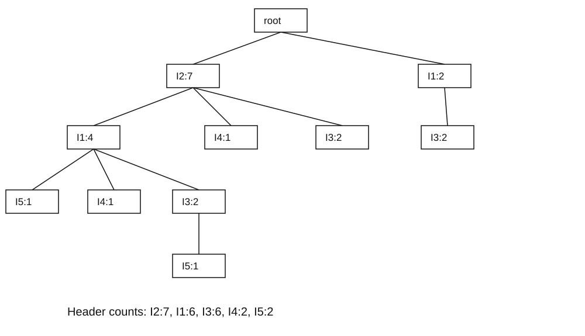

#### 3. 从叶端向根抽取条件模式基

节点计数是此前缀的事务数。抽取后缀 $x$ 的前缀路径时，路径权重取对应 $x$ 节点计数。

| 后缀 | 条件模式基（路径:权重） | 剪枝后的条件树 |
| --- | --- | --- |
| $I_5$ | $(I_2,I_1):1$；$(I_2,I_1,I_3):1$ | $I_2:2\to I_1:2$ |
| $I_4$ | $(I_2):1$；$(I_2,I_1):1$ | $I_2:2$ |
| $I_3$ | $(I_2):2$；$(I_1):2$；$(I_2,I_1):2$ | root 下 $I_2:4\to I_1:2$，另支 $I_1:2$ |
| $I_1$ | $(I_2):4$；空前缀:2 | $I_2:4$ |
| $I_2$ | 空前缀:7 | 空树 |

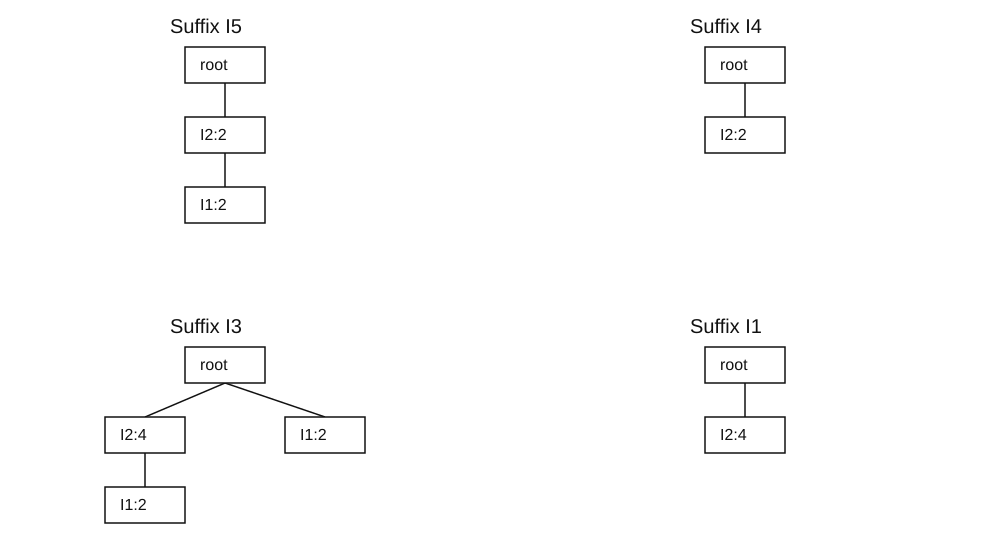

例如 $I_5$ 的条件模式基中，$I_3$ 只出现一次，未达到 2，被删除；$I_2,I_1$ 各出现两次，构成单链。条件树继续使用全库门槛 2。

#### 4. 递归挖掘并拼接后缀

从 $I_5$ 的单链得到 $I_5:2, I_1I_5:2,I_2I_5:2,I_1I_2I_5:2$。从 $I_4$ 得到 $I_4:2,I_2I_4:2$。

$I_3$ 条件树中，$I_1$ 的条件前缀为 $I_2:2$，所以继续得到三项集 $I_1I_2I_3:2$；这一层递归必须写出。

#### 5. 汇总最终结果

| 长度 | 频繁项集 | 支持计数 |
| --- | --- | --- |
| 1 | $\{I_1\}$ | 6 |
| 1 | $\{I_2\}$ | 7 |
| 1 | $\{I_3\}$ | 6 |
| 1 | $\{I_4\}$ | 2 |
| 1 | $\{I_5\}$ | 2 |
| 2 | $\{I_1,I_2\}$ | 4 |
| 2 | $\{I_1,I_3\}$ | 4 |
| 2 | $\{I_1,I_5\}$ | 2 |
| 2 | $\{I_2,I_3\}$ | 4 |
| 2 | $\{I_2,I_4\}$ | 2 |
| 2 | $\{I_2,I_5\}$ | 2 |
| 3 | $\{I_1,I_2,I_3\}$ | 2 |
| 3 | $\{I_1,I_2,I_5\}$ | 2 |

共 13 个，与同数据 Apriori 结果一致。主树同名节点的计数相加应等于头表计数，例如 $I_3$ 的三处节点计数 $2+2+2=6$。

### English answer pattern

The FP-tree uses order I2,I1,I3,I4,I5. Recursive conditional mining gives 13 frequent itemsets: five singletons, six pairs and two triples, {I1,I2,I3} and {I1,I2,I5}, each triple with count 2.

FP 树使用顺序 I2、I1、I3、I4、I5。递归条件挖掘得到 13 个频繁项集：五个单项、六个二项及两个三项 {I1,I2,I3} 和 {I1,I2,I5}，两个三项计数均为 2。

### 计算与内存分析

建主树先计单项、再按序插入，共两次主数据库扫描；排序后的插入成本与事务总长度同阶。条件树数量和大小取决于数据，低阈值下频繁输出仍可能指数增长。

### 知识点与公式总结

- 先求 $q=\lceil N\,min\_sup\rceil$（本题 $N=9$、$min\_sup=0.2$），按单项频数降序过滤、重排事务，再合并共同前缀建 FP-tree。
- 取后缀的前缀路径形成条件模式基，路径权重取对应后缀节点计数；同名节点合计才是该项支持计数。
- 条件树继续用原整数门槛 q；递归挖掘后拼接当前后缀。空条件树仍保留频繁后缀单项，最后汇总全部长度的项集。
