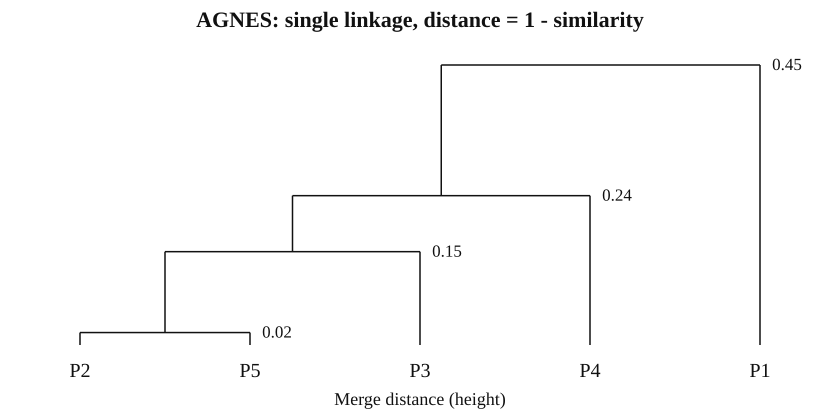
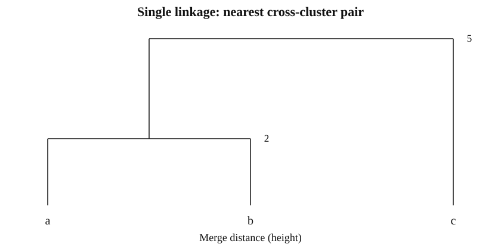
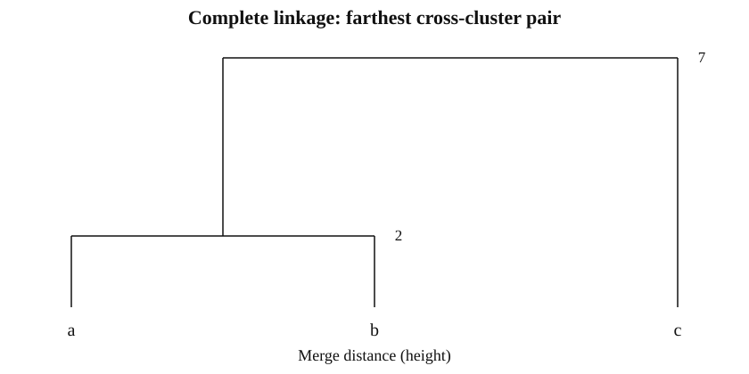

# AGNES 与层次聚类

[返回题型索引](../题型索引.md) · [网页练习](../index.html#type=hierarchy)

同数据同题合并列出多处来源；题目文字为转录整理，原扫描页保留供核对。

## E20-06 · 2020：相似度表做 AGNES 树状图

来源：2020 年扫描卷 · Q6 / 12 points · PDF p.3

状态：完整；形式：计算 / 推导。

### 本题公式 · 相似度表的 Single-Link 合并

对相似度，先合并最大相似度的对象或簇：

$$s(A,B)=\max_{x\in A,y\in B}s(x,y),\quad s(A\cup B,C)=\max\{s(A,C),s(B,C)\}.$$

若树状图以距离为高度，可用 $d=1-s$；每合并一次更新其到其他簇的值。

**相似度最大与距离最小的关系。** 本题 $s(x,y)$ 表示相似度，取 $d(x,y)=1-s(x,y)$ 后：

$$d_{single}(A,B)=\min_{x\in A,y\in B}(1-s(x,y))=1-\max_{x\in A,y\in B}s(x,y)=1-s(A,B).$$

因此从相似度表选择最大值合并，与从转换后的距离表选择最小值合并得到同一顺序。

### 原文

Use the following similarity matrix to perform AGNES clustering. Draw a dendrogram showing the merge order. Numbers indicate similarities.

使用下列相似度矩阵进行 AGNES 聚类。绘制显示合并顺序的树状图。数值表示相似度。

|  | P1 | P2 | P3 | P4 | P5 |
| --- | --- | --- | --- | --- | --- |
| P1 | 1.0 | 0.1 | 0.41 | 0.55 | 0.35 |
| P2 | 0.1 | 1.0 | 0.64 | 0.47 | 0.98 |
| P3 | 0.41 | 0.64 | 1.0 | 0.44 | 0.85 |
| P4 | 0.55 | 0.47 | 0.44 | 1.0 | 0.76 |
| P5 | 0.35 | 0.98 | 0.85 | 0.76 | 1.0 |

### 逐步解答

#### 1. 确定合并准则

原表为相似度，先合并相似度最大的不同对象。按课件 single-link，对两个簇使用最大的跨簇相似度：

$$s(A,B)=\max_{x\in A,y\in B}s(x,y).$$

更新式为 $s(A\cup B,C)=\max\{s(A,C),s(B,C)\}$；若将树画成距离高度，可取 $d=1-s$。

#### 2. 每轮更新并选择最大相似度

| 轮次 | 合并 | 相似度 | 树的距离高度 |
| --- | --- | --- | --- |
| 1 | P2 与 P5 | 0.98 | 0.02 |
| 2 | {P2,P5} 与 P3 | 0.85 | 0.15 |
| 3 | {P2,P3,P5} 与 P4 | 0.76 | 0.24 |
| 4 | {P2,P3,P4,P5} 与 P1 | 0.55 | 0.45 |

第一轮合并后，到其余点的相似度为

$$\begin{aligned}
s(\{P2,P5\},P1)&=\max(0.10,0.35)=0.35,\\
s(\{P2,P5\},P3)&=\max(0.64,0.85)=0.85,\\
s(\{P2,P5\},P4)&=\max(0.47,0.76)=0.76.
\end{aligned}$$

因此第二步合并 P3。随后该簇到 P4 的相似度仍为 0.76，到 P1 为 $\max(0.10,0.35,0.41)=0.41$；第三步合并 P4。最后 P1 与大簇的最大相似度为 0.55。

#### 3. 树状图与最终合并顺序

图的叶子对应五个对象，横线高度为该次合并的距离 $1-s$。从下向上读取即为表中的四轮合并；根节点最终包含全部五个点。

### English answer pattern

Merge the largest similarity. With single linkage, the merges occur at .98, .85, .76 and .55.

合并相似度最大的簇。单链接下的合并值依次为 0.98、0.85、0.76、0.55。

### 计算与内存分析

保存该矩阵 O(N²)；每轮重找所有簇对的朴素实现 O(N³)，single-link 可专门优化。

### 知识点与公式总结

- 原表给相似度，先合并最大的非对角元素；single-link 用 $s(A\cup B,C)=\max\{s(A,C),s(B,C)\}$ 更新。
- 画距离高度可取 $d=1-s$；每次画出两个旧簇在相应高度合并，并保持前面已经形成的子树。
- 先写清 linkage 和表中数字的方向，再列合并顺序；相似度越大越先合并，距离越小越先合并。

---

## SUP-HIER · 补充变式：single 与 complete 的差别

来源：整理者补充练习 · 依据 clustering pp.39–43

状态：完整；形式：补充变式。

### 本题公式 · Single-Link 与 Complete-Link

对距离矩阵，两种方法都从最小跨簇距离开始合并：

$$d_{single}(A,B)=\min_{x\in A,y\in B}d(x,y),\qquad d_{complete}(A,B)=\max_{x\in A,y\in B}d(x,y).$$

每次合并后按相同规则更新距离；树的横线高度等于该次所采用的合并距离。

### 原文

Given distances d(a,b)=2,d(a,c)=7,d(b,c)=5, compute the agglomerative merge heights under single and complete linkage.

给定距离 d(a,b)=2、d(a,c)=7、d(b,c)=5，计算单链接与全链接凝聚聚类的合并高度。

### 逐步解答

#### 1. 第一次合并

三个距离为 2、7、5，最小的是 $d(a,b)=2$。两种 linkage 都先在高度 2 合并 $\{a,b\}$。

#### 2. 计算合并簇到 c 的距离

Single-link 采用最近的跨簇点对，complete-link 采用最远的跨簇点对：

$$\begin{aligned}
d_{single}(\{a,b\},c)&=\min\{d(a,c),d(b,c)\}=\min(7,5)=5,\\
d_{complete}(\{a,b\},c)&=\max\{d(a,c),d(b,c)\}=\max(7,5)=7.
\end{aligned}$$

#### 3. 画出两种结果

最终合并高度：single 为 **2、5**，complete 为 **2、7**。Single-link 只需一对点靠近就能连起来，容易形成链；complete-link 会检查最远点，更强调合并簇的紧凑程度。

### English answer pattern

Single linkage uses the closest pair; complete linkage uses the farthest pair.

单链接使用最近点对，全链接使用最远点对。

### 知识点与公式总结

- Single-link 取最近跨簇点对：$d(A,B)=\min_{x\in A,y\in B}d(x,y)$；complete-link 取最远跨簇点对，即把 min 换为 max。
- 先按原点对最小距离合并，再用相应 linkage 计算新簇与剩余点的距离；树状图的合并高度就是这一新距离。
- Single-link 容易形成链，complete-link 更强调簇的整体紧凑；同一原距离表可以得到不同合并高度。
