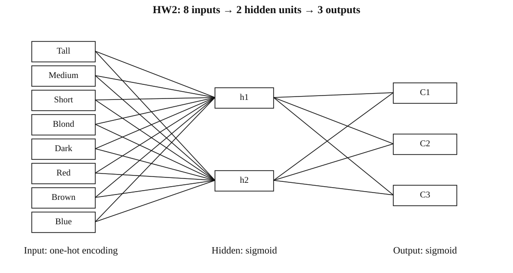
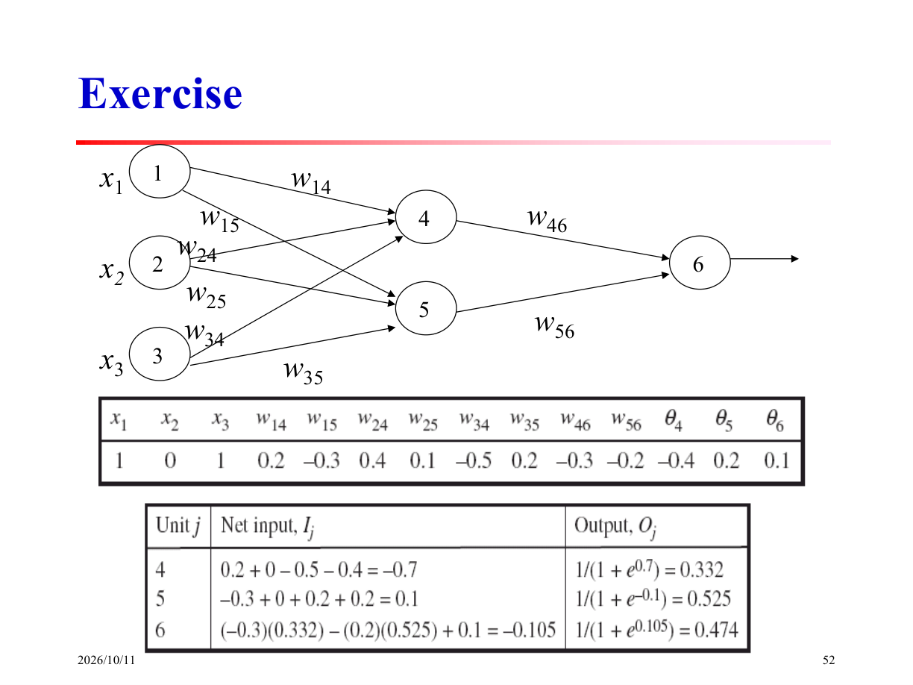

# 神经网络与反向传播

[返回题型索引](../题型索引.md) · [网页练习](../index.html#type=network)

同数据同题合并列出多处来源；题目文字为转录整理，原扫描页保留供核对。

## E17-06 · 2017：分段激活与题给 BP 公式冲突

来源：2017 年扫描卷 · Q6(a-b) / 20 points · PDF p.2

状态：原卷公式不一致；给出两种明确口径；形式：计算 / 推导。

### 原文

A 2–2–1 network has learning rate l=0.9 and all biases initially 0. The printed activation is f(x)=x if x≥1, and 1 if x<1. Input x1=1,x2=0, target z=1. Initial weights: w11=0,w12=2,w21=2,w22=1, output weights T1=T2=1. Compute the forward output and updated weights using the printed error formulas Err_j=O_j(1−O_j)(T_j−O_j), Err_j=O_j(1−O_j)Σ Err_k w_jk.

一个 2–2–1 网络的学习率为 0.9，所有偏置初始为 0。印出的激活函数为：x≥1 时 f(x)=x，x<1 时 f(x)=1。输入 x1=1、x2=0，目标 z=1。初始权重 w11=0、w12=2、w21=2、w22=1，输出权重 T1=T2=1。使用印出的输出层和隐藏层误差公式，计算前向输出及更新后的权重。

### 逐步解答

#### 1. 连接与前向计算

令隐藏单元为 $y_1,y_2$，输出为 z，目标记作 $t=1$。连接约定为 $w_{11}:x_1\to y_1$、$w_{12}:x_2\to y_1$、$w_{21}:x_1\to y_2$、$w_{22}:x_2\to y_2$；隐藏到输出权重为 $T_1,T_2$。

$$f(a)=\begin{cases}a,&a\ge1,\\1,&a<1.\end{cases}$$

$$\begin{aligned}
a_{y_1}&=0\times1+2\times0=0,&y_1&=f(0)=1,\\
a_{y_2}&=2\times1+1\times0=2,&y_2&=f(2)=2,\\
a_z&=1\times1+1\times2=3,&z&=f(3)=\boxed3.
\end{aligned}$$

#### 2. 按题给误差式代入

题目印刷的误差式为 $\delta_z=z(1-z)(t-z)$、$\delta_j=y_j(1-y_j)\delta_zT_j$；随后用 $w'=w+\eta\delta\,input$、$b'=b+\eta\delta$ 更新。

$$\delta_z=3(1-3)(1-3)=12,\quad\delta_{y_1}=1(1-1)12=0,\quad\delta_{y_2}=2(1-2)12=-24.$$

例如 $w'_{21}=2+0.9(-24)\times1=-19.6$，$T'_2=1+0.9\times12\times2=22.6$。全部误差使用旧权重计算，然后统一更新：

| 参数 | 代入或结果 |
| --- | --- |
| $w'_{11},w'_{12}$ | $0,2$ |
| $w'_{21},w'_{22}$ | $-19.6,1$ |
| $T'_1,T'_2$ | $11.8,22.6$ |
| 隐藏偏置 | $0,-21.6$ |
| 输出偏置 | $10.8$ |

#### 3. 说明题面公式冲突的影响

上表是遵照题目指定误差式的结果。因 $o(1-o)$ 是 sigmoid 的导数，而题目印刷激活为分段函数，所给误差式与该激活并不一致。若按印刷分段函数和平方误差推导真实梯度：

$$f'(0)=0,\qquad f'(2)=f'(3)=1.$$

因此 $\delta_z=-2,\delta_{y_1}=0,\delta_{y_2}=-2$，对应 $w'_{21}=0.2,T'_1=-0.8,T'_2=-2.6$。卷面写清“采用题给误差式”或“采用分段激活的真实导数”，即可让计算口径与答案对应。

### English answer pattern

The printed piecewise activation is inconsistent with the supplied sigmoid derivative. State the convention before computing the update.

印出的分段激活函数与给定 Sigmoid 导数不一致。计算更新前，先说明采用哪种约定。

### 易错点与约定

初始偏置为零，更新时仍按偏置梯度计算增量。当前题只要求四个输入权重时，其他权重/偏置可作为补充检查。

### 知识点与公式总结

- 先按照题面分段激活做前向传播，固定各权重对应的起点、终点；目标值与输出连接权重使用不同记号。
- 采用题给误差式时，$\delta_z=z(1-z)(t-z)$、$\delta_j=y_j(1-y_j)\delta_zT_j$；隐藏误差使用旧 $T_j$。
- 先算全部误差，再同时更新 $w'=w+\eta\delta\,input$ 与 $b'=b+\eta\delta$。题给导数与分段激活不一致，若采用真实导数需另行声明计算口径。

---

## HW2-03 · 当前 HW2：类别编码与一次 8–2–3 更新

来源：当前 HW2 · Written Q3(a-b)

状态：完整；形式：计算 / 推导。

### 原文

Design a one-hidden-layer feed-forward network for Height/Hair/Eye with classes C1,C2,C3. For (Tall,Red,Brown,C3), compute forward outputs and updated weights and biases. State initial values and learning rate.

针对身高、发色、眼睛颜色及 C1、C2、C3 三类，设计单隐藏层前馈网络。对（高、红发、棕眼、C3），计算前向输出以及更新后的权重和偏置。说明初始值与学习率。

### 逐步解答

#### 本题公式

每层先做加权和，再通过激活函数。下式采用 sigmoid 与平方误差，$t_k$ 是目标，$o_k$ 是输出，$h_j$ 是隐藏输出：

$$\begin{aligned}
h_j&=\sigma\!\left(\sum_i w_{ij}x_i+b_j\right),&\sigma(a)&=\frac1{1+e^{-a}},\\
o_k&=\sigma\!\left(\sum_j v_{jk}h_j+c_k\right),\\
\delta_k&=o_k(1-o_k)(t_k-o_k),\\
\delta_j&=h_j(1-h_j)\sum_kv_{jk}\delta_k,\\
v'_{jk}&=v_{jk}+\eta\delta_kh_j,&c'_k&=c_k+\eta\delta_k,\\
w'_{ij}&=w_{ij}+\eta\delta_jx_i,&b'_j&=b_j+\eta\delta_j.
\end{aligned}$$

激活导数 $o(1-o)$ 来自 sigmoid；更新式中的输入因子来自加权和对该权重的导数。先用同一套旧参数计算全部误差，再统一更新。

#### 1. 编码和初始化

Height 三类、Hair 三类、Eye 两类，采用独热输入 $x=(Tall,Medium,Short,Blond,Dark,Red,Brown,Blue)=(1,0,0,0,0,1,1,0)$，输出目标 $t=(0,0,1)$。隐藏层取 2 个神经元，得到 8–2–3 网络。

**为便于逐项核算，自设初值**：所有输入→隐藏权重为 .1，隐藏偏置 0；所有隐藏→输出权重为 .1，输出偏置 0；sigmoid 激活、平方误差、η=.1。下面按这套初值逐项计算。

$h_1=h_2=\sigma(.3)=.574442517$；三个输出均为 $o=\sigma(.1h_1+.1h_2)=.528690575$。输出误差使用 $\delta_k=o_k(1-o_k)(t_k-o_k)$，前两类约 −.131737，第三类约 .117439；精确值以计算验证表为准。

令 $a=\sigma(.3),b=\sigma(.2a)$，则可保留精确表达式：$d_0=-b^2(1-b)$，$d_1=b(1-b)^2$，隐藏误差均为 $d_h=a(1-a)\,.1(2d_0+d_1)$。

更新时沿用上方公式的符号：隐藏到输出权重为 $v_{jk}$，输出偏置为 $c_k$：

$$v'_{jk}=0.1+0.1\delta_k a,\qquad c'_k=0.1\delta_k.$$

激活的 Tall、Red、Brown 输入到每个隐藏单元的权重变为 $w'_{ij}=0.1+0.1d_h$，未激活输入的权重仍为 0.1；隐藏偏置为 $b'_j=0.1d_h$。这样分别更新四类参数，且与本题公式中的下标和字母一致。

此初值具有对称性，适合手算检查；实际训练一般用非对称随机初值以打破隐藏单元对称。Softmax+交叉熵可用于三分类，但其输出误差不能再套这里的 sigmoid+SSE 公式。

**本初始化的数值更新表：**

| Parameter group | Updated value |
| --- | --- |
| 每个隐藏单元：Tall/Red/Brown 对应输入权重 | 0.099643004 |
| 其他输入→隐藏权重 | .100000000 |
| 两个隐藏偏置 | -0.000356996 |
| 任一隐藏→C1/C2/C3 | 0.092432441, 0.092432441, 0.106746218 |
| C1/C2/C3 输出偏置 | -0.013173745, -0.013173745, 0.011743940 |

按表分别替换输入权重、隐藏偏置、输出权重和输出偏置，即完成这一次更新。

### English answer pattern

Use one-hot inputs, declare the initialization and loss, compute all deltas with old weights, then update all weights and biases.

采用独热输入，声明初始参数和损失；使用旧权重计算全部误差信号，再更新全部权重和偏置。

### 易错点与约定

本题 C3 标签与建树题不同。当前网络三输出；不要拿往届的二分类网络目标直接套用。

### 计算与内存分析

设总权重/偏置数 P，8–2–3 网络 P=(8+1)×2+(2+1)×3=27，一样本前向与反向均 O(P)。

### 知识点与公式总结

- 类别属性先独热编码；每层按加权和及 sigmoid $\sigma(a)=1/(1+e^{-a})$ 前向计算。
- sigmoid 加平方损失的输出误差为 $\delta_k=o_k(1-o_k)(t_k-o_k)$。
- 隐藏误差为 $\delta_j=h_j(1-h_j)\sum_k v_{jk}\delta_k$，其中 $v_{jk}$ 必须使用本轮旧权重。
- 权重按 $w'=w+\eta\delta\,input$、偏置按 $b'=b+\eta\delta$ 同时更新；输入为 0 的边本轮增量为 0。

---

## HX2-02 · 往届 HW2：Medium/Blond/Blue 二分类网络

来源：往届 HW2（hxd） · Written Q2

状态：完整；形式：计算 / 推导。

### 原文

Design a one-hidden-layer network for Q1. Show one backpropagation update for (Medium,Blond,Blue,C1), stating initial weights, biases and learning rate.

为 Q1 设计单隐藏层网络。对（中等身高、金发、蓝眼、C1），展示一次反向传播更新，并说明初始权重、偏置和学习率。

### 逐步解答

#### 本题公式

每层先做加权和，再通过激活函数。下式采用 sigmoid 与平方误差，$t_k$ 是目标，$o_k$ 是输出，$h_j$ 是隐藏输出：

$$\begin{aligned}
h_j&=\sigma\!\left(\sum_i w_{ij}x_i+b_j\right),&\sigma(a)&=\frac1{1+e^{-a}},\\
o_k&=\sigma\!\left(\sum_j v_{jk}h_j+c_k\right),\\
\delta_k&=o_k(1-o_k)(t_k-o_k),\\
\delta_j&=h_j(1-h_j)\sum_kv_{jk}\delta_k,\\
v'_{jk}&=v_{jk}+\eta\delta_kh_j,&c'_k&=c_k+\eta\delta_k,\\
w'_{ij}&=w_{ij}+\eta\delta_jx_i,&b'_j&=b_j+\eta\delta_j.
\end{aligned}$$

激活导数 $o(1-o)$ 来自 sigmoid；更新式中的输入因子来自加权和对该权重的导数。先用同一套旧参数计算全部误差，再统一更新。

#### 1. 编码和初始化

可取 8–2–1 网络。输入顺序明确为 (Tall,Medium,Short,Blond,Dark,Red,Brown,Blue)，$x=(0,1,0,1,0,0,0,1)$，用 C1=1,C2=0 编码目标，取各权重 .1、偏置 0、η=.1、sigmoid+SSE。

三个激活输入使两个隐藏输出仍 $a=\sigma(.3)$；输出 $b=\sigma(.2a)$。输出误差 $\delta_o=b(1-b)(1-b)$，隐藏误差 $\delta_h=a(1-a)\,.1\delta_o$。

两个隐藏→输出权重均变为 $.1+.1\delta_o a$，输出偏置 $.1\delta_o$；三个激活输入到每个隐藏单元的权重变为 $.1+.1\delta_h$，其他输入权重不变，隐藏偏置 $.1\delta_h$。这是完整可复算的一个自设初始化解。

由于本题只需二分类，一输出即可；若用两输出独热，也要写明目标向量和相应误差式。

本例数值：隐藏输出 0.574442517，最终输出 0.528690575，输出误差 0.117439398，隐藏误差 0.002870904；更新后的两条输出权重均 0.106746218，输出偏置 0.011743940，激活输入权重 0.100287090，隐藏偏置 0.000287090。

### English answer pattern

The older assignment is binary. One sigmoid output is sufficient when C1 is encoded as 1.

往届作业是二分类。把 C1 编码为 1 时，一个 Sigmoid 输出已足够。

### 知识点与公式总结

- 二分类可用一输出，先声明 C1=1、C2=0；输入独热编码后用 sigmoid 做前向计算。
- 输出误差 $\delta_o=o(1-o)(t-o)$；隐藏误差 $\delta_h=h(1-h)v\delta_o$ 使用旧输出权重 v。
- 所有误差先算完，再按 $w'=w+\eta\delta\,input$、$b'=b+\eta\delta$ 同时更新；分别报告输入权重、隐藏偏置、输出权重、输出偏置。

---

## PPT-CL52 · 课件 · 3–2–1 网络的前向与一次 BP 更新

来源：当前完整七讲课件 · classification.pdf · Exercise：网络、初值和前向 · PDF p.52；当前完整七讲课件 · classification.pdf · Exercise：误差及参数更新 · PDF p.53

状态：完整课件练习；形式：课件计算 / 逐步练习。

### 原文

Exercise

练习。

Study task (following the worked exercise): use sigmoid activations, input (1,0,1), target 1 and learning rate 0.9. Compute the forward outputs, error signals and updated weights and biases.

练习任务（按课件演示步骤整理）：使用 sigmoid 激活，输入为 (1,0,1)，目标值为 1，学习率为 0.9。计算前向输出、误差信号及更新后的权重和偏置。

### 逐步解答

#### 1. 本题公式与符号

节点输入 $z_j=\sum_iw_{ij}o_i+b_j$，激活输出 $o_j=\sigma(z_j)=1/(1+e^{-z_j})$。用平方损失 $E=\tfrac12(t-o_6)^2$，将负梯度写作误差信号：

$$\delta_6=(t-o_6)o_6(1-o_6),\qquad
\delta_j=o_j(1-o_j)w_{j6}\delta_6\ (j=4,5).$$

$$w_{ij}'=w_{ij}+\eta\delta_j o_i,\qquad b_j'=b_j+\eta\delta_j.$$

误差信号包含“目标与输出的差”和“激活导数”；链式法则把它传播到隐藏层。

#### 2. 前向：输入、隐藏、输出依次算

$$\begin{aligned}
z_4&=0.2(1)+0.4(0)-0.5(1)-0.4=-0.7,&o_4&=0.331812,\\
z_5&=-0.3(1)+0.1(0)+0.2(1)+0.2=0.1,&o_5&=0.524979,\\
z_6&=-0.3o_4-0.2o_5+0.1=-0.104540,&o_6&=0.473889.
\end{aligned}$$

#### 3. 反向：先输出误差，再隐藏误差

$$\begin{aligned}
\delta_6&=(1-0.473889)(0.473889)(1-0.473889)=0.131169,\\
\delta_4&=(0.331812)(1-0.331812)(-0.3)(0.131169)=-0.00872456,\\
\delta_5&=(0.524979)(1-0.524979)(-0.2)(0.131169)=-0.00654209.
\end{aligned}$$

#### 4. 同时更新全部参数

例如 $w_{46}'=-0.3+0.9(0.131169)(0.331812)=-0.260829$。

| 参数 | 初值 | 增量 $0.9\delta_j o_i$（偏置输入取 1） | 新值 |
| --- | --- | --- | --- |
| $w_{14}$ | 0.200000 | -0.007852 | 0.192148 |
| $w_{15}$ | -0.300000 | -0.005888 | -0.305888 |
| $w_{24}$ | 0.400000 | 0.000000 | 0.400000 |
| $w_{25}$ | 0.100000 | 0.000000 | 0.100000 |
| $w_{34}$ | -0.500000 | -0.007852 | -0.507852 |
| $w_{35}$ | 0.200000 | -0.005888 | 0.194112 |
| $w_{46}$ | -0.300000 | 0.039171 | -0.260829 |
| $w_{56}$ | -0.200000 | 0.061975 | -0.138025 |
| $b_4$ | -0.400000 | -0.007852 | -0.407852 |
| $b_5$ | 0.200000 | -0.005888 | 0.194112 |
| $b_6$ | 0.100000 | 0.118052 | 0.218052 |

输入 $x_2=0$，所以 $w_{24},w_{25}$ 的增量均为 0。隐藏误差使用本轮更新前的输出层权重；保留足够小数，最后统一舍入。

### English answer pattern

The output before updating is approximately 0.473889. The error signals are 0.131169, -0.00872456 and -0.00654209 for units 6,4,5. Update all weights and biases using the same forward pass.

更新前输出约为 0.473889。节点 6、4、5 的误差信号分别约为 0.131169、-0.00872456、-0.00654209。使用同一次前向计算更新全部权重和偏置。

### 计算与内存分析

一条样本的一次前向及反向均按连接计算，$W$ 条连接约需 $O(W)$ 时间、$O(W)$ 参数空间。

### 知识点与公式总结

- 前向依次算 $z_j=\sum_iw_{ij}o_i+b_j$、$o_j=\sigma(z_j)$；偏置直接加到净输入。
- 先算输出误差 $\delta_6=(t-o_6)o_6(1-o_6)$，再算隐藏误差 $\delta_j=o_j(1-o_j)w_{j6}\delta_6$；传播使用旧权重。
- 统一更新 $w_{ij}'=w_{ij}+\eta\delta_j o_i$、$b_j'=b_j+\eta\delta_j$；本题输入 $x_2=0$，对应两条边的增量为 0。
