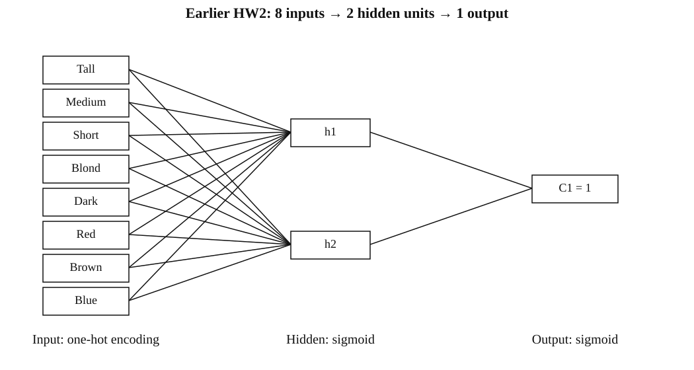

# 神经网络与反向传播

[返回题型索引](../题型索引.md) · [网页练习](../index.html#type=network)

同数据同题合并列出多处来源；题目文字为转录整理，原扫描页保留供核对。

## E17-06 · 2017：分段激活与题给 BP 公式冲突

来源：2017 年扫描卷 · Q6(a-b) / 20 points · PDF p.2

状态：原卷公式不一致；给出两种明确口径；形式：计算 / 推导。

### 本题公式 · 神经网络：前向、误差项与一次更新

**前向与损失。** $w_{ij}$ 是节点 i 到 j 的旧权重，$b_j$ 为偏置，输入层 $o_i=x_i$；$t_k$ 是输出节点 k 的目标值，$\eta$ 是学习率；下式用于 sigmoid 与平方损失：

$$\begin{aligned}
a_j&=\sum_iw_{ij}o_i+b_j,\\
o_j&=\sigma(a_j)=\frac1{1+e^{-a_j}},\\
E&=\frac12\sum_k(t_k-o_k)^2,\\
\sigma'(a_j)&=o_j(1-o_j).
\end{aligned}$$

**误差信号。** 统一定义 $\delta_j=-\partial E/\partial a_j$，因此更新式使用加号：

$$\begin{aligned}
\delta_k&=(t_k-o_k)o_k(1-o_k) &&\text{输出节点},\\
\delta_j&=o_j(1-o_j)\sum_k w_{jk}\delta_k &&\text{隐藏节点}.
\end{aligned}$$

**更新。** 前向及全部误差都使用同一套旧参数，算完后同时更新：

$$w'_{ij}=w_{ij}+\eta\delta_j o_i,\qquad b'_j=b_j+\eta\delta_j.$$

先前向、再输出误差、再隐藏误差、最后更新全部权重与偏置。输入为 0 的边增量为 0。分层写法中的 v 表示隐藏到输出的权重，与上式相应的 $w_{jk}$ 对应；题目另给激活或误差式时，按题内声明的口径代入。

### 原文

A 2–2–1 network has learning rate l=0.9 and all biases initially 0. The printed activation is f(x)=x if x≥1, and 1 if x<1. Input x1=1,x2=0, target z=1. Initial weights: w11=0,w12=2,w21=2,w22=1, output weights T1=T2=1. Compute the forward output and updated weights using the printed error formulas Err_j=O_j(1−O_j)(T_j−O_j), Err_j=O_j(1−O_j)Σ Err_k w_jk.

一个 2–2–1 网络的学习率为 0.9，所有偏置初始为 0。印出的激活函数为：x≥1 时 f(x)=x，x<1 时 f(x)=1。输入 x1=1、x2=0，目标 z=1。初始权重 w11=0、w12=2、w21=2、w22=1，输出权重 T1=T2=1。使用印出的输出层和隐藏层误差公式，计算前向输出及更新后的权重。

### 逐步解答

#### 1. 节点、连接与初值对应

输入为 $x_1=1,x_2=0$，隐藏节点为 $y_1,y_2$，输出记 z，目标值记 $t=1$，学习率 $\eta=0.9$。题中 $w_{ab}$ 的第一位 a 对应隐藏节点，第二位 b 对应输入节点，按下表代入：

| 连接 | 题中权重 | 初值 |
| --- | --- | --- |
| $x_1\to y_1$ | $w_{11}$ | 0 |
| $x_2\to y_1$ | $w_{12}$ | 2 |
| $x_1\to y_2$ | $w_{21}$ | 2 |
| $x_2\to y_2$ | $w_{22}$ | 1 |
| $y_1\to z$ | $T_1$ | 1 |
| $y_2\to z$ | $T_2$ | 1 |

三个偏置初值均为 0。$T_1,T_2$ 表示边权重，目标 t 单独记。激活函数及前向代入为

$$f(a)=\begin{cases}a,&a\ge1,\\1,&a<1.\end{cases}$$

$$\begin{aligned}
a_{y_1}&=0\times1+2\times0=0,&y_1&=f(0)=1,\\
a_{y_2}&=2\times1+1\times0=2,&y_2&=f(2)=2,\\
a_z&=1\times1+1\times2=3,&z&=f(3)=\boxed3.
\end{aligned}$$

#### 2. 按题给误差式代入

本题以下 $\delta$ 直接按题目指定的误差式计算： $\delta_z=z(1-z)(t-z)$、$\delta_j=y_j(1-y_j)\delta_zT_j$；更新时用 $w'=w+\eta\delta\,input$、$b'=b+\eta\delta$ 更新。

$$\delta_z=3(1-3)(1-3)=12,\quad\delta_{y_1}=1(1-1)12=0,\quad\delta_{y_2}=2(1-2)12=-24.$$

先用旧 $T_1=T_2=1$ 算全部隐藏误差，再更新。三种参数分别代入如下：

$$\begin{aligned}
w'_{21}&=2+0.9(-24)(1)=-19.6,\\
T'_2&=1+0.9(12)(2)=22.6,\\
b'_z&=0+0.9(12)=10.8.
\end{aligned}$$

其余参数同时更新为：

| 参数 | 代入或结果 |
| --- | --- |
| $w'_{11},w'_{12}$ | $0,2$ |
| $w'_{21},w'_{22}$ | $-19.6,1$ |
| $T'_1,T'_2$ | $11.8,22.6$ |
| 隐藏偏置 | $0,-21.6$ |
| 输出偏置 | $10.8$ |

#### 3. 说明题面公式冲突的影响

上表是遵照题目指定误差式的结果。因 $o(1-o)$ 是 sigmoid 的导数，而题目印刷激活为分段函数，所给误差式与该激活并不一致。若按印刷分段函数和平方误差推导真实梯度：

$$f'(0)=0,\qquad f'(2)=f'(3)=1.$$

因此 $\delta_z=-2,\delta_{y_1}=0,\delta_{y_2}=-2$，对应 $w'_{21}=0.2,T'_1=-0.8,T'_2=-2.6$。卷面写清“采用题给误差式”或“采用分段激活的真实导数”，即可让计算口径与答案对应。

### English answer pattern

The printed piecewise activation is inconsistent with the supplied sigmoid derivative. State the convention before computing the update.

印出的分段激活函数与给定 Sigmoid 导数不一致。计算更新前，先说明采用哪种约定。

### 易错点与约定

初始偏置为零，更新时仍按偏置梯度计算增量。当前题只要求四个输入权重时，其他权重/偏置可作为补充检查。

### 知识点与公式总结

- 按连接表读取参数：$w_{ab}$ 连接 $x_b\to y_a$，$T_1,T_2$ 分别连接 $y_1,y_2\to z$；先用题给分段激活做前向。
- 采用题给误差式时，$\delta_z=z(1-z)(t-z)$、$\delta_j=y_j(1-y_j)\delta_zT_j$；隐藏误差使用旧 $T_j$。
- 先算全部误差，再同时更新 $w'=w+\eta\delta\,input$ 与 $b'=b+\eta\delta$。题给导数与分段激活不一致，若采用真实导数需另行声明计算口径。

---

## HW2-03 · 当前 HW2：类别编码与一次 8–2–3 更新

来源：当前 HW2 · Written Q3(a-b)

状态：完整；形式：计算 / 推导。

### 本题公式 · 神经网络：前向、误差项与一次更新

**前向与损失。** $w_{ij}$ 是节点 i 到 j 的旧权重，$b_j$ 为偏置，输入层 $o_i=x_i$；$t_k$ 是输出节点 k 的目标值，$\eta$ 是学习率；下式用于 sigmoid 与平方损失：

$$\begin{aligned}
a_j&=\sum_iw_{ij}o_i+b_j,\\
o_j&=\sigma(a_j)=\frac1{1+e^{-a_j}},\\
E&=\frac12\sum_k(t_k-o_k)^2,\\
\sigma'(a_j)&=o_j(1-o_j).
\end{aligned}$$

**误差信号。** 统一定义 $\delta_j=-\partial E/\partial a_j$，因此更新式使用加号：

$$\begin{aligned}
\delta_k&=(t_k-o_k)o_k(1-o_k) &&\text{输出节点},\\
\delta_j&=o_j(1-o_j)\sum_k w_{jk}\delta_k &&\text{隐藏节点}.
\end{aligned}$$

**更新。** 前向及全部误差都使用同一套旧参数，算完后同时更新：

$$w'_{ij}=w_{ij}+\eta\delta_j o_i,\qquad b'_j=b_j+\eta\delta_j.$$

先前向、再输出误差、再隐藏误差、最后更新全部权重与偏置。输入为 0 的边增量为 0。分层写法中的 v 表示隐藏到输出的权重，与上式相应的 $w_{jk}$ 对应；题目另给激活或误差式时，按题内声明的口径代入。

### 原文

Design a one-hidden-layer feed-forward network for Height/Hair/Eye with classes C1,C2,C3. For (Tall,Red,Brown,C3), compute forward outputs and updated weights and biases. State initial values and learning rate.

针对身高、发色、眼睛颜色及 C1、C2、C3 三类，设计单隐藏层前馈网络。对（高、红发、棕眼、C3），计算前向输出以及更新后的权重和偏置。说明初始值与学习率。

### 逐步解答

#### 1. 编码、结构和本次初值

输入顺序为 (Tall,Medium,Short,Blond,Dark,Red,Brown,Blue)，所以

$$x=(1,0,0,0,0,1,1,0),\qquad t=(0,0,1).$$

取 8–2–3 网络。沿用本例已声明的自设初值：输入到隐藏权重均为 0.1，隐藏到输出权重均为 0.1，全部偏置为 0，学习率 $\eta=0.1$；采用 sigmoid 和 $E=\tfrac12\sum_k(t_k-o_k)^2$。

本题分层记输入权重为 $w_{ij}$、输出权重为 $v_{jk}$，隐藏/输出偏置为 $b_j,c_k$。隐藏输出为 $h_j$。

#### 2. 前向：展开两个隐藏值和三个输出值

只有三个输入为 1，所以两个隐藏节点相同：

$$a_{h_1}=a_{h_2}=0.1(1+1+1)=0.3,\quad h_1=h_2=\sigma(0.3)=0.574442517.$$

三个输出节点的旧权重相同，净输入也相同：

$$a_{o_k}=0.1h_1+0.1h_2=0.114888503,\quad o_k=\sigma(a_{o_k})=0.528690575.$$

#### 3. 输出误差，再用旧权重计算隐藏误差

采用指南的负梯度误差信号，$\delta_k=(t_k-o_k)o_k(1-o_k)$：

$$\begin{aligned}
\delta_1=\delta_2&=(0-0.528690575)(0.528690575)(1-0.528690575)\\
&\approx-0.131737453,\\
\delta_3&=(1-0.528690575)(0.528690575)(1-0.528690575)\\
&\approx0.117439398.
\end{aligned}$$

隐藏节点均使用旧输出权重 0.1：

$$\begin{aligned}
\delta_{h_j}&=h_j(1-h_j)\sum_{k=1}^{3}v_{jk}\delta_k\\
&=(0.574442517)(1-0.574442517)\,0.1\,(2\delta_1+\delta_3)\\
&\approx-0.003569959.
\end{aligned}$$

#### 4. 代入更新式，列出全部参数组

输出权重按 $v'_{jk}=v_{jk}+\eta\delta_kh_j$、输出偏置按 $c'_k=c_k+\eta\delta_k$ 更新。例如

$$v'_{j1}=0.1+0.1(-0.131737453)(0.574442517)=0.092432441.$$

输入权重按 $w'_{ij}=w_{ij}+\eta\delta_{h_j}x_i$。激活输入和隐藏偏置分别为

$$\begin{aligned}
w'_{ij}&=0.1+0.1(-0.003569959)(1)=0.099643004,\\
b'_j&=0+0.1(-0.003569959)=-0.000356996.
\end{aligned}$$

| 参数组 | 同时更新后的值 |
| --- | --- |
| Tall、Red、Brown 到任一隐藏节点 | 0.099643004 |
| 其余输入到隐藏节点 | 0.100000000 |
| 两个隐藏偏置 | -0.000356996 |
| 任一隐藏节点到 C1、C2、C3 | 0.092432441，0.092432441，0.106746218 |
| C1、C2、C3 输出偏置 | -0.013173745，-0.013173745，0.011743940 |

#### 最终答案与结构核对

前向输出为 $(0.528690575,0.528690575,0.528690575)$；上表覆盖这一次更新的全部权重和偏置。各层误差先用旧权重算完，再统一替换参数；计算中保留未舍入值，表中最后舍入。

### English answer pattern

Using the stated 8–2–3 sigmoid network and initial values, both hidden outputs are 0.574442517 and all three outputs are 0.528690575. The output deltas are (-0.131737453,-0.131737453,0.117439398); each hidden delta is -0.003569959. Compute every delta with the old output weights, then update all weights and biases simultaneously using the values in the table.

采用已声明的 8–2–3 sigmoid 网络及初值，两个隐藏输出均为 0.574442517，三个输出均为 0.528690575。输出误差信号为 (-0.131737453,-0.131737453,0.117439398)，每个隐藏误差信号为 -0.003569959。使用旧输出权重计算全部误差，再按表中数值同时更新全部权重和偏置。

### 易错点与约定

本题 C3 标签与建树题不同。当前网络三输出；不要拿往届的二分类网络目标直接套用。

### 计算与内存分析

设总权重/偏置数 P，8–2–3 网络 P=(8+1)×2+(2+1)×3=27，一样本前向与反向均 O(P)。

### 知识点与公式总结

- 前向先算净输入与 sigmoid；本题三处独热输入为 1，隐藏净输入均为 0.3。
- 输出误差 $\delta_k=(t_k-o_k)o_k(1-o_k)$；隐藏误差 $\delta_{h_j}=h_j(1-h_j)\sum_kv_{jk}\delta_k$。
- 隐藏误差使用旧 v；再按“权重加 $\eta\delta\,input$、偏置加 $\eta\delta$”同时更新。输入为 0 的边增量为 0。

---

## HX2-02 · 往届 HW2：Medium/Blond/Blue 二分类网络

来源：往届 HW2（hxd） · Written Q2

状态：完整；形式：计算 / 推导。

### 本题公式 · 神经网络：前向、误差项与一次更新

**前向与损失。** $w_{ij}$ 是节点 i 到 j 的旧权重，$b_j$ 为偏置，输入层 $o_i=x_i$；$t_k$ 是输出节点 k 的目标值，$\eta$ 是学习率；下式用于 sigmoid 与平方损失：

$$\begin{aligned}
a_j&=\sum_iw_{ij}o_i+b_j,\\
o_j&=\sigma(a_j)=\frac1{1+e^{-a_j}},\\
E&=\frac12\sum_k(t_k-o_k)^2,\\
\sigma'(a_j)&=o_j(1-o_j).
\end{aligned}$$

**误差信号。** 统一定义 $\delta_j=-\partial E/\partial a_j$，因此更新式使用加号：

$$\begin{aligned}
\delta_k&=(t_k-o_k)o_k(1-o_k) &&\text{输出节点},\\
\delta_j&=o_j(1-o_j)\sum_k w_{jk}\delta_k &&\text{隐藏节点}.
\end{aligned}$$

**更新。** 前向及全部误差都使用同一套旧参数，算完后同时更新：

$$w'_{ij}=w_{ij}+\eta\delta_j o_i,\qquad b'_j=b_j+\eta\delta_j.$$

先前向、再输出误差、再隐藏误差、最后更新全部权重与偏置。输入为 0 的边增量为 0。分层写法中的 v 表示隐藏到输出的权重，与上式相应的 $w_{jk}$ 对应；题目另给激活或误差式时，按题内声明的口径代入。

### 原文

Design a one-hidden-layer network for Q1. Show one backpropagation update for (Medium,Blond,Blue,C1), stating initial weights, biases and learning rate.

为 Q1 设计单隐藏层网络。对（中等身高、金发、蓝眼、C1），展示一次反向传播更新，并说明初始权重、偏置和学习率。

### 逐步解答

#### 1. 编码与初值

取 8–2–1 网络，输入顺序为 (Tall,Medium,Short,Blond,Dark,Red,Brown,Blue)，所以 $x=(0,1,0,1,0,0,0,1)$。目标按 C1=1、C2=0 编码，本样本 $t=1$。沿用已声明的各权重 0.1、偏置 0、$\eta=0.1$，采用 sigmoid 与 $E=\tfrac12(t-o)^2$。

#### 2. 前向计算

三个激活输入使两个隐藏节点均有

$$a_h=0.1(1+1+1)=0.3,\qquad h=\sigma(0.3)=0.574442517.$$

$$a_o=0.1h_1+0.1h_2=0.114888503,\qquad o=\sigma(a_o)=0.528690575.$$

#### 3. 反传误差信号

$$\begin{aligned}
\delta_o&=(1-o)o(1-o)\\
&=(1-0.528690575)(0.528690575)(1-0.528690575)\\
&=0.117439398,\\
\delta_h&=h(1-h)(0.1)\delta_o=0.002870904.
\end{aligned}$$

隐藏层使用更新前的输出权重 0.1；此时先不替换任何权重。

#### 4. 展开参数更新

$$\begin{aligned}
v'_j&=0.1+0.1\delta_oh_j=0.106746218,\\
c'&=0+0.1\delta_o=0.011743940,\\
w'_{ij}&=0.1+0.1\delta_h(1)=0.100287090,\\
b'_j&=0+0.1\delta_h=0.000287090.
\end{aligned}$$

| 参数组 | 更新值 |
| --- | --- |
| 两条隐藏到输出权重 | 0.106746218 |
| 输出偏置 | 0.011743940 |
| Medium、Blond、Blue 到任一隐藏节点 | 0.100287090 |
| 其余输入到隐藏节点 | 0.100000000 |
| 两个隐藏偏置 | 0.000287090 |

#### 最终答案与结构

更新前输出为 **0.528690575**；上表给出本次自设初始化下的全部参数更新。未激活输入的权重增量为 0；全部误差由旧权重计算，最后同时更新。

### English answer pattern

With the stated 8–2–1 sigmoid network, the hidden outputs are 0.574442517 and the output is 0.528690575. The output delta is 0.117439398 and each hidden delta is 0.002870904. Each output weight becomes 0.106746218; the output bias becomes 0.011743940. Active input weights become 0.100287090 and hidden biases become 0.000287090.

在已声明的 8–2–1 sigmoid 网络下，隐藏输出均为 0.574442517，输出为 0.528690575。输出误差信号为 0.117439398，每个隐藏误差信号为 0.002870904。每条输出权重变为 0.106746218，输出偏置变为 0.011743940。激活输入权重变为 0.100287090，隐藏偏置变为 0.000287090。

### 知识点与公式总结

- 先声明类别编码、输入顺序、激活、损失和初值；本题 C1 的目标为 1。
- 按前向→$\delta_o=(t-o)o(1-o)$→$\delta_h=h(1-h)v\delta_o$ 的顺序计算，隐藏误差使用旧 v。
- 输出权重乘隐藏输出更新，输入权重乘原输入更新；偏置相当于恒为 1 的输入，最后一起更新。

---

## PPT-CL52 · 课件 · 3–2–1 网络的前向与一次 BP 更新

来源：当前完整七讲课件 · classification.pdf · Exercise：网络、初值和前向 · PDF p.52；当前完整七讲课件 · classification.pdf · Exercise：误差及参数更新 · PDF p.53

状态：完整课件练习；形式：课件计算 / 逐步练习。

### 本题公式 · 神经网络：前向、误差项与一次更新

**前向与损失。** $w_{ij}$ 是节点 i 到 j 的旧权重，$b_j$ 为偏置，输入层 $o_i=x_i$；$t_k$ 是输出节点 k 的目标值，$\eta$ 是学习率；下式用于 sigmoid 与平方损失：

$$\begin{aligned}
a_j&=\sum_iw_{ij}o_i+b_j,\\
o_j&=\sigma(a_j)=\frac1{1+e^{-a_j}},\\
E&=\frac12\sum_k(t_k-o_k)^2,\\
\sigma'(a_j)&=o_j(1-o_j).
\end{aligned}$$

**误差信号。** 统一定义 $\delta_j=-\partial E/\partial a_j$，因此更新式使用加号：

$$\begin{aligned}
\delta_k&=(t_k-o_k)o_k(1-o_k) &&\text{输出节点},\\
\delta_j&=o_j(1-o_j)\sum_k w_{jk}\delta_k &&\text{隐藏节点}.
\end{aligned}$$

**更新。** 前向及全部误差都使用同一套旧参数，算完后同时更新：

$$w'_{ij}=w_{ij}+\eta\delta_j o_i,\qquad b'_j=b_j+\eta\delta_j.$$

先前向、再输出误差、再隐藏误差、最后更新全部权重与偏置。输入为 0 的边增量为 0。分层写法中的 v 表示隐藏到输出的权重，与上式相应的 $w_{jk}$ 对应；题目另给激活或误差式时，按题内声明的口径代入。

### 原文

Exercise

练习。

Study task (following the worked exercise): use sigmoid activations, input (1,0,1), target 1 and learning rate 0.9. Compute the forward outputs, error signals and updated weights and biases.

练习任务（按课件演示步骤整理）：使用 sigmoid 激活，输入为 (1,0,1)，目标值为 1，学习率为 0.9。计算前向输出、误差信号及更新后的权重和偏置。

### 逐步解答

#### 1. 本题公式与符号

沿用课件所有边的记号 $w_{ij}$。节点净输入 $a_j=\sum_iw_{ij}o_i+b_j$，输出 $o_j=\sigma(a_j)$，输入层 $o_i=x_i$。平方损失为 $E=\tfrac12(t-o_6)^2$，误差信号定义为 $\delta_j=-\partial E/\partial a_j$：

$$\delta_6=(t-o_6)o_6(1-o_6),\qquad
\delta_j=o_j(1-o_j)w_{j6}\delta_6\ (j=4,5).$$

$$w_{ij}'=w_{ij}+\eta\delta_j o_i,\qquad b_j'=b_j+\eta\delta_j.$$

误差信号包含“目标与输出的差”和“激活导数”；链式法则把它传播到隐藏层。

#### 2. 前向：输入、隐藏、输出依次算

$$\begin{aligned}
a_4&=0.2(1)+0.4(0)-0.5(1)-0.4=-0.7,&o_4&=0.331812,\\
a_5&=-0.3(1)+0.1(0)+0.2(1)+0.2=0.1,&o_5&=0.524979,\\
a_6&=-0.3o_4-0.2o_5+0.1=-0.104540,&o_6&=0.473889.
\end{aligned}$$

#### 3. 反向：先输出误差，再隐藏误差

$$\begin{aligned}
\delta_6&=(1-0.473889)(0.473889)(1-0.473889)=0.131169,\\
\delta_4&=(0.331812)(1-0.331812)(-0.3)(0.131169)=-0.00872456,\\
\delta_5&=(0.524979)(1-0.524979)(-0.2)(0.131169)=-0.00654209.
\end{aligned}$$

#### 4. 同时更新全部参数

所有误差先用旧权重算完，再同时更新。举两条不同层的边和一个偏置：

$$\begin{aligned}
w'_{46}&=-0.3+0.9(0.131169)(0.331812)=-0.260829,\\
w'_{14}&=0.2+0.9(-0.00872456)(1)=0.192148,\\
b'_4&=-0.4+0.9(-0.00872456)=-0.407852.
\end{aligned}$$

| 参数 | 初值 | 增量 $0.9\delta_j o_i$（偏置输入取 1） | 新值 |
| --- | --- | --- | --- |
| $w_{14}$ | 0.200000 | -0.007852 | 0.192148 |
| $w_{15}$ | -0.300000 | -0.005888 | -0.305888 |
| $w_{24}$ | 0.400000 | 0.000000 | 0.400000 |
| $w_{25}$ | 0.100000 | 0.000000 | 0.100000 |
| $w_{34}$ | -0.500000 | -0.007852 | -0.507852 |
| $w_{35}$ | 0.200000 | -0.005888 | 0.194112 |
| $w_{46}$ | -0.300000 | 0.039171 | -0.260829 |
| $w_{56}$ | -0.200000 | 0.061975 | -0.138025 |
| $b_4$ | -0.400000 | -0.007852 | -0.407852 |
| $b_5$ | 0.200000 | -0.005888 | 0.194112 |
| $b_6$ | 0.100000 | 0.118052 | 0.218052 |

输入 $x_2=0$，所以 $w_{24},w_{25}$ 的增量均为 0。隐藏误差使用本轮更新前的输出层权重；保留足够小数，最后统一舍入。

### English answer pattern

The output before updating is approximately 0.473889. The error signals are 0.131169, -0.00872456 and -0.00654209 for units 6,4,5. Update all weights and biases using the same forward pass.

更新前输出约为 0.473889。节点 6、4、5 的误差信号分别约为 0.131169、-0.00872456、-0.00654209。使用同一次前向计算更新全部权重和偏置。

### 计算与内存分析

一条样本的一次前向及反向均按连接计算，$W$ 条连接约需 $O(W)$ 时间、$O(W)$ 参数空间。

### 知识点与公式总结

- 前向依次算 $a_j=\sum_iw_{ij}o_i+b_j$、$o_j=\sigma(a_j)$；偏置直接加到净输入。
- 先算输出误差 $\delta_6=(t-o_6)o_6(1-o_6)$，再算隐藏误差 $\delta_j=o_j(1-o_j)w_{j6}\delta_6$；传播使用旧权重。
- 统一更新 $w_{ij}'=w_{ij}+\eta\delta_j o_i$、$b_j'=b_j+\eta\delta_j$；本题输入 $x_2=0$，对应两条边的增量为 0。
