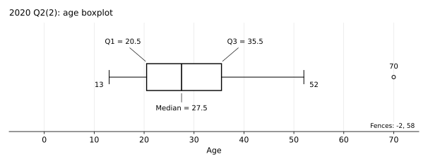
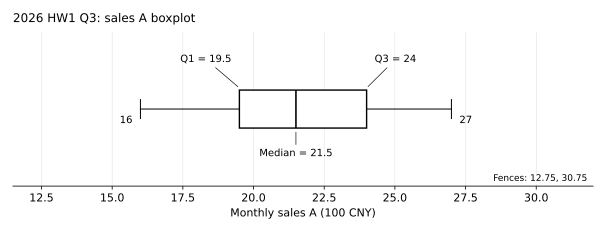
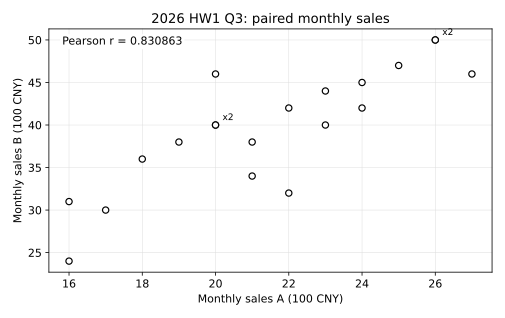
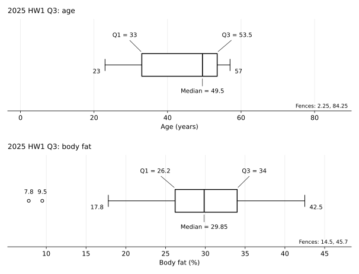
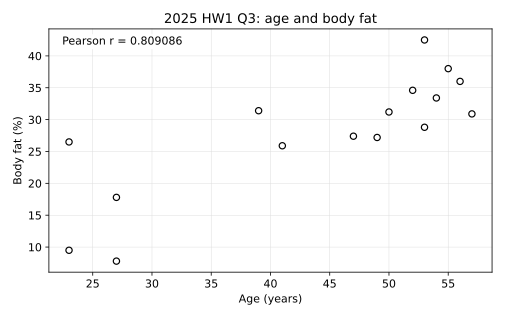
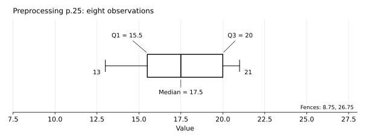

# 统计、箱线图与相关

[返回题型索引](../题型索引.md) · [网页练习](../index.html#type=statistics)

同数据同题合并列出多处来源；题目文字为转录整理，原扫描页保留供核对。

## E20-02B · 2020：五数概括与离群值

来源：2020 年扫描卷 · Q2(2) / 4 points · PDF p.1

状态：完整；形式：计算 / 推导。

### 本题公式 · 五数概括、离群界限与箱线图

排序后用上下半组各自的中位数求 $Q_1,Q_3$；奇数个观测先排除总体中位数再分两半。五数概括依次为 min、$Q_1$、median（$Q_2$）、$Q_3$、max。

$$IQR=Q_3-Q_1,\qquad LF=Q_1-1.5IQR,\quad UF=Q_3+1.5IQR.$$

箱体从 $Q_1$ 到 $Q_3$，中位线在 $Q_2$；须取 $[LF,UF]$ 内最小、最大的**实际观测**，界限外的观测单独画点。

### 原文

Determine outliers in the age data by five-number summary.

利用五数概括确定年龄数据中的离群值。

20, 13, 15, 16, 25, 35, 36, 40, 45, 46, 52, 25, 25, 30, 21, 22, 22, 33, 33, 35, 35, 70, 19, 20

### 逐步解答

#### 排序并定位四分位数

本题采用上下半组中位数法。排序后为：

$$\begin{aligned}
&13,15,16,19,20,20,21,22,22,25,25,25,\\
&30,33,33,35,35,35,36,40,45,46,52,70.
\end{aligned}$$

24 个数的中位数取第 12、13 个数的平均；下半组、上半组各有 12 个数，各自再取中位数：

$$\begin{aligned}
Q_2&=(25+30)/2=27.5,\\
Q_1&=(20+21)/2=20.5,\\
Q_3&=(35+36)/2=35.5.
\end{aligned}$$

因此五数概括为

$$\boxed{(\min,Q_1,Q_2,Q_3,\max)=(13,20.5,27.5,35.5,70)}.$$

#### 用四分位距判定离群值

四分位距（interquartile range, IQR）表示中间 50% 数据的跨度。用它构造 $1.5IQR$ 离群界限：

$$\begin{aligned}
IQR&=Q_3-Q_1=35.5-20.5=15,\\
LF&=Q_1-1.5IQR=20.5-22.5=-2,\\
UF&=Q_3+1.5IQR=35.5+22.5=58.
\end{aligned}$$

检查每个观测是否满足 $x<LF$ 或 $x>UF$。只有 $70>58$，故**唯一离群值为 70**。

#### 绘制有刻度的箱线图

箱体从 $20.5$ 到 $35.5$，中位线在 $27.5$。两条须分别连到界限内最小、最大的实际观测 $13,52$；离群值 $70$ 单独画点。

#### 此类题的作答顺序

排序 → 五数概括 → $IQR$ → 两个离群界限 → 离群值 → 须端点与图。五数概括保留全体数据的最大值 $70$；箱线图上须落在最大非离群观测 $52$。

### English answer pattern

The five-number summary is $(13,20.5,27.5,35.5,70)$. With $IQR=15$, the fences are $-2$ and $58$. The only outlier is $70$, and the whiskers end at $13$ and $52$.

五数概括为 $(13,20.5,27.5,35.5,70)$。$IQR=15$，离群界限为 $-2$、$58$。唯一离群值为 $70$，须端点为 $13$、$52$。

### 易错点与约定

本题按上下半组中位数法求四分位数。软件插值定义可能给出略有差别的 $Q_1,Q_3$，手算时先声明所用约定。须端点取界限内实际观测，理论界限只用于判定。

### 计算与内存分析

通常排序需 $O(N\log N)$ 时间；排序后定位四分位数及扫描离群值需 $O(N)$。保留完整数据需 $O(N)$ 空间；精确分位数也可用选择算法在线性时间内求得。

### 知识点与公式总结

- **五数概括（five-number summary）** 依次为最小值 min、第一四分位数 $Q_1$、中位数 median（$Q_2$）、第三四分位数 $Q_3$、最大值 max。本题 $Q_1,Q_3$ 用上下半组各自的中位数。
- **离群界限**：$IQR=Q_3-Q_1$，$LF=Q_1-1.5IQR$，$UF=Q_3+1.5IQR$；观测满足 $x<LF$ 或 $x>UF$ 时标为离群值。
- **作图**：箱体为 $[Q_1,Q_3]$，内线为 median；须落在 $[LF,UF]$ 内最小、最大的实际观测。此题须为 13、52，70 单独画点。

---

## HW1-03 · 当前 HW1：销量统计、箱线图与 Pearson

来源：当前 HW1 · Q3(a,b,d,e)

状态：完整；形式：计算 / 推导。

### 本题公式 · 描述统计、箱线图与相关系数

设 $n$ 个观测为 $x_i$，均值 $\bar x=\sum_i x_i/n$，离均差平方和 $S_{xx}=\sum_i(x_i-\bar x)^2$。

$$\sigma^2=S_{xx}/n,\quad s^2=S_{xx}/(n-1),\qquad \sigma=\sqrt{\sigma^2},\quad s=\sqrt{s^2}.$$

总体方差用分母 $n$，样本方差用 $n-1$；标准差取对应平方根。

排序后用上下半组各自的中位数求 $Q_1,Q_3$；奇数个观测先排除总体中位数再分两半。五数概括依次为 min、$Q_1$、median（$Q_2$）、$Q_3$、max。

$$IQR=Q_3-Q_1,\qquad LF=Q_1-1.5IQR,\quad UF=Q_3+1.5IQR.$$

箱体从 $Q_1$ 到 $Q_3$，中位线在 $Q_2$；须取 $[LF,UF]$ 内最小、最大的**实际观测**，界限外的观测单独画点。

两列保留原始配对；$S_{xy}=\sum_i(x_i-\bar x)(y_i-\bar y)$，$S_{yy}=\sum_i(y_i-\bar y)^2$。

$$r=\frac{S_{xy}}{\sqrt{S_{xx}S_{yy}}}.$$

散点图每个点是一条原始 $(x_i,y_i)$ 记录。

### 原文

A: 21, 16, 19, 24, 27, 23, 22, 21, 20, 17, 16, 20, 23, 22, 18, 24, 26, 25, 20, 26

B: 38, 24, 38, 45, 46, 44, 42, 34, 40, 30, 31, 40, 40, 32, 36, 42, 50, 47, 46, 50

Calculate mean, median, standard deviation of A; draw its boxplot; compute the correlation coefficient of A and B and draw a scatter plot.

计算 A 的均值、中位数、标准差；画出其箱线图；计算 A、B 的相关系数，并画散点图。

### 逐步解答

本题 A、B 销售数据的单位均为百元。均值、中位数与标准差沿用该单位，例如均值 $21.5$ 表示 $2150$ 元。

#### 均值、中位数与标准差

均值概括平均销售额；标准差衡量销售额围绕均值的波动。A 的统计量为

$$N=20,\qquad\sum A_i=430,\qquad\sum A_i^2=9452.$$

因此

$$\begin{aligned}
\bar A&=430/20=21.5,\\
S_{AA}&=\sum(A_i-\bar A)^2=9452-20(21.5)^2=207.
\end{aligned}$$

排序后的 A 为

$$\begin{aligned}
&16,16,17,18,19,20,20,20,21,21,\\
&22,22,23,23,24,24,25,26,26,27.
\end{aligned}$$

中位数为第 10、11 个值的平均：$Q_2=(21+22)/2=21.5$。标准差按题目要求声明口径：

$$\begin{aligned}
\sigma_A&=\sqrt{\frac{S_{AA}}{N}}=\sqrt{207/20}\approx3.217142\quad\text{(population)},\\
s_A&=\sqrt{\frac{S_{AA}}{N-1}}=\sqrt{207/19}\approx3.300718\quad\text{(sample)}.
\end{aligned}$$

这里总体方差 $\sigma_A^2=207/20=10.35$，样本方差 $s_A^2=207/19\approx10.894737$。样本方差使用 $N-1$ 对总体方差进行无偏估计，其平方根为样本标准差；题目把 20 个月视为全部研究对象时可使用总体口径。

#### 五数概括与箱线图

采用上下半组中位数法：

$$\begin{aligned}
Q_1&=(19+20)/2=19.5,\\
Q_3&=(24+24)/2=24,\\
IQR&=24-19.5=4.5.
\end{aligned}$$

五数概括为 $(16,19.5,21.5,24,27)$。离群界限为

$$LF=19.5-1.5(4.5)=12.75,\qquad UF=24+1.5(4.5)=30.75.$$

全部值落在界限内，所以无离群点；下、上须分别为 $16,27$。

#### Pearson 相关：保留每月 A、B 的配对

相关系数衡量两个变量的线性共同变化，并把量纲与尺度消去。令

$$S_{AB}=\sum(A_i-\bar A)(B_i-\bar B),\qquad r=\frac{S_{AB}}{\sqrt{S_{AA}S_{BB}}}.$$

由原月序的 20 对数据得到

$$\begin{aligned}
\bar B&=795/20=39.75,\\
S_{BB}&=32531-20(39.75)^2=929.75,\\
S_{AB}&=17457-20(21.5)(39.75)=364.5.
\end{aligned}$$

所以

$$\boxed{r=\frac{364.5}{\sqrt{207\times929.75}}\approx0.830863}.$$

#### 散点图与结论

横轴为当月 A 销售额，纵轴为同月 B 销售额，每个月画一个点。重叠的坐标标出出现次数。

点云总体向右上方延伸，$r\approx0.831$，说明 A、B 销售额有较强正线性相关。相关系数描述共同变化，因果关系需另有证据。

### English answer pattern

For A, the mean and median are both $21.5$. Its population standard deviation is $3.217142$, and its sample standard deviation is $3.300718$. Its five-number summary is $(16,19.5,21.5,24,27)$, with no outliers. The paired Pearson correlation is $r=0.830863$. Sales values are in hundreds of yuan.

A 的均值和中位数均为 $21.5$。总体标准差为 $3.217142$，样本标准差为 $3.300718$。五数概括为 $(16,19.5,21.5,24,27)$，无离群值。配对 Pearson 相关系数为 $r=0.830863$。 销售数据单位为百元。

### 易错点与约定

为箱线图单独排序 A；相关系数始终使用原月份配对。标准差要写出分母 $N$ 或 $N-1$。

### 计算与内存分析

用 $N,\sum A_i,\sum B_i,\sum A_i^2,\sum B_i^2,\sum A_iB_i$ 可在 $O(N)$ 时间、$O(1)$ 累计内存求均值、方差和相关。精确箱线图常先用 $O(N\log N)$ 排序，保存输入与输出图点需 $O(N)$。

### 知识点与公式总结

- **均值与波动**：$\bar x=\sum x_i/n$；总体方差用 $\sum(x_i-\bar x)^2/n$，样本方差用 $\sum(x_i-\bar x)^2/(n-1)$，标准差取对应平方根。$n$ 是观测数，销售数据单位为百元。
- **五数概括**：min（最小值）、$Q_1$、median（$Q_2$）、$Q_3$、max（最大值）；本题四分位数取排序后上下半组的中位数。
- **箱线图**：$IQR=Q_3-Q_1$，界限为 $Q_1-1.5IQR$、$Q_3+1.5IQR$；须接界限内最小、最大的实际观测，离群值独立画点。
- **相关与散点图**：$r=\frac{\sum(A_i-\bar A)(B_i-\bar B)}{\sqrt{\sum(A_i-\bar A)^2\sum(B_i-\bar B)^2}}$；保留同月份的配对，横轴 A、纵轴 B；$r$ 的正负表示线性共同变化的方向。

---

## HX1-03 · 往届 HW1：年龄/体脂、z-score 与相关

来源：往届 HW1（hxd） · Q3(a-e) · PDF p.1

状态：完整；形式：计算 / 推导。

### 本题公式 · 统计量、z 分数与相关系数

设 $n$ 个观测为 $x_i$，均值 $\bar x=\sum_i x_i/n$，离均差平方和 $S_{xx}=\sum_i(x_i-\bar x)^2$。

$$\sigma^2=S_{xx}/n,\quad s^2=S_{xx}/(n-1),\qquad \sigma=\sqrt{\sigma^2},\quad s=\sqrt{s^2}.$$

总体方差用分母 $n$，样本方差用 $n-1$；标准差取对应平方根。

每列分别标准化：$z_i=(x_i-\bar x)/\mathrm{SD}$，其中 SD 为题目采用口径下的标准差。

排序后用上下半组各自的中位数求 $Q_1,Q_3$；奇数个观测先排除总体中位数再分两半。五数概括依次为 min、$Q_1$、median（$Q_2$）、$Q_3$、max。

$$IQR=Q_3-Q_1,\qquad LF=Q_1-1.5IQR,\quad UF=Q_3+1.5IQR.$$

箱体从 $Q_1$ 到 $Q_3$，中位线在 $Q_2$；须取 $[LF,UF]$ 内最小、最大的**实际观测**，界限外的观测单独画点。

两列保留原始配对；$S_{xy}=\sum_i(x_i-\bar x)(y_i-\bar y)$，$S_{yy}=\sum_i(y_i-\bar y)^2$。

$$r=\frac{S_{xy}}{\sqrt{S_{xx}S_{yy}}}.$$

散点图每个点是一条原始 $(x_i,y_i)$ 记录。

### 原文

Suppose a hospital tested age and body fat for 16 adults. Calculate mean, median, standard deviation; draw boxplots and scatter plot; normalize using z-score; calculate Pearson correlation.

假设医院测量了 16 位成年人的年龄和体脂率。计算均值、中位数、标准差；绘制箱线图和散点图；用 z 分数归一化；计算 Pearson 相关系数。

| age | %fat |
| --- | --- |
| 23 | 9.5 |
| 23 | 26.5 |
| 27 | 7.8 |
| 27 | 17.8 |
| 39 | 31.4 |
| 41 | 25.9 |
| 47 | 27.4 |
| 49 | 27.2 |
| 50 | 31.2 |
| 52 | 34.6 |
| 53 | 42.5 |
| 53 | 28.8 |
| 54 | 33.4 |
| 55 | 38 |
| 56 | 36 |
| 57 | 30.9 |

### 逐步解答

#### 均值、中位数和标准差

分别对年龄与体脂率计算，$N=16$。使用

$$\bar x=\frac{\sum x_i}{N},\qquad S_{xx}=\sum x_i^2-N\bar x^2,\qquad
\sigma=\sqrt{S_{xx}/N},\quad s=\sqrt{S_{xx}/(N-1)}.$$

其中总体方差 $\sigma^2=S_{xx}/N$，样本方差 $s^2=S_{xx}/(N-1)$，标准差为相应方差的平方根；$x_i$ 是该列第 $i$ 个观测，$\bar x$ 是该列均值。

| 统计量 | 年龄 age | 体脂率 %fat |
| --- | ---: | ---: |
| $\sum x_i$ | 706 | 448.9 |
| $\sum x_i^2$ | 33476 | 13934.21 |
| $\bar x$ | 44.125 | 28.05625 |
| $S_{xx}$ | 2323.75 | 1339.759375 |
| 中位数 | 49.5 | 29.85 |
| 总体标准差 $\sigma$ | 12.051323 | 9.150681 |
| 样本标准差 $s$ | 12.446552 | 9.450783 |

例如年龄的 $S_{xx}=33476-16(44.125)^2=2323.75$。中位数取排序后第 8、9 个数的平均；体脂率先单独排序为

$$\begin{aligned}
&7.8,9.5,17.8,25.9,26.5,27.2,27.4,28.8,\\
&30.9,31.2,31.4,33.4,34.6,36,38,42.5.
\end{aligned}$$

所以其中位数为 $(28.8+30.9)/2=29.85$。

#### 四分位数、界限与两张箱线图

采用上下半组中位数法。每列的下半组、上半组各 8 个值，分别取中间两值平均：

$$\begin{aligned}
Q_{1,age}&=(27+39)/2=33,&Q_{3,age}&=(53+54)/2=53.5,\\
Q_{1,fat}&=(25.9+26.5)/2=26.2,&Q_{3,fat}&=(33.4+34.6)/2=34.
\end{aligned}$$

| 项目 | age | %fat |
| --- | --- | --- |
| 五数概括 | $(23,33,49.5,53.5,57)$ | $(7.8,26.2,29.85,34,42.5)$ |
| $IQR=Q_3-Q_1$ | 20.5 | 7.8 |
| $LF=Q_1-1.5IQR$ | 2.25 | 14.5 |
| $UF=Q_3+1.5IQR$ | 84.25 | 45.7 |
| 实际下须、上须 | 23、57 | 17.8、42.5 |
| 离群值 | 无 | 7.8、9.5 |

两列单位分别为年龄与百分比，分别作图。体脂率的两个低值小于 $14.5$，单独画点；下须从第一个界限内观测 $17.8$ 开始。

#### z-score：每列减去其均值，再除以其标准差

z 分数将数值变成“距离均值多少个标准差”，便于比较不同量纲。这里采用总体标准差：

$$z_{age}=\frac{age-44.125}{12.05132254},\qquad z_{fat}=\frac{fat-28.05625}{9.15068090}.$$

例如第一人的年龄与体脂率标准化为

$$z_{age,1}=\frac{23-44.125}{12.05132254}\approx-1.752920,\qquad
z_{fat,1}=\frac{9.5-28.05625}{9.15068090}\approx-2.027855.$$

下表保留原人的配对次序，结果保留 4 位小数：

| 序号 | age | %fat | $z_{age}$ | $z_{fat}$ |
| --- | ---: | ---: | ---: | ---: |
| 1 | 23 | 9.5 | -1.7529 | -2.0279 |
| 2 | 23 | 26.5 | -1.7529 | -0.1701 |
| 3 | 27 | 7.8 | -1.4210 | -2.2136 |
| 4 | 27 | 17.8 | -1.4210 | -1.1208 |
| 5 | 39 | 31.4 | -0.4253 | 0.3654 |
| 6 | 41 | 25.9 | -0.2593 | -0.2356 |
| 7 | 47 | 27.4 | 0.2386 | -0.0717 |
| 8 | 49 | 27.2 | 0.4045 | -0.0936 |
| 9 | 50 | 31.2 | 0.4875 | 0.3436 |
| 10 | 52 | 34.6 | 0.6535 | 0.7151 |
| 11 | 53 | 42.5 | 0.7364 | 1.5784 |
| 12 | 53 | 28.8 | 0.7364 | 0.0813 |
| 13 | 54 | 33.4 | 0.8194 | 0.5840 |
| 14 | 55 | 38 | 0.9024 | 1.0867 |
| 15 | 56 | 36 | 0.9854 | 0.8681 |
| 16 | 57 | 30.9 | 1.0683 | 0.3108 |

若采用样本标准差，使用同一组均值并分别把分母换为 $12.44655240$、$9.45078260$，全题保持同一口径。

#### Pearson 相关与散点图

相关公式使用原表中的每对 $(age_i,fat_i)$：

$$\begin{aligned}
S_{age,fat}&=\sum age_i fat_i-N\bar{age}\,\bar{fat}\\
&=21235.3-16(44.125)(28.05625)=1427.5875,\\
r&=\frac{1427.5875}{\sqrt{2323.75\times1339.759375}}\\
&\approx\boxed{0.809086}.
\end{aligned}$$

点云总体呈正向趋势，表示样本中年龄与体脂率有较强正线性相关。z 分数使用正标准差进行线性缩放，相关系数保持相同。

### English answer pattern

The means of age and body fat are $44.125$ and $28.05625$. Using population standard deviations, $z_{age}=(age-44.125)/12.051323$ and $z_{fat}=(fat-28.05625)/9.150681$. The body-fat outliers are $7.8$ and $9.5$. The paired correlation is $r=0.809086$.

年龄与体脂率均值为 $44.125$、$28.05625$。使用总体标准差，$z_{age}=(age-44.125)/12.051323$，$z_{fat}=(fat-28.05625)/9.150681$。体脂率离群值为 $7.8$、$9.5$。配对相关系数为 $r=0.809086$。

### 易错点与约定

画各列箱线图时可以分别排序；相关和散点图保留同一个人的年龄、体脂率配对。体脂率 $7.8,9.5$ 是按本题 $1.5IQR$ 规则识别的低侧离群值。

### 计算与内存分析

均值、方差、z 分数与相关均为 $O(N)$ 时间；先保存配对数据再输出全部 z 值需 $O(N)$ 空间。精确四分位数通常先排序，需 $O(N\log N)$ 时间。

### 知识点与公式总结

- **均值、标准差与 z 分数**：$\bar x=\sum x_i/n$；总体 / 样本方差的分母分别为 $n,n-1$，标准差取平方根。每列做 $z=(x-\bar x)/\mathrm{SD}$，其中 $\mathrm{SD}$ 为该列按所选口径计算的标准差。
- **五数概括**依次为 min（最小值）、$Q_1$、median（$Q_2$）、$Q_3$、max（最大值）；$Q_1,Q_3$ 取各自排序列上下半组的中位数。
- **箱线图**：$IQR=Q_3-Q_1$，界限为 $Q_1-1.5IQR$、$Q_3+1.5IQR$；须取界限内实际极值，离群点单画。年龄和体脂率按各自单位作图。
- **Pearson 相关**：$r=\frac{\sum(x_i-\bar x)(y_i-\bar y)}{\sqrt{\sum(x_i-\bar x)^2\sum(y_i-\bar y)^2}}$；散点与相关均保留同一人的年龄—体脂率配对。

---

## PPT-PRE25 · 课件 · 8 个值的统计量、五数概括与箱线图

来源：当前完整七讲课件 · Preprocessing.pdf · Exercise 1(a–f) · PDF p.25

状态：完整课件练习；形式：课件计算 / 逐步练习。

### 本题公式 · 均值、中位数、众数与箱线图

均值 $\bar x=\sum_i x_i/n$。排序后，奇数个观测的中位数取中间一项，偶数个取中间两项平均；众数是出现次数最多的值。

排序后用上下半组各自的中位数求 $Q_1,Q_3$；奇数个观测先排除总体中位数再分两半。五数概括依次为 min、$Q_1$、median（$Q_2$）、$Q_3$、max。

$$IQR=Q_3-Q_1,\qquad LF=Q_1-1.5IQR,\quad UF=Q_3+1.5IQR.$$

箱体从 $Q_1$ 到 $Q_3$，中位线在 $Q_2$；须取 $[LF,UF]$ 内最小、最大的**实际观测**，界限外的观测单独画点。

### 原文

The values of data tuples are 13, 15, 16, 16, 19, 20, 20, 21.

数据元组的数值为 13、15、16、16、19、20、20、21。

(a) What is the mean of the data? What is the median?

(b) What is the mode of the data?

(c) What is Q1 and Q3?

(d) What is the IQR of the data?

(e) Give the five-number-summary of the data.

(f) Show a boxplot for the data.

(a) 数据的均值和中位数是多少？

(b) 数据的众数是多少？

(c) 第一、第三四分位数是多少？

(d) 数据的四分位距是多少？

(e) 给出数据的五数概括。

(f) 画出数据的箱线图。

### 逐步解答

#### 1. 均值、中位数与众数

数据已经升序排列，$n=8$。均值为

$$\bar x=\frac{1}{n}\sum_{i=1}^{n}x_i=\frac{140}{8}=\boxed{17.5}.$$

偶数个值的中位数取中间两项平均：

$$Q_2=\frac{x_{(4)}+x_{(5)}}2=\frac{16+19}{2}=\boxed{17.5}.$$

16 与 20 各出现两次，频数最高，因此有两个众数：$\boxed{16,20}$。

#### 2. 将上下半组分别取中位数

下半组 $(13,15,16,16)$，上半组 $(19,20,20,21)$：

$$Q_1=\frac{15+16}{2}=15.5,\qquad Q_3=\frac{20+20}{2}=20.$$

$$IQR=Q_3-Q_1=20-15.5=\boxed{4.5}.$$

五数概括为 $\boxed{(13,15.5,17.5,20,21)}$，依次是最小值、第一四分位数、中位数、第三四分位数、最大值。

#### 3. 判离群值并画箱线图

$$L=Q_1-1.5IQR=8.75,\qquad U=Q_3+1.5IQR=26.75.$$

没有值落在区间 $[8.75,26.75]$ 之外，所以没有按此规则识别的离群值。箱体从 15.5 到 20，中线在 17.5，两条须延伸到实际观测 13 和 21。

#### 4. 同类题公式

先排序，再求分位数；按 $IQR=Q_3-Q_1$ 和 $Q_1-1.5IQR,Q_3+1.5IQR$ 判离群。围栏用于判定，须端取围栏内最远的实际观测值。

### English answer pattern

The mean and median are both 17.5. The modes are 16 and 20. The five-number summary is (13,15.5,17.5,20,21), IQR=4.5, and there are no 1.5-IQR outliers.

均值和中位数均为 17.5，众数为 16 与 20。五数概括为 (13,15.5,17.5,20,21)，四分位距为 4.5，按 1.5 倍四分位距规则没有离群值。

### 计算与内存分析

排序需 $O(n\log n)$ 时间；排序后线性扫描即可求各统计量。四分位数采用上下半组中位数法，答卷写明口径。

### 知识点与公式总结

- **位置统计量**：均值 $\bar x=\sum x_i/n$，$n$ 是观测数；中位数取排序后的中间位置，偶数个观测取中间两值平均；众数 mode 是出现次数最多的值，可有多个。
- **五数概括**依次为 min（最小值）、$Q_1$、median（$Q_2$）、$Q_3$、max（最大值）。本题 $Q_1,Q_3$ 取上下半组的中位数，得到 $(13,15.5,17.5,20,21)$。
- **箱线图**：$IQR=Q_3-Q_1$；下、上界为 $Q_1-1.5IQR$、$Q_3+1.5IQR$。须为界限内最小、最大的实际观测，界限外的观测单独画点。

---

## PPT-CHI2 · 课件：科幻偏好与下棋的卡方独立性检验

来源：当前完整七讲课件 · Preprocessing.pdf · Chi-Square Calculation: An Example；p49 原表与结论，p48 检验公式 · PDF p.49

状态：完整（课件原表；显著性条件与计算小问为复习补充）；形式：课件算例 / 计算。

### 本题公式 · 列联表卡方独立性检验

设 $O_{ij}$ 为观察计数，行、列总数为 $R_i,C_j$，总数 $N$；$r,c$ 是行、列类别数。

$$E_{ij}=\frac{R_iC_j}{N},\quad \chi^2=\sum_{i,j}\frac{(O_{ij}-E_{ij})^2}{E_{ij}},\quad df=(r-1)(c-1).$$

逐格算期望与贡献后求和，再与给定显著性水平下的临界值比较。

### 原文

Chi-Square Calculation: An Example

卡方计算：一个例子。

| | Play chess | Not play chess | Sum (row) |
| --- | --- | --- | --- |
| Like science fiction | 250(90) | 200(360) | 450 |
| Not like science fiction | 50(210) | 1000(840) | 1050 |
| Sum(col.) | 300 | 1200 | 1500 |

表头：下国际象棋、不下国际象棋、行合计；行标签：喜欢科幻、不喜欢科幻、列合计。

Χ² (chi-square) calculation (numbers in parenthesis are expected counts calculated based on the data distribution in the two categories)

Χ²（卡方）计算（括号内数字是根据两个类别中的数据分布计算出的期望计数）。

It shows that like_science_fiction and play_chess are correlated in the group, dependent

它表明，在这个群体中，喜欢科幻与下国际象棋相关，是依赖的。

**Practice task (added for review):** Recompute the expected counts, all four chi-square contributions and the degrees of freedom. For this practice task, use $\alpha=0.05$ and the supplied critical value $\chi^2_{0.95,1}=3.841$ to state the test conclusion. Explain its meaning.

**复习补充小问：** 重新计算期望计数、四格的卡方贡献和自由度。本补充小问给定 $\alpha=0.05$ 及临界值 $\chi^2_{0.95,1}=3.841$，据此写出检验结论并解释其含义。

### 逐步解答

#### 本题公式

设 $O_{ij}$ 是观察计数（observed count），$E_{ij}$ 是假设两个属性独立时的期望计数（expected count）；$R_i,C_j$ 分别为行、列合计，总样本数为 N。

$$E_{ij}=N\frac{R_i}{N}\frac{C_j}{N}=\frac{R_iC_j}{N}.$$

这里“独立”意味着两个类别同时出现的概率等于各自概率之积。用行、列占比估计这两个概率，再乘样本数，就得到该格期望计数。

$$\chi^2=\sum_{i=1}^{r}\sum_{j=1}^{c}\frac{(O_{ij}-E_{ij})^2}{E_{ij}},\qquad df=(r-1)(c-1).$$

每格先算偏差的平方，再除以它自己的期望计数，最后求和。偏差较大的格对独立性偏离的贡献更大。

#### 1. 汇总原始观察数

括号外是观察数。两行合计为 $250+200=450$、$50+1000=1050$；两列合计为 $250+50=300$、$200+1000=1200$，所以 $N=1500$。

#### 2. 逐格计算独立假设下的期望数

$$\begin{aligned}
E_{11}&=\frac{450\times300}{1500}=90,\\
E_{12}&=\frac{450\times1200}{1500}=360,\\
E_{21}&=\frac{1050\times300}{1500}=210,\\
E_{22}&=\frac{1050\times1200}{1500}=840.
\end{aligned}$$

这些结果与课件括号内数字对应；行列合计保持不变。

#### 3. 列出每格卡方贡献再求和

| 格子 | $O$ | $E$ | $O-E$ | $(O-E)^2/E$ |
| --- | --- | --- | --- | --- |
| 喜欢科幻、下棋 | 250 | 90 | 160 | $25600/90=284.444444$ |
| 喜欢科幻、不下棋 | 200 | 360 | -160 | $25600/360=71.111111$ |
| 不喜欢科幻、下棋 | 50 | 210 | -160 | $25600/210=121.904762$ |
| 不喜欢科幻、不下棋 | 1000 | 840 | 160 | $25600/840=30.476190$ |

$$\begin{aligned}
\chi^2&=\frac{25600}{90}+\frac{25600}{360}+\frac{25600}{210}+\frac{25600}{840}\\
&=507.9365079\ldots\approx507.94.
\end{aligned}$$

课件将总值写为约 507.93；保留中间精度计算为 507.9365079…，四舍五入到两位小数为 507.94。

#### 4. 自由度与检验结论

独立假设为 $H_0$：喜欢科幻与下棋独立；备择 $H_1$：二者相关。2 行、2 列对应

$$df=(2-1)(2-1)=1.$$

本复习补充条件给定 $\alpha=0.05$、临界值 3.841。所有期望计数均大于 5；按这里使用的 Pearson 卡方近似：

$$507.9365>3.841\quad\Longrightarrow\quad\text{拒绝 }H_0.$$

#### 最终答案

期望数依次为 **90、360、210、840**；$df=1$；$\chi^2\approx507.94$。在补充给定的 5% 显著性水平下，拒绝独立假设。

该群体中，喜欢科幻者下棋比例为 $250/450\approx55.56\%$，不喜欢科幻者为 $50/1050\approx4.76\%$，显示明显关联。检验表明这两个属性在样本群体中并非独立；因果关系还需其他证据。

### English answer pattern

The expected counts under independence are 90, 360, 210 and 840. Pearson’s statistic is $\chi^2=507.936508$ with $df=1$. Using the supplied practice cutoff 3.841 at the 5% level, we reject independence. Science-fiction preference and chess playing are associated in this group; association alone does not establish causation.

在独立假设下，期望计数为 90、360、210 和 840。Pearson 统计量为 $\chi^2=507.936508$，自由度 $df=1$。使用补充练习给定的 5% 水平临界值 3.841，拒绝独立假设。该群体中的科幻偏好与下棋有关联；仅有关联本身不能确定因果关系。

### 易错点与约定

分母使用各格的期望数 $E_{ij}$；行、列合计用于计算期望数，不再作为额外格子计入卡方和。自由度用类别行列数，排除合计行列。本题使用未作连续性校正的 Pearson 统计量，与课件一致。

### 计算与内存分析

对 $r\times c$ 列联表，累计行列和并逐格计算需 $O(rc)$ 时间；若按格流式计算期望与贡献，除已给原表外，行列合计需 $O(r+c)$ 存储。

### 知识点与公式总结

- **独立假设下的期望数**：$E_{ij}=R_iC_j/N$；$R_i,C_j$ 为行、列总数，$N$ 为总样本数。$O_{ij}$ 是实际观察计数。
- **卡方统计量**：$\chi^2=\sum_{i,j}(O_{ij}-E_{ij})^2/E_{ij}$，逐格求贡献再相加；自由度 $df=(r-1)(c-1)$，$r,c$ 是行、列类别数。
- **检验结论**：本题 $df=1$，$\chi^2\approx507.9365>3.841$，在 $\alpha=0.05$ 下拒绝独立假设，表明样本中的两种偏好有关联；这项检验本身不确定因果方向。
