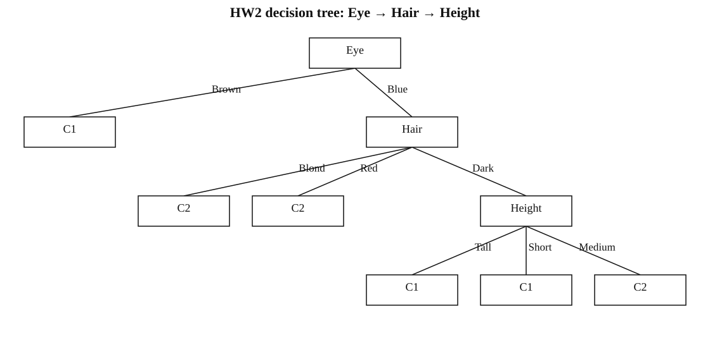
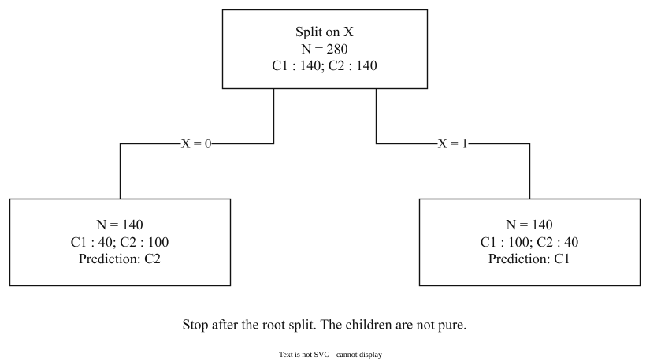

# 信息增益与决策树

[返回题型索引](../题型索引.md) · [网页练习](../index.html#type=tree)

同数据同题合并列出多处来源；题目文字为转录整理，原扫描页保留供核对。

## E16-03 · 2016：二元属性信息增益与整棵树

来源：2016 年扫描卷 · Q3 / 15 points · PDF p.2

状态：完整；形式：计算 / 推导。

### 原文

Given attributes {A,B,C} and classes {C1,C2}, build a decision tree using information gain to select the split attribute.

给定属性 {A,B,C} 和类别 {C1,C2}，构建决策树，使用信息增益选择分裂属性。

| ID | A | B | C | Class |
| --- | --- | --- | --- | --- |
| 1 | 0 | 0 | 0 | C1 |
| 2 | 0 | 0 | 1 | C1 |
| 3 | 0 | 1 | 0 | C1 |
| 4 | 0 | 1 | 1 | C2 |
| 5 | 1 | 0 | 0 | C1 |
| 6 | 1 | 0 | 0 | C1 |
| 7 | 1 | 1 | 0 | C2 |
| 8 | 1 | 0 | 1 | C1 |
| 9 | 1 | 1 | 0 | C2 |
| 10 | 1 | 1 | 0 | C2 |

### 逐步解答

#### 本题公式

对当前节点数据集 $D$，$p_c$ 是第 $c$ 类占比，$D_v$ 是按属性 $A=v$ 分出的子集：

$$\begin{aligned}
H(D)&=-\sum_c p_c\log_2p_c,\\
H(D\mid A)&=\sum_v\frac{|D_v|}{|D|}H(D_v),\\
Gain(A)&=H(D)-H(D\mid A).
\end{aligned}$$

熵衡量类别混杂程度；条件熵按各子集样本数加权。选择增益最大的属性后，在尚未纯净的子节点中重新计算。

#### 2. 根节点的类别计数与属性比较

总计 C1=6、C2=4，$H(D)=0.970951$。使用 $Gain(A)=H(D)-\sum_v |D_v|H(D_v)/|D|$。

| Attribute | Conditional entropy | Information gain |
| --- | --- | --- |
| A | 0.924511 | 0.046439 |
| B | 0.360964 | 0.609987 |
| C | 0.965148 | 0.005802 |

根选 B。B=0 有 5 条，全部 C1；B=1 有 5 条，其中 C1=1、C2=4，熵 $H(1/5,4/5)=0.721928$。

| Attribute | Conditional entropy | Information gain |
| --- | --- | --- |
| A | 0.4 | 0.321928 |
| B | 0.721928 | 0 |
| C | 0.649022 | 0.072906 |

该子集选 A；A=1 有三条全部 C2；A=0 两条由 C 区分。

逐行回代全部十个样本即可检查树是否一致。重复样本仍须保留其计数权重。

#### 3. 展开一次实际计算

根节点的 $B=0$ 分支全为 C1，其熵为 0；$B=1$ 分支的比例为 $1/5,4/5$：

$$H(D\mid B)=\frac5{10}\times0+\frac5{10}\times0.721928=0.360964.$$

$$Gain(B)=0.970951-0.360964=0.609987.$$

在 $B=1$ 子集中，$A=1$ 三条全为 C2；$A=0$ 的两条类别各一。因此 $H(D_{B=1}\mid A)=(3/5)\times0+(2/5)\times1=0.4$，增益为 $0.721928-0.4=0.321928$。最后仅剩 $A=0,B=1$ 的两条，用 C 分开即得到纯叶节点。

### English answer pattern

Choose B at the root and recursively recompute information gain on the B=1 subset.

根节点选 B，在 B=1 子集中重新计算信息增益并递归。

### 易错点与约定

分支权重取该分支样本数占当前节点样本总数的比例。某子集上已用属性 B 的增益为 0，不应再次选择。

### 知识点与公式总结

- 类别熵 $H(D)=-\sum_c p_c\log_2p_c$，$p_c=n_c/|D|$；先数当前节点各类样本数，纯节点的熵为 0。
- 信息增益 $Gain(A)=H(D)-\sum_v\frac{|D_v|}{|D|}H(D_v)$；按子节点人数加权，比较增益选属性。
- 在每个未纯净子节点重算局部比例，再继续分裂；重复样本也计入人数，最后沿树逐行检查预测。

---

## HW2-01 · 当前与往届同题：Height/Hair/Eye 建树

来源：当前 HW2 · Written Q1；往届 HW2（hxd） · Written Q1

状态：完整；形式：计算 / 推导。

### 原文

Compute information gain for Height, Hair and Eye, then construct a decision tree.

计算身高、发色和眼睛颜色的信息增益，再构建决策树。

| ID | Height | Hair | Eye | Class |
| --- | --- | --- | --- | --- |
| 1 | Tall | Blond | Brown | C1 |
| 2 | Tall | Dark | Blue | C1 |
| 3 | Tall | Dark | Brown | C1 |
| 4 | Short | Dark | Blue | C1 |
| 5 | Short | Blond | Brown | C1 |
| 6 | Tall | Red | Blue | C2 |
| 7 | Tall | Blond | Blue | C2 |
| 8 | Short | Blond | Blue | C2 |
| 9 | Medium | Dark | Blue | C2 |

表中 Tall、Short、Medium 为高、矮、中等；Blond、Dark、Red 为金色、深色、红色；Brown、Blue 为棕色、蓝色。

### 逐步解答

#### 本题公式

对当前节点数据集 $D$，$p_c$ 是第 $c$ 类占比，$D_v$ 是按属性 $A=v$ 分出的子集：

$$\begin{aligned}
H(D)&=-\sum_c p_c\log_2p_c,\\
H(D\mid A)&=\sum_v\frac{|D_v|}{|D|}H(D_v),\\
Gain(A)&=H(D)-H(D\mid A).
\end{aligned}$$

熵衡量类别混杂程度；条件熵按各子集样本数加权。选择增益最大的属性后，在尚未纯净的子节点中重新计算。

#### 2. 根节点的类别计数与属性比较

总体 C1=5、C2=4，熵 $H=0.991076$。

| Attribute | Conditional entropy | Information gain |
| --- | --- | --- |
| Height | 0.845516 | 0.14556 |
| Hair | 0.805012 | 0.186064 |
| Eye | 0.612197 | 0.378879 |

根选 Eye。Brown 的三条全部 C1；Blue 的六条 C1=2、C2=4。在 Blue 子集重算，Hair 的增益为 0.459148，Height 为 0.125815，故选 Hair。Hair=Blond/Red 均为 C2；Dark 子集按 Height，Tall/Short 为 C1，Medium 为 C2。

#### 3. 为什么 Eye 获得最大增益

Brown 三条全部属于 C1，熵为 0；Blue 六条中有 C1 两条、C2 四条：

$$H(D\mid Eye)=\frac39\times0+\frac69 H\!\left(\frac26,\frac46\right)=0.612197.$$

$$Gain(Eye)=0.991076-0.612197=0.378879.$$

进入 Blue 后，Hair=Blond 的两条和 Hair=Red 的一条均为 C2；Hair=Dark 三条比例为 $(2/3,1/3)$。因此 Hair 的条件熵为 $(3/6)\times0.918296=0.459148$，增益也是 $0.918296-0.459148=0.459148$。继续按 Height 分开 Dark 的三条即可。

### English answer pattern

Eye has the largest root information gain. Recompute gains within the Blue subset and split by Hair.

Eye 在根节点的信息增益最大。在 Blue 子集内重算增益，按 Hair 分裂。

### 易错点与约定

当前 HW2 网络题 Q3 的第 8、9 条标签是 C3，这个建树题中仍是 C2。

### 知识点与公式总结

- 类别熵 $H(D)=-\sum_c p_c\log_2p_c$，$p_c=n_c/|D|$；先数当前节点各类样本数，纯节点的熵为 0。
- 信息增益 $Gain(A)=H(D)-\sum_v\frac{|D_v|}{|D|}H(D_v)$；按子节点人数加权，比较增益选属性。
- 根选定后，只用该分支的数据比较下一属性；可按“类频数→子熵→加权熵→增益→画树”组织计算。

---

## E25-04 · 2025 · 第4题：8 行频数表的信息增益与一层树

来源：2025 年人工智能学院回忆卷 · Q4 · PDF p.1；2025 年人工智能学院回忆卷 · Q4 续：信息增益与根分裂要求 · PDF p.2

状态：完整复原练习；形式：回忆复原 / 完整练习。

**复原依据：**回忆的表有 X/Y/Z 三个二元属性及 C1/C2 两列样本频数，原卷为 8 行。先算指定属性的信息增益，再选根属性并画根分裂；作者给的四行数字为自填示例。

**补配与口径：**

- 补配 X/Y/Z 的完整 8 组合频数表。
- 限定画一层分裂（根 + 两个子结点），子结点标频数；按多数票加预测标签。

以下为可完整作答的复原练习；补配数值不是原卷原值。

### 原文

Each row below represents multiple samples. Columns C1 and C2 are class **counts**, not input attributes. Logs are base 2.

下表每行代表多个样本。C1、C2 列是类别**计数**，不是输入属性。对数以 2 为底。

| X | Y | Z | C1 | C2 |
| --- | --- | --- | --- | --- |
| 0 | 0 | 0 | 5 | 35 |
| 0 | 0 | 1 | 10 | 30 |
| 0 | 1 | 0 | 15 | 15 |
| 0 | 1 | 1 | 10 | 20 |
| 1 | 0 | 0 | 30 | 10 |
| 1 | 0 | 1 | 35 | 5 |
| 1 | 1 | 0 | 20 | 10 |
| 1 | 1 | 1 | 15 | 15 |

**(a)** Compute the information gain for splitting on X. Show the total sample size, class counts, parent entropy and weighted child entropy.

**(a)** 计算按 X 分裂的信息增益。给出总样本数、类别计数、父熵与加权子熵。

**(b)** Compute the gains for Y and Z and choose the root attribute.

**(b)** 计算 Y、Z 的信息增益，并选择根属性。

**(c)** Draw **only the first split**: the root and its two child nodes. Annotate each child with its C1/C2 counts. If stopping at this depth, label each child by majority class. Do not recursively grow the full tree.

**(c)** 只画**第一次分裂**，即根及两个子节点。在各子节点标出 C1、C2 计数。若在此深度停止，按多数类给子节点标记。不要递归生长完整树。

### 小问要求与完成标准

| 小问 | 必须交付 | 停止位置 |
| --- | --- | --- |
| (a) | 总样本数、总类频数、H(D)、H(D\|X)、Gain(X) | 频数加权，不把 8 行当作 8 个单样本。 |
| (b) | 对 Y、Z 也计算增益并比较 | 选最大增益属性作为根。 |
| (c) | 一层决策树及每个子结点的 C1/C2 频数、停止时多数类 | 只分裂根一次，不递归到完整树。 |

### 逐步解答

#### 本题公式

对当前节点数据集 $D$，$p_c$ 是第 $c$ 类占比，$D_v$ 是按属性 $A=v$ 分出的子集：

$$\begin{aligned}
H(D)&=-\sum_c p_c\log_2p_c,\\
H(D\mid A)&=\sum_v\frac{|D_v|}{|D|}H(D_v),\\
Gain(A)&=H(D)-H(D\mid A).
\end{aligned}$$

熵衡量类别混杂程度；条件熵按各子集样本数加权。选择增益最大的属性后，在尚未纯净的子节点中重新计算。

#### 1. 按类别频数计算样本量

$$N=280,\qquad n_{C_1}=140,\qquad n_{C_2}=140.$$
$$H(D)=-\tfrac12\log_2\tfrac12-\tfrac12\log_2\tfrac12=1\ \text{bit}.$$

某行如 $(X,Y,Z)=(0,0,0)$ 代表 $5+35=40$ 个样本；将八行的类别计数全部相加，得到 280 个样本。

#### 2. 展开 X 的加权熵

X=0 的类频数为 $(40,100)$，X=1 为 $(100,40)$，两组均 140 人。组内比例分别为 $(2/7,5/7)$ 及 $(5/7,2/7)$。

这里 $H(p_1,p_2)=-p_1\log_2p_1-p_2\log_2p_2$，表示给定两类比例时的不确定性；两组各占总样本的一半。

$$\begin{aligned}
H(D\mid X)&=\frac{140}{280}H\!\left(\frac27,\frac57\right)\\
&\quad+\frac{140}{280}H\!\left(\frac57,\frac27\right)\\
&=0.863120569.
\end{aligned}$$
$$Gain(X)=1-0.863120569=\boxed{0.136879431}.$$

#### 3. 比较 Y、Z

| Attribute | 0 branch: (C1,C2) | 1 branch: (C1,C2) | Weighted entropy | Information gain |
| --- | --- | --- | --- | --- |
| X | (40, 100) | (100, 40) | 0.863120569 | 0.136879431 |
| Y | (80, 80) | (60, 60) | 1.000000000 | 0.000000000 |
| Z | (70, 70) | (70, 70) | 1.000000000 | 0.000000000 |

Y 的两组都是类比例 1:1，Z 也一样，所以条件熵都为 1，增益 0。根选 **X**。

#### 4. 按要求只画一层

X=0 预测 C2，X=1 预测 C1。两个子节点仍包含两类样本；按各节点多数类标记，即完成题目要求的**一层截断树**。

### English answer pattern

The dataset contains 280 samples. Gain(X)=0.136879431, while Gain(Y)=Gain(Z)=0. Select X and draw only its two children, labeled C2 and C1 by majority vote.

数据集有 280 个样本。Gain(X)=0.136879431，Gain(Y)=Gain(Z)=0。选 X，只画两个子节点；按多数投票分别标为 C2、C1。

### 易错点与约定

类频数不能当作模型输入；组熵必须乘该组样本比例。多数类标签用于预测；节点是否纯，要检查另一类计数是否为 0。

### 计算与内存分析

对 $r$ 行聚合记录和 $d$ 个属性，可用 $O(rd)$ 时间汇总分裂统计，无须把频数展开成 $N$ 行；额外计数空间按属性取值和类别数计。

### 知识点与公式总结

- 类别熵 $H(D)=-\sum_c p_c\log_2p_c$，$p_c=n_c/|D|$；先数当前节点各类样本数，纯节点的熵为 0。
- 信息增益 $Gain(A)=H(D)-\sum_v\frac{|D_v|}{|D|}H(D_v)$；按子节点人数加权，比较增益选属性。
- 每行代表多名样本，样本量由 C1、C2 频数相加；题目只要求首次分裂，子节点写频数与多数类即可停止。

---

## E20-03C · 2020 简答：决策树如何选择分裂属性

来源：2020 年扫描卷 · Q3(3) / 4 points · PDF p.1

状态：完整；形式：历年简答。

### 原文

Please present an attribute selection method in a decision tree.

请给出一种决策树的属性选择方法。

### 逐步解答

#### 1. 信息增益：先算当前节点混杂度

设 $D$ 为当前节点的样本，$p_c$ 为类 c 的样本比例。信息熵为

$$H(D)=-\sum_c p_c\log_2p_c.$$

比例为 0 的项按 $0\log_2 0=0$ 处理。纯节点熵为 0；两类各半时熵为 1 bit。

#### 2. 按子节点样本数加权，选择增益最大者

属性 A 的取值 v 对应子集 $D_v$：

$$H(D\mid A)=\sum_v\frac{|D_v|}{|D|}H(D_v),\qquad Gain(A)=H(D)-H(D\mid A).$$

例如父节点两类各 5 人，熵为 1。某分裂得到 4 人的纯节点，以及 6 人、类比例 $(1/6,5/6)$ 的节点：

$$H(D\mid A)=\frac4{10}\times0+\frac6{10}H(1/6,5/6)\approx0.390013.$$

故 $Gain(A)\approx0.609987$。对每个可用属性同样计算，选择最大者，然后在各子集递归。

#### 3. 增益率为什么再除一个量

多取值属性容易把训练数据切成很多小组，得到偏高的信息增益。C4.5 的增益率用分裂本身的熵归一化：

$$SplitInfo(A)=-\sum_v\frac{|D_v|}{|D|}\log_2\frac{|D_v|}{|D|},\qquad GainRatio(A)=\frac{Gain(A)}{SplitInfo(A)}.$$

上例组比例为 0.4、0.6，$SplitInfo=0.970951$，增益率约为 $0.609987/0.970951=0.628236$。实际选择需排除分母为 0 的分裂，并处理低增益却比例偏高的情况。

#### 4. 若题目采用 Gini

$$Gini(D)=1-\sum_c p_c^2,\qquad Gini_{split}(A)=\sum_v\frac{|D_v|}{|D|}Gini(D_v).$$

它同样衡量类别混杂，但使用平方而非对数。上例父 Gini 为 0.5，子 Gini 为 $(4/10)\times0+(6/10)\times[1-(1/6)^2-(5/6)^2]=1/6$；选择加权子 Gini 最小、或 Gini 降低量最大的分裂。

### English answer pattern

Select the attribute with maximum information gain, recomputed from class proportions at the current node.

选择信息增益最大的属性；在当前节点上根据类别比例重新计算。

### 知识点与公式总结

- 类别熵 $H(D)=-\sum_c p_c\log_2p_c$，$p_c=n_c/|D|$；先数当前节点各类样本数，纯节点的熵为 0。
- 信息增益 $Gain(A)=H(D)-\sum_v\frac{|D_v|}{|D|}H(D_v)$；按子节点人数加权，比较增益选属性。
- 增益率 $GainRatio=Gain/SplitInfo$，其中 $SplitInfo=-\sum_v q_v\log_2q_v$、$q_v=|D_v|/|D|$；分母为 0 的分裂不作此比值。
- Gini 口径为 $1-\sum_c p_c^2$；同样按子集人数加权，选择子 Gini 最小的分裂。选题目要求的一套准则完成比较。

---

## PPT-CL24 · 课件 · 买电脑数据的信息增益

来源：当前完整七讲课件 · classification.pdf · 训练数据表 · PDF p.17；当前完整七讲课件 · classification.pdf · Exercise 1 · PDF p.24

状态：完整课件练习；形式：课件计算 / 逐步练习。

### 原文

Please calculate the information gain of income, student, and credit_rating, respectively.

请分别计算 income、student 和 credit_rating 的信息增益。

| age | income | student | credit_rating | buys_computer |
| --- | --- | --- | --- | --- |
| <=30 | high | no | fair | no |
| <=30 | high | no | excellent | no |
| 31..40 | high | no | fair | yes |
| >40 | medium | no | fair | yes |
| >40 | low | yes | fair | yes |
| >40 | low | yes | excellent | no |
| 31..40 | low | yes | excellent | yes |
| <=30 | medium | no | fair | no |
| <=30 | low | yes | fair | yes |
| >40 | medium | yes | fair | yes |
| <=30 | medium | yes | excellent | yes |
| 31..40 | medium | no | excellent | yes |
| 31..40 | high | yes | fair | yes |
| >40 | medium | no | excellent | no |

### 逐步解答

#### 1. 总体熵：先数 yes/no

14 条记录中 yes 有 9 条，no 有 5 条。二分类熵及信息增益为

$$H(p,n)=-\frac p{p+n}\log_2\frac p{p+n}-\frac n{p+n}\log_2\frac n{p+n},$$

$$\operatorname{Gain}(A)=H(D)-\sum_v\frac{|D_v|}{|D|}H(D_v).$$

加权子熵表示“知道属性值以后还剩多少分类不确定性”；从原熵中减去它，得到此属性消除的不确定性。

$$H(D)=H(9,5)=0.940286.$$

#### 2. 按每个属性取值分组

下表每对计数依次为 $(yes,no)$。例如 income=medium 有 6 人，其中 4 yes、2 no。

| 属性 | 分组计数 (yes,no) | 加权子熵 | 信息增益 |
| --- | --- | --- | --- |
| age | <=30: (2,3)；31..40: (4,0)；>40: (3,2) | 0.693536 | 0.246750 |
| income | high: (2,2)；medium: (4,2)；low: (3,1) | 0.911063 | 0.029223 |
| student | no: (3,4)；yes: (6,1) | 0.788450 | 0.151836 |
| credit_rating | fair: (6,2)；excellent: (3,3) | 0.892159 | 0.048127 |

#### 3. 展开一个属性的代入

$$\begin{aligned}
E(income)&=\frac4{14}H(2,2)+\frac6{14}H(4,2)+\frac4{14}H(3,1)\\
&=\frac4{14}(1)+\frac6{14}(0.918296)+\frac4{14}(0.811278)\\
&=0.911063,\\
\operatorname{Gain}(income)&=0.940286-0.911063=\boxed{0.029223}.
\end{aligned}$$

同理，$\operatorname{Gain}(student)=\boxed{0.151836}$，$\operatorname{Gain}(credit\_rating)=\boxed{0.048127}$。比较三个题目要求的属性时，student 最大；若在全部四个属性中选根，age 的增益 0.246750 最大。

### English answer pattern

The gains are approximately 0.029223 for income, 0.151836 for student, and 0.048127 for credit_rating. Student is best among these three attributes.

信息增益约为：income 0.029223，student 0.151836，credit_rating 0.048127。在这三个属性中 student 最佳。

### 计算与内存分析

一次节点分裂可扫描 $n$ 条记录并累计 $d$ 个属性的类别计数，约需 $O(nd)$ 时间。

### 知识点与公式总结

- 类别熵 $H(D)=-\sum_c p_c\log_2p_c$，$p_c=n_c/|D|$；先数当前节点各类样本数，纯节点的熵为 0。
- 信息增益 $Gain(A)=H(D)-\sum_v\frac{|D_v|}{|D|}H(D_v)$；按子节点人数加权，比较增益选属性。
- 每个属性值分别统计 (yes,no)，再加权；题目比较 income、student、credit_rating，若另问全部属性的根才把 age 加入比较。
