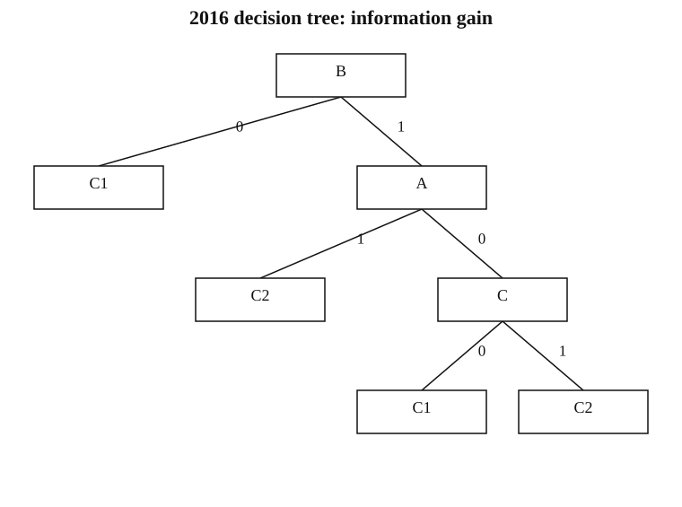

# 信息增益与决策树

[返回题型索引](../题型索引.md) · [网页练习](../index.html#type=tree)

同数据同题合并列出多处来源；题目文字为转录整理，原扫描页保留供核对。

## E16-03 · 2016：二元属性信息增益与整棵树

来源：2016 年扫描卷 · Q3 / 15 points · PDF p.2

状态：完整；形式：计算 / 推导。

### 本题公式 · 决策树：符号、公式与选属性规则

**按 X 分裂（split on X）**：用属性 X 的取值把当前数据分组。例如二元属性分出 X=0、X=1 两个子节点，分别统计各子节点中的类别人数。

### 先认清符号

- $D$：**当前节点**的数据集，$|D|$ 为其中样本数。
- $C_k$：第 $k$ 个**类别**；$p_k=n_k/|D|$ 为当前节点内该类占比。
- $A$：待比较的**分裂属性**；$v$ 是它的一个取值。代入题目时，$A$ 可换成 B、Hair、Eye 等实际列名。
- $D_v=\{x\in D:A(x)=v\}$：按 $A=v$ 分出的子集；$w_v=|D_v|/|D|$ 为该分支占父节点的比例。

计算 $H(D_v)$ 时，用该子集内部的类别比例 $p_{k\mid v}=n_{k,v}/|D_v|$，其中 $n_{k,v}$ 是分支 v 中类别 k 的人数。所有对数以2为底，$0\log_2 0=0$。

### ① 类别熵 Entropy：当前节点有多混杂

$$H(D)=-\sum_k p_k\log_2p_k.$$

只有一个类别时为0；二分类各占一半时为1 bit。课件 p21 写作 $I(p,n)$，p、n 是两类人数；把 $p_1=p/(p+n)$、$p_2=n/(p+n)$ 代入上式，就得到课件的二分类形式。

### ② 条件熵 Conditional entropy：分裂后还剩多少混杂

$$H(D\mid A)=\sum_v w_vH(D_v).$$

先算每个子集的类别熵，再按子集人数占比加权。课件 p22 的 $E(A)$ 与这里的 $H(D\mid A)$ 相同。

### ③ 信息增益 Information gain：熵减少了多少

$$Gain(A)=H(D)-H(D\mid A).$$

选择信息增益最大的属性，再对未纯净子节点重新计算。

### ④ 分裂信息 Split information：样本怎样分配到分支

$$SplitInfo(A)=-\sum_v w_v\log_2w_v.$$

课件 p25 写作 $SplitInfo_A(D)$。这里用的是**各分支人数比例 $w_v$**；类别熵用的是**各类别人数比例 $p_k$**。

### ⑤ 增益率 Gain ratio：用分裂信息归一化增益

$$GainRatio(A)=\frac{Gain(A)}{SplitInfo(A)}.$$

按增益率准则比较有效候选时，取较大者；$SplitInfo(A)=0$ 的分裂跳过该比值。C4.5还结合信息增益筛选候选，避免仅由很小的分母获得较高比值。

### ⑥ 基尼指数 Gini index：用平方比例衡量类别混杂

$$\begin{aligned}
Gini(D)&=1-\sum_k p_k^2,\\
Gini_{split}(A)&=\sum_v w_vGini(D_v),\\
\Delta Gini(A)&=Gini(D)-Gini_{split}(A).
\end{aligned}$$

课件 p26 的 $gini(T)$ 对应 $Gini(D)$，$gini_{split}(T)$ 对应 $Gini_{split}(A)$。选择**加权子 Gini 最小**的分裂，等价于选择 **$\Delta Gini$ 最大**的分裂。

**计算顺序：** 当前节点类频数 → 子节点类频数与人数权重 → 代入公式 → 比较结果 → 画树。

### 原文

Given attributes {A,B,C} and classes {C1,C2}, build a decision tree using information gain to select the split attribute.

给定属性 {A,B,C} 和类别 {C1,C2}，构建决策树，使用信息增益选择分裂属性。

| ID | A | B | C | Class |
| --- | --- | --- | --- | --- |
| 1 | 0 | 0 | 0 | C1 |
| 2 | 0 | 0 | 1 | C1 |
| 3 | 0 | 1 | 0 | C1 |
| 4 | 0 | 1 | 1 | C2 |
| 5 | 1 | 0 | 0 | C1 |
| 6 | 1 | 0 | 0 | C1 |
| 7 | 1 | 1 | 0 | C2 |
| 8 | 1 | 0 | 1 | C1 |
| 9 | 1 | 1 | 0 | C2 |
| 10 | 1 | 1 | 0 | C2 |

### 逐步解答

#### 1. 父节点类别人数表：先算 H(D)

| 类别 | 原表记录ID | 人数 | 类别比例 $p_k$ |
| --- | --- | --- | --- |
| $C_1$ | 1、2、3、5、6、8 | 6 | $6/10$ |
| $C_2$ | 4、7、9、10 | 4 | $4/10$ |
| 合计 | 全部记录 | 10 | 1 |

$$H(D)=-\frac6{10}\log_2\frac6{10}-\frac4{10}\log_2\frac4{10}
=\boxed{0.970951}.$$

#### 2. 以按 B 分裂为例，完整展示子集怎样形成

按原表B列的值分组，其他列和类别跟随各记录进入对应子集：

| 分支 | 记录ID | $(C_1,C_2)$人数 | 子集人数 | 权重 $w_v$ |
| --- | --- | --- | --- | --- |
| B=0 | 1、2、5、6、8 | (5,0) | 5 | $5/10$ |
| B=1 | 3、4、7、9、10 | (1,4) | 5 | $5/10$ |

B=0只有$C_1$，子熵为0；B=1内部两类比例为$1/5,4/5$，所以

$$H(D_{B=1})=-\frac15\log_2\frac15-\frac45\log_2\frac45\approx0.721928095.$$

再用**分支人数权重**对两个子熵加权，最后从父熵相减：

$$\begin{aligned}
H(D\mid B)&\approx\frac5{10}(0)+\frac5{10}(0.721928095)=0.360964047,\\
Gain(B)&\approx0.970950594-0.360964047\approx\boxed{0.609987}.
\end{aligned}$$

#### 3. 对另外两个候选属性采用同样的计算

**属性A：** A=0的记录为1、2、3、4，类频数$(3,1)$、人数4；A=1为5至10，类频数$(3,3)$、人数6。先算A=0内部的子熵：

$$H(D_{A=0})=-\frac34\log_2\frac34-\frac14\log_2\frac14=0.811278.$$

A=1两类各半，子熵为1。按$4/10,6/10$加权：

$$\begin{aligned}
H(D\mid A)&\approx\frac4{10}(0.811278124)+\frac6{10}(1)=0.924511250,\\
Gain(A)&\approx0.970950594-0.924511250\approx\boxed{0.046439}.
\end{aligned}$$

**属性C：** C=0含1、3、5、6、7、9、10，类频数$(4,3)$、子熵$0.985228136$；C=1含2、4、8，类频数$(2,1)$、子熵$0.918295834$。按$7/10,3/10$加权：

$$\begin{aligned}
H(D\mid C)&\approx\frac7{10}(0.985228136)+\frac3{10}(0.918295834)=0.965148445,\\
Gain(C)&\approx0.970950594-0.965148445\approx\boxed{0.005802}.
\end{aligned}$$

#### 4. 候选属性汇总：计算完再选根

| 候选属性 | 加权子熵 $H(D\mid A)$ | 信息增益 |
| --- | --- | --- |
| A | 0.924511250 | 0.046439 |
| B | 0.360964047 | **0.609987** |
| C | 0.965148445 | 0.005802 |

增益最大的是B，故根选B；B=0的5条记录全为$C_1$，直接成为叶节点。

#### 5. 进入 B=1 后，只用这5条记录重新计算

现在$D$指B=1节点。它的父类别人数为：

| 类别 | 人数 | 类别比例 |
| --- | --- | --- |
| $C_1$ | 1 | $1/5$ |
| $C_2$ | 4 | $4/5$ |

$$H(D)=-\frac15\log_2\frac15-\frac45\log_2\frac45=0.721928095.$$

先看按A划分出的两个子集：

| 分支 | 记录ID | $(C_1,C_2)$ | 人数 / 当前父人数 | 子熵 |
| --- | --- | --- | --- | --- |
| A=0 | 3、4 | (1,1) | $2/5$ | 1 |
| A=1 | 7、9、10 | (0,3) | $3/5$ | 0 |

另一个候选C：C=0含3、7、9、10，类频数$(1,3)$、子熵$0.811278$；C=1仅记录4，类频数$(0,1)$、子熵0。分别代入：

$$\begin{aligned}
H(D\mid A)&=\frac25(1)+\frac35(0)=0.4,\\
Gain(A)&=0.721928-0.4=\boxed{0.321928};\\[4pt]
H(D\mid C)&=\frac45(0.811278)+\frac15(0)=0.649022,\\
Gain(C)&=0.721928-0.649022=\boxed{0.072906}.
\end{aligned}$$

| 此节点的候选 | 加权子熵 | 信息增益 |
| --- | --- | --- |
| A | 0.400000 | **0.321928** |
| C | 0.649022 | 0.072906 |

因此B=1节点选A。A=1的3条均为$C_2$；A=0仅剩记录3、4，类别各一，熵为1。再按C划分，C=0给$C_1$、C=1给$C_2$，两个子集均纯净，条件熵0、增益1。

#### 6. 最后画树

逐行代入原表10条记录，可检查所有叶节点分类。重复记录仍按各自出现次数计入人数。

### English answer pattern

Choose B at the root: $Gain(B)=0.609987$. The B=0 branch is C1. In the B=1 subset, choose A: $Gain(A)=0.321928$. The A=1 branch is C2; split A=0 by C to obtain pure leaves.

根选择B：$Gain(B)=0.609987$。B=0分支为C1。在B=1子集中选择A：$Gain(A)=0.321928$。A=1分支为C2；对A=0再按C分裂，得到纯叶节点。

### 易错点与约定

分支权重取该分支样本数占当前节点样本总数的比例。某子集上已用属性 B 的增益为 0，不应再次选择。

### 知识点与公式总结

- $D$始终表示当前节点：根有10条数据；进入B=1后，分母改为该节点的5条数据。
- 根增益：$Gain(B)=0.609987>Gain(A)=0.046439>Gain(C)=0.005802$。
- B=1内：$Gain(A)=0.321928>Gain(C)=0.072906$，故先按A，再用C区分剩下两条。
- 计算权重$w_v$用分支人数，计算子熵用分支内部类别比例。

---

## HW2-01 · 当前与往届同题：Height/Hair/Eye 建树

来源：当前 HW2 · Written Q1；往届 HW2（hxd） · Written Q1

状态：完整；形式：计算 / 推导。

### 本题公式 · 决策树：符号、公式与选属性规则

**按 X 分裂（split on X）**：用属性 X 的取值把当前数据分组。例如二元属性分出 X=0、X=1 两个子节点，分别统计各子节点中的类别人数。

### 先认清符号

- $D$：**当前节点**的数据集，$|D|$ 为其中样本数。
- $C_k$：第 $k$ 个**类别**；$p_k=n_k/|D|$ 为当前节点内该类占比。
- $A$：待比较的**分裂属性**；$v$ 是它的一个取值。代入题目时，$A$ 可换成 B、Hair、Eye 等实际列名。
- $D_v=\{x\in D:A(x)=v\}$：按 $A=v$ 分出的子集；$w_v=|D_v|/|D|$ 为该分支占父节点的比例。

计算 $H(D_v)$ 时，用该子集内部的类别比例 $p_{k\mid v}=n_{k,v}/|D_v|$，其中 $n_{k,v}$ 是分支 v 中类别 k 的人数。所有对数以2为底，$0\log_2 0=0$。

### ① 类别熵 Entropy：当前节点有多混杂

$$H(D)=-\sum_k p_k\log_2p_k.$$

只有一个类别时为0；二分类各占一半时为1 bit。课件 p21 写作 $I(p,n)$，p、n 是两类人数；把 $p_1=p/(p+n)$、$p_2=n/(p+n)$ 代入上式，就得到课件的二分类形式。

### ② 条件熵 Conditional entropy：分裂后还剩多少混杂

$$H(D\mid A)=\sum_v w_vH(D_v).$$

先算每个子集的类别熵，再按子集人数占比加权。课件 p22 的 $E(A)$ 与这里的 $H(D\mid A)$ 相同。

### ③ 信息增益 Information gain：熵减少了多少

$$Gain(A)=H(D)-H(D\mid A).$$

选择信息增益最大的属性，再对未纯净子节点重新计算。

### ④ 分裂信息 Split information：样本怎样分配到分支

$$SplitInfo(A)=-\sum_v w_v\log_2w_v.$$

课件 p25 写作 $SplitInfo_A(D)$。这里用的是**各分支人数比例 $w_v$**；类别熵用的是**各类别人数比例 $p_k$**。

### ⑤ 增益率 Gain ratio：用分裂信息归一化增益

$$GainRatio(A)=\frac{Gain(A)}{SplitInfo(A)}.$$

按增益率准则比较有效候选时，取较大者；$SplitInfo(A)=0$ 的分裂跳过该比值。C4.5还结合信息增益筛选候选，避免仅由很小的分母获得较高比值。

### ⑥ 基尼指数 Gini index：用平方比例衡量类别混杂

$$\begin{aligned}
Gini(D)&=1-\sum_k p_k^2,\\
Gini_{split}(A)&=\sum_v w_vGini(D_v),\\
\Delta Gini(A)&=Gini(D)-Gini_{split}(A).
\end{aligned}$$

课件 p26 的 $gini(T)$ 对应 $Gini(D)$，$gini_{split}(T)$ 对应 $Gini_{split}(A)$。选择**加权子 Gini 最小**的分裂，等价于选择 **$\Delta Gini$ 最大**的分裂。

**计算顺序：** 当前节点类频数 → 子节点类频数与人数权重 → 代入公式 → 比较结果 → 画树。

### 原文

Compute information gain for Height, Hair and Eye, then construct a decision tree.

计算身高、发色和眼睛颜色的信息增益，再构建决策树。

| ID | Height | Hair | Eye | Class |
| --- | --- | --- | --- | --- |
| 1 | Tall | Blond | Brown | C1 |
| 2 | Tall | Dark | Blue | C1 |
| 3 | Tall | Dark | Brown | C1 |
| 4 | Short | Dark | Blue | C1 |
| 5 | Short | Blond | Brown | C1 |
| 6 | Tall | Red | Blue | C2 |
| 7 | Tall | Blond | Blue | C2 |
| 8 | Short | Blond | Blue | C2 |
| 9 | Medium | Dark | Blue | C2 |

表中 Tall、Short、Medium 为高、矮、中等；Blond、Dark、Red 为金色、深色、红色；Brown、Blue 为棕色、蓝色。

### 逐步解答

#### 1. 父节点类别人数表

| 类别 | 原表记录ID | 人数 | 类别比例 |
| --- | --- | --- | --- |
| $C_1$ | 1、2、3、4、5 | 5 | $5/9$ |
| $C_2$ | 6、7、8、9 | 4 | $4/9$ |
| 合计 | 全部记录 | 9 | 1 |

$$H(D)=-\frac59\log_2\frac59-\frac49\log_2\frac49=\boxed{0.991076}.$$

#### 2. 以 Eye 为例：从原记录形成子集

| 分支 | 记录ID | $(C_1,C_2)$ | 子集人数 | 权重 |
| --- | --- | --- | --- | --- |
| Brown | 1、3、5 | (3,0) | 3 | $3/9$ |
| Blue | 2、4、6、7、8、9 | (2,4) | 6 | $6/9$ |

Brown仅有$C_1$，子熵为0；Blue内部类别比例为$2/6,4/6$：

$$H(D_{Blue})=-\frac26\log_2\frac26-\frac46\log_2\frac46=0.918296.$$

用各子集人数占9人的比例加权，再求增益：

$$\begin{aligned}
H(D\mid Eye)&=\frac39(0)+\frac69(0.918296)=0.612197,\\
Gain(Eye)&=0.991076-0.612197=\boxed{0.378879}.
\end{aligned}$$

#### 3. 分别完成 Height 和 Hair 的计算

**Height：** Tall为$(3,2)$共5人，子熵$0.970951$；Short为$(2,1)$共3人，子熵$0.918296$；Medium为$(0,1)$共1人，子熵0。

$$\begin{aligned}
H(D\mid Height)&=\frac59(0.970951)+\frac39(0.918296)+\frac19(0)\\
&=0.845516,\\
Gain(Height)&=0.991076-0.845516=\boxed{0.145560}.
\end{aligned}$$

**Hair：** Blond为$(2,2)$共4人，子熵1；Dark为$(3,1)$共4人，子熵$0.811278$；Red为$(0,1)$共1人，子熵0。

$$\begin{aligned}
H(D\mid Hair)&=\frac49(1)+\frac49(0.811278)+\frac19(0)=0.805012,\\
Gain(Hair)&=0.991076-0.805012=\boxed{0.186064}.
\end{aligned}$$

#### 4. 汇总候选属性，选择根节点

| 属性 | 加权子熵 | 信息增益 |
| --- | --- | --- |
| Height | 0.845516 | 0.145560 |
| Hair | 0.805012 | 0.186064 |
| Eye | 0.612197 | **0.378879** |

根选Eye。Brown直接标为$C_1$；Blue需要继续分裂。

#### 5. 在 Blue 的6条数据中重新按 Hair、Height 分组

此时父节点$D$有$C_1=2,C_2=4$，$H(D)=0.918296$。先展示按Hair得到的三个子集：

| 分支 | 原表ID | $(C_1,C_2)$ | 权重 | 子熵 |
| --- | --- | --- | --- | --- |
| Dark | 2、4、9 | (2,1) | $3/6$ | 0.918296 |
| Blond | 7、8 | (0,2) | $2/6$ | 0 |
| Red | 6 | (0,1) | $1/6$ | 0 |

Dark子集的类别比例为$2/3,1/3$，代入类别熵得到$0.918296$。另一个候选Height：Tall为$(1,2)$共3人，子熵$0.918296$；Short为$(1,1)$共2人，子熵1；Medium为$(0,1)$共1人，子熵0。两种划分分别加权：

$$\begin{aligned}
H(D\mid Hair)&=\frac36(0.918296)+\frac26(0)+\frac16(0)=0.459148,\\
Gain(Hair)&=0.918296-0.459148=\boxed{0.459148};\\[4pt]
H(D\mid Height)&=\frac36(0.918296)+\frac26(1)+\frac16(0)=0.792481,\\
Gain(Height)&=0.918296-0.792481=\boxed{0.125815}.
\end{aligned}$$

| Blue节点候选 | 加权子熵 | 信息增益 |
| --- | --- | --- |
| Hair | 0.459148 | **0.459148** |
| Height | 0.792481 | 0.125815 |

选择Hair。Blond、Red直接标$C_2$；Dark子集剩记录2、4、9，按Height分成纯叶：Tall、Short为$C_1$，Medium为$C_2$。这次Height划分的加权子熵为0。

#### 6. 最后画树并核对

该树可正确分类原表全部9条记录。

### English answer pattern

The root gains for Height, Hair and Eye are 0.145560,0.186064 and 0.378879, so choose Eye. Brown is C1. Within Blue, choose Hair; Blond and Red are C2. Split Dark by Height: Tall and Short are C1, Medium is C2.

Height、Hair和Eye在根节点的增益分别为0.145560、0.186064和0.378879，因此选择Eye。Brown为C1。在Blue内选择Hair；Blond和Red为C2。Dark按Height分裂：Tall和Short为C1，Medium为C2。

### 易错点与约定

当前 HW2 网络题 Q3 的第 8、9 条标签是 C3，这个建树题中仍是 C2。

### 知识点与公式总结

- 根类频数为$(5,4)$；先求各属性的加权子熵，再用父熵$0.991076$相减。
- Eye增益最大$0.378879$；Brown为纯叶，Blue进入局部递归。
- Blue内用6条数据重算，Hair增益$0.459148$，大于Height的$0.125815$。
- 最终树在计算之后画；每次分裂选择与局部数据的计算结果对应。

---

## E25-04 · 2025 · 第4题：8 行频数表的信息增益与一层树

来源：2025 年人工智能学院回忆卷 · Q4 · PDF p.1；2025 年人工智能学院回忆卷 · Q4 续：信息增益与根分裂要求 · PDF p.2

状态：完整复原练习；形式：回忆复原 / 完整练习。

**复原依据：**回忆的表有 X/Y/Z 三个二元属性及 C1/C2 两列样本频数，原卷为 8 行。先算指定属性的信息增益，再选根属性并画根分裂；作者给的四行数字为自填示例。

**补配与口径：**

- 补配 X/Y/Z 的完整 8 组合频数表。
- 限定画一层分裂（根 + 两个子结点），子结点标频数；按多数票加预测标签。

以下为可完整作答的复原练习；补配数值不是原卷原值。

### 本题公式 · 决策树：符号、公式与选属性规则

**按 X 分裂（split on X）**：用属性 X 的取值把当前数据分组。例如二元属性分出 X=0、X=1 两个子节点，分别统计各子节点中的类别人数。

### 先认清符号

- $D$：**当前节点**的数据集，$|D|$ 为其中样本数。
- $C_k$：第 $k$ 个**类别**；$p_k=n_k/|D|$ 为当前节点内该类占比。
- $A$：待比较的**分裂属性**；$v$ 是它的一个取值。代入题目时，$A$ 可换成 B、Hair、Eye 等实际列名。
- $D_v=\{x\in D:A(x)=v\}$：按 $A=v$ 分出的子集；$w_v=|D_v|/|D|$ 为该分支占父节点的比例。

计算 $H(D_v)$ 时，用该子集内部的类别比例 $p_{k\mid v}=n_{k,v}/|D_v|$，其中 $n_{k,v}$ 是分支 v 中类别 k 的人数。所有对数以2为底，$0\log_2 0=0$。

### ① 类别熵 Entropy：当前节点有多混杂

$$H(D)=-\sum_k p_k\log_2p_k.$$

只有一个类别时为0；二分类各占一半时为1 bit。课件 p21 写作 $I(p,n)$，p、n 是两类人数；把 $p_1=p/(p+n)$、$p_2=n/(p+n)$ 代入上式，就得到课件的二分类形式。

### ② 条件熵 Conditional entropy：分裂后还剩多少混杂

$$H(D\mid A)=\sum_v w_vH(D_v).$$

先算每个子集的类别熵，再按子集人数占比加权。课件 p22 的 $E(A)$ 与这里的 $H(D\mid A)$ 相同。

### ③ 信息增益 Information gain：熵减少了多少

$$Gain(A)=H(D)-H(D\mid A).$$

选择信息增益最大的属性，再对未纯净子节点重新计算。

### ④ 分裂信息 Split information：样本怎样分配到分支

$$SplitInfo(A)=-\sum_v w_v\log_2w_v.$$

课件 p25 写作 $SplitInfo_A(D)$。这里用的是**各分支人数比例 $w_v$**；类别熵用的是**各类别人数比例 $p_k$**。

### ⑤ 增益率 Gain ratio：用分裂信息归一化增益

$$GainRatio(A)=\frac{Gain(A)}{SplitInfo(A)}.$$

按增益率准则比较有效候选时，取较大者；$SplitInfo(A)=0$ 的分裂跳过该比值。C4.5还结合信息增益筛选候选，避免仅由很小的分母获得较高比值。

### ⑥ 基尼指数 Gini index：用平方比例衡量类别混杂

$$\begin{aligned}
Gini(D)&=1-\sum_k p_k^2,\\
Gini_{split}(A)&=\sum_v w_vGini(D_v),\\
\Delta Gini(A)&=Gini(D)-Gini_{split}(A).
\end{aligned}$$

课件 p26 的 $gini(T)$ 对应 $Gini(D)$，$gini_{split}(T)$ 对应 $Gini_{split}(A)$。选择**加权子 Gini 最小**的分裂，等价于选择 **$\Delta Gini$ 最大**的分裂。

**计算顺序：** 当前节点类频数 → 子节点类频数与人数权重 → 代入公式 → 比较结果 → 画树。

### 原文

Each row below represents multiple samples. Columns C1 and C2 are class **counts**, not input attributes. Logs are base 2.

下表每行代表多个样本。C1、C2 列是类别**计数**，不是输入属性。对数以 2 为底。

| X | Y | Z | C1 | C2 |
| --- | --- | --- | --- | --- |
| 0 | 0 | 0 | 5 | 35 |
| 0 | 0 | 1 | 10 | 30 |
| 0 | 1 | 0 | 15 | 15 |
| 0 | 1 | 1 | 10 | 20 |
| 1 | 0 | 0 | 30 | 10 |
| 1 | 0 | 1 | 35 | 5 |
| 1 | 1 | 0 | 20 | 10 |
| 1 | 1 | 1 | 15 | 15 |

**(a)** Compute the information gain for splitting on X. Show the total sample size, class counts, parent entropy and weighted child entropy.

**(a)** 计算按 X 分裂的信息增益。给出总样本数、类别计数、父熵与加权子熵。

**(b)** Compute the gains for Y and Z and choose the root attribute.

**(b)** 计算 Y、Z 的信息增益，并选择根属性。

**(c)** Draw **only the first split**: the root and its two child nodes. Annotate each child with its C1/C2 counts. If stopping at this depth, label each child by majority class. Do not recursively grow the full tree.

**(c)** 只画**第一次分裂**，即根及两个子节点。在各子节点标出 C1、C2 计数。若在此深度停止，按多数类给子节点标记。不要递归生长完整树。

### 小问要求与完成标准

| 小问 | 必须交付 | 停止位置 |
| --- | --- | --- |
| (a) | 总样本数、总类频数、H(D)、H(D\|X)、Gain(X) | 频数加权，不把 8 行当作 8 个单样本。 |
| (b) | 对 Y、Z 也计算增益并比较 | 选最大增益属性作为根。 |
| (c) | 一层决策树及每个子结点的 C1/C2 频数、停止时多数类 | 只分裂根一次，不递归到完整树。 |

### 逐步解答

#### 1. (a) 先将频数表加总为父节点类别人数

原表每行代表多条样本，C1、C2两列为类别人数。

| 类别 | 八行人数之和 | 父节点比例 |
| --- | --- | --- |
| $C_1$ | 140 | $140/280=1/2$ |
| $C_2$ | 140 | $140/280=1/2$ |
| 合计 | $|D|=280$ | 1 |

$$H(D)=-\frac{140}{280}\log_2\frac{140}{280}
-\frac{140}{280}\log_2\frac{140}{280}=1.$$

#### 2. (a) 按 X 分裂：先看两支分别包含哪些原表行

下面行号按原频数表从上到下1至8编号。

| 分支 | 原频数表行号 | $(C_1,C_2)$ | 样本人数 | 权重 |
| --- | --- | --- | --- | --- |
| X=0 | 第1–4行 | (40,100) | 140 | $140/280$ |
| X=1 | 第5–8行 | (100,40) | 140 | $140/280$ |

每支内部先由类别人数计算子熵，再按两支样本量加权：

$$\begin{aligned}
H(D_{X=0})&=-\frac{40}{140}\log_2\frac{40}{140}
-\frac{100}{140}\log_2\frac{100}{140}=0.863120569,\\
H(D_{X=1})&=0.863120569,\\
H(D\mid X)&=\frac{140}{280}(0.863120569)
+\frac{140}{280}(0.863120569)=0.863120569,\\
Gain(X)&=1-0.863120569=\boxed{0.136879431}.
\end{aligned}$$

#### 3. (b) 用同一流程计算 Y、Z

**Y：** Y=0的类频数为$(80,80)$、人数160；Y=1为$(60,60)$、人数120。两支类别比例均为$1/2,1/2$，所以两个子熵均为1。

**Z：** Z=0、Z=1的类频数均为$(70,70)$，各140人，两个子熵也均为1。

$$\begin{aligned}
H(D\mid Y)&=\frac{160}{280}(1)+\frac{120}{280}(1)=1,\\
Gain(Y)&=1-1=\boxed{0};\\[4pt]
H(D\mid Z)&=\frac{140}{280}(1)+\frac{140}{280}(1)=1,\\
Gain(Z)&=1-1=\boxed{0}.
\end{aligned}$$

#### 4. (b) 算完各候选，再汇总选根

| 属性 | 加权子熵 | 信息增益 |
| --- | --- | --- |
| X | 0.863120569 | **0.136879431** |
| Y | 1 | 0 |
| Z | 1 | 0 |

最大信息增益来自X，故根选X。

#### 5. (c) 最后画一层树

X=0的子节点标$(40,100)$，多数类为$C_2$；X=1标$(100,40)$，多数类为$C_1$。按题意在这一层停止。

### English answer pattern

There are 280 samples, with 140 in each class. $H(D)=1$ and $H(D\mid X)=0.863120569$, giving $Gain(X)=0.136879431$. $Gain(Y)=Gain(Z)=0$. Draw only the X split: child counts are (40,100) and (100,40), labeled C2 and C1.

共有280个样本，每类140个。$H(D)=1$，$H(D\mid X)=0.863120569$，因此$Gain(X)=0.136879431$。$Gain(Y)=Gain(Z)=0$。只画X的分裂：子节点频数为(40,100)和(100,40)，分别标为C2和C1。

### 易错点与约定

类频数不能当作模型输入；组熵必须乘该组样本比例。多数类标签用于预测；节点是否纯，要检查另一类计数是否为 0。

### 计算与内存分析

对 $r$ 行聚合记录和 $d$ 个属性，可用 $O(rd)$ 时间汇总分裂统计，无须把频数展开成 $N$ 行；额外计数空间按属性取值和类别数计。

### 知识点与公式总结

- 输入是类别频数表，$|D|=\sum_i(n_{i,C_1}+n_{i,C_2})=280$。
- $H(D\mid A)$的权重按样本人数计算：Y两支为160/280与120/280。
- $Gain(X)=0.136879431$，Y和Z的条件熵都为1，所以增益为0。
- 本题只画首次分裂；写子节点频数，再按多数类标记即可。

---

## E20-03C · 2020 简答：决策树如何选择分裂属性

来源：2020 年扫描卷 · Q3(3) / 4 points · PDF p.1

状态：完整；形式：历年简答。

### 本题公式 · 决策树：符号、公式与选属性规则

**按 X 分裂（split on X）**：用属性 X 的取值把当前数据分组。例如二元属性分出 X=0、X=1 两个子节点，分别统计各子节点中的类别人数。

### 先认清符号

- $D$：**当前节点**的数据集，$|D|$ 为其中样本数。
- $C_k$：第 $k$ 个**类别**；$p_k=n_k/|D|$ 为当前节点内该类占比。
- $A$：待比较的**分裂属性**；$v$ 是它的一个取值。代入题目时，$A$ 可换成 B、Hair、Eye 等实际列名。
- $D_v=\{x\in D:A(x)=v\}$：按 $A=v$ 分出的子集；$w_v=|D_v|/|D|$ 为该分支占父节点的比例。

计算 $H(D_v)$ 时，用该子集内部的类别比例 $p_{k\mid v}=n_{k,v}/|D_v|$，其中 $n_{k,v}$ 是分支 v 中类别 k 的人数。所有对数以2为底，$0\log_2 0=0$。

### ① 类别熵 Entropy：当前节点有多混杂

$$H(D)=-\sum_k p_k\log_2p_k.$$

只有一个类别时为0；二分类各占一半时为1 bit。课件 p21 写作 $I(p,n)$，p、n 是两类人数；把 $p_1=p/(p+n)$、$p_2=n/(p+n)$ 代入上式，就得到课件的二分类形式。

### ② 条件熵 Conditional entropy：分裂后还剩多少混杂

$$H(D\mid A)=\sum_v w_vH(D_v).$$

先算每个子集的类别熵，再按子集人数占比加权。课件 p22 的 $E(A)$ 与这里的 $H(D\mid A)$ 相同。

### ③ 信息增益 Information gain：熵减少了多少

$$Gain(A)=H(D)-H(D\mid A).$$

选择信息增益最大的属性，再对未纯净子节点重新计算。

### ④ 分裂信息 Split information：样本怎样分配到分支

$$SplitInfo(A)=-\sum_v w_v\log_2w_v.$$

课件 p25 写作 $SplitInfo_A(D)$。这里用的是**各分支人数比例 $w_v$**；类别熵用的是**各类别人数比例 $p_k$**。

### ⑤ 增益率 Gain ratio：用分裂信息归一化增益

$$GainRatio(A)=\frac{Gain(A)}{SplitInfo(A)}.$$

按增益率准则比较有效候选时，取较大者；$SplitInfo(A)=0$ 的分裂跳过该比值。C4.5还结合信息增益筛选候选，避免仅由很小的分母获得较高比值。

### ⑥ 基尼指数 Gini index：用平方比例衡量类别混杂

$$\begin{aligned}
Gini(D)&=1-\sum_k p_k^2,\\
Gini_{split}(A)&=\sum_v w_vGini(D_v),\\
\Delta Gini(A)&=Gini(D)-Gini_{split}(A).
\end{aligned}$$

课件 p26 的 $gini(T)$ 对应 $Gini(D)$，$gini_{split}(T)$ 对应 $Gini_{split}(A)$。选择**加权子 Gini 最小**的分裂，等价于选择 **$\Delta Gini$ 最大**的分裂。

**计算顺序：** 当前节点类频数 → 子节点类频数与人数权重 → 代入公式 → 比较结果 → 画树。

### 原文

Please present an attribute selection method in a decision tree.

请给出一种决策树的属性选择方法。

### 逐步解答

#### 1. 属性选择的方法与公式

按候选属性 A 的取值把当前数据 D 分组。先计算父节点的类别熵，再计算各分支的类别熵，按分支人数加权：

$$\begin{aligned}
H(D)&=-\sum_kp_k\log_2p_k,\\
H(D\mid A)&=\sum_v\frac{|D_v|}{|D|}H(D_v),\\
Gain(A)&=H(D)-H(D\mid A).
\end{aligned}$$

选信息增益最大的属性，继续划分未纯净的子节点。下面沿用已有课件题 **PPT-CL24** 的 income 数据，演示同一次分裂的三种指标。

#### 2. 划分前：先数类别，再求父熵

| 类别 | 人数 | 类别占比 |
| --- | ---: | --- |
| yes | 9 | $9/14$ |
| no | 5 | $5/14$ |
| 合计 | 14 | 1 |

$$H(D)=-\frac9{14}\log_2\frac9{14}-\frac5{14}\log_2\frac5{14}=0.940286.$$

#### 3. 按 income 划分：列分支并算子熵

income 有 high、medium、low 三个取值，因此分出三个子节点：

| 分支 | yes | no | 分支人数 | 权重 |
| --- | ---: | ---: | ---: | --- |
| high | 2 | 2 | 4 | $4/14$ |
| medium | 4 | 2 | 6 | $6/14$ |
| low | 3 | 1 | 4 | $4/14$ |

每个分支内部用自己的类别比例求熵：

$$\begin{aligned}
H(D_{high})&=-\frac24\log_2\frac24-\frac24\log_2\frac24=1,\\
H(D_{medium})&=-\frac46\log_2\frac46-\frac26\log_2\frac26=0.918296,\\
H(D_{low})&=-\frac34\log_2\frac34-\frac14\log_2\frac14=0.811278.
\end{aligned}$$

#### 4. 信息增益：分裂前减分裂后

$$H(D\mid income)=\sum_v\frac{|D_v|}{|D|}H(D_v).$$

把上面已求出的子熵与分支权重代入：

$$\begin{aligned}
H(D\mid income)&=\frac4{14}(1)+\frac6{14}(0.918296)+\frac4{14}(0.811278)\\
&\approx0.911063,\\
Gain(income)&=H(D)-H(D\mid income)\\
&\approx0.940286-0.911063=\boxed{0.029223}.
\end{aligned}$$

#### 5. 增益率：信息增益除以分裂信息

SplitInfo 只用三条分支的人数比例 $4/14,6/14,4/14$：

$$SplitInfo(A)=-\sum_vw_v\log_2w_v,\qquad GainRatio(A)=\frac{Gain(A)}{SplitInfo(A)}.$$

$$\begin{aligned}
SplitInfo(income)&=-\frac4{14}\log_2\frac4{14}-\frac6{14}\log_2\frac6{14}\\
&\quad-\frac4{14}\log_2\frac4{14}=1.556657,\\
GainRatio(income)&\approx\frac{0.029222566}{1.556656707}=\boxed{0.018773}.
\end{aligned}$$

$H(D\mid income)$ 用各分支内部的类别比例衡量分类后的混杂；SplitInfo 用分支大小衡量数据分配情况。

#### 6. Gini：先算类别混杂，再对子节点加权

$$Gini(D)=1-\sum_kp_k^2,\qquad Gini_{split}(A)=\sum_vw_vGini(D_v).$$

父节点和三个子节点先分别代入：

$$\begin{aligned}
Gini(D)&=1-(9/14)^2-(5/14)^2=\frac{45}{98}\approx0.459184,\\
Gini(D_{high})&=1-(2/4)^2-(2/4)^2=0.5,\\
Gini(D_{medium})&=1-(4/6)^2-(2/6)^2=4/9,\\
Gini(D_{low})&=1-(3/4)^2-(1/4)^2=3/8.
\end{aligned}$$

再按同一组分支人数权重加权：

$$\begin{aligned}
Gini_{split}(income)&=\frac4{14}(0.5)+\frac6{14}\left(\frac49\right)+\frac4{14}\left(\frac38\right)\\
&=\frac{37}{84}\approx\boxed{0.440476},\\
\Delta Gini(income)&=Gini(D)-Gini_{split}(income)\\
&=\frac{45}{98}-\frac{37}{84}=\frac{11}{588}\approx\boxed{0.018707}.
\end{aligned}$$

#### 7. 计算完成后汇总选择标准

| 指标 | 本例结果 | 比较候选属性时 |
| --- | --- | --- |
| Information gain | 0.029223 | 选较大者 |
| Gain ratio | 0.018773 | 在有效候选中选较大者 |
| Weighted child Gini | 0.440476 | 选较小者 |
| Gini reduction | 0.018707 | 选较大者 |

原题介绍属性选择方法时，可以按第1部分说明信息增益选属性的步骤。以上使用同一组已有数据，帮助对应三种指标的公式与代入顺序；计算保留未舍入值，最后统一保留6位小数。

### English answer pattern

At the current node, compute class entropy, split by each candidate attribute, and weight child entropies by child size. Select the largest information gain. If using Gini, select the smallest weighted child Gini, equivalently the largest Gini reduction.

在当前节点计算类别熵，按各候选属性分裂，并按子节点大小对其熵加权。选择信息增益最大的属性。若使用Gini，则选择加权子Gini最小的分裂，等价于Gini降低量最大的分裂。

### 知识点与公式总结

- 分裂（split）是按属性取值分组；本例 income 产生 high、medium、low 三个分支。
- 父类别比例为 $9/14,5/14$，分支权重为 $4/14,6/14,4/14$；二者分别用于类别熵和分支加权。
- $Gain=H(D)-H(D\mid A)$；$GainRatio=Gain/SplitInfo$；加权子 Gini 为各子节点 Gini 的人数加权平均。
- 先列计数、算每个子节点，再加权并汇总；熵与 Gini 的父子计算使用同一组数据。

---

## PPT-CL24 · 课件 · 买电脑数据的信息增益

来源：当前完整七讲课件 · classification.pdf · 训练数据表 · PDF p.17；当前完整七讲课件 · classification.pdf · Exercise 1 · PDF p.24

状态：完整课件练习；形式：课件计算 / 逐步练习。

### 本题公式 · 决策树：符号、公式与选属性规则

**按 X 分裂（split on X）**：用属性 X 的取值把当前数据分组。例如二元属性分出 X=0、X=1 两个子节点，分别统计各子节点中的类别人数。

### 先认清符号

- $D$：**当前节点**的数据集，$|D|$ 为其中样本数。
- $C_k$：第 $k$ 个**类别**；$p_k=n_k/|D|$ 为当前节点内该类占比。
- $A$：待比较的**分裂属性**；$v$ 是它的一个取值。代入题目时，$A$ 可换成 B、Hair、Eye 等实际列名。
- $D_v=\{x\in D:A(x)=v\}$：按 $A=v$ 分出的子集；$w_v=|D_v|/|D|$ 为该分支占父节点的比例。

计算 $H(D_v)$ 时，用该子集内部的类别比例 $p_{k\mid v}=n_{k,v}/|D_v|$，其中 $n_{k,v}$ 是分支 v 中类别 k 的人数。所有对数以2为底，$0\log_2 0=0$。

### ① 类别熵 Entropy：当前节点有多混杂

$$H(D)=-\sum_k p_k\log_2p_k.$$

只有一个类别时为0；二分类各占一半时为1 bit。课件 p21 写作 $I(p,n)$，p、n 是两类人数；把 $p_1=p/(p+n)$、$p_2=n/(p+n)$ 代入上式，就得到课件的二分类形式。

### ② 条件熵 Conditional entropy：分裂后还剩多少混杂

$$H(D\mid A)=\sum_v w_vH(D_v).$$

先算每个子集的类别熵，再按子集人数占比加权。课件 p22 的 $E(A)$ 与这里的 $H(D\mid A)$ 相同。

### ③ 信息增益 Information gain：熵减少了多少

$$Gain(A)=H(D)-H(D\mid A).$$

选择信息增益最大的属性，再对未纯净子节点重新计算。

### ④ 分裂信息 Split information：样本怎样分配到分支

$$SplitInfo(A)=-\sum_v w_v\log_2w_v.$$

课件 p25 写作 $SplitInfo_A(D)$。这里用的是**各分支人数比例 $w_v$**；类别熵用的是**各类别人数比例 $p_k$**。

### ⑤ 增益率 Gain ratio：用分裂信息归一化增益

$$GainRatio(A)=\frac{Gain(A)}{SplitInfo(A)}.$$

按增益率准则比较有效候选时，取较大者；$SplitInfo(A)=0$ 的分裂跳过该比值。C4.5还结合信息增益筛选候选，避免仅由很小的分母获得较高比值。

### ⑥ 基尼指数 Gini index：用平方比例衡量类别混杂

$$\begin{aligned}
Gini(D)&=1-\sum_k p_k^2,\\
Gini_{split}(A)&=\sum_v w_vGini(D_v),\\
\Delta Gini(A)&=Gini(D)-Gini_{split}(A).
\end{aligned}$$

课件 p26 的 $gini(T)$ 对应 $Gini(D)$，$gini_{split}(T)$ 对应 $Gini_{split}(A)$。选择**加权子 Gini 最小**的分裂，等价于选择 **$\Delta Gini$ 最大**的分裂。

**计算顺序：** 当前节点类频数 → 子节点类频数与人数权重 → 代入公式 → 比较结果 → 画树。

### 原文

Please calculate the information gain of income, student, and credit_rating, respectively.

请分别计算 income、student 和 credit_rating 的信息增益。

| age | income | student | credit_rating | buys_computer |
| --- | --- | --- | --- | --- |
| <=30 | high | no | fair | no |
| <=30 | high | no | excellent | no |
| 31..40 | high | no | fair | yes |
| >40 | medium | no | fair | yes |
| >40 | low | yes | fair | yes |
| >40 | low | yes | excellent | no |
| 31..40 | low | yes | excellent | yes |
| <=30 | medium | no | fair | no |
| <=30 | low | yes | fair | yes |
| >40 | medium | yes | fair | yes |
| <=30 | medium | yes | excellent | yes |
| 31..40 | medium | no | excellent | yes |
| 31..40 | high | yes | fair | yes |
| >40 | medium | no | excellent | no |

### 逐步解答

#### 1. 父节点类别人数表

| 类别 buys_computer | 人数 | 类别比例 |
| --- | --- | --- |
| yes | 9 | $9/14$ |
| no | 5 | $5/14$ |
| 合计 | 14 | 1 |

$$H(D)=-\frac9{14}\log_2\frac9{14}-\frac5{14}\log_2\frac5{14}=\boxed{0.940286}.$$

#### 2. 完整展开 income：记录怎样分到各个子集

行号按原训练表从上到下1至14编号。

| 分支 | 原表行号 | $(yes,no)$ | 人数 | 权重 |
| --- | --- | --- | --- | --- |
| high | 1、2、3、13 | (2,2) | 4 | $4/14$ |
| medium | 4、8、10、11、12、14 | (4,2) | 6 | $6/14$ |
| low | 5、6、7、9 | (3,1) | 4 | $4/14$ |

先在各分支内部求类别熵：

$$\begin{aligned}
H(D_{high})&=-\frac24\log_2\frac24-\frac24\log_2\frac24=1,\\
H(D_{medium})&=-\frac46\log_2\frac46-\frac26\log_2\frac26\approx0.918296,\\
H(D_{low})&=-\frac34\log_2\frac34-\frac14\log_2\frac14\approx0.811278.
\end{aligned}$$

再按三支人数占14人的比例加权，最后求增益：

$$\begin{aligned}
H(D\mid income)&=\frac4{14}(1)+\frac6{14}(0.918296)
+\frac4{14}(0.811278)=0.911063,\\
Gain(income)&=0.940286-0.911063=\boxed{0.029223}.
\end{aligned}$$

#### 3. 同样计算 student、credit_rating

**student：** no分支为$(3,4)$共7人，子熵$0.985228$；yes分支为$(6,1)$共7人，其子熵代入为：

$$H(D_{student=yes})=-\frac67\log_2\frac67-\frac17\log_2\frac17=0.591673.$$

按$7/14,7/14$加权：

$$\begin{aligned}
H(D\mid student)&=\frac7{14}(0.985228)+\frac7{14}(0.591673)=0.788450,\\
Gain(student)&=0.940286-0.788450=\boxed{0.151836}.
\end{aligned}$$

**credit_rating：** fair分支为$(6,2)$共8人，子熵$0.811278$；excellent分支为$(3,3)$共6人，子熵1。按$8/14,6/14$加权：

$$\begin{aligned}
H(D\mid credit\_rating)&=\frac8{14}(0.811278)+\frac6{14}(1)=0.892159,\\
Gain(credit\_rating)&=0.940286-0.892159=\boxed{0.048127}.
\end{aligned}$$

#### 4. 汇总题目要求的三个信息增益

| 属性 | 加权子熵 | 信息增益 |
| --- | --- | --- |
| income | 0.911063 | 0.029223 |
| student | 0.788450 | **0.151836** |
| credit_rating | 0.892159 | 0.048127 |

在指定的三个候选属性中，student最大。先使用未舍入的子熵计算，最后保留6位小数。

#### 5. 补充：课件 income 增益率的完整代入与数值勘误

income 的三个分支人数为4、6、4，所以先将人数转为分支占比，再代入分裂信息公式：

$$\begin{aligned}
SplitInfo(income)&=-\frac4{14}\log_2\frac4{14}-\frac6{14}\log_2\frac6{14}\\
&\quad-\frac4{14}\log_2\frac4{14}=1.556657,\\
GainRatio(income)&=\frac{Gain(income)}{SplitInfo(income)}\\
&=\frac{0.029222566}{1.556656707}\approx\boxed{0.018773}.
\end{aligned}$$

课件 p25 此例的 SplitInfo 与增益率数值有误，按上述分支人数复算得到这里的结果。$E(income)=0.911063$ 计算的是各分支内部的类别混杂，$SplitInfo(income)$ 计算的是三条分支的人数分布。

### English answer pattern

The information gains for income, student and credit_rating are 0.029223,0.151836 and 0.048127. Student is best among these three candidates.

income、student和credit_rating的信息增益分别为0.029223、0.151836和0.048127。在这三个候选属性中，student最佳。

### 计算与内存分析

一次节点分裂可扫描 $n$ 条记录并累计 $d$ 个属性的类别计数，约需 $O(nd)$ 时间。

### 知识点与公式总结

- 父类频数为$(yes,no)=(9,5)$，父熵为$0.940286$。
- income分支人数4、6、4；student为7、7；credit_rating为8、6。
- 先求各子集内部类别熵，再按上述人数除以14加权。
- 三个增益依次为$0.029223,0.151836,0.048127$；按题目指定的三个属性比较时，student最大。
