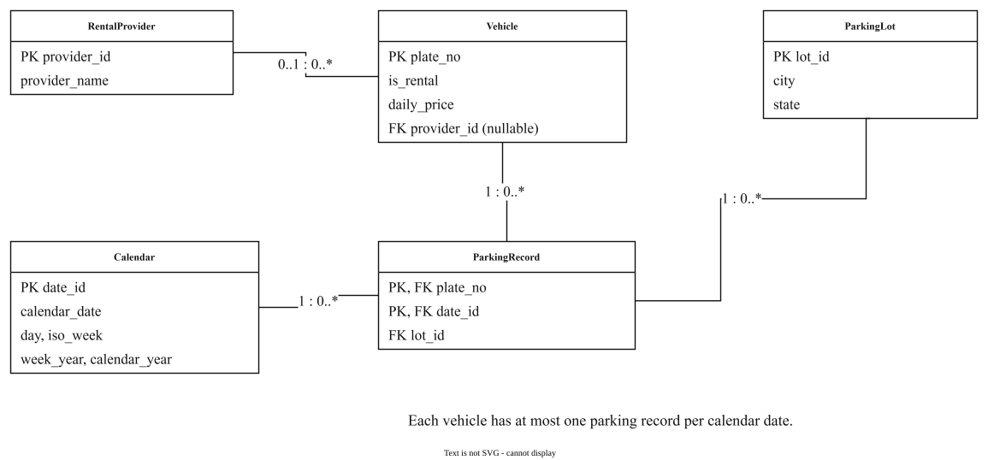
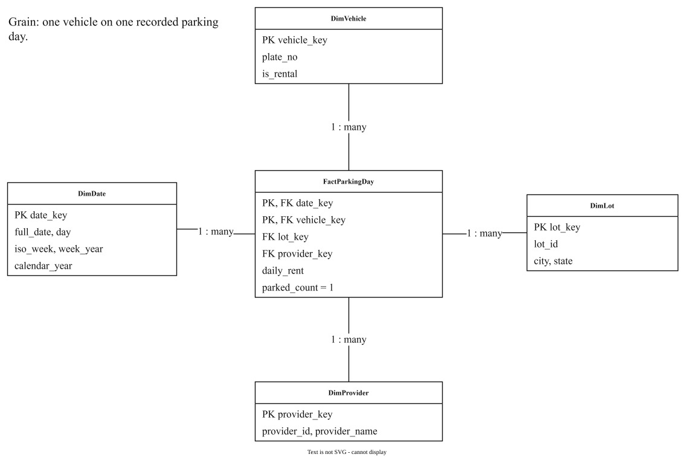
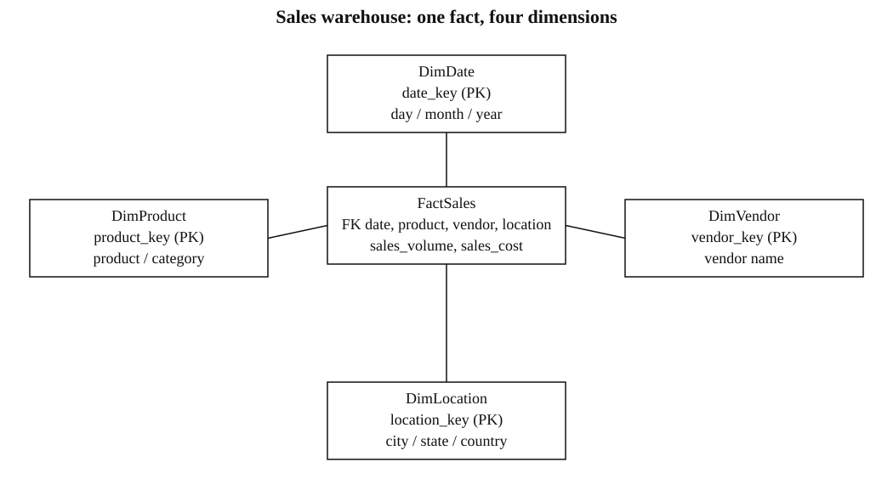
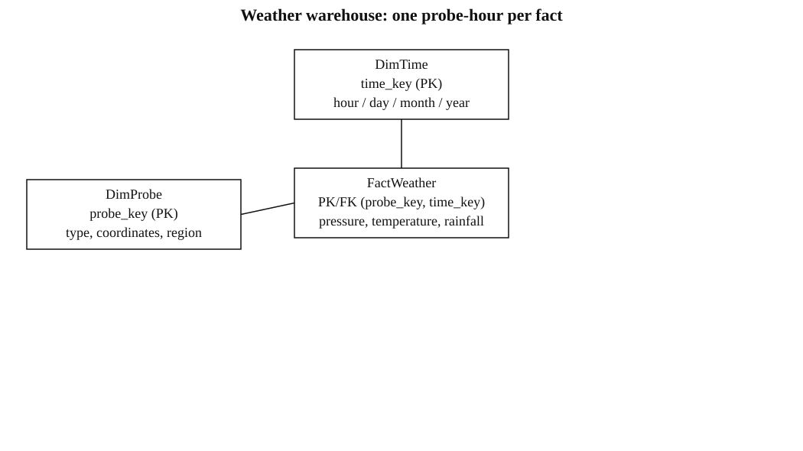
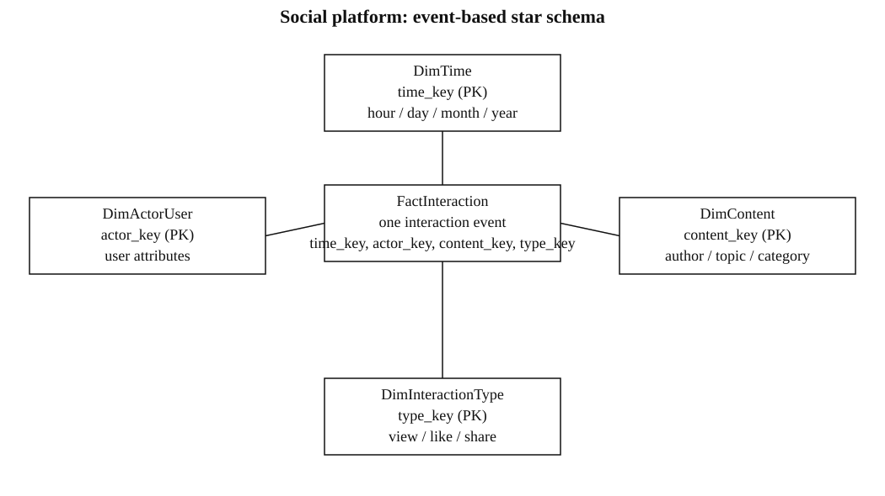

# 仓库设计与 OLAP

[返回题型索引](../题型索引.md) · [网页练习](../index.html#type=warehouse)

同数据同题合并列出多处来源；题目文字为转录整理，原扫描页保留供核对。

<a id="E20-01"></a>

## E20-01 · 航空公司：事实粒度与饮食事实

来源：2020 年扫描卷 · Q1 / 12 points · PDF p.1

状态：完整；形式：设计 / OLAP。

### 原文


航空公司希望分析常客的旅行趋势、不同航线旅客的季节变化和增长，并跟踪不同航班上消费的食品和饮料。请为航空公司的任务设计一个数据仓库模型。

### 逐步解答

#### 1. 先确定两种业务事实的粒度

旅行事实表 $FactTravel$ 的一行表示“一名旅客乘坐某次具体航班航段”。餐饮事实表 $FactCatering$ 的一行表示“该旅客在该航段消费某种食品或饮料的一条记录”。分开保存这两个粒度，便于分别统计客流和餐饮量。


#### 2. 写出维度、外键和度量

| 事实表 | 外键所连接的维度 | 度量 |
| --- | --- | --- |
| FactTravel | Passenger、Date、FlightLeg、Route | $passenger\_count=1$；票价可用时记录 $fare$。 |
| FactCatering | Passenger、Date、FlightLeg、Product | 消费数量 $quantity$；价格可用时记录金额 $amount$。 |

旅客维保存常客等级；路线维保存始发与到达机场、城市、国家；日期维保存年、季节、月、日。两个事实共享维度，构成事实星座（fact constellation）。若原始系统只记录航班餐饮总量，则餐饮粒度用“航段×商品”，按此粒度建键即可。

#### 3. 用聚合回答业务问题

- 旅客出行趋势：按旅客或常客等级、路线、年/月，对 $passenger\_count$ 求和。
- 航线季节变化：按路线、年份、季节汇总客流，再比较相同季节。
- 餐饮需求：按航段、路线、季节、商品汇总 $quantity$。

若本期客流为 $V_t$、上期为 $V_{t-1}>0$，增长率为

$$g_t=\frac{V_t-V_{t-1}}{V_{t-1}}\times100\%.$$

先聚合得到两个时期的总客流，再计算增长率。增长率本身通常不按月份直接求和。


### English answer pattern

Define the grain first. Use a passenger-flight fact for travel and a separate consumption fact for catering, with shared date, passenger and flight dimensions.

先定义粒度。旅行使用旅客—航班事实，餐饮使用独立消费事实，共享日期、旅客和航班维度。

### 易错点与约定

不同粒度事实直接连接再汇总会重复计数。题目没给票价或消费金额时，应写为可选度量，不能假装已有该字段。


---

<a id="E17-04A"></a>

## E17-04A · 电子邮件库的多维组织

来源：2017 年扫描卷 · Q4(a) / 8 points · PDF p.1

状态：完整；形式：设计 / OLAP。

### 原文

An e-mail database stores a large number of electronic mail messages. How can such a database be structured so as to facilitate multidimensional search, such as by sender, by receiver, by subject, and by time?

一个电子邮件数据库存储了大量邮件。应怎样组织这个数据库，以便按发件人、收件人、主题、时间等进行多维搜索？

### 逐步解答

#### 1. 消息粒度和维度


先定一封邮件一行的 FactMessage，含 message_key、sender_key、subject_key、sent_time_key、message_count=1、size_bytes（若可得）。维度为 Sender、Subject、Time；Time 可有 hour→day→month→year。正文单独存储或建立全文索引。

一封邮件可能有多个收件人。可用 BridgeMessageRecipient(message_key,recipient_key,recipient_type) 连接接收者维；此时跨收件人统计“邮件数”须 COUNT(DISTINCT message_key)，不能让同一邮件因多收件人而重复。若事实粒度改为邮件×收件人，则须明确 message_count 的含义。

主题关键词或话题标签也可能多值；要区分原始 subject 文本、可检索的词项和经过归类的主题维。

#### 2. 如何执行多维查询

发件人、主题、时间条件通过对应维度筛选消息；收件人条件先从桥表找到 message_key，再筛选事实。若查询“某月某主题的邮件数”，按月份和主题分组，对去重后的 message_key 计数。

桥表允许一封邮件连接多个收件人。收件人信息可由 recipient_key 进一步连接 DimRecipient；与事实一封邮件一行的粒度配合，既支持按收件人检索，也支持正确统计独立邮件数。


### English answer pattern

Store message-level facts with sender, subject and time dimensions. Model multiple recipients with a bridge and avoid double-counting messages.

保存邮件级事实，设置发件人、主题和时间维度。用桥接表建模多个收件人，避免邮件重复计数。


---

<a id="E25-01"></a>

## E25-01 · 2025 · 第1题：ER 图、星型模式、概念层次与 OLAP

来源：2025 年人工智能学院回忆卷 · Q1 · PDF p.1

状态：完整复原练习；形式：回忆复原 / 完整练习。

**复原依据：**给停车场、汽车与租车服务商的 ER 图，按已给属性构造星型仓库，标概念层次，再通过 OLAP 查询某年北京停车场中汽车的租价。回忆保留了车牌、是否租赁、price、city/state 及 days/weeks/years 等信息。

**补配与口径：**

- 补绘 5 个实体及其主外键关系。
- 补配 6 条停车日记录。
- 将“某年租价”明确为 2025 年、按车辆计算其北京停车日的平均挂牌日租价。

以下为可完整作答的复原练习；补配数值不是原卷原值。

### 原文

The operational database is represented by the ER diagram below. Vehicle has plate_no, is_rental and daily_price; a rental vehicle belongs to one provider. ParkingLot has lot_id, city and state. Calendar contains day, ISO week, week-year and calendar year. ParkingRecord records the lot in which a vehicle is parked on a date. Each vehicle has at most one parking record per date. For this exercise, rental status, provider and listed daily price remain unchanged over the recorded period. Non-rental vehicles have a NULL rental price.

业务数据库由下方 ER 图表示。Vehicle 包含车牌号、是否租赁、日租价；一辆租赁车属于一个服务商。ParkingLot 包含停车场编号、城市和州或省。Calendar 包含日、ISO 周、周年和自然年。ParkingRecord 记录车辆某日在何处停车。每辆车每天最多一条停车记录。本练习中，租赁状态、服务商和挂牌日租价在记录期间保持不变。非租赁车辆的租价为 NULL。



**(a)** Design a star-schema data warehouse. State the fact grain, keys, dimensions and measures.

**(a)** 设计星型模式数据仓库。说明事实粒度、键、维度和度量。

**(b)** Specify appropriate concept hierarchies. Distinguish calendar year from ISO week-year.

**(b)** 指定适当的概念层次。区分自然年与 ISO 周年。

**(c)** Starting from the base cuboid [day, vehicle, lot, provider], return, for each rental vehicle parked in Beijing in calendar year 2025, its average listed daily rental price over its recorded Beijing parking days. Give the OLAP operations and a SQL query. Use the six records below to calculate the result. A listed price is not rental revenue.

**(c)** 从基本方体 [日、车辆、停车场、服务商] 出发，对自然年 2025 年在北京停车的每辆租赁车，返回其已记录的北京停车日上的平均挂牌日租价。给出 OLAP 操作及 SQL 查询。使用下方六条记录计算结果。挂牌价格不等于租赁收入。

| Date | Plate | Lot | City | Provider | Daily price |
| --- | --- | --- | --- | --- | --- |
| 2025-01-06 | 京A001 | L1 | Beijing | P1 | 200 |
| 2025-01-07 | 京A001 | L1 | Beijing | P1 | 200 |
| 2025-02-03 | 京B002 | L2 | Beijing | P2 | 150 |
| 2025-02-03 | 京C003 | L1 | Beijing | N/A | NULL |
| 2025-03-01 | 京B002 | L3 | Shanghai | P2 | 150 |
| 2024-12-30 | 京A001 | L1 | Beijing | P1 | 200 |

### 小问要求与完成标准

| 小问 | 明确要做什么 | 写到什么程度 |
| --- | --- | --- |
| (a) Star schema | 将 ER 模型变为仓库星型模式 | 画 1 张事实表、4 张维度表；写粒度、PK/FK 和度量含义。 |
| (b) Concept hierarchies | 标出日期、地点等可用层次 | 至少写 day→week→week-year、day→year、lot→city→state；指出不同年口径。 |
| (c) OLAP query | 查询 2025 年在北京停车的各租赁车的平均日租价 | 给 OLAP 操作、聚合口径、SQL 及结果表；不把日租价累加成租金收入。 |

### 逐步解答

#### 1. 从业务事实确定粒度

一行表示“**某车辆在某一天、某停车场的停车快照**”。题目约定一车一天最多一条，故事实主键可用 $(date\_key,vehicle\_key)$；lot 与 provider 是该粒度上的外键。不能一行写“停车场全年汇总”却又存单辆车的租价。



#### 2. 写清表、键与度量

| Table | Keys / fields | 含义 |
| --- | --- | --- |
| FactParkingDay | PK(date_key, vehicle_key); lot_key, provider_key; daily_rent, parked_count | 日快照；parked_count=1；daily_rent 从该车日租价取得。 |
| DimDate | date_key; full_date, day, iso_week, week_year, calendar_year | 同一日期同时有自然年与 ISO 周年属性。 |
| DimVehicle | vehicle_key; plate_no, is_rental | 车牌识别车辆；本练习属性在记录期内不变。 |
| DimLot | lot_key; lot_id, city, state | 停车场及其地点。 |
| DimProvider | provider_key; provider_id, provider_name | 租赁商；自有车可指向 N/A 维度成员。 |

$parked\_count$ 可按日累计为“停车车日”；统计跨日独立车辆数时需按车辆去重。$daily\_rent$ 是价格，对时间不能当作收入直接求和。若需要物化均价，应保留价格之和与有效价格的观测数，最后相除。

#### 3. 概念层次

- 日期：$day\to ISO\ week\to week\text{-}year\to ALL$；另一路 $day\to calendar\ year\to ALL$。跨年周属于周年，不能硬拼成 week→calendar-year。
- 地点：$lot\to city\to state\to ALL$。
- 车辆：$plate\to rental\ status\to ALL$ 仅用于按租赁状态分组；查询中保留 plate。
- 租赁商：$provider\to ALL$，题目没有给地区等属性，不另造层级。

#### 4. OLAP 与 SQL

对自然年、城市做切片：$calendar\_year=2025$、$city=Beijing$；筛 $is\_rental=1$。地点从 lot roll-up 到 city，日期从 day 聚合到 calendar-year，provider roll-up 至 ALL，**保留 vehicle**，价格按有效停车日做 AVG。

```sql
SELECT v.plate_no, AVG(f.daily_rent) AS avg_daily_price
FROM FactParkingDay AS f
JOIN DimDate AS d ON d.date_key = f.date_key
JOIN DimVehicle AS v ON v.vehicle_key = f.vehicle_key
JOIN DimLot AS l ON l.lot_key = f.lot_key
WHERE d.calendar_year = 2025
  AND l.city = 'Beijing'
  AND v.is_rental = 1
GROUP BY v.plate_no
ORDER BY v.plate_no;
```

筛选后留下前三条：

$$\begin{aligned}
\bar p_{\text{京A001}}&=\frac{200+200}{2}=200,\\[5pt]
\bar p_{\text{京B002}}&=\frac{150}{1}=150.
\end{aligned}$$

| Plate | Included parking days | Average daily price |
| --- | --- | --- |
| 京A001 | 2 | 200 |
| 京B002 | 1 | 150 |

第四条为非租赁车，第五条不在北京，第六条不在自然年 2025。京A001 的平均日租价为 $(200+200)/2=200$ 元。

### English answer pattern

Use a vehicle-day fact grain. Slice to Beijing and calendar year 2025, retain the vehicle dimension, and average valid listed daily prices. The two resulting prices are 200 and 150.

采用车辆—日事实粒度。切片到北京及自然年 2025，保留车辆维，对有效挂牌日租价求平均。所得两个价格为 200、150。

### 易错点与约定

先解释平均的是“已记录的北京停车日”，不补算全年未出现的日期；自然年查询不能误用 week_year。

### 计算与内存分析

直接扫描 $N$ 条事实并哈希分组约 $O(N)$ 时间、$O(g)$ 分组空间，$g$ 是输出车辆数。预聚合均价需保存 sum 和 count，不能直接平均不等样本量的均值。


---

<a id="HW1-01"></a>

## HW1-01 · 销售仓库、Los Angeles 查询与位图

来源：当前 HW1 · Q1(a-c)

状态：完整；形式：设计 / OLAP。

### 原文


假定数据仓库有 date, product, vendor, location 四维和 sales_volume, sales_cost 两个度量。(a) 画星型模式；(b) 从基本方体出发列出每年在 Los Angles 的每个 vendor 的 sales_volume；(c) 讨论位图索引优点和问题。

### 逐步解答

#### 1. 星型模式与事实粒度



事实粒度：date×product×vendor×location 的销售汇总。一张 FactSales 保存四个外键和两个度量，连接 DimDate、DimProduct、DimVendor、DimLocation。

#### 2. OLAP 与对应 SQL

OLAP：Slice(location.city=Los Angeles)；date Roll-up 到 year；product Roll-up 到 ALL；保留 vendor；对 sales_volume 求 SUM。

```sql
SELECT d.year, v.vendor_name, SUM(f.sales_volume) AS volume
FROM FactSales f
JOIN DimDate d ON f.date_key = d.date_key
JOIN DimVendor v ON f.vendor_key = v.vendor_key
JOIN DimLocation l ON f.location_key = l.location_key
WHERE l.city = 'Los Angeles'
GROUP BY d.year, v.vendor_name;
```
#### 3. 位图索引为什么适合组合查询

对每个属性值保存一条位向量，第 $i$ 位表示第 $i$ 行是否满足该值。`city=Los Angeles AND year=2025` 可以将两条位向量逐位 AND，再聚合选中的事实。

设 $N$ 为事实行数、$K$ 为该属性的不同值个数，未压缩数据位的估算式为

$$M=\frac{NK}{8}\ \text{bytes}.$$

位图可为 city、year 等低基数属性每个值保存一个长度为 N 的 bit 向量，以 AND/OR 组合查询。未压缩大小约 NK/8 字节；高基数 K、频繁写入与并发更新会增加代价，不能说位图总比普通索引省空间。


### English answer pattern

Slice the location to Los Angeles, roll up date to year and product to ALL, and group sales volume by year and vendor.

把地点切片到洛杉矶，日期上卷到年、商品上卷到 ALL，按年和供应商汇总销售量。

### 计算与内存分析

位图的字级交运算约 O(N/w)，w 为机器字长；扫描聚合约 O(N)，输出分组表额外 O(g) 空间。


---

<a id="HW1-02"></a>

## HW1-02 · 1000 探针、十年逐小时气象仓库

来源：当前 HW1 · Q2

状态：完整；形式：设计 / OLAP。

### 原文

Design a data warehouse for a regional weather bureau with about 1000 land/ocean probes collecting air pressure, temperature and precipitation each hour for over ten years. Present the schema, fact table(s), dimension tables and concept hierarchies for querying and OLAP.

为地区气象局设计数据仓库：约 1000 个陆地或海洋探测器，每小时采集气压、温度、降水，已有十余年数据。给出供查询和 OLAP 使用的模式、事实表、维度表与概念层次。

### 逐步解答

#### 1. 星型模式



FactWeather 一行是一探针一小时的观测，键 probe_key,time_key，度量 pressure、temperature、precipitation。Probe 维保存海陆类型、坐标、所属区域；Time 为 hour→day→month→quarter→year，另存季节。地点层次可用 station→region→ALL；海域需采用适用的海区层次，不能强行 city→state。

#### 2. 度量如何上卷

平均温度由有效观测计算：

$$\bar T=\frac{\sum_i T_i}{n_{\mathrm{valid}}}.$$

若多个分区已分别保存温度总和 $S_p$ 和有效数量 $n_p$，合并后的均值为

$$\bar T=\frac{\sum_pS_p}{\sum_p n_p}.$$

这样可处理不同探针缺失数量不同的情况。气温和气压不对时间直接 SUM，通常取平均、最小、最大；为正确合并平均数，保留 sum 与有效观测 count。降水量若表示该小时累计降水，在**不重叠时间段**可求和；不同地点降水深度不能未经面积权重解释就当总水量累加。

#### 3. OLAP 与数据规模

按年、月或地区做 Roll-up，按某探针或海陆类型 Slice；按小时 Drill-down。可按时间分区，以 probe/time 建索引，常用日/月汇总做物化视图。

以每年 365 天粗估，十年约 $1000\times24\times365\times10=87{,}600{,}000$ 条观测。按时间分区与物化日/月汇总，可以减少重复扫描的明细行数。


### English answer pattern

Use a probe-hour grain. Store additive precipitation intervals carefully and aggregate temperature with sums and valid counts rather than summing averages.

采用探测器—小时粒度。谨慎保存可加的降水时段量；温度用总和与有效计数聚合。

### 易错点与约定

缺测不应当成温度 0；平均数的平均只有等样本量时才等于整体平均。

### 计算与内存分析

仅按 365 天/年估算：1000×24×365×10=87,600,000 行。实际考虑闰日、缺测和设备更替。


---

<a id="HX1-01"></a>

## HX1-01 · 往届销售仓库：vendor A 年汇总

来源：往届 HW1（hxd） · Q1 · PDF p.1

状态：完整；形式：设计 / OLAP。

### 原文


四维 date, product, vendor, location；度量 sales_volume, sales_cost。画星型，并从基本方体列出每年 vendor A 的 sales_volume。

### 逐步解答

#### 1. 星型模式


事实粒度为 date×product×vendor×location；四个维度键连接 FactSales，保存销售量和销售成本。

#### 2. 先筛选、再上卷

Slice(vendor=A)；date Roll-up 至 year；product、location Roll-up 至 ALL；按 year 对 sales_volume 求 SUM。

```sql
SELECT d.year, SUM(f.sales_volume)
FROM FactSales f
JOIN DimDate d ON f.date_key=d.date_key
JOIN DimVendor v ON f.vendor_key=v.vendor_key
WHERE v.vendor_name='A'
GROUP BY d.year;
```
最终结果一行对应一个 year，度量为该年 vendor A 在全部产品、全部地点的销售量。`WHERE` 选择 vendor A，`GROUP BY year` 决定输出粒度。


### English answer pattern

Slice vendor to A and roll up all dimensions except year.

把供应商切片到 A，除年份外的维度均上卷。


---

<a id="HX1-02"></a>

## HX1-02 · 社交平台的多维仓库设计

来源：往届 HW1（hxd） · Q2 · PDF p.1

状态：完整；形式：设计 / OLAP。

### 原文


某网络社交平台数据库存储大量信息。设计数据仓库结构，便于多维查询和挖掘。

### 逐步解答

#### 1. 用互动事件定义事实粒度



可选“内容互动”作为业务过程，FactInteraction 一行为一次用户对内容的互动事件。维度：Time、ActorUser、Content、InteractionType、Device/Location（可获得时）；度量 event_count=1、watch_seconds（仅观看事件可得）。作者可作为 User 的另一角色维。

时间 hour→day→month→year；内容 video→topic→category 仅在主题关系严格适用时才做层次。统计每月每类内容的观看时长、某地区转发数等。

点赞事件数、浏览次数、独立用户数不同：前两者可在对应粒度求和，独立用户跨日不能直接相加。推荐/流失预测需要从按时间窗口聚合的行为特征中学习，并以未来数据评价。

#### 2. 用例说明查询流程

查询“每月各类内容的互动次数”时：Time 上卷至 month，Content 上卷至 category，ActorUser 上卷至 ALL，对 $event\_count$ 求和。若只统计转发，先在 InteractionType 上 slice 到 share。

独立用户数使用 $COUNT(DISTINCT\ actor\_key)$；事件数使用 $SUM(event\_count)$。同一个用户一天发生多次互动，正好说明这两个度量为什么应分别计算。


### English answer pattern

Choose an interaction-event grain and distinguish event counts from distinct-user measures.

选择交互事件粒度，区分事件计数与去重用户度量。


---

<a id="PPT-DW27"></a>

## PPT-DW27 · 课件 · 医生就诊仓库：星型模式与 1999 年汇总

来源：当前完整七讲课件 · Data_Warehouse.pdf · Exercise 1(1) · PDF p.27；当前完整七讲课件 · Data_Warehouse.pdf · Exercise 1(2) · PDF p.37

状态：完整课件练习；形式：课件设计 / OLAP。

### 原文

Suppose that a data warehouse consists of three dimensions time, doctor, and patient, and two measures count and charge, where charge is the fee that a doctor charges a patient for a visit.

假设一个数据仓库由时间、医生、病人三个维度，以及 count 和 charge 两个度量组成，其中 charge 是医生向病人一次就诊收取的费用。

(1) Draw a schema diagram for the data warehouse.

(1) 为该数据仓库画出模式图。

(2) Starting with the base cuboid [day, doctor, patient], what OLAP operations should be performed in order to list the total fee collected by each doctor in 1999?

(2) 从基本方体 [日、医生、病人] 出发，要列出各医生在 1999 年收取的总费用，应执行哪些 OLAP 操作？

### 逐步解答

#### 1. 定义事实粒度并画图

一条事实是一次医生为病人提供的就诊服务；同一天的多次就诊用不同 $visit\_key$ 区分。$count=1$，$charge$ 为本次费用。


#### 2. 从基本方体做 OLAP

保留 doctor；日期从 day 上卷（roll-up）到 year，并切片（slice）为 1999；patient 上卷到 ALL。费用按 SUM 聚合：

$$\operatorname{TotalCharge}(d,1999)=\sum_{v:\,doctor(v)=d,\,year(v)=1999}charge(v).$$

#### 3. 写出等价查询与最终输出含义

```sql
SELECT d.doctor_id, SUM(f.charge) AS total_charge
FROM FactVisit f
JOIN DimDoctor d ON d.doctor_key=f.doctor_key
JOIN DimTime t ON t.date_key=f.date_key
WHERE t.year=1999
GROUP BY d.doctor_id;
```

输出每位医生一行，列为医生编号和该年总费用。题目没有给就诊记录，因此答案写到模式、OLAP 操作和聚合式即可。

### English answer pattern

Use a visit-level fact with time, doctor and patient dimensions. Roll up day to year, slice year 1999, roll up patient to ALL, and sum charge by doctor.

使用就诊级事实及时间、医生、病人维度。将日上卷到年，切片为 1999 年，将病人上卷到 ALL，按医生求费用总和。

### 计算与内存分析

扫描 $N$ 条就诊事实并按医生哈希聚合约需 $O(N)$ 时间、$O(g)$ 分组空间，$g$ 为医生数。


---

<a id="PPT-DW53"></a>

## PPT-DW53 · 课件 · 大学雪花模式、课程查询与方体数量

来源：当前完整七讲课件 · Data_Warehouse.pdf · Exercise 1(a–d) · PDF p.53

状态：完整课件练习；形式：课件设计 / OLAP / 位图。

### 原文

Suppose a data warehouse for university consists of four dimensions student, course, semester, and instructor, and two measures count and score.

假设大学数据仓库由学生、课程、学期、教师四个维度，以及 count 和 score 两个度量组成。

(a) Draw a snowflake schema diagram for this data warehouse.

(a) 为该数据仓库画出雪花模式图。

(b) Starting with the base cuboid [student, course, semester, instructor], what specific OLAP operations should you perform to list the number of CS courses for each Big_University student?

(b) 从基本方体 [学生、课程、学期、教师] 出发，要列出 Big_University 每位学生的 CS 课程数，应执行哪些具体 OLAP 操作？

(c) If each dimension has five concept levels (including all), such as “student < major < status < university < all”, how many cuboids will this cube contain?

(c) 如果每个维度都有五个概念层次（包括 all），例如“学生 < 专业 < 身份 < 大学 < all”，该立方体包含多少个方体？

(d) Taking this cube as an example, discuss advantages and problems of using a bitmap index structure.

(d) 以此立方体为例，讨论使用位图索引结构的优点和问题。

### 逐步解答

#### 1. 雪花模式与粒度

事实表保存一条学生在某学期、某教师所授课程中的选课记录；维表中的院系、专业、大学等信息进一步规范化。


#### 2. 明确筛选与聚合

在 student 维筛选 university=Big_University，在 course 维筛选 department=CS；保留 student，将 semester、instructor 上卷到 ALL，再汇总课程。

若 count 表示选课记录数，计算 $\sum count$；若“课程数”要求同一学生跨学期修同一课程只计一次，则用 $\operatorname{COUNT(DISTINCT\ course\_key)}$。考试中写清采用哪种口径。本题按不同课程数给出：

```sql
SELECT s.student_key, COUNT(DISTINCT f.course_key) AS cs_courses
FROM FactEnrollment f
JOIN DimStudent s ON s.student_key=f.student_key
JOIN DimUniversity u ON u.university_key=s.university_key
JOIN DimCourse c ON c.course_key=f.course_key
JOIN DimDepartment d ON d.department_key=c.department_key
WHERE u.university='Big_University' AND d.department_name='CS'
GROUP BY s.student_key;
```

#### 3. 方体数：各维的层次选择相乘

每个方体为每个维度选择一个层次。四个维度各有 5 种选择：

$$\#\text{cuboids}=\prod_{i=1}^{4}L_i=5^4=\boxed{625}.$$

这里 $L_i$ 已包含 ALL；因此无需再加一个层次。

#### 4. 位图索引的优点与成本

对 semester、department 等取值较少的属性，每个值保存一条长度为事实行数 $N$ 的位图。两个条件用 AND 求交，多个可选值用 OR，最后计数置位位数。这样的按位运算可并行处理多个记录。

若不同值共有 $V$ 个，未压缩位图约需 $VN/8$ 字节。student 或 course 的取值很多时，空间及更新成本上升；适用于相对稳定、分析查询较多的仓库。

### English answer pattern

Use normalized dimensions for a snowflake schema. Filter Big_University and CS, retain each student, and aggregate over semester and instructor. The cube contains 5^4=625 cuboids.

使用规范化维表构成雪花模式。筛选 Big_University 和 CS，保留每位学生，跨学期与教师聚合。该立方体包含 5^4=625 个方体。


---

<a id="PPT-DW54"></a>

## PPT-DW54 · 课件 · 20 维仓库：部分物化与钻透

来源：当前完整七讲课件 · Data_Warehouse.pdf · Exercise 2(a–b) · PDF p.54

状态：完整课件练习；形式：课件设计 / 物化策略。

### 原文

Suppose a data warehouse has 20 dimensions, each with five concept levels.

假设一个数据仓库有 20 个维度，每个维度有五个概念层次。

(a) Users are mainly interested in four particular dimensions, each having three frequently accessed levels for rolling up and drilling down. How would you design a data cube to efficiently support this preference?

(a) 用户主要关注四个特定维度，每个维度有三个经常访问、用于上卷和下钻的层次。你会怎样设计数据立方体来高效支持这种偏好？

(b) Occasionally, a user may want to drill through the cube down to its raw relational database for one or two particular dimensions. How would you support this feature?

(b) 用户偶尔可能希望沿一两个特定维度，从立方体钻透到原始关系数据库。你会怎样支持这一功能？

### 逐步解答

#### 1. 先比较全部物化与重点物化

全部 20 维各选 5 个层次，共有

$$5^{20}=95\,367\,431\,640\,625$$

种层次组合。用户频繁访问的四维子空间，只涉及 $3^4=81$ 种常用层次组合。

#### 2. 给出设计

对 16 个非常用维度先汇总到 ALL，形成四维子立方体；优先物化四个常用维度的高频组合及可复用聚合。保留基本事实表，低频组合按需从基本表或合适的已有聚合计算。81 是待考虑的层次组合数，具体是否全部物化还需结合实际单元格数量与预算。

#### 3. 怎样钻透

在事实表保存通向原关系记录的稳定键，并保存维度代理键与原业务键的映射。用户请求明细时，把当前切片条件翻译为 WHERE 和 JOIN，从原始表取回对应记录。聚合表保留筛选维度键，便于确定应回到哪些原始记录。

#### 4. 这一类题的答题顺序

先写候选组合数，再写物化范围，最后说明如何回到明细。上卷后被合并的单条记录无法仅由 SUM/COUNT 唯一恢复，钻透需要访问基本表。

### English answer pattern

Materialize a workload-oriented four-dimensional subcube and retain base facts for less frequent queries. Support drill-through through dimension keys and links to relational detail records.

物化面向工作负载的四维子立方体，保留基本事实以支持低频查询。通过维度键和关系明细记录链接支持钻透。
