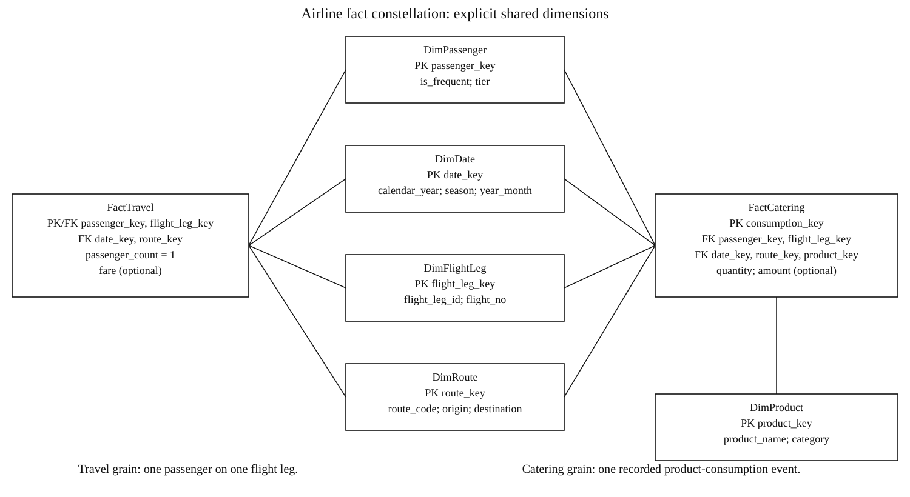
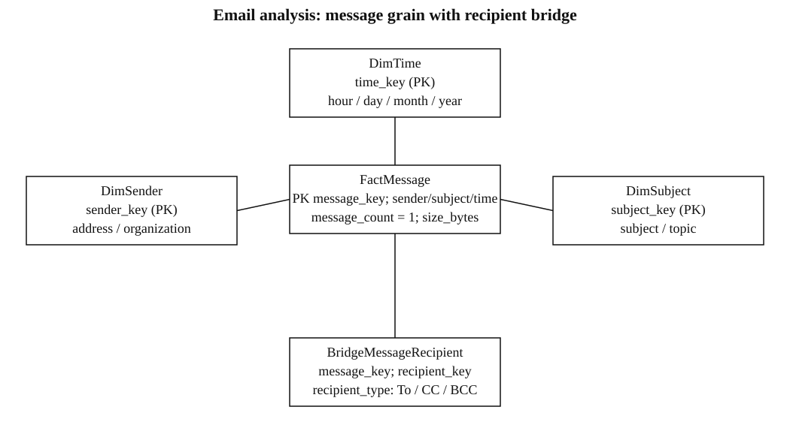
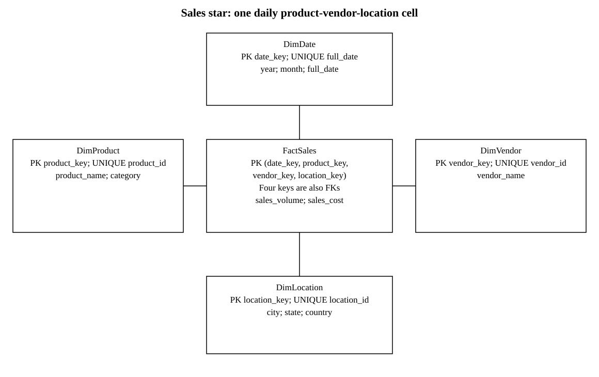
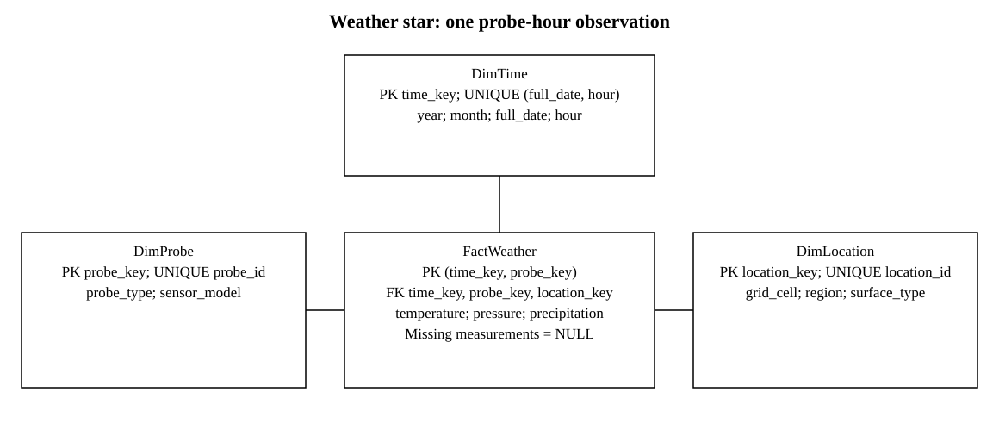
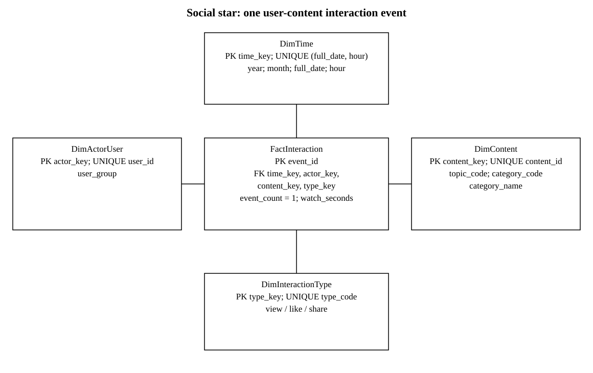
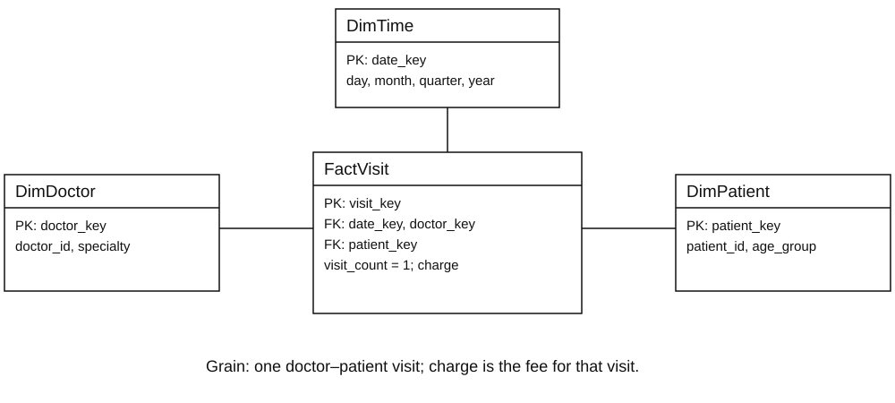
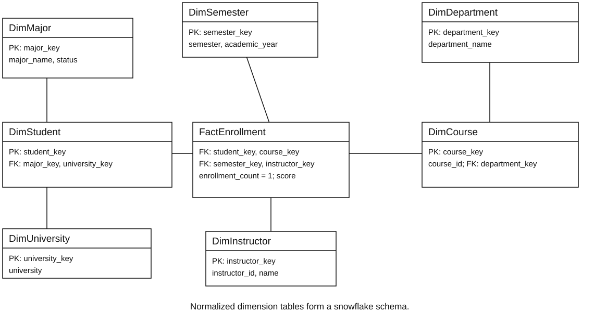

# 仓库设计与 OLAP

[返回题型索引](../题型索引.md) · [网页练习](../index.html#type=warehouse)

同数据同题合并列出多处来源；题目文字为转录整理，原扫描页保留供核对。

<a id="E20-01"></a>

## E20-01 · 航空公司：事实粒度与饮食事实

来源：2020 年扫描卷 · Q1 / 12 points · PDF p.1

状态：完整；形式：设计 / OLAP。

### 英文题面（由中文原题译写）

An airline wants to analyze the travel trends of the frequent flyers it serves so that it can correctly target the frequent-flyer market within the airline market.

航空公司希望能够分析在其服务中的常客的旅行趋势，这样可以为公司正确定位航空市场中的常客市场。

The airline wants to track seasonal changes and growth in passenger traffic on different routes, and the food and beverages consumed on different flights. This can help the airline schedule flights on different routes and arrange food supplies.

公司希望能够跟踪不同航线旅客的季节变化情况和增长，并跟踪在不同航班上所消费的食品和饮料情况，这样可以帮助航空公司安排在不同航线上的航班和食品供应。

Please design a data warehouse model for the airline's tasks. (12 points)

请面向航空公司的任务，设计一个数据仓库的模型。（12 分）

### 解答



**事实与维度。** 采用事实星座（fact constellation）。旅行事实 FactTravel：一名旅客乘坐一次具体航段一行，PK 为 $(passenger\_key,flight\_leg\_key)$；FK 连接 Passenger、FlightLeg、Date、Route，度量为 passenger_count=1。餐饮事实 FactCatering：一次商品消费明细一行，PK 为 consumption_key；共享上述四维，另以 product_key 连接商品维，度量为 quantity。

**分析用途。** Date 可上卷到年月或年—季，Route 保存始发/到达地点，Passenger 保存常客标志，Product 区分食品和饮料。按航线、时期汇总乘坐人次与消费量；两张事实先各自聚合，再结合结果。增长率为

$$g_t=\frac{V_t-V_{t-1}}{V_{t-1}}\times100\%,\quad V_{t-1}>0.$$

### English answer · 英文作答

Use a passenger-flight-leg travel fact and a separate product-consumption fact. Share Passenger, FlightLeg, Date and Route dimensions, and add Product to the consumption fact. Sum passenger_count and quantity by route and period. Aggregate the facts separately. Compute traffic growth as $(V_t-V_{t-1})/V_{t-1}$ when the previous volume is positive.

使用旅客—具体航段旅行事实和独立的商品消费事实。共享Passenger、FlightLeg、Date和Route维度，并给消费事实增加Product维。按航线和时期汇总passenger_count和quantity。分别聚合两张事实。上期客流为正时，以$(V_t-V_{t-1})/V_{t-1}$计算客流增长率。

<details>
<summary>补充解释与 SQL（展开）</summary>


### 补充详解

#### 1. 确定两种事实粒度

旅行事实 $FactTravel$ 一行表示“一名旅客乘坐一次具体航班航段”，主键为 $(passenger\_key,flight\_leg\_key)$。餐饮事实 $FactCatering$ 一行表示“一次商品消费明细”，用 $consumption\_key$ 作主键；同一旅客同一航段可以有多条消费明细。


#### 2. 模式、键与度量

| 表 | 主键与外键 | 度量或描述属性 |
| --- | --- | --- |
| FactTravel | PK(passenger_key,flight_leg_key)；两键也为 FK；date_key、route_key 为 FK。 | passenger_count=1；有票价数据时可加 fare。 |
| FactCatering | PK consumption_key；FK passenger_key、flight_leg_key、date_key、route_key、product_key。 | quantity；有金额数据时可加 amount。 |
| DimPassenger | PK passenger_key。 | 常客标志 is_frequent、常客等级 tier。 |
| DimFlightLeg | PK flight_leg_key。 | 某次具体航段的稳定标识、航班号。 |
| DimDate | PK date_key。 | 出发日期、calendar_year、year_month、业务定义的 season。 |
| DimRoute | PK route_key。 | route_code、始发机场、到达机场、对应城市/国家。 |
| DimProduct | PK product_key。 | 食品或饮料名称、类别。 |

日期、路线与航段在装载时保持一致：同一具体 flight_leg 对应唯一出发日期和路线；两张事实写入相同的 date_key、route_key。图中 FlightLeg 和 Route 是两个明确维度，两张事实分别直接引用它们。

$SUM(passenger\_count)$ 得到乘坐人次；跨航段统计独立旅客需 $COUNT(DISTINCT\ passenger\_key)$。餐饮量按 $SUM(quantity)$ 计算。不同粒度的明细各自聚合，可保持这两类计数的含义。

#### 3. OLAP 示例：各航线常客的季节客流

以下示例将原题“常客趋势、航线季节变化”具体化为某一年各路线、各季节的常客乘坐人次。

1. **Base cuboid：** $[Passenger,FlightLeg,Day,Route]$。
2. **Dice：** 同时限定 $is\_frequent=1$、$calendar\_year=2025$。两个条件确定统计范围；若先将某维上卷到所需层次，再固定其中一个成员，可记 Slice。
3. **Roll-up：** $Passenger\to ALL$、$FlightLeg\to ALL$；$Day\to(CalendarYear,Season)$；保留 Route 明细。
4. **结果方体：** $[ALL,ALL,(2025,Season),Route]$，度量为 $SUM(passenger\_count)$。

SQL 使用稳定路线键分组，并把展示名称一起列入 GROUP BY：

```sql
SELECT d.calendar_year, d.season, r.route_key, r.route_code,
       SUM(f.passenger_count) AS passenger_legs
FROM FactTravel AS f
JOIN DimDate AS d ON d.date_key = f.date_key
JOIN DimRoute AS r ON r.route_key = f.route_key
JOIN DimPassenger AS p ON p.passenger_key = f.passenger_key
WHERE d.calendar_year = :year AND p.is_frequent = 1
GROUP BY d.calendar_year, d.season, r.route_key, r.route_code;
```

参数 `:year=2025`。不需要显示的 Passenger、FlightLeg 没有进入 GROUP BY，体现上卷到 ALL；WHERE 中的常客和年份条件仍然保留。此查询仅返回有符合条件乘坐事实的路线—季节组，未出现的组合不自动产生 0 行。

#### 4. OLAP 示例：某路线各季节食品饮料消耗

**Base：** $[Passenger,FlightLeg,Day,Route,Product]$。 **Dice：** $calendar\_year=2025$、$route\_key=10$。先选定范围，再上卷 $Passenger,FlightLeg,Route\to ALL$、$Day\to(CalendarYear,Season)$，保留 Product；结果为 $[ALL,ALL,(2025,Season),ALL,Product]$，汇总 $SUM(quantity)$。

```sql
SELECT d.calendar_year, d.season, p.product_key, p.product_name,
       SUM(f.quantity) AS consumed_quantity
FROM FactCatering AS f
JOIN DimDate AS d ON d.date_key = f.date_key
JOIN DimProduct AS p ON p.product_key = f.product_key
WHERE d.calendar_year = :year AND f.route_key = :route_key
GROUP BY d.calendar_year, d.season, p.product_key, p.product_name;
```

参数为 `:year=2025, :route_key=10`。路线已筛定，最后不按路线细分；其他路线不会因 Route 上卷到 ALL 而重新进入结果。若只统计某类饮料，可再在 Product 维增加类别筛选。

#### 5. 增长和多事实查询

设同一统计口径的本期客流为 $V_t$，上期为 $V_{t-1}>0$：

$$g_t=\frac{V_t-V_{t-1}}{V_{t-1}}\times100\%.$$

先分别聚合两个时期，再计算增长率。若同时展示客流和餐饮量，先将两张事实各聚合到共同的路线—年月或路线—季节粒度，再按这一唯一分组键连接。直接连接两张明细会把一条乘坐事实随多条餐饮明细重复。


### 易错点与约定

客流人次、独立旅客数和商品消费量分别用 SUM(passenger_count)、COUNT(DISTINCT passenger_key)、SUM(quantity)。每个维表连接键均为唯一主键；两张不同粒度的事实先各自汇总，再按唯一分组键合并。没有观察到的路线—季节组合默认不输出；如要显示 0，需先列出所需组合再 LEFT JOIN 已聚合结果。

### 计算与内存分析

对每个查询，令 N 为对应事实表行数、M 为筛选后事实行数、G 为输出组数、W 为机器字位数。扫描筛选为 $O(N)$，对 M 行哈希聚合的期望时间为 $O(M)$、分组状态为 $O(G)$。维表主键唯一保证不放大事实；若使用已建哈希维表或合适索引，可有效查键，哈希建表或 B-tree 查找成本另计。若已存在与事实行对齐的 b 条位图或位图连接索引，交集约需 $O(b\lceil N/W\rceil)$ 字操作，再读取 M 行聚合。可按日期分区、物化路线—年月汇总；平均值物化保存 sum/count，增长率由同口径期间总量再计算。

</details>

### 知识点与公式总结

- **粒度与连接：** 旅行按旅客—具体航段记录，餐饮按消费明细记录；共享维度形成事实星座。
- **客流与消费：** $V=SUM(passenger\_count)$；$Q=SUM(quantity)$，两张事实各自聚合到共同粒度后连接。
- **增长率：** $g=(V_t-V_{t-1})/V_{t-1}$；分母是上期同口径客流。
- **季节比较：** 日期保留年份与季节，路线保留明细，其余不展示的轴上卷到ALL。


---

<a id="E17-04A"></a>

## E17-04A · 电子邮件库的多维组织

来源：2017 年扫描卷 · Q4(a) / 8 points · PDF p.1

状态：完整；形式：设计 / OLAP。

### 原文

An e-mail database stores a large number of electronic mail messages. How can such a database be structured so as to facilitate multidimensional search, such as by sender, by receiver, by subject, and by time?

一个电子邮件数据库存储了大量邮件。应怎样组织这个数据库，以便按发件人、收件人、主题、时间等进行多维搜索？

### 解答



**一封邮件一行。** FactMessage 以 message_key 为 PK，以 sender_key、subject_key、sent_time_key 为 FK，分别连接发件人、主题、时间维；度量为 message_count=1。

**多收件人。** 用 BridgeMessageRecipient(message_key, recipient_key, recipient_type) 表示 To/CC/BCC 关系，前三列共同作 PK；前两列分别引用邮件事实和收件人维。

**查询。** 按发件人、收件人、主题、时间组合做 Slice/Dice。Time 可按 Timestamp→Day→(Year,Month)→Year→ALL 上卷；保留所需输出轴，其余轴上卷到 ALL。通过邮件键去重，确保一封发给多人的邮件在总体邮件数中只计一次；正文关键词另建全文索引。

### English answer · 英文作答

Store one fact row per message, with sender, subject and sent-time foreign keys. Connect multiple recipients through a message-recipient bridge. Filter the requested dimensions, roll time to the required level and unused axes to ALL, and count distinct message keys to avoid counting one message more than once.

每封邮件保存一条事实记录，包含发件人、主题和发送时间外键。通过邮件—收件人桥表连接多个收件人。筛选所需维度，将时间上卷到要求的层次、未使用的轴上卷到ALL，并对邮件键去重计数，避免一封邮件重复计数。

<details>
<summary>补充解释与 SQL（展开）</summary>


### 补充详解

#### 1. 一封邮件一条事实

采用消息级粒度（message grain），$FactMessage$ 每行对应一封邮件，以 $message\_key$ 为主键。发件人、主题、发送时间分别通过唯一维度键连接；收件人是多值属性，用桥表建模。


| 表 | 键 | 保存内容 |
| --- | --- | --- |
| FactMessage | PK message_key；FK sender_key、subject_key、sent_time_key。 | message_count=1；可选 size_bytes；正文引用。 |
| DimSender | PK sender_key。 | sender_address、所属组织等。 |
| DimSubject | PK subject_key。 | subject_text；本模型每封邮件只有一个 subject_key。 |
| DimTime | PK time_key。 | full_timestamp、calendar_year、month。 |
| BridgeMessageRecipient | PK(message_key,recipient_key,recipient_type)；前两键分别 FK 至 FactMessage、DimRecipient。 | To/CC/BCC 收件角色；同一邮件可有多位收件人。 |
| DimRecipient | PK recipient_key。 | recipient_address。 |

Time 可按 $Timestamp\to Day\to(Year,Month)\to Year\to ALL$ 上卷，年月组合区分不同年的同名月份。主题原文可直接检索；正文关键词可使用独立全文索引，多个主题标签则另设标签桥表。

#### 2. 多维搜索与 OLAP 示例

原题要求便于按发件人、收件人、主题、时间搜索。以下示例将它具体化为：统计“2025 年、主题键 10、发给收件人键 100”的邮件，按年月和发件人输出邮件数。

1. **Base cuboid：** $[Sender,Recipient,Subject,Timestamp]$，底层仍由邮件标识 message_key 确认一封邮件。
2. **Dice：** $calendar\_year=2025$、$subject\_key=10$、$recipient\_key=100$。
3. **Roll-up：** $Timestamp\to(Year,Month)$；保留 Sender；已筛定的 Recipient、Subject 均上卷至 ALL。
4. **最终方体：** $[Sender,ALL,ALL,(2025,Month)]$，度量为符合条件邮件的数量。收件人条件通过 EXISTS 判断存在，保留每封邮件一行。

```sql
SELECT t.calendar_year, t.month, s.sender_key, s.sender_address,
       SUM(f.message_count) AS message_count
FROM FactMessage AS f
JOIN DimTime AS t ON t.time_key = f.sent_time_key
JOIN DimSender AS s ON s.sender_key = f.sender_key
WHERE t.calendar_year = :year
  AND f.subject_key = :subject_key
  AND EXISTS (
      SELECT 1
      FROM BridgeMessageRecipient AS b
      WHERE b.message_key = f.message_key
        AND b.recipient_key = :recipient_key
  )
GROUP BY t.calendar_year, t.month, s.sender_key, s.sender_address;
```

参数为 `:year=2025, :subject_key=10, :recipient_key=100`。EXISTS 只决定一封邮件是否入选，同一收件人出现在 To、CC 等多条桥记录中也只算一封。Sender 按稳定键分组，同时列出地址便于阅读；地址不是独立识别不同人的唯一依据。

#### 3. 为什么邮件数保持正确

收件人是多值维度，跨收件人上卷时按 message_key 去重。例如一封邮件同时发给 A、B，两个收件人各有 1 封，合并后的邮件总数仍为 1。因而各收件人邮件数直接相加不能得到总体独立邮件数。

桥表用于表示收件关系，不向事实表增加邮件。若直接把桥表明细连接到消息事实后 COUNT(*)，一封有多个收件人的邮件会出现多行。需要这种连接结果时，可按分组使用 $COUNT(DISTINCT\ f.message\_key)$；本题示例用 EXISTS，故可以对每封唯一邮件的 message_count 求和。

SQL 仅返回至少有一封符合条件邮件的发件人—月份组。无匹配事实的组不自动输出 0；若要求完整空组，需要先构造月份与发件人的目标集合，再 LEFT JOIN 上述已聚合结果并对缺失计数补 0。


### 易错点与约定

一封邮件可有多个收件关系；统计邮件数时通过 EXISTS 或按组 COUNT(DISTINCT message_key) 保持唯一邮件口径。主题维的单个 subject_key 表示邮件主题原文；若扩展为多标签，需另行处理标签的多对多关系。按月份统计时同时保留年份。

### 计算与内存分析

令 N 为邮件事实数、M 为筛选后的唯一邮件数、G 为输出组数、B 为桥表行数、W 为机器字位数。主键唯一的维表连接不会放大邮件行；聚合 M 条邮件期望 $O(M)$ 时间、$O(G)$ 状态。EXISTS 应配桥表索引 (recipient_key,message_key) 或 (message_key,recipient_key)；逐邮件 B-tree 查询另有约 $O(N\log B)$ 查找成本，预取该收件人的唯一消息键作半连接可改为扫描候选键并查集合。若已有 b 条事实行对齐位图，组合过滤约 $O(b\lceil N/W\rceil)$ 字操作；维表查键、收件人键映射及读取 M 行另计。为时间范围查询按时间分区，主题/正文检索使用相应索引。

</details>

### 知识点与公式总结

- **多值维度：** 一封邮件可有多名收件人，使用邮件—收件人桥表。
- **独立邮件数：** $COUNT(DISTINCT\ message\_key)$；收件人分组的计数合并时重新去重。
- **多维查询：** Slice/Dice确定发件人、收件人、主题与时间范围；Roll-up确定输出层次。
- **年月：** 使用$(Year,Month)$区分不同年份的同名月份。


---

<a id="E25-01"></a>

## E25-01 · 2025 · 第1题：ER 图、星型模式、概念层次与 OLAP

来源：2025 年人工智能学院回忆卷 · Q1 · PDF p.1

状态：完整复原练习；形式：回忆复原 / 完整练习。

**复原依据：**给停车场、汽车与租车服务商的 ER 图，按已给属性构造星型仓库，标概念层次，再通过 OLAP 查询某年北京停车场中汽车的租价。回忆保留了车牌、是否租赁、price、city/state 及 days/weeks/years 等信息。

**补配与口径：**

- 补绘 5 个实体及其主外键关系。
- 补配 6 条停车日记录。
- 将“某年租价”明确为 2025 年、按车辆计算其北京停车日的平均挂牌日租价。

以下为可完整作答的复原练习；补配数值不是原卷原值。

### 原文

The operational database is represented by the ER diagram below. Vehicle has plate_no, is_rental and daily_price; a rental vehicle belongs to one provider. ParkingLot has lot_id, city and state. Calendar contains day, ISO week, week-year and calendar year. ParkingRecord records the lot in which a vehicle is parked on a date. Each vehicle has at most one parking record per date. For this exercise, rental status, provider and listed daily price remain unchanged over the recorded period. Non-rental vehicles have a NULL rental price.

业务数据库由下方 ER 图表示。Vehicle 包含车牌号、是否租赁、日租价；一辆租赁车属于一个服务商。ParkingLot 包含停车场编号、城市和州或省。Calendar 包含日、ISO 周、周年和自然年。ParkingRecord 记录车辆某日在何处停车。每辆车每天最多一条停车记录。本练习中，租赁状态、服务商和挂牌日租价在记录期间保持不变。非租赁车辆的租价为 NULL。


**(a)** Design a star-schema data warehouse. State the fact grain, keys, dimensions and measures.

**(a)** 设计星型模式数据仓库。说明事实粒度、键、维度和度量。

**(b)** Specify appropriate concept hierarchies. Distinguish calendar year from ISO week-year.

**(b)** 指定适当的概念层次。区分自然年与 ISO 周年。

**(c)** Starting from the base cuboid [day, vehicle, lot, provider], return, for each rental vehicle parked in Beijing in calendar year 2025, its average listed daily rental price over its recorded Beijing parking days. Give the OLAP operations and a SQL query. Use the six records below to calculate the result. A listed price is not rental revenue.

**(c)** 从基本方体 [日、车辆、停车场、服务商] 出发，对自然年 2025 年在北京停车的每辆租赁车，返回其已记录的北京停车日上的平均挂牌日租价。给出 OLAP 操作及 SQL 查询。使用下方六条记录计算结果。挂牌价格不等于租赁收入。

| Date | Plate | Lot | City | Provider | Daily price |
| --- | --- | --- | --- | --- | --- |
| 2025-01-06 | 京A001 | L1 | Beijing | P1 | 200 |
| 2025-01-07 | 京A001 | L1 | Beijing | P1 | 200 |
| 2025-02-03 | 京B002 | L2 | Beijing | P2 | 150 |
| 2025-02-03 | 京C003 | L1 | Beijing | N/A | NULL |
| 2025-03-01 | 京B002 | L3 | Shanghai | P2 | 150 |
| 2024-12-30 | 京A001 | L1 | Beijing | P1 | 200 |

### 小问要求与完成标准

| 小问 | 明确要做什么 | 写到什么程度 |
| --- | --- | --- |
| (a) Star schema | 将 ER 模型变为仓库星型模式 | 画 1 张事实表、4 张维度表；写粒度、PK/FK 和度量含义。 |
| (b) Concept hierarchies | 标出日期、地点等可用层次 | 至少写 day→week→week-year、day→year、lot→city→state；指出不同年口径。 |
| (c) OLAP query | 查询 2025 年在北京停车的各租赁车的平均日租价 | 给 OLAP 操作、聚合口径、SQL 及结果表；不把日租价累加成租金收入。 |

### 解答


**(a) 星型模式。** 一辆车在一个已记录日期的停车快照一行，PK 为 $(date\_key,vehicle\_key)$；FK 连接 Date、Vehicle、Lot、Provider。度量为 parked_count=1 和 daily_rent。

**(b) 层次。** 日期分别为 Day→(WeekYear,ISOWeek)→WeekYear→ALL，以及 Day→CalendarYear→ALL；地点为 Lot→City→State→ALL。车辆可按租赁状态分组，Provider→ALL。

**(c) OLAP 与结果。** 从 $[Day,Vehicle,Lot,Provider]$ 出发，Dice：自然年2025、北京、租赁车；在此范围内将 Day、Lot、Provider 上卷到 ALL，保留 Vehicle。最终为 $[ALL,Vehicle,ALL,ALL]$，按已记录停车日求 $AVG(daily\_rent)$：

$$\bar p_{\text{京A001}}=\frac{200+200}{2}=\boxed{200},\qquad
\bar p_{\text{京B002}}=\frac{150}{1}=\boxed{150}.$$

2024-12-30 按自然年属于2024，应排除；挂牌日租价表示价格。

**对应 SQL：**

```sql
SELECT v.plate_no, AVG(f.daily_rent) AS avg_price
FROM FactParkingDay f
JOIN DimDate d ON d.date_key=f.date_key
JOIN DimVehicle v ON v.vehicle_key=f.vehicle_key
JOIN DimLot l ON l.lot_key=f.lot_key
WHERE d.calendar_year=2025 AND l.city='Beijing' AND v.is_rental=1
GROUP BY v.vehicle_key,v.plate_no;
```


### English answer · 英文作答

Use a vehicle-day fact with primary key (date_key,vehicle_key) and Date, Vehicle, Lot and Provider foreign keys. Keep separate calendar-year and ISO-week-year hierarchies. Dice to calendar year 2025, Beijing and rental vehicles. Roll Day, Lot and Provider to ALL, retain Vehicle, and average daily_rent. The answers are 200 for 京A001 and 150 for 京B002.

使用车辆—日事实，主键为(date_key,vehicle_key)，并设置Date、Vehicle、Lot和Provider外键。分别保留自然年与ISO周年层次。切块限定自然年2025、北京和租赁车。将Day、Lot和Provider上卷到ALL，保留Vehicle，对daily_rent求平均。答案为京A001的200和京B002的150。

<details>
<summary>补充解释与 SQL（展开）</summary>


### 补充详解

#### 1. 事实粒度与星型模式

一条事实记录“一辆车在一个已记录日期所在停车场的日快照”。原题规定每车每日最多一条，因此 $FactParkingDay$ 的主键为 $(date\_key,vehicle\_key)$；这两个键同时连接日期和车辆维，另含 lot_key、provider_key 外键。


| 表 | 键 | 属性与度量 |
| --- | --- | --- |
| FactParkingDay | PK(date_key,vehicle_key)；FK date_key、vehicle_key、lot_key、provider_key。 | daily_rent：挂牌日租价；parked_count=1。 |
| DimDate | PK date_key。 | full_date、day、iso_week、week_year、calendar_year。 |
| DimVehicle | PK vehicle_key；车牌 plate_no 为业务标识。 | plate_no、is_rental。 |
| DimLot | PK lot_key。 | lot_id、city、state。 |
| DimProvider | PK provider_key。 | provider_id、provider_name；非租赁车可引用 N/A 成员。 |

各维度主键唯一，事实中外键均引用对应主键；连接维度不会让同一车日出现多行。本题租赁状态、服务商和挂牌价格在记录期内保持不变。$SUM(parked\_count)$ 是停车车日数；独立车辆数另用 $COUNT(DISTINCT\ vehicle\_key)$。日租价按记录日求均值；实际租赁收入需要租赁交易及实际收费数据。

#### 2. 概念层次与年份口径

- 日期路径一：$Day\to(WeekYear,ISOWeek)\to WeekYear\to ALL$。ISO 周用周年与周号的组合识别。
- 日期路径二：$Day\to CalendarYear\to ALL$，也可在中间加入年月层次。
- 地点：$Lot\to City\to State\to ALL$；跨国家建模时应以稳定地点键识别同名城市。
- 车辆可按 $Vehicle\to RentalStatus\to ALL$ 分组，本查询保留单车；Provider 可上卷至 ALL。

2024-12-30 的 ISO 周年为 2025，但其自然年仍为 2024。本题条件使用 calendar_year，故这条记录应排除。

#### 3. 从基本方体到最终结果

1. **Base cuboid：** $[Day,Vehicle,Lot,Provider]$。
2. **Dice：** 同时限定 $calendar\_year=2025$、$city=Beijing$、$is\_rental=1$。
3. **Roll-up：** 筛选后将 $Day\to ALL$、$Lot\to ALL$、$Provider\to ALL$；保留 Vehicle 详细层次。地点筛到北京后，最后合并北京内所有停车场；日期筛到 2025 后，最后合并该年所有符合条件的已记录停车日。
4. **最终方体：** $[ALL,Vehicle,ALL,ALL]$，限定范围仍为“自然年 2025、北京、租赁车”。度量为 $AVG(daily\_rent)$。

WHERE 保留范围条件；GROUP BY 中只保留车辆，落实最终的单车粒度。上卷至 ALL 合并的是已入选事实，不撤销前面的 Dice 条件。

#### 4. SQL 与六条记录手算

```sql
SELECT v.vehicle_key, v.plate_no,
       AVG(f.daily_rent) AS avg_daily_price
FROM FactParkingDay AS f
JOIN DimDate AS d ON d.date_key = f.date_key
JOIN DimVehicle AS v ON v.vehicle_key = f.vehicle_key
JOIN DimLot AS l ON l.lot_key = f.lot_key
WHERE d.calendar_year = 2025
  AND l.city = 'Beijing'
  AND v.is_rental = 1
GROUP BY v.vehicle_key, v.plate_no;
```

SQL 按稳定 vehicle_key 识别车辆，并同时列入 plate_no 以供展示；各维表通过唯一主键连接，不连接会重复行的明细表。筛选后保留前三条，得到

$$\begin{aligned}
\bar p_{\text{京A001}}&=\frac{200+200}{2}=200,\\[5pt]
\bar p_{\text{京B002}}&=\frac{150}{1}=150.
\end{aligned}$$

| 车辆 | 合格的已记录北京停车日 | 平均挂牌日租价 |
| --- | --- | --- |
| 京A001 | 2 | 200 |
| 京B002 | 1 | 150 |

第四条非租赁、第五条在上海、第六条自然年为 2024，均被 Dice 排除。没有合格停车记录的车辆不生成结果组；AVG 忽略 NULL，若某个已有组的价格全部缺失则结果为 NULL。表中两辆租赁车均有有效价格。

#### 最终答案

保留车辆，筛选自然年 2025、北京、租赁状态后，将日期、停车场、服务商合并到 ALL；以已记录停车日为观测单位计算均价。京A001 为 **200**，京B002 为 **150**。


### 易错点与约定

多个维度条件一起写 Dice；最终输出只有车辆，所以筛选后 Day、Lot、Provider 都上卷至 ALL。2024-12-30 虽属于 ISO 周年 2025，仍不满足自然年 2025。均价只覆盖题给已记录北京停车日；无合格记录的车辆不自动补零。预聚合均价应保留 SUM(price) 与 COUNT(price)，合并后相除。

### 计算与内存分析

令 N 为停车日事实数、M 为筛选后行数、G 为输出车辆组数、W 为机器字位数。扫描筛选为 $O(N)$，对 M 行哈希分组的期望时间为 $O(M)$、状态为 $O(G)$；唯一维度键防止连接放大，维表哈希构建或索引查找成本另计。若按日期分区或索引有效，可减少实际读取行；若已有与事实行对齐的 b 条位图，交集约 $O(b\lceil N/W\rceil)$ 字操作，再读取 M 行。物化均价保存价格和与有效价格数，以 $\sum S/\sum n$ 合并；不可直接平均不同样本量的分组均价。

</details>

### 知识点与公式总结

- **车日粒度：** PK为$(date\_key,vehicle\_key)$，均价以合格的已记录停车日为观测单位。
- **筛选与上卷：** 先限定2025自然年、北京、租赁车，再合并Day、Lot、Provider，保留Vehicle。
- **均价：** $\bar p=\sum p_i/n_{valid}$；AVG忽略NULL。
- **年份：** CalendarYear与ISO WeekYear为不同日期分类路径，查询按题目指定路径筛选。


---

<a id="HW1-01"></a>

## HW1-01 · 销售仓库、Los Angeles 查询与位图

来源：当前 HW1 · Q1(a-c)

状态：完整；形式：设计 / OLAP。

### 英文题面（由中文原题译写）

Assume that a data warehouse contains four dimensions: date, product, vendor, and location; and two measures: sales_volume and sales_cost.

假定数据仓库中包含 4 个维：date、product、vendor、location；和两个度量：sales_volume、sales_cost。

**(a)** Draw the star schema of this data warehouse.

**(a)** 画出该数据仓库的星形模式图。

**(b)** Starting from the base cuboid [date, product, vendor, location], list the sales_volume of each vendor in Los Angles for each year.

**(b)** 从基本方体 [date, product, vendor, location] 开始，列出每年在 Los Angles 的每个 vendor 的 sales_volume。

**(c)** Bitmap indexes are useful for data warehouses. Taking this cube as an example, briefly discuss the advantages and problems of using bitmap indexing structures.

**(c)** 对于数据仓库，位图索引是有用的。以该立方体为例，简略讨论使用位图索引结构的优点和问题。

### 解答



**(a) 星型。** FactSales 一行为某日、某商品、某供应商、某地点的销售汇总；四个维度键共同作 PK，并分别作连接 Date、Product、Vendor、Location 的 FK。度量为 sales_volume、sales_cost（总成本）。

**(b) OLAP。** 从 $[Date,Product,Vendor,Location]$ 出发，筛选 $city=\text{Los Angeles}$；Date→Year，Product→ALL，Location 在已筛选范围内→ALL，保留 Vendor。按年、供应商计算 $SUM(sales\_volume)$，最终为 $[Year,ALL,Vendor,ALL]$，范围仍为洛杉矶。


**对应 SQL：**

```sql
SELECT d.year,v.vendor_name,SUM(f.sales_volume) AS total_volume
FROM FactSales f
JOIN DimDate d ON d.date_key=f.date_key
JOIN DimVendor v ON v.vendor_key=f.vendor_key
JOIN DimLocation l ON l.location_key=f.location_key
WHERE l.city='Los Angeles'
GROUP BY d.year,v.vendor_key,v.vendor_name;
```

**(c) 位图索引。** 对低基数条件按位 AND/OR，能快速组合多维筛选；高基数字段会增加位图空间，频繁更新增加维护成本。维表属性通过外键映射到事实行，也可采用位图连接索引。

### English answer · 英文作答

Use a Date-Product-Vendor-Location sales fact with the four keys as its primary key and foreign keys. Slice to Los Angeles, roll Date to Year and Product and Location to ALL, retain Vendor, and sum sales_volume. Bitmap indexes accelerate low-cardinality filters with AND/OR but require storage and update maintenance.

使用日期—商品—供应商—地点销售事实，以四个键共同作主键并作外键。切片限定洛杉矶，将Date上卷到Year、Product和Location上卷到ALL，保留Vendor，求sales_volume之和。位图索引使用AND/OR加速低基数筛选，但需要存储和更新维护。

<details>
<summary>补充解释与 SQL（展开）</summary>


### 补充详解

#### 1. 画星型并声明粒度、主外键


**事实粒度（fact grain）：** 一行表示“某一天、某商品、某供应商、某地点”的销售汇总。把当日同一四维组合的销售明细先汇总成一行。

| 表 | 主键 PK、外键 FK 与主要属性 |
| --- | --- |
| FactSales | 复合 PK：$(date\_key,product\_key,vendor\_key,location\_key)$；这四列分别是连接下列维表的 FK；度量为 $sales\_volume,sales\_cost$ |
| DimDate | PK：$date\_key$；$full\_date$ 唯一；保存 $year,month$ |
| DimProduct | PK：$product\_key$；稳定业务编号 $product\_id$ 唯一；保存名称、类别 |
| DimVendor | PK：$vendor\_key$；稳定业务编号 $vendor\_id$ 唯一；保存 $vendor\_name$ |
| DimLocation | PK：$location\_key$；$location\_id$ 唯一；保存 $city,state,country$ |

这里 $sales\_volume$ 是该单元销量，$sales\_cost$ 定义为该单元的总销售成本，二者均可跨这些维度求和。维度层次可用：Date→YearMonth→Year→ALL，Product→Category→ALL，Vendor→ALL，Location→City→State→Country→ALL。YearMonth 使用 $(year,month)$ 确定。

#### 2. 从基本方体写完整 OLAP 操作

基本方体为 $[Date,Product,Vendor,Location]$。筛选和上卷按下表分别写清：

| 步骤 | 操作 | 作用 |
| --- | --- | --- |
| Slice | $Location.city=\text{Los Angeles}$ | 选中洛杉矶的基础事实 |
| Roll-up | Date→Year | 每年输出一组 |
| Roll-up | Product→ALL | 汇总全部商品 |
| 保留 | Vendor 叶层 $vendor\_key$ | 每个供应商分别输出 |
| Roll-up | Location→ALL（在已筛选范围内） | 合并洛杉矶内部的地点明细 |
| Aggregate | $SUM(sales\_volume)$ | 对每年、每供应商求销量总和 |

最终方体为

$$\boxed{[Year,ALL,Vendor,ALL]\;\big|\;Location.city=\text{Los Angeles}}.$$

这里竖线表示保留筛选范围；Location 上卷到 ALL 后，参与汇总的仍是洛杉矶事实。结果的一行为“某年、某供应商在洛杉矶的销售总量”。

#### 3. 写出与最终粒度一致的 SQL

```sql
SELECT d.year, v.vendor_key, v.vendor_name,
       SUM(f.sales_volume) AS total_volume
FROM FactSales AS f
JOIN DimDate AS d ON d.date_key = f.date_key
JOIN DimVendor AS v ON v.vendor_key = f.vendor_key
JOIN DimLocation AS l ON l.location_key = f.location_key
WHERE l.city = 'Los Angeles'
GROUP BY d.year, v.vendor_key, v.vendor_name;
```

`WHERE` 决定参与计算的地点，`GROUP BY` 决定 Year×Vendor 的输出粒度。供应商使用稳定的 $vendor\_key$ 分组，名称作为显示属性；同名的两个供应商仍分别得到一行。

#### 4. 位图索引的收益、空间和维护

对事实行集合中的一个属性值建立长度为 $N_F$ 的位向量，第 $i$ 位指示事实行 $i$ 是否匹配。多个筛选条件可先对齐事实行编号，再用 AND/OR 组合；适合低基数、读多写少的 OLAP 条件。

本模式的 city、year 属性位于维表：维表上的普通位图对应维表行。要组合成事实行掩码，需沿外键映射，或使用数据库支持的**位图连接索引（bitmap join index）** ；该索引才直接以事实行为位的位置。

若基数为 $K$，事实行数为 $N_F$，未压缩事实行位图约需

$$M\approx\frac{N_FK}{8}\ \text{bytes}.$$

例如 $N_F=10^8,K=2$，约 $25{,}000{,}000$ bytes；$K=10^4$ 则约 $125{,}000{,}000{,}000$ bytes。压缩效果取决于数据分布。高基数、索引刷新与频繁并发更新都会增加代价，因此需要按查询负载选择属性。


### 易错点与约定

最终保留 Year、Vendor；Product 与 Location 在筛选后汇总到 ALL。城市条件仍有效。分组包含 $vendor\_key$，避免同名供应商被合并。

### 计算与内存分析

无索引时关联并聚合需读取约 $O(N_F)$ 条事实（固定数量维度）；哈希聚合工作内存约 $O(g)$，$g$ 为 Year×Vendor 输出组数。对长度 $N_F$ 的两个事实行位图做 AND 约需 $O(N_F/w)$ 个字运算，$w$ 为机器字长；索引存储与刷新另计。

</details>

### 知识点与公式总结

- **星型粒度：** Date×Product×Vendor×Location；四键共同标识日销售汇总。
- **查询目标：** 年份与供应商为输出分组；商品与洛杉矶内部地点合并到ALL。
- **销量：** $TotalVolume=SUM(sales\_volume)$，筛选范围始终为洛杉矶。
- **位图空间：** $V$个取值、$N$行的未压缩位图约为$VN/8$字节；AND/OR加速条件组合。


---

<a id="HW1-02"></a>

## HW1-02 · 1000 探针、十年逐小时气象仓库

来源：当前 HW1 · Q2

状态：完整；形式：设计 / OLAP。

### 原文

Design a data warehouse for a regional weather bureau with about 1000 land/ocean probes collecting air pressure, temperature and precipitation each hour for over ten years. Present the schema, fact table(s), dimension tables and concept hierarchies for querying and OLAP.

为地区气象局设计数据仓库：约 1000 个陆地或海洋探测器，每小时采集气压、温度、降水，已有十余年数据。给出供查询和 OLAP 使用的模式、事实表、维度表与概念层次。

### 解答



**粒度与模式。** 一个探测器一小时一次观测，FactWeather 的 PK 为 $(time\_key,probe\_key)$，FK 连接 Time、Probe、Location；度量为温度、气压、降水，缺测记 NULL。

**概念层次。** Time：Hour→Day→YearMonth→Year→ALL；Probe：Probe→ProbeType→ALL；Location：Grid→Region→ALL，可另按海陆类别分组。

**聚合与查询。** 温度、气压按有效值求 $AVG=SUM/COUNT_{valid}$；同一固定探测器的不重叠小时降水可求 SUM。示例：从 $[Hour,Probe,Location]$ 出发，Dice 到某年、某地区，再将 Hour→YearMonth、Probe和Location→ALL，得到各月平均温度，最终为 $[YearMonth,ALL,ALL]$。

**规模与优化。** 十年约 $1000\times24\times365\times10=87{,}600{,}000$ 行。按时间分区；物化常用日/月汇总，并保存总和与有效数以便继续上卷。

### English answer · 英文作答

Use one probe-hour observation per fact row, with Time, Probe and Location dimensions and temperature, pressure and precipitation measures. Roll time from Hour to Day, YearMonth and Year. Average valid temperature and pressure values; sum nonoverlapping hourly precipitation for the same fixed probe. Ten years gives about 87.6 million rows. Partition by time and materialize common aggregates with sums and valid counts.

每条事实记录一次探测器—小时观测，设置Time、Probe和Location维，以及温度、气压和降水度量。将时间从Hour上卷到Day、YearMonth和Year。对有效温度和气压取平均；对同一固定探测器的不重叠小时降水求和。十年约有8760万行。按时间分区，并用总和与有效计数物化常用汇总。

<details>
<summary>补充解释与 SQL（展开）</summary>


### 补充详解

#### 1. 固定事实粒度并画出三维星型

一行表示“某探测器在某小时的一次观测”。每设备每小时至多一行，主键为 $(time\_key,probe\_key)$；观测时的地点用 $location\_key$ 记录。


事实表连接 Time、Probe、Location 三张维表，形成三条独立的方体轴。

| 表 | 主键、外键和主要字段 |
| --- | --- |
| FactWeather | PK：$(time\_key,probe\_key)$；FK：$time\_key,probe\_key,location\_key$；$temperature,pressure,precipitation$ |
| DimTime | PK：$time\_key$；$(full\_date,hour)$ 唯一；保存 $year,month,full\_date,hour$ |
| DimProbe | PK：$probe\_key$；$probe\_id$ 唯一；保存 $probe\_type,sensor\_model$ |
| DimLocation | PK：$location\_key$；$location\_id$ 唯一；保存坐标 / 网格、地区 $region$、海陆类别 $surface\_type$ |

缺测值保存为 NULL，每项度量分别计算有效数量。若设备可移动，事实中的地点是该小时地点；Probe 维不重复保存当前地点来替代历史地点。

#### 2. 写出概念层次与可聚合度量

| 轴 | 层次 |
| --- | --- |
| Time | Hour→Day→YearMonth→Year→ALL；YearMonth 用 $(year,month)$ 唯一表示 |
| Probe | Probe→ProbeType→ALL |
| Location | Grid / Location→Region→ALL；另可按 SurfaceType（land/ocean）分组 |

海上地点可以用海区划分。季节可作为时间维的另一分类属性；按“某年某季”分组时也要保留年份键。

| 度量 | 合适的上卷方式 |
| --- | --- |
| temperature、pressure | 对有效观测取 AVG、MIN、MAX；物化保存各自的 SUM 与有效 COUNT |
| precipitation | 若表示不重叠小时内的累计降水深度，同一探测器跨时间可 SUM |
| 有效观测计数 | 各度量分别 COUNT 非 NULL 值，再跨分组 SUM |

例如日汇总分别保存 $temp\_sum,n\_temp$、$pressure\_sum,n\_pressure$、$precip\_sum,n\_precip$。每个有效计数对应本度量的非 NULL 值；一个小时温度有效而气压缺测时，只增加 $n\_temp$。

温度均值的公式为

$$\bar T=\frac{\sum_{i:T_i\ne\mathrm{NULL}}T_i}{n_T},\qquad n_T=\#\{i:T_i\ne\mathrm{NULL}\}.$$

若已有各子组的温度总和 $S_j$、有效数 $n_j$，继续上卷使用

$$\bar T=\frac{\sum_j S_j}{\sum_j n_j}.$$

例如两组均值为 20、50，有效数为 3、1，整体均值为 $(3\times20+1\times50)/(3+1)=27.5$。两组观测数量不同，需要由总和与总数得到整体均值。

#### 3. 查询示例：2026 年华北地区各月平均温度

这是一项用于展示查询与 OLAP 的示例。基本方体为 $[Hour,Probe,Location]$：

| 步骤 | 操作 |
| --- | --- |
| Dice | $Time.year=2026$ 且 $Location.region=\text{NorthChina}$ |
| Roll-up | Hour→YearMonth；Probe→ALL；Location→ALL（在华北筛选范围内） |
| Aggregate | $SUM(temperature)/COUNT(temperature)$，只计有效温度 |
| 最终方体 | $[YearMonth,ALL,ALL]$，受上述筛选条件限定 |

```sql
SELECT t.year, t.month,
       1.0 * SUM(f.temperature)
         / NULLIF(COUNT(f.temperature), 0) AS avg_temperature,
       COUNT(f.temperature) AS valid_temperature_count
FROM FactWeather AS f
JOIN DimTime AS t ON t.time_key = f.time_key
JOIN DimLocation AS l ON l.location_key = f.location_key
WHERE t.year = 2026 AND l.region = 'NorthChina'
GROUP BY t.year, t.month;
```

$COUNT(f.temperature)$ 只数非 NULL 温度；一个月全部缺测时返回 NULL 平均值与 0 个有效温度。该值是有效探测器—小时观测的平均温度；计算面积加权区域温度还需区域面积权重。

#### 4. 查询示例：P001 每天的累计降水

从同一基本方体出发，Dice 到 $Probe.probe\_id=\text{P001}$、$Time.year=2026$；Hour 上卷到 Day，已固定 Probe 轴及 Location 轴在筛选后上卷到 ALL。最终方体为 $[Day,ALL,ALL]$，聚合度量为该探测器各小时降水量之和。

```sql
SELECT t.full_date,
       SUM(f.precipitation) AS observed_daily_precipitation,
       COUNT(f.precipitation) AS valid_precipitation_hours
FROM FactWeather AS f
JOIN DimTime AS t ON t.time_key = f.time_key
JOIN DimProbe AS p ON p.probe_key = f.probe_key
WHERE p.probe_id = 'P001' AND t.year = 2026
GROUP BY t.full_date;
```

这里将 P001 作为当天位于同一地点的固定探测器。移动设备的小时值累积应按其观测路径解释；固定地点的日降水应按地点与日期汇总。返回有效降水小时数，用于检查当天覆盖程度。若期望每日 24 个小时，有效数少于 24 时，SUM 表示已有有效小时的累计降水，应同时注明缺测。全日缺测返回 NULL。不同站点的降水深度需按空间含义另行平均或面积加权；计算区域水量需要面积与单位换算。

#### 5. 行数、存储与查询优化

按十年、每年 365 天、全部设备每小时采样粗估：

$$N_F=1000\times24\times365\times10=87{,}600{,}000.$$

这给出十年的基准规模；十余年、闰日、设备增减与缺测都会影响实际行数。假定每行 3 个 4-byte 代理键、3 个 8-byte 浮点度量，加上约 12 bytes 的行头、空值位图及对齐，共 48 bytes：

$$M_{fact}\approx87{,}600{,}000\times48=4{,}204{,}800{,}000\ \text{bytes}\approx3.916\ \text{GiB}.$$

该估算仅计未压缩事实行；维表、索引、物化汇总、副本和数据库页开销另外估算。

| 技术 | 本题中的实施方式与代价 |
| --- | --- |
| 时间分区 | 按事实时间键 / 日期范围分区。查询直接限定相应分区键，或优化器能由时间维条件推导事实键范围时，可做 partition pruning，减少无关分区读取 |
| 连接键索引 | 按常用负载选择 $(probe\_key,time\_key)$ 或时间键等索引；增加存储与写入维护 |
| 位图 / 位图连接索引 | 海陆类别等低基数条件适合位图组合；维表属性需先映射到事实行，或使用 bitmap join index，再按事实行编号 AND/OR |
| 选择性物化 | 保存常用 Probe-Day 或 Region-Month 汇总：各度量的 SUM、有效 COUNT、MIN、MAX；上卷平均数用 SUM/COUNT；需要增量刷新 |
| 压缩与列式读取 | 只读取查询度量及键，减少扫描字节；效果依赖存储实现与数据分布 |

例如海陆两个值的未压缩**事实行**位图约需 $2N_F/8=21{,}900{,}000$ bytes；Probe ID 有约 1000 个值，同样方法会到 $1000N_F/8=10{,}950{,}000{,}000$ bytes，应结合压缩、其他索引与查询负载选择。


### 易错点与约定

YearMonth 由年份、月份共同确定。NULL 缺测值不参加该度量的有效计数。物化均值保存 SUM 和 COUNT 以支持正确上卷。每小时降水深度对同一探测器跨不重叠时间可加；空间汇总需说明权重和单位。维度位图映射到事实行后才能直接组合事实筛选。

### 计算与内存分析

十年约 $87.6\times10^6$ 行；按 48 bytes/行假定，未压缩事实约 $4.2048\times10^9$ bytes。无可用访问路径时聚合扫描约为 $O(N_F)$；哈希分组需 $O(g)$ 工作内存。分区裁剪或物化视图使实际扫描范围缩小；索引和汇总占用额外空间并需维护。

</details>

### 知识点与公式总结

- **观测粒度：** Probe×Hour，地点取该次观测位置；缺测值按度量分别记录。
- **可合并均值：** 保留总和$S_j$与有效数$n_j$，上卷用$\bar x=\sum_jS_j/\sum_jn_j$。
- **降水求和：** 同一固定探测器、不重叠时间段的累计降水可以相加。
- **规模与优化：** $N\approx1000\times24\times365\times10$；时间分区与常用汇总物化减少扫描。


---

<a id="HX1-01"></a>

## HX1-01 · 往届销售仓库：vendor A 年汇总

来源：往届 HW1（hxd） · Q1 · PDF p.1

状态：完整；形式：设计 / OLAP。

### 英文题面（由中文原题译写）

Assume that a data warehouse contains four dimensions: date, product, vendor, and location; and two measures: sales_volume and sales_cost.

假定数据仓库中包含 4 个维：date、product、vendor、location；和两个度量：sales_volume、sales_cost。

**(a)** Draw the star schema of this data warehouse. (10 points)

**(a)** 画出该数据仓库的星形模式图。（10 分）

**(b)** Starting from the base cuboid [date, product, vendor, location], list the sales_volume of vendor A for each year. (10 points)

**(b)** 从基本方体 [date, product, vendor, location] 开始，列出每年 vendor A 的 sales_volume。（10 分）

### 解答


**星型。** FactSales 一行为某日、某商品、某供应商、某地点的销售汇总；四个维度键共同作 PK，分别作连接 Date、Product、Vendor、Location 的 FK。度量为 sales_volume、sales_cost（总成本）。

**OLAP。** 从 $[Date,Product,Vendor,Location]$ 出发，Slice：$vendor\_id=A$。Date→Year，Product→ALL、Location→ALL；Vendor 在已选A的范围内→ALL。

**最终结果。** 方体为 $[Year,ALL,ALL,ALL]$，筛选条件仍为供应商A。对每一年计算 $SUM(sales\_volume)$，输出“年份、A的年度总销量”。年份保留分别统计，其余维度合计。

**对应 SQL：**

```sql
SELECT d.year,SUM(f.sales_volume) AS total_volume
FROM FactSales f
JOIN DimDate d ON d.date_key=f.date_key
JOIN DimVendor v ON v.vendor_key=f.vendor_key
WHERE v.vendor_id='A'
GROUP BY d.year;
```


### English answer · 英文作答

Use a Date-Product-Vendor-Location sales star schema. Slice Vendor to A, roll Date to Year, and roll Product, Location and the selected Vendor axis to ALL. Sum sales_volume for each year. The final cuboid is [Year,ALL,ALL,ALL] within the Vendor A scope.

使用日期—商品—供应商—地点销售星型模式。将Vendor切片为A，将Date上卷到Year，将Product、Location和已选定的Vendor轴上卷到ALL。按年求sales_volume之和。最终方体为[Year,ALL,ALL,ALL]，范围限定为供应商A。

<details>
<summary>补充解释与 SQL（展开）</summary>


### 补充详解

#### 1. 星型、事实粒度与主外键


**事实粒度（fact grain）：** 一行表示“某一天、某商品、某供应商、某地点”的销售汇总。把当日同一四维组合的销售明细先汇总成一行。

| 表 | 主键 PK、外键 FK 与主要属性 |
| --- | --- |
| FactSales | 复合 PK：$(date\_key,product\_key,vendor\_key,location\_key)$；这四列分别是连接下列维表的 FK；度量为 $sales\_volume,sales\_cost$ |
| DimDate | PK：$date\_key$；$full\_date$ 唯一；保存 $year,month$ |
| DimProduct | PK：$product\_key$；稳定业务编号 $product\_id$ 唯一；保存名称、类别 |
| DimVendor | PK：$vendor\_key$；稳定业务编号 $vendor\_id$ 唯一；保存 $vendor\_name$ |
| DimLocation | PK：$location\_key$；$location\_id$ 唯一；保存 $city,state,country$ |

这里 $sales\_volume$ 是该单元销量，$sales\_cost$ 定义为该单元的总销售成本，二者均可跨这些维度求和。维度层次可用：Date→YearMonth→Year→ALL，Product→Category→ALL，Vendor→ALL，Location→City→State→Country→ALL。YearMonth 使用 $(year,month)$ 确定。

#### 2. Vendor A 的筛选与每年的汇总

基本方体为 $[Date,Product,Vendor,Location]$。将供应商 A 解析为稳定业务编号 $vendor\_id=\text{A}$，在 Vendor 叶层筛选。

| 维度 / 度量 | 操作后的目标 |
| --- | --- |
| Vendor | Slice 到业务编号 A；该已固定维度在筛选后汇总为 ALL |
| Date | Roll-up Date→Year，保留各年 |
| Product | Roll-up→ALL，合并各商品 |
| Location | Roll-up→ALL，合并各地点 |
| sales_volume | 按每年 $SUM(sales\_volume)$ |

最终方体为

$$\boxed{[Year,ALL,ALL,ALL]\;\big|\;Vendor.id=\text{A}}.$$

Vendor 先选定 A，随后删除其分组坐标；筛选范围保持为 A。结果一行对应一年，值为 A 当年在全部商品、地点的销量。

#### 3. SQL

```sql
SELECT d.year, SUM(f.sales_volume) AS total_volume
FROM FactSales AS f
JOIN DimDate AS d ON d.date_key = f.date_key
JOIN DimVendor AS v ON v.vendor_key = f.vendor_key
WHERE v.vendor_id = 'A'
GROUP BY d.year;
```

供应商维表的 $vendor\_id$ 是唯一业务编号，$vendor\_key$ 是事实表连接用的主键。`WHERE` 将范围固定为 A；`GROUP BY d.year` 将日期汇总到年。


### 易错点与约定

Vendor A 是筛选条件；Year 是结果分组层次。SQL 对稳定编号 $vendor\_id$ 筛选，供应商名称只用于显示。

### 计算与内存分析

对符合供应商条件的 $n_A$ 条事实做哈希年聚合需约 $O(n_A)$ 时间、$O(Y)$ 工作空间，$Y$ 为年份组数。若没有可用的供应商事实行访问路径，仍可能扫描 $N_F$ 条事实。

</details>

### 知识点与公式总结

- **Slice：** 先用稳定供应商编号选中A。
- **Roll-up：** Date→Year；Product、Location及已筛定Vendor→ALL。
- **聚合：** 每年$SUM(sales\_volume)$；最终只保留Year分组。
- **范围：** Vendor上卷到ALL合并的是已选A的事实，筛选条件继续有效。


---

<a id="HX1-02"></a>

## HX1-02 · 社交平台的多维仓库设计

来源：往届 HW1（hxd） · Q2 · PDF p.1

状态：完整；形式：设计 / OLAP。

### 英文题面（由中文原题译写）

Suppose that the database of an online social platform (for example, Douyin, Xiaohongshu, or YouTube) stores a large amount of information. Design a data warehouse structure so that users can query and mine the information from multiple dimensions. (25 points)

假设某网络社交平台（例如，抖音、小红书、YouTube 等）数据库中存储了大量信息。请设计数据仓库的结构，以便用户从多个维度进行查询和挖掘。（25 分）

### 解答



**星型设计。** 以用户对内容的一次互动事件为粒度；FactInteraction 的 PK 为 event_id，四个 FK 连接 Time、ActorUser、Content、InteractionType；度量为 event_count=1，观看事件可记录 watch_seconds。

**层次。** Time：Hour→Day→YearMonth→Year→ALL；每条内容指定主要主题和类别，Content→Topic→Category→ALL。

**OLAP 示例。** 从 $[Hour,ActorUser,Content,InteractionType]$ 出发，统计全部互动时无需筛选；Hour→YearMonth、Content→Category，ActorUser与InteractionType→ALL。最终为 $[YearMonth,ALL,Category,ALL]$。每组 $SUM(event\_count)$ 为互动次数，$COUNT(DISTINCT\ actor\_key)$ 为活跃用户数。只查转发时，先 Slice(type=share)。互动频次和近期行为可用于推荐与流失预测。

### English answer · 英文作答

Use one interaction event per fact, with Time, ActorUser, Content and InteractionType dimensions. For monthly category statistics, roll Hour to YearMonth and Content to Category, and roll ActorUser and InteractionType to ALL. Sum event_count for events and count distinct actor keys for active users. Slice to share first for share-only statistics.

每次互动事件保存一条事实，设置Time、ActorUser、Content和InteractionType维。统计每月各类别时，将Hour上卷到YearMonth、Content上卷到Category，将ActorUser和InteractionType上卷到ALL。求event_count之和得到事件数，对actor键去重计数得到活跃用户数。只统计转发时，先切片为share。

<details>
<summary>补充解释与 SQL（展开）</summary>


### 补充详解

#### 1. 选择内容互动业务并定义粒度

这是开放设计题，以下选择“用户对内容的一次互动事件”。每个事件独占一行，$event\_id$ 为稳定主键；同一用户同一小时可以对同一内容产生多次事件。


| 表 | PK / FK 与属性 |
| --- | --- |
| FactInteraction | PK：$event\_id$；FK：$time\_key,actor\_key,content\_key,type\_key$；$event\_count=1$；观看事件可记录 $watch\_seconds$ |
| DimTime | PK：$time\_key$；$(full\_date,hour)$ 唯一；$year,month,full\_date,hour$ |
| DimActorUser | PK：$actor\_key$；$user\_id$ 唯一；$user\_group$ |
| DimContent | PK：$content\_key$；$content\_id$ 唯一；$topic\_code,category\_code,category\_name$ |
| DimInteractionType | PK：$type\_key$；$type\_code$ 唯一，如 view、like、share |

四张维表分别直接连接事实表，基本方体为 $[Hour,ActorUser,Content,InteractionType]$。本设计为每条内容指定一个主要主题和类别，形成 Content→Topic→Category→ALL；若业务保留多个主题，需另行设计桥表及计数口径，防止连接后重复计事件。

Time 层次为 Hour→Day→YearMonth→Year→ALL，YearMonth 用 $(year,month)$ 表示。ActorUser→UserGroup→ALL、InteractionType→ALL。观看时长按实际记录的秒数求和，非观看事件的观看时长保存 NULL。

#### 2. 查询：每月各类内容的互动次数与活跃用户数

本查询涵盖全部事件，无额外 Slice/Dice。OLAP 从基础事件方体出发：

| 轴 / 度量 | 操作 |
| --- | --- |
| Time | Roll-up Hour→YearMonth |
| Content | Roll-up Content→Category |
| ActorUser | Roll-up→ALL |
| InteractionType | Roll-up→ALL，包含所有互动类型 |
| 互动次数 | $SUM(event\_count)$，等于基础事件表的 $COUNT(*)$ |
| 活跃用户数 | 每组 $COUNT(DISTINCT\ actor\_key)$ |

最终方体为 $\boxed{[YearMonth,ALL,Category,ALL]}$，每组返回上述两个度量。

```sql
SELECT t.year, t.month, c.category_code, c.category_name,
       SUM(f.event_count) AS interaction_count,
       COUNT(DISTINCT f.actor_key) AS active_users
FROM FactInteraction AS f
JOIN DimTime AS t ON t.time_key = f.time_key
JOIN DimContent AS c ON c.content_key = f.content_key
GROUP BY t.year, t.month, c.category_code, c.category_name;
```

按 $year,month$ 共同分组，确保不同年份的一月分开统计；类别使用稳定的 $category\_code$，名称作为显示属性。每个事实外键只匹配一条维表 PK 记录，所以连接后仍是一事件一行。

#### 3. 限定互动类型时先 Slice

例如只求转发数，先 Slice $InteractionType.type\_code=\text{share}$。随后 Hour→YearMonth、Content→Category，ActorUser 及已固定的 InteractionType 轴在筛选范围内上卷到 ALL；最终分组坐标相同，度量只涵盖转发事件。

```sql
SELECT t.year, t.month, c.category_code, c.category_name,
       SUM(f.event_count) AS share_count
FROM FactInteraction AS f
JOIN DimTime AS t ON t.time_key = f.time_key
JOIN DimContent AS c ON c.content_key = f.content_key
JOIN DimInteractionType AS it ON it.type_key = f.type_key
WHERE it.type_code = 'share'
GROUP BY t.year, t.month, c.category_code, c.category_name;
```

#### 4. 说明事件计数、去重用户数与挖掘用途

同一用户发生三次互动：事件数为 3，独立用户数为 1。事件数可跨不重叠事件集合相加；同一用户可能跨日或跨类别出现，整体活跃用户数需在目标范围重新去重。

例如 A 类有用户 $\{u_1,u_2\}$、B 类有 $\{u_2\}$，两类合计有 $|\{u_1,u_2\}\cup\{u_2\}|=2$ 位用户。

按用户、内容及时间窗口聚合互动频次、最近互动时间、观看时长等，可作为推荐或流失预测的特征；训练与评价使用明确的时间边界，评价窗口位于训练窗口之后。

#### 5. 大规模事件仓库的优化

按事件时间分区；对常用维度连接键选择索引或连接访问路径；物化 YearMonth×Category 的事件总数、时长总和等可加度量，并增量刷新。精确去重用户数可保留相应去重集合或从事件明细重新计算；若用近似去重摘要，需要注明近似误差。


### 易错点与约定

图、事实表和方体均采用四条轴。YearMonth 含年和月。所有类型一起统计时直接汇总；限定 share 时先筛选。一个事件只连接一条主内容类别记录。跨组活跃用户数需在合并范围重新去重。

### 计算与内存分析

对 $N_F$ 条事件扫描并做普通哈希分组约需 $O(N_F)$ 时间和 $O(g)$ 组状态；精确 $COUNT(DISTINCT)$ 还要保存各组见过的用户键，最坏可到 $O(N_F)$ 空间，或采用排序 / 外存去重。时间分区及合适物化汇总可减少实际扫描量。

</details>

### 知识点与公式总结

- **事件粒度：** event_id标识一次互动；事件数$SUM(event\_count)$可跨不重叠事件集合相加。
- **活跃用户：** $COUNT(DISTINCT\ actor\_key)$；同一用户多次互动只算一人。
- **月类别汇总：** Hour→YearMonth、Content→Category，其余轴→ALL。
- **限定类型：** 只查转发时先Slice(type=share)，再按目标粒度汇总。


---

<a id="PPT-DW27"></a>

## PPT-DW27 · 课件 · 医生就诊仓库：星型模式与 1999 年汇总

来源：当前完整七讲课件 · Data_Warehouse.pdf · Exercise 1(1) · PDF p.27；当前完整七讲课件 · Data_Warehouse.pdf · Exercise 1(2) · PDF p.37

状态：完整课件练习；形式：课件设计 / OLAP。

### 原文

Suppose that a data warehouse consists of three dimensions time, doctor, and patient, and two measures count and charge, where charge is the fee that a doctor charges a patient for a visit.

假设一个数据仓库由时间、医生、病人三个维度，以及 count 和 charge 两个度量组成，其中 charge 是医生向病人一次就诊收取的费用。

(1) Draw a schema diagram for the data warehouse.

(1) 为该数据仓库画出模式图。

(2) Starting with the base cuboid [day, doctor, patient], what OLAP operations should be performed in order to list the total fee collected by each doctor in 1999?

(2) 从基本方体 [日、医生、病人] 出发，要列出各医生在 1999 年收取的总费用，应执行哪些 OLAP 操作？

### 解答



**(1) 星型模式。** 一次医生为病人提供的就诊服务一行。FactVisit 的 PK 为 visit_key；date_key、doctor_key、patient_key 为连接 Time、Doctor、Patient 的 FK。度量为 visit_count=1 与本次 charge；时间层次可用 Day→Month→Quarter→Year→ALL。

**(2) OLAP。** 从 $[Day,Doctor,Patient]$ 出发，将 Day→Year 并汇总 charge；Slice：Year=1999；Patient→ALL，保留 Doctor。最终为 $[Year=1999,Doctor,ALL]$，每位医生的收费为

$$TotalCharge(d)=\sum_{v:\,doctor(v)=d,\,year(v)=1999}charge(v).$$

输出“医生、1999年总收费”；没有当年就诊的医生可补0。

**对应 SQL：**

```sql
SELECT d.doctor_id,COALESCE(SUM(v.charge),0) AS total_charge
FROM DimDoctor d
LEFT JOIN (
    SELECT f.doctor_key,f.charge
    FROM FactVisit f JOIN DimTime t ON t.date_key=f.date_key
    WHERE t.year=1999
) v ON v.doctor_key=d.doctor_key
GROUP BY d.doctor_key,d.doctor_id;
```


### English answer · 英文作答

Use a visit-level fact with Time, Doctor and Patient foreign keys, visit_count=1 and charge. From [Day,Doctor,Patient], roll Day to Year, slice Year=1999, roll Patient to ALL, retain Doctor, and sum charge. The final time coordinate remains 1999.

使用就诊级事实，设置Time、Doctor和Patient外键，以及visit_count=1和charge。从[Day,Doctor,Patient]出发，将Day上卷到Year，切片为Year=1999，将Patient上卷到ALL，保留Doctor，求charge之和。最终时间坐标仍为1999年。

<details>
<summary>补充解释与 SQL（展开）</summary>


### 补充详解

#### 1. 设计：一次就诊一条事实

**事实粒度（fact grain）：** 某医生为某病人的一次就诊服务。用独立的 `visit_key` 标识就诊，同一病人同一天多次就诊可以分别记录。题目中的 `count` 实现为 `visit_count=1`，`charge` 是本次收费。


| 表 | 主键（PK） | 外键（FK）与其他字段 |
| --- | --- | --- |
| FactVisit | visit_key | date_key→DimTime；doctor_key→DimDoctor；patient_key→DimPatient；visit_count、charge |
| DimTime | date_key | full_date、month、quarter、year |
| DimDoctor | doctor_key | doctor_id |
| DimPatient | patient_key | patient_id |

时间层次为 $day\to month\to quarter\to year\to ALL$；医生与病人分别可上卷为 $doctor\to ALL$、$patient\to ALL$。在此粒度上，`visit_count` 与 `charge` 均可求和。同一“日、医生、病人”的多次就诊，先将费用相加即可构成题给基本方体的一格。

#### 2. OLAP：先取 1999 年，再按医生汇总

初始方体为 $[day,doctor,patient]$。

| 步骤 | 操作 | 操作后的含义 |
| --- | --- | --- |
| ① | Roll-up：$day\to year$，用 SUM(charge) | 每年、每位医生、每位病人的收费 |
| ② | Slice：$year=1999$ | 只保留 1999 年范围 |
| ③ | Roll-up：$patient\to ALL$；保留 doctor | 在 1999 年内合计每位医生对全部病人的收费 |

最终方体可写为 $\boxed{[year=1999,doctor,ALL]}$，时间坐标固定为 1999；结果表展示“医生、1999 年总费用”。从基本记录先筛选 `year=1999` 再按医生求和，与上述顺序等价。

$$\operatorname{TotalCharge}(d,1999)=\sum_{v:\,doctor(v)=d,\,year(v)=1999}charge(v).$$

#### 3. SQL：与模式、筛选和 SUM 完全对应

```sql
WITH Visits1999 AS (
    SELECT f.doctor_key, f.charge
    FROM FactVisit AS f
    JOIN DimTime AS t ON t.date_key = f.date_key
    WHERE t.year = 1999
)
SELECT d.doctor_id,
       COALESCE(SUM(v.charge), 0) AS total_charge
FROM DimDoctor AS d
LEFT JOIN Visits1999 AS v ON v.doctor_key = d.doctor_key
GROUP BY d.doctor_key, d.doctor_id;
```

`Visits1999` 确定年份范围；外层只按医生分组，因此病人维已汇总到 ALL。从医生维出发使用 LEFT JOIN，未发生当年就诊的医生也显示为 0。

#### 4. 考场写到哪里

画一张事实表连接三个维表，标出粒度、PK/FK、两个度量；写清 Day→Year、Slice(1999)、Patient→ALL、按医生 SUM(charge)，最后给出查询。原题没有具体就诊记录，最终答案为模式和查询式。

### 易错点与约定

年份条件确定统计范围；doctor 决定输出分组；patient→ALL 表示跨病人合计。每次就诊一行时，SUM(visit_count) 得就诊次数，SUM(charge) 得收费总额。

### 计算与内存分析

令 $N$ 为就诊事实数，$D$ 为医生维中的医生数。在维表可高效查键、采用哈希连接与聚合时，扫描事实并输出含零就诊医生的结果，期望约需 $O(N+D)$ 时间、$O(D)$ 分组状态；维表哈希建表或索引查找另计。按日期分区与医生—年度物化汇总可减少重复扫描，另需存储及刷新成本。

</details>

### 知识点与公式总结

- **度量：** $SUM(visit\_count)$为就诊次数，$SUM(charge)$为收费总额。
- **顺序：** Day→Year，Slice(Year=1999)，Patient→ALL，保留Doctor。
- **结果：** $[Year=1999,Doctor,ALL]$；年份条件固定，按医生分别合计。
- **同日多次就诊：** 用visit_key区分各次服务后再汇总。


---

<a id="PPT-DW53"></a>

## PPT-DW53 · 课件 · 大学雪花模式、课程查询与方体数量

来源：当前完整七讲课件 · Data_Warehouse.pdf · Exercise 1(a–d) · PDF p.53

状态：完整课件练习；形式：课件设计 / OLAP / 位图。

### 原文

Suppose a data warehouse for university consists of four dimensions student, course, semester, and instructor, and two measures count and score.

假设大学数据仓库由学生、课程、学期、教师四个维度，以及 count 和 score 两个度量组成。

(a) Draw a snowflake schema diagram for this data warehouse.

(a) 为该数据仓库画出雪花模式图。

(b) Starting with the base cuboid [student, course, semester, instructor], what specific OLAP operations should you perform to list the number of CS courses for each Big_University student?

(b) 从基本方体 [学生、课程、学期、教师] 出发，要列出 Big_University 每位学生的 CS 课程数，应执行哪些具体 OLAP 操作？

(c) If each dimension has five concept levels (including all), such as “student < major < status < university < all”, how many cuboids will this cube contain?

(c) 如果每个维度都有五个概念层次（包括 all），例如“学生 < 专业 < 身份 < 大学 < all”，该立方体包含多少个方体？

(d) Taking this cube as an example, discuss advantages and problems of using a bitmap index structure.

(d) 以此立方体为例，讨论使用位图索引结构的优点和问题。

### 解答



**(a) 雪花模式。** 一条学生—课程—学期—教师选课记录一行。FactEnrollment 的四个维度键共同作 PK，同时为连接四个主维表的 FK；度量为 enrollment_count=1、score。学生维再连接 Major、University，课程维再连接 Department。

**(b) OLAP。** 从 $[Student,Course,Semester,Instructor]$ 出发，Dice 到 University=Big_University、Department=CS；Course、Semester、Instructor→ALL，保留 Student。最终为 $[Student,ALL,ALL,ALL]$，每人求 $SUM(enrollment\_count)$；没有CS选课者记0。


**对应 SQL：**

```sql
SELECT s.student_id,
       SUM(CASE WHEN d.department_name='CS'
                THEN f.enrollment_count ELSE 0 END) AS cs_course_count
FROM DimStudent s
JOIN DimUniversity u ON u.university_key=s.university_key
LEFT JOIN FactEnrollment f ON f.student_key=s.student_key
LEFT JOIN DimCourse c ON c.course_key=f.course_key
LEFT JOIN DimDepartment d ON d.department_key=c.department_key
WHERE u.university_name='Big_University'
GROUP BY s.student_key,s.student_id;
```

**(c) 方体数。** 四维各5层，已含ALL，故 $\boxed{5^4=625}$。

**(d) 位图。** 适合学期、身份、院系等低基数筛选，以 AND/OR 快速组合条件。高基数索引占用较大空间，更新需要维护；雪花维度可借助位图连接索引映射到事实行。

### English answer · 英文作答

Use a Student-Course-Semester-Instructor snowflake schema with count=1 and score. Dice to Big_University and CS; roll Course, Semester and Instructor to ALL, retain Student, and sum count. Include zero-course students. There are $5^4=625$ cuboids. Bitmap indexes speed low-cardinality filters but add storage and update costs.

使用学生—课程—学期—教师雪花模式，度量为count=1和score。切块限定Big_University和CS；将Course、Semester和Instructor上卷到ALL，保留Student，求count之和。包括零门课程的学生。共有$5^4=625$个方体。位图索引加速低基数筛选，但增加存储和更新成本。

<details>
<summary>补充解释与 SQL（展开）</summary>


### 补充详解

#### 1. (a) 设计：选课事实与雪花模式

**事实粒度：** 一名学生在某学期选修某教师所授课程的一条选课记录。四个维度键共同标识该记录；`enrollment_count=1` 实现题给 `count`，`score` 保存该条记录的成绩。


| 表 | 主键（PK） | 外键（FK）与其他字段 |
| --- | --- | --- |
| FactEnrollment | (student_key, course_key, semester_key, instructor_key) | 四个同名键分别引用四个主维表；enrollment_count、score |
| DimStudent | student_key | student_id；major_key→DimMajor；university_key→DimUniversity；student_status |
| DimMajor | major_key | major_name |
| DimUniversity | university_key | university_name |
| DimCourse | course_key | course_id；department_key→DimDepartment |
| DimDepartment | department_key | department_name |
| DimSemester | semester_key | semester_label、academic_year |
| DimInstructor | instructor_key | instructor_id、instructor_name |

学生维进一步分出专业、大学表，课程维进一步分出院系表，形成雪花结构。大学通过 `DimStudent.university_key` 连接；学生身份 `student_status` 保存在学生维。可用汇总路径如 $student\to university\to ALL$、$course\to department\to ALL$、$semester\to academic\ year\to ALL$。

#### 2. (b) OLAP：每位 Big_University 学生的 CS 选课数量

初始方体为 $[student,course,semester,instructor]$。按题给计数度量，默认统计选课事实：一门课程在不同学期修读，分别产生一次计数。

| 步骤 | 操作 | 保留的含义 |
| --- | --- | --- |
| ① | Dice：$student.university=Big\_University$ 且 $course.department=CS$ | 先限定学校与课程范围 |
| ② | Roll-up：$course\to ALL$ | 将选中的所有 CS 课程合计 |
| ③ | Roll-up：$semester\to ALL$ | 合计全部学期 |
| ④ | Roll-up：$instructor\to ALL$；student 保留明细层 | 合计全部教师，仍分别输出每位学生 |
| ⑤ | Aggregate：$SUM(enrollment\_count)$ | 每位学生的 CS 选课数量 |

最终方体为 $\boxed{[student,ALL,ALL,ALL]}$，Big_University 与 CS 的筛选范围在聚合中保持有效。

$$\operatorname{CSCount}(s)=\sum_{f:\,student(f)=s,\,department(f)=CS}enrollment\_count(f),\quad s\in Big\_University.$$

#### 3. 对应 SQL：保留学校中的每位学生

```sql
WITH CSCourseFacts AS (
    SELECT f.student_key, f.course_key, f.enrollment_count
    FROM FactEnrollment AS f
    JOIN DimCourse AS c ON c.course_key = f.course_key
    JOIN DimDepartment AS d ON d.department_key = c.department_key
    WHERE d.department_name = 'CS'
)
SELECT s.student_id,
       COALESCE(SUM(f.enrollment_count), 0) AS cs_course_count
FROM DimStudent AS s
JOIN DimUniversity AS u ON u.university_key = s.university_key
LEFT JOIN CSCourseFacts AS f ON f.student_key = s.student_key
WHERE u.university_name = 'Big_University'
GROUP BY s.student_key, s.student_id;
```

CTE 先选出 CS 选课事实。主查询沿学生→大学的外键路径筛选 Big_University；只按学生分组，对课程、学期、教师维度求和。LEFT JOIN 与 COALESCE 使未修读 CS 课程的学生输出 0。

若小问明确要求“不同课程的门数”，将聚合表达式改为 `COUNT(DISTINCT f.course_key)`；重复修读同一课程只计一次。例如某学生两个学期修同一 CS 课程，题给 count 的合计为 2，不同课程数为 1。

#### 4. (c) 方体数量：各维可选层数相乘

每个方体在四个维度中各选择一个概念层次。题设每维有五层，且已包括 ALL：

$$\#\operatorname{cuboids}=\prod_{i=1}^{4}L_i=5^4=\boxed{625}.$$

625 是层次组合的数量。各方体包含的实际单元格数量还取决于各层不同取值数与数据分布。五层是此小问给定的计数条件，物理模式中的汇总路径按实际函数依赖设计。

#### 5. (d) 位图索引：筛选、空间与维护

对取值较少、经常筛选的维度属性，如学期、学生身份、院系，为各取值建立位向量。两个条件可用 AND 求交，多个可选值用 OR 合并；置位计数可用于求满足条件的记录数。雪花模式的维表属性先通过外键映射到事实行，也可预建位图连接索引来加速这种映射。

设事实行数为 $N$，被索引属性合计有 $V$ 个取值，未压缩位图约需 $VN$ 位，即 $VN/8$ 字节。低基数、读多写少的属性适合该结构；高基数的 student_key 会增加位图条数，频繁更新会增加维护成本。索引以额外空间换取筛选速度，物化常用汇总则进一步减少重复聚合。

### 易错点与约定

先限定 CS，再将 course 上卷到 ALL；学生维始终保留到每位学生。SUM(enrollment_count) 计选课事实，COUNT(DISTINCT course_key) 计不同课程。按学生→大学的既定外键路径编写学校筛选条件。

### 计算与内存分析

令 $N$ 为选课事实行数，$S$ 为所选学校学生数。在维表可高效查键、采用哈希连接与聚合时，扫描事实并输出含零门学生的结果，期望约需 $O(N+S)$ 时间、$O(S)$ 分组状态；维表哈希建表或索引查找另计。两个长度为 $N$ 的事实行位图可按机器字并行求交，约处理 $\lceil N/w\rceil$ 个字，$w$ 为每字位数；索引和物化结果均有额外存储与维护成本。

</details>

### 知识点与公式总结

- **雪花模式：** 将学生的专业、大学及课程的院系规范化为相关维表。
- **CS计数：** Dice限定学校和院系，Course、Semester、Instructor→ALL，按Student求$SUM(count)$。
- **计数口径：** $SUM(count)$计选课事实；$COUNT(DISTINCT\ course\_key)$计不同课程。
- **方体与位图：** 层次组合数$\prod_iL_i=5^4=625$；位图适合低基数、读多写少的筛选。


---

<a id="PPT-DW54"></a>

## PPT-DW54 · 课件 · 20 维仓库：部分物化与钻透

来源：当前完整七讲课件 · Data_Warehouse.pdf · Exercise 2(a–b) · PDF p.54

状态：完整课件练习；形式：课件设计 / 物化策略。

### 原文

Suppose a data warehouse has 20 dimensions, each with five concept levels.

假设一个数据仓库有 20 个维度，每个维度有五个概念层次。

(a) Users are mainly interested in four particular dimensions, each having three frequently accessed levels for rolling up and drilling down. How would you design a data cube to efficiently support this preference?

(a) 用户主要关注四个特定维度，每个维度有三个经常访问、用于上卷和下钻的层次。你会怎样设计数据立方体来高效支持这种偏好？

(b) Occasionally, a user may want to drill through the cube down to its raw relational database for one or two particular dimensions. How would you support this feature?

(b) 用户偶尔可能希望沿一两个特定维度，从立方体钻透到原始关系数据库。你会怎样支持这一功能？

### 解答

**(a) 选择性物化。** 按每维5层含ALL计算，完整层次格有 $5^{20}$ 个方体。将16个非重点维度上卷到ALL，保留四个重点维度；各取3个常用层次，得到 $\boxed{3^4=81}$ 种常用层次组合。根据访问频次和实际单元数，优先物化高频方体，同时保留基本事实。81表示层次组合数量。

**(b) 钻透（drill-through）。** 保留基本事实、维度外键和稳定的原业务记录键。将当前单元格的全部坐标及 Slice/Dice 条件映射为明细筛选，再通过原记录键查询关系数据库。即使只展开一两个维度，其他范围条件仍保留。

物化用额外存储与刷新成本换取查询速度；下钻更细层次和钻透原始记录依赖保留的基本数据。

### English answer · 英文作答

Assuming ALL is included in the five levels, the full lattice has $5^{20}$ cuboids. Roll sixteen dimensions to ALL and selectively materialize frequent combinations among the $3^4=81$ common four-dimensional level choices. Retain base facts, dimension keys and source-record keys. For drill-through, preserve every cell coordinate and filter when retrieving relational details.

假设ALL包含在五个层次中，完整层次格有$5^{20}$个方体。将16维上卷到ALL，在四个重点维度的$3^4=81$种常用层次选择中选择性物化高频组合。保留基本事实、维度键和原记录键。钻透查询关系明细时，保留单元格的全部坐标和筛选条件。

<details>
<summary>补充解释与 SQL（展开）</summary>


### 补充详解

#### 1. (a) 计算层次组合，明确物化范围

按“每维五个可选层次，其中含 ALL”的口径，完整层次格有

$$\#\operatorname{cuboids}=5^{20}=\boxed{95\,367\,431\,640\,625}.$$

若题意将 ALL 作为五层之外的附加层，则相应为 $(5+1)^{20}$。本题以下采用五层含 ALL 的口径。

将 16 个非重点维度上卷到 ALL，保留四个重点维度：

$$[D_1,D_2,D_3,D_4,\underbrace{ALL,\ldots,ALL}_{16\text{ 个}}].$$

四个重点维度各有三个常用层次，候选常用层次组合有

$$3^4=\boxed{81}.$$

81 表示方体的层次组合数；每个方体仍有多个数据单元。根据查询频次、实际单元数及可用空间，优先物化常用方体，保留基本事实表以支持低频查询和进一步下钻。

#### 2. 用一致的基本表说明实现

原题没有指定业务和度量。下面仅用“原始记录数”演示 SQL，原始一条记录对应一条基本事实；实际业务可按所求度量改用 SUM、COUNT 或 AVG。

| 表 | 粒度、键与字段 |
| --- | --- |
| RawRecord | 原始关系记录；source_row_id 为 PK，detail 为其业务明细 |
| FactBase | 一条原始记录一行；source_row_id 为 PK，并引用 RawRecord；d1_key…d20_key 分别为指向 Dim1…Dim20 的 FK；record_count=1 |
| Dim$i$ | d$i$_key 为 PK；level_2、level_3、level_4 表示其更高层属性，ALL 为隐含总计层 |

键层、level_2、level_3、level_4、ALL 共五层；每个细粒度键映射到各高层值。

#### 3. 四维汇总 SQL

以四个重点维度均选 level_2 为例：

```sql
SELECT d1.level_2 AS d1_group,
       d2.level_2 AS d2_group,
       d3.level_2 AS d3_group,
       d4.level_2 AS d4_group,
       SUM(f.record_count) AS record_total
FROM FactBase AS f
JOIN Dim1 AS d1 ON d1.d1_key = f.d1_key
JOIN Dim2 AS d2 ON d2.d2_key = f.d2_key
JOIN Dim3 AS d3 ON d3.d3_key = f.d3_key
JOIN Dim4 AS d4 ON d4.d4_key = f.d4_key
GROUP BY d1.level_2, d2.level_2, d3.level_2, d4.level_2;
```

GROUP BY 保留四维 level_2，其他 16 维均汇总到 ALL，度量为 `SUM(record_count)`。其他常用方体把相应维度替换为请求的层次。可将高频查询结果保存为物化表，后续查询直接复用。

#### 4. (b) Drill-through：将完整单元格条件映射回原记录

保留基本事实、全部维度外键和稳定的原记录键。请求钻透时，将当前单元格的每个非 ALL 坐标，以及已有的 Slice/Dice 条件，全部翻译成维度表上的筛选，再沿 `source_row_id` 连接原关系记录。

例如从单元格 $(A,U,North,Online)$ 钻透到构成该单元格的原记录：

```sql
SELECT f.source_row_id, r.detail
FROM FactBase AS f
JOIN Dim1 AS d1 ON d1.d1_key = f.d1_key
JOIN Dim2 AS d2 ON d2.d2_key = f.d2_key
JOIN Dim3 AS d3 ON d3.d3_key = f.d3_key
JOIN Dim4 AS d4 ON d4.d4_key = f.d4_key
JOIN RawRecord AS r ON r.source_row_id = f.source_row_id
WHERE d1.level_2 = 'A'
  AND d2.level_2 = 'U'
  AND d3.level_2 = 'North'
  AND d4.level_2 = 'Online';
```

四个 WHERE 条件共同确定当前单元格；查询返回原记录键和明细，不做 GROUP BY。用户即使只要求查看其中一两个维度的详细属性，其他坐标和筛选仍用于限定原来的统计范围。

#### 5. 答题核心与性能取舍

**选择性物化负责加速常用汇总；基本事实及业务键负责支持下钻和钻透。** 保留 sum 与有效 count 可继续计算加权均值；只保存均值的汇总需要其样本数才能正确合并。物化表占用额外空间，新增数据后需要刷新；按事实日期分区、按外键建立适当索引可进一步减少扫描与连接成本。

### 易错点与约定

81 是常用层次组合数，实际存储需按每个方体的单元数和单元大小估算。钻透保留当前单元格的全部筛选条件；一两个维度的明细展示要求只改变返回的明细列。

### 计算与内存分析

若物化方体 $j$ 有 $C_j$ 个单元、每单元平均 $b_j$ 字节，总存储约为 $\sum_j C_jb_j$，再加索引与元数据。选择性物化减少查询时的重复扫描和聚合，并增加刷新与存储成本。钻透依赖筛选选择性、连接索引及实际返回记录数。

</details>

### 知识点与公式总结

- **层次组合：** 每维5层含ALL时为$5^{20}$；四个重点维度各取3层时为$3^4=81$。
- **物化选择：** 结合查询频次、单元数与空间预算，优先保存高频方体。
- **Drill-down：** 在保留的数据上转到更细的概念层次。
- **Drill-through：** 携带全部单元格坐标与筛选条件，通过原记录键取得关系明细。
